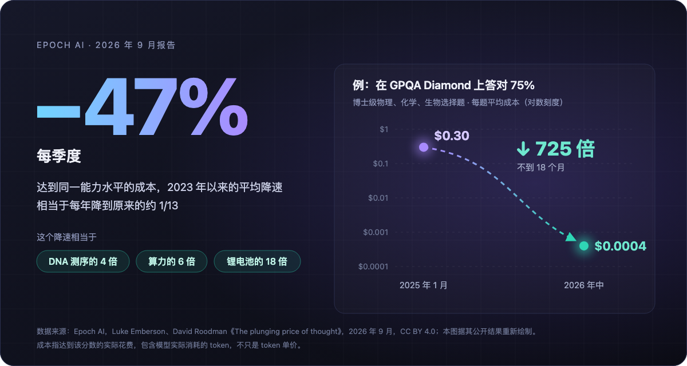
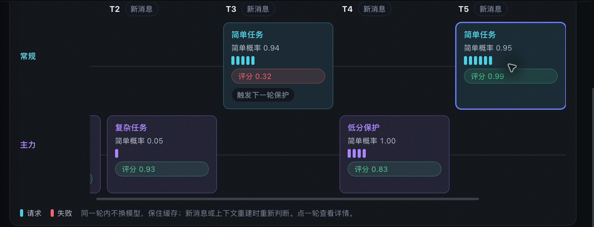
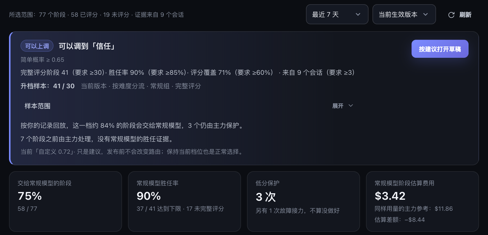
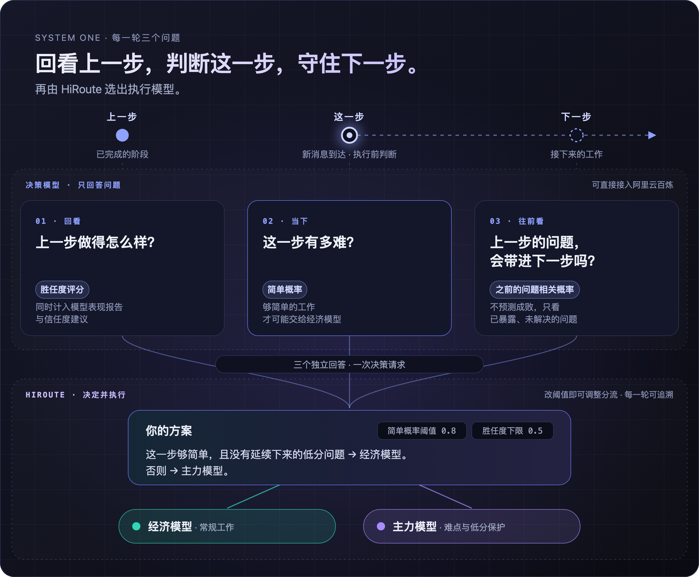
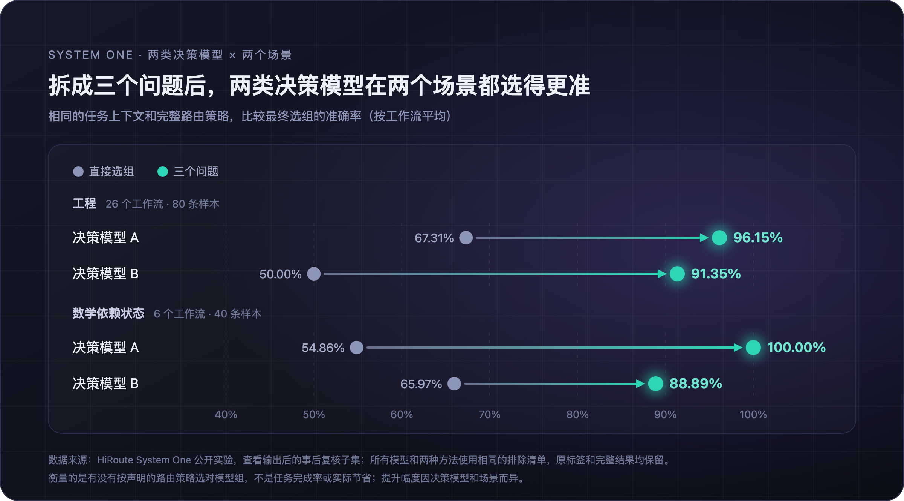
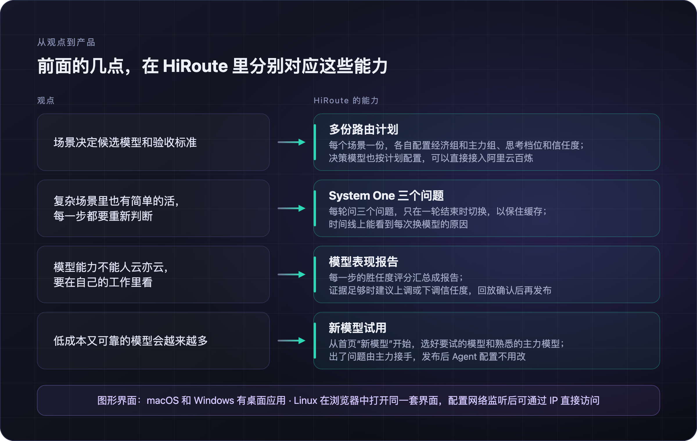
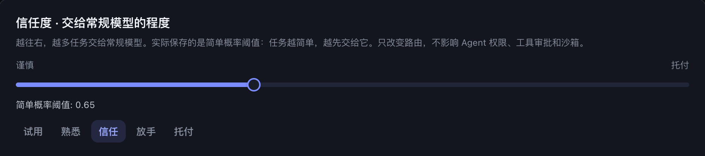

# 智能路由：如何利用便宜模型提升智价比

最近几乎每隔几周就有新模型发布：价格是旗舰模型的零头，但一些公开评测集的评分已经很接近。每次看到都会心动，然后犹豫：手上正在跑的 Agent 任务，真的敢交给它吗？

这段时间我在做一个开源项目 HiRoute([https://github.com/higress-group/HiRoute](https://github.com/higress-group/HiRoute))，一个运行在本地的 Agent 智能路由器。这篇文章想聊聊做它的过程中，我对这个问题的几点思考：Agent 的智价比到底怎么提升，以及怎么在自己的日常工作里判断一个低价模型是否胜任。文中的数据来自公开研究、我们自己的实验和真实会话，最后会介绍这些想法在 HiRoute 里是怎么落地的。

## 智价比：便宜的模型越来越多，难的是怎么用好

先看一组数据。Epoch AI 是一家独立的非营利研究机构，2022 年正式成立，专门用数据追踪 AI 的发展趋势。斯坦福大学的《AI 指数报告》和 Our World in Data 都在使用它整理的数据。

今年 9 月，Epoch AI 发布了一份关于推理成本的报告《The plunging price of thought》。结论是：2023 年以来，达到同一能力水平的成本平均每季度下降约 47%，相当于每年降到原来的十三分之一左右。按报告里的对比，这个降速是 DNA 测序的 4 倍、算力的 6 倍、锂电池的 18 倍。



_图 1：达到同一能力水平的成本每季度下降约 47%；在 GPQA Diamond 上答对 75%，每题成本不到 18 个月降了 725 倍_

报告里举了个例子：在 GPQA Diamond 这套博士级物理、化学、生物选择题上答对 75%，2025 年 1 月每道题平均要花 0.3 美元左右，不到 18 个月后只要 0.0004 美元，降了 725 倍。报告还发现，一种能力刚达到最先进水平时，成本降得最快，平均每年降约 75 倍；两年之后，降速放缓到每年约 4.7 倍。

方向很明确：今天只有旗舰模型才具备的能力，用不了多久就会出现在便宜得多的模型上。低成本、能力够用的模型只会越来越多，真正的问题变成了怎么用好它们。

这份报告还有个细节和 Agent 很相关：它算的不是 token 单价，而是达到某个分数的 token 总成本，因为低价的模型完成一个问题往往需要更多 token。看 Agent 的成本也该这样算。Agent 一轮任务要调用几十次模型，便宜的模型如果在关键一步走错，后面的返工、排查，甚至因此选错方案，代价远远超过省下的那点单价。所以我更愿意用"智价比"来衡量：**在同样的验收标准下，完成一件事总共花多少钱。**

按这个口径看，问题就不再是"换成哪个更便宜的模型"，而是"在自己的工作里，哪些部分可以交给便宜的模型"。

## 场景与难度：复杂场景里也有简单的活

现在比较常见的做法是按场景分工：写代码配一个 Agent 和强模型，整理资料配另一个 Agent 和便宜的模型，再按场景的复杂度调思考档位。这个做法本身没有问题。不同场景要的能力确实不同，连"什么算难"的标准都不一样：对编码来说，难的是定位未知的根因、在几种设计之间取舍；对调研来说，难的是从一堆事实里得出可靠的结论。

但在实际会话里我们看到，**难度是一步一步变化的，不是一个场景对应一个值**。复杂场景里有大量简单的活，简单场景里也会突然冒出难题。

在 HiRoute 项目仓库里可以看到我们做过的一次对比实验：一次消息系统的技术选型，前面是调研六种候选技术、核验官方资料，最后是一份关键方案的决策文档。结论很清楚：**把资料整理交给便宜的模型、关键判断交给主力模型，关键判断的质量和全程用主力模型一样，整个任务的成本只有后者的十二分之一左右。** 反过来，全程用便宜的模型，资料整理做得并不差，但三次关键判断里有两次出了重大错误。

一个"技术选型"场景，大部分工作是整理和核验，真正需要强模型的只有少数几个判断。按场景给它配强模型，钱主要花在了整理上；配便宜的模型，又会在最关键的那一步出错。

所以我的看法是：场景这一层决定"有哪些候选模型、按什么标准验收"，具体每一步用哪个模型，要到这一步再判断。
> 这里还有一个工程细节值得一提：什么时候换模型。Agent 在一轮任务里会连续调用很多次模型，前后共享上下文缓存，如果在一轮之内来回切换，缓存就白白丢掉了。我们的做法是只在新的用户消息、上下文压缩或重建时重新选择，一轮之内保持不变。在一段实际会话里，一轮 21 次调用全部留在同一个模型上，缓存命中接近九成；真要切换，也只有切换后的第一次请求会错过缓存。

## 模型能力：通用评分只能做初筛

上面的实验也说明了另一件事：模型能力不能人云亦云。

各类评测和榜单给出的是通用、笼统的对比，适合用来初筛，先看看哪些模型值得一试。但一个模型在榜单上的分数，回答不了"它在我的工作里行不行"。

Scale AI 去年 9 月发布的 SWE-Bench Pro 是个很好的例子。为了避开模型训练时可能见过的代码，它的公开题只从使用 GPL 等强 copyleft 许可的开源仓库里出，另有一组题目来自创业公司的 18 个私有代码库，从未公开。发布时的结果是：在 SWE-bench Verified 上能解决七成以上问题的头部模型，在 SWE-Bench Pro 的公开题上只有 23% 左右；换到创业公司的私有代码库上，最好的成绩又降到了 17.8%。

SWE-Bench Pro 的题目本来就更难，前面那一大段落差不能全算在"代码没见过"上。但公开题和私有代码库的题目是按同一套方法构建的，后面这一截落差更能说明问题：同样的模型，到了没公开过的真实业务代码上，表现又打了折扣。**而你的代码库，对模型来说可能正是这样在真实场景翻车的情况。**

那怎么在自己的工作里看？新模型来得太快，不可能每来一个就专门做一套评测集。我的思路是边用边评：先只把足够简单的步骤交给新模型，每一步做完都看结果，出了问题由主力模型接手，证据够了再逐步多放手。

判断"这一步做得怎么样"，最直接的证据其实就在用户的下一条消息里。用户明确否定了上一步的结果，就是它没有做到的证据；用户只是接着往下安排，或者什么都没说，并不能说明它失败了。

下面这段真实会话可以说明这个过程。HiRoute 为这个 Agent 配置了一个经济模型和一个主力模型，用户连续提了五个需求：



_图 2：基于 HiRoute 真实会话观测的路由时间线（已隐去模型名称；"常规"即经济模型组）_
1. 补测试、讨论设计取舍，这两轮不够简单，由主力模型完成。
2. 给运维同事写一份使用说明，足够简单，交给经济模型。
3. 用户反馈"读起来像功能介绍"。上一步的评分是 0.32，而且这个问题和接下来的改写直接相关，于是改写交给主力模型。
4. 改写后的版本评分 0.83，问题解决了，下一步导出数据又回到经济模型。

单次评分会有误差。评分本身由决策模型给出，并不是标准答案，所以调整"放手的程度"不能看一两次的结果，要看足够多的证据。我们现在用的规则是：
- **建议多放手**：上次调整之后至少积累了 30 个评过分的步骤，来自至少 3 个会话，评过分的步骤占全部步骤的六成以上，并且其中 85% 以上达到胜任线。
- **建议收回**：至少 30 个评过分的步骤里，达标的不到 70%。



_图 3：HiRoute 的模型表现报告：每条规则的实际值和要求并排列出，并按历史记录回放调整后的效果_

放手的门槛比收回高，这是有意的：偶尔几次做得好，不足以多放手；问题足够明显时，收回要更及时。另外，每次调整之前，先用自己的历史记录回放一遍，看看会有哪些步骤因此换模型，确认之后才生效。

## 三个问题：让模型回答问题，让程序做决定

上面的判断每一轮都要做一次。最直接的办法是把任务、历史和路由策略都交给一个决策模型，问它"这一步该用哪个模型"。我们试过，结果并不稳定：它得同时权衡任务难度、过往表现、问题有没有解决、策略是怎么规定的，任何一项想偏了，结论就错了。

我们后来的做法是拆成三个独立的问题，在一次请求里各自回答：



_图 4：三个问题_
- **上一步做得怎么样？** 给出胜任度评分。
- **这一步有多难？** 给出简单概率。
- **上一步的问题会不会带到这一步？** 判断一个已知、未解决的问题是否仍然适用，而不是预测下一步能不能成功。

决策模型只回答问题，最后选哪个模型组，由程序按设定的阈值来决定。调整信任度，改的是阈值，不是问题本身。

在 HiRoute 项目仓库里可以看到一篇这个机制说明和量化验证的论文，我们也公开了中英文数据集、原始模型响应和离线回放工具。实验里，两种方法读取相同的任务上下文和完整路由策略：一种直接选模型组，另一种回答三个问题，再由程序组合判断。我们用两类决策模型，在工程和数学两个场景里做了对比：



_图 5：拆成三个问题后，两类决策模型在工程和数学两个场景的选组准确率都明显提高_
- 工程：决策模型 A 从 67.31% 提升到 96.15%，决策模型 B 从 50.00% 提升到 91.35%；
- 数学依赖状态：决策模型 A 从 54.86% 提升到 100%，决策模型 B 从 65.97% 提升到 88.89%。

这组数据里，有一点值得多说几句：两个决策模型直接选组时，错的方向正好相反。

在数学场景里，A 偏大胆：24 条需要保护的记录只选对 6 条，该保护的时候没有保护。B 偏保守：16 条应当解除保护的记录只选对 2 条，不该保护的时候也保护了。改成三个问题以后，A 的 24 条保护全部选对，16 条解除也保持全对；B 的解除提升到 14 条，保护则从 24 条变成 22 条。方向相反的两种偏差，用同一种拆法都明显压了下来。

所以我对三个问题的理解是：它的价值不在于让某个模型变得更聪明，而在于把容易想偏的复合判断拆开，让结果不再依赖某个模型恰好擅长这种判断。在这组对比里，两类决策模型在两个场景用三个问题之后，最低的也有 88.89%。

成本和延迟也不是问题。以其中一个决策模型的实际计费，每千次三问决策约 0.085 美元；实测的决策耗时中位数在半秒到一秒左右，每一轮（并不是每一次模型调用）都重新判断完全负担得起。

## 落地：这些想法在 HiRoute 里怎么实现

用 HiRoute 时，你继续用 Qoder、OpenCode、Pi、Hermes 等熟悉的 Agent，由它决定每一步交给哪个模型。

*视频｜HiRoute 三分钟产品介绍*

把前面几点对照到产品上：



_图 6：前面几点观点在 HiRoute 里对应的能力：多份路由计划、System One 三个问题、模型表现报告和新模型试用_
- **场景决定候选和标准**：可以建多份路由计划，每个场景一份，各自配置经济组和主力组（比如经济组用 Qwen Flash、主力组用 Qwen Max）、思考档位、信任度和决策模型。决策模型可以直接接入阿里云百炼。
- **每一步重新判断**：System One 每轮问三个问题，只在一轮结束时切换，时间线上能看到每次换模型的原因。
- **在自己的工作里评估**：每一步的胜任度评分汇总成模型表现报告；证据足够时，报告会建议上调或下调信任度，回放确认后再发布。
- **新模型不断出现**：从首页的"新模型"开始试用，选好要试的模型和熟悉的主力模型即可。发布新设置后，Agent 里用的模型名不变，不用改 Agent 配置。



_图 7：信任度：越往右，越多任务交给经济模型_

在 HiRoute 的新版本里我们也补齐了平台：macOS 和 Windows 都有桌面应用，Windows 版按当前用户安装，不需要管理员权限，也不需要 Python；Linux 支持 x86\_64 和 ARM64，在浏览器里打开的是和桌面版同一套界面。将 Web 控制台配置为网络监听后，其他设备可通过服务器 IP 和端口直接访问。

## 延伸：从模型路由到 Super Agent 式任务路由

前面提到一种常见的用法：写代码用一个 Agent，整理资料用另一个 Agent，再分别配好模型。HiRoute 的任务路由把这种按场景的分工放进了路由计划里：日常使用的 Agent 按任务选择已发布的计划，由计划绑定的执行 Agent 完成工作。

比如，可以为资料搜集、工程开发和代码审查各建一份计划，写清适用场景，分别绑定 Pi、Qoder CLI 和 Codex CLI，再各自配置经济组和主力组。任务路由决定“这项工作交给谁”，模型路由继续决定“执行中的这一轮用哪个模型”。按场景分工和按难度选模型，就可以同时起作用。

DeepSeek 最近公开的 Super Agent 研究原型把系统分成常驻的 Router 和独立执行的 Worker：前者保持对话、协调和分派，后者在各自的上下文里完成任务。用 Hermes 和 HiRoute，就可以搭出类似的分工：
- **日常 Agent 负责分派**：Hermes 可以直接开启 HiRoute 的任务路由，OpenCode 也能委派任务。OpenClaw 等 personal agent，只要能执行本机命令，也可以调用同一套委派命令。可以直接点名计划，也可以让它按每份计划写明的用途选择。
- **执行交给相应的 Worker**：把任务、工作目录和验收要求交给 `hiroute worker exec`。加上 `--no-wait`，任务一被接受就返回，日常 Agent 可以继续响应新消息；多个任务也可以并行执行。
- **完成后回到对话**：以 Hermes 为例，它在后台进程里一直等到任务结束，并打开自带的 `notify_on_complete`。等待进程结束后，Hermes 被唤起，取回结果，再在对话里告诉你。
```sh
# 把资料搜集交给绑定 Pi 的计划，提交后立即返回
hiroute worker exec --plan <PLAN_ID> --cwd /work/mq-research --no-wait \
  -- "搜集三种消息队列的官方文档和发布说明，整理成对比表"

# 随时查看进度；任务结束后取回结果
hiroute worker status --run <RUN_ID>
hiroute worker result --run <RUN_ID>
```

这样，用户仍然在熟悉的 Agent 里交代需求，按场景选执行者、在执行中按难度选模型，都由事先配置好的计划承接。路由计划既保存了“这类工作交给谁”，也保存了“做这类工作时怎么用模型”。HiRoute 社区也有一篇文章专门介绍了这种用法：[https://hiroute.ai/news/hermes-super-agent/](https://hiroute.ai/news/hermes-super-agent/)

## 写在最后

低成本的模型会越来越多，这件事几乎是确定的。不确定的是，它们在每个人自己的工作里到底能做好什么。这个问题没有榜单能替你回答，只能在自己的工作里一点点积累证据。

HiRoute 是我们对这个问题给出的一个回答。它并不完美，决策模型也会判断错。欢迎在自己的场景里试一试，也欢迎告诉我们它在哪里判断错了。

更多资料：[HiRoute 官网](https://hiroute.ai/) · [开源项目](https://github.com/higress-group/HiRoute)
