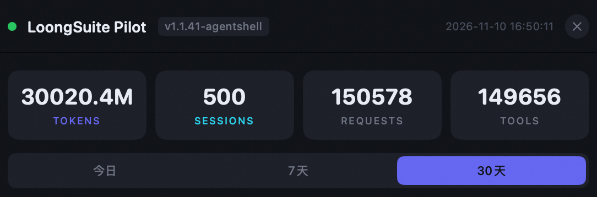
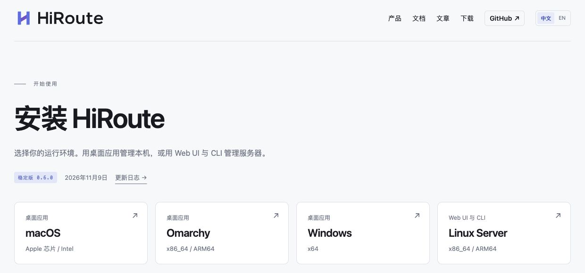
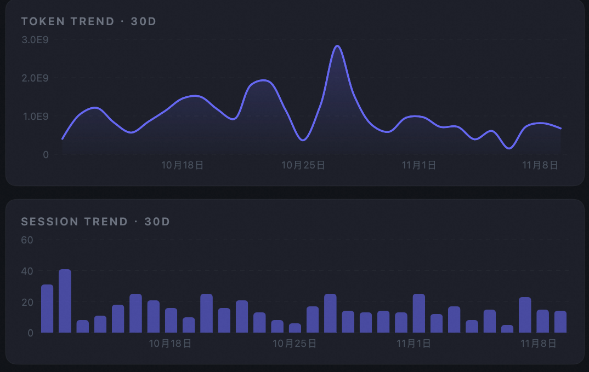
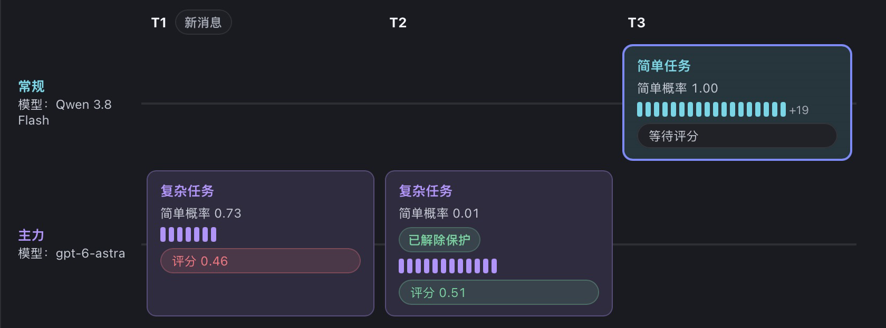
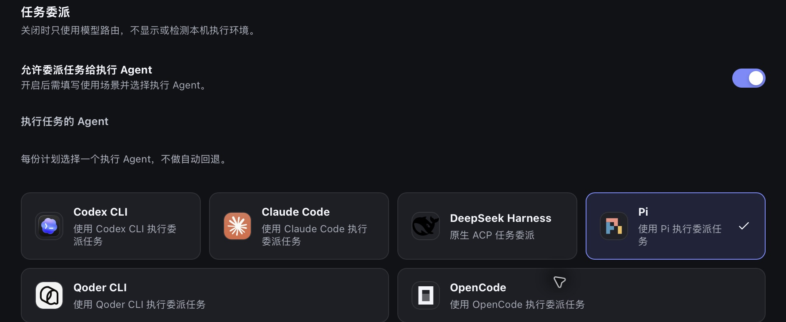
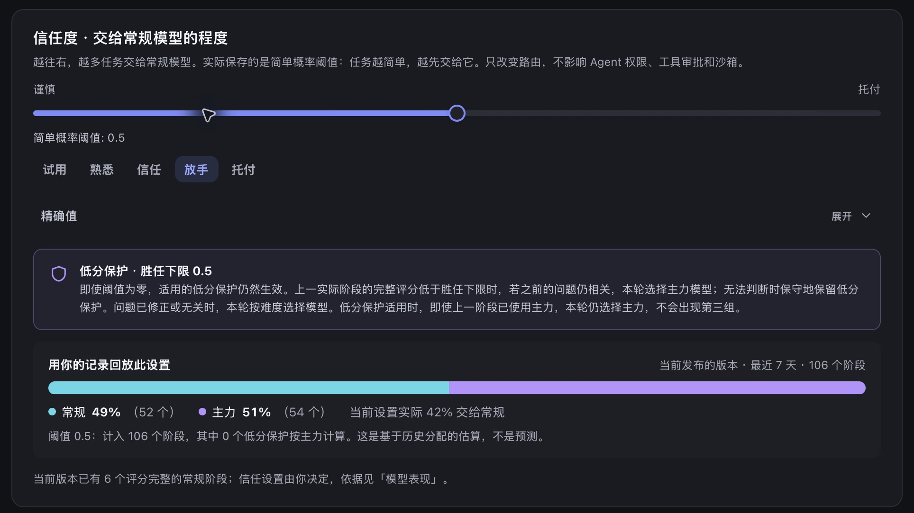
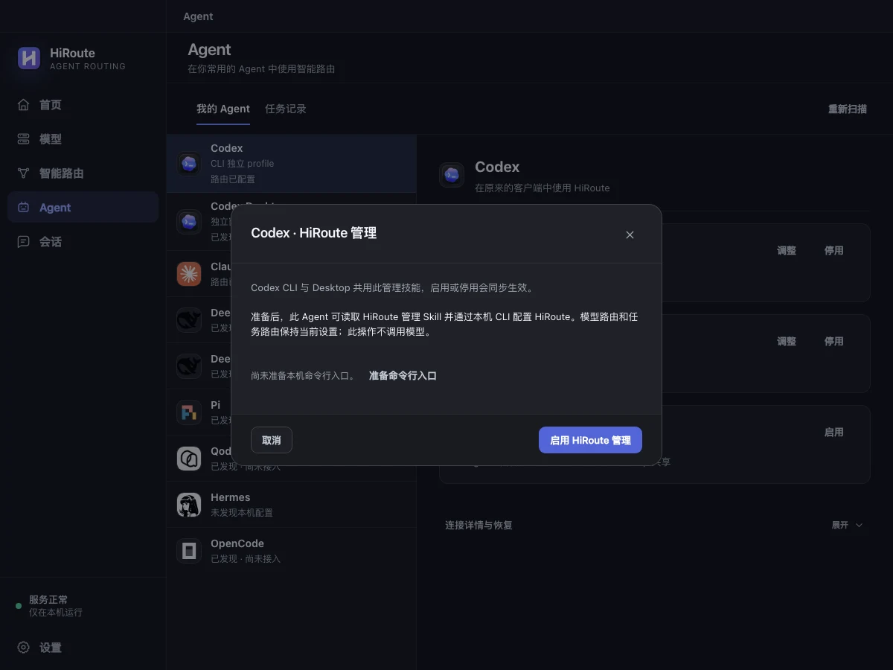

# 把主力模型用在刀刃上：一个月 300 亿 Token、31 万行 Rust 背后的 AI Coding 实践

前几天整理本机环境时，我点开 LoongSuite Pilot 看了一眼近 30 天的用量统计：<strong>30020.4M token，约合 300 亿</strong>。



*LoongSuite Pilot 的本机用量总览。近 30 天共 500 个会话、150,578 次模型请求和 149,656 次工具调用。*

如果还停留在一问一答写代码片段的阶段，300 亿很难想象。把一个缺陷交给 Coding Agent 后，它要读代码、查调用链、改实现、跑编译和测试，遇到报错再改一轮。

我的记录里，一个会话平均要发出约 300 次模型请求。这 300 亿 token 中，约 98% 是长上下文的缓存读取。

这段时间，我一边维护开源 AI 网关 Higress、参与阿里云 AI 网关研发，一边从 9 月开始做一个在开发者本机运行的开源 AI 网关 [HiRoute](https://github.com/higress-group/HiRoute)。<strong>300 亿 token 是这几条工作线的合计</strong>。我用一份 <strong>Codex Pro 20× 订阅</strong>做主力，也从其他渠道接入了经济模型来跑常规任务。

9 月份刚开始写 HiRoute 的时候，它自己还没成型，没法拿来承载日常开发。几条线同时往前推，经常周三、周四就把周额度跑见底了。回头看最可惜的是，大量额度其实消耗在了补测试、查调用链这些常规回合上；真到推进核心架构改造、最该让主力模型顶上去提速的时候，反而得去省着算额度。

做 HiRoute 时，我想把团队做 AI 网关积累的经验用到本地开发。让开发者继续用熟悉的 Coding Agent，由本机网关按任务阶段选模型。<strong>在 AI Coding 实践里，怎么让每一份 token 用得更值？</strong>

这里说的“智价比”，得把交付质量和返工也算进去。我的做法是<strong>把主力模型留给关键判断，让经济模型推进常规工作，两边用同一套验收标准</strong>。

到了 10 月份，核心链路跑通后，我正式把本机开发切了过来，开始“<strong>用 HiRoute 来开发 HiRoute 自己</strong>”。整整一个月，仓库净增了约 31.1 万行 Rust（含测试、注释与空行），合入了 145 次主线提交，跑通了 macOS、Windows、Omarchy 三个桌面端与 Linux Server Web UI，而手里那份 Codex 订阅反而不再捉襟见肘了。



*10 月份用 HiRoute 迭代 HiRoute 自己，跑通了三个桌面端与 Linux Server Web UI。*

这轮实践里，我用四种办法让主力额度用得更久：按阶段换模型，用验收兜底，把独立支线交给轻量工具，再用真实记录调整路由。

---

## 一、拆开一个工程任务看：智力需求从来不是匀速的

早期用 Agent 最容易养成的一个昂贵习惯，是从新建会话的第一秒到最后提交 PR，全程挂着最强的旗舰模型不撒手。

看一眼近 30 天连续不断的会话曲线就能明白为什么额度不经烧：



*工程任务一旦跑起来几乎每天不断档，高峰日单天就要跑掉近 30 亿 token。*

但只要回看几个真实的研发会话就会发现，<strong>同一个工程任务内部，不同阶段的智力密度差得非常远</strong>。

拿修一个网关缺陷来说，整个过程通常分成好几拍：先读日志和代码做问题复现，接着分析根因、权衡修改方案、写下核心补丁，最后还要照着已经确定的方案，把几条协议入口的回归测试补齐、跑通全量检查、同步更新文档。

定位根因和拍板方案时，主力模型 GPT-6 Astra（下文简称 Astra）往往更稳。核心补丁敲定后，补边界用例、跑测试、修编译小错还是要走几十轮，对推理深度的要求却已经降下来了。全程让主力模型做这些收尾，就像请架构师通宵手抄测试用例。

手动切换时，我得一边推进任务，一边判断这一步该不该换模型、什么时候再切回主力。有些想用的经济模型，在当前 Coding Agent 的模型列表里也选不到。现在我还是在熟悉的 Codex Desktop 里工作，把从其他渠道接入的经济模型放进 HiRoute 的“常规组”，把 Codex 订阅里的 Astra 放进“主力组”。<strong>我提前定好分工，接下来由 HiRoute 在同一个会话里按阶段难度选模型。</strong>

为了客观验证这套跑法到底值不值，我们在维护 Higress 社区时，专门挑了一个真实的并发缺陷（[Issue #5310](https://github.com/higress-group/higress/issues/5310)）做了一次受控复跑。

这个问题出在 Claude / Vertex 流式响应转换上：单条请求测试时完全正常，但多条流式请求高并发交错时，由于底层共用了状态对象，会把不同请求的 usage 和 message ID 串到对方账上。社区贡献者 zhihao-yuan 已经在 [PR #5311](https://github.com/higress-group/higress/pull/5311) 修好了它。我们把代码切回修复前的基线，只给问题现象，让 Agent 在同一个会话里从零完成复现、核心修复和回归测试补充，最后用 14 条并发交错的真实网关流做独立验收。

三种跑法各跑了 3 次。表里列的是独立验收结果、通过样本的中位用时，以及按固定 API 费率估算的费用。

<div class="hiroute-practice-table">

| <strong>策略</strong> | <strong>独立验收通过</strong> | <strong>完整交付用时</strong> | <strong>API 等价费用</strong> |
|-----------------------------------------------|-----------------------------------------------------------|-----------------------------------------------------------|---------------------------------------------------------|
| 全程经济模型（Qwen 3.8 Flash） | 1/3 | 51 分 34 秒（唯一通过样本） | — |
| <strong>HiRoute 按阶段分流（Astra \+ Qwen 3.8 Flash）</strong> | <strong>3/3</strong> | <strong>32 分 25 秒</strong> | <strong>\$2.65</strong> |
| 全程主力模型（Astra） | 3/3 | 17 分 46 秒 | \$6.45 |

</div>

Astra 全程跑最快。HiRoute 分流的 3 次也都通过了独立验收，中位用时多约 15 分钟，计入路由决策后，<strong>API 等价费用从 \$6.45 降到 \$2.65，约省 59%</strong>。全程 Qwen 有 2 次未通过，唯一通过的一次用时 51 分 34 秒。

打开其中一次运行在 HiRoute 里的会话路由时间线，能直观看到两个模型是怎么接力的：



*HiRoute 会话时间线实录：T1、T2 复现与核心修复由 Astra 完成，T3 补回归切给 Qwen 连续跑完 37 次请求。*

这次会话共 56 次请求。前两轮要定位问题、完成核心修复，决策模型给出的简单概率分别是 0.73 和 0.01，19 次请求都走 Astra。第三轮按已确定的方案补回归测试，简单概率升至 1.00，Qwen 3.8 Flash 连续处理了剩下的 37 次请求，核心补丁在这一阶段保持原样。

按同一套 API 费率折算，<strong>Qwen 承担了这单约 86% 的 token 用量，占约 5% 的费用</strong>。把这 56 次请求的同样用量全部按 Astra 计价，等价费用为 \$12.14，按本次实际路由折算则为 \$2.48。

*费用按实验时固定的 API 费率估算，分流组计入路由决策开销。表格按每组 3 次实验汇总，\$12.14 和 \$2.48 来自上述单次会话的同用量比较。*

这就是提升智价比的第一条抓手：<strong>保住同一个会话的连续上下文，在网关层按阶段切换模型，别让主力模型在低难度的长尾回合里空转。</strong>

---

## 二、敢用经济模型干活的前提，是把验收和人的判断接进闭环

跟其他开发者聊起混用模型时，我常听到一个担心：“万一经济模型表面上把代码写完了，实际上把逻辑改歪了，后面排查起来不是更亏？”

这个担心完全成立。按难度分流如果只有“事前预判”、没有“事后兜底”，遇到稍微绕一点的坑就会在原地打转。为此，我在 HiRoute 里加了一层<strong>胜任度评估与低分保护</strong>机制，并在日常研发里配上了两条工程规矩：一条管夜间自动跑的任务，一条管白天人盯着的核心任务。

### 1\. 范围清楚的任务：让验收门禁替人守夜

单靠编译通过和几条浅层单测，确实拦不住经济模型的疏漏。为了让问题在交付前当场暴露，我们在 HiRoute 仓库里一路攒下了 <strong>5,000 多个 Rust 测试、60 多个界面场景脚本，以及 14 条 Computer Use 端到端实操验收链路</strong>。

规矩定得很明确：涉及桌面或 Web 界面的改动，Agent 跑完单测不算完，必须调起 Computer Use 像真人一样去点一遍窗口——比如加了一个列表筛选功能，就算单元测试全绿，只要点完筛选框界面列表是空的，实操验收当场就会报错。

测试和实操验收的输出会随会话进入 HiRoute。决策模型评估上一阶段的表现，如果发现经济模型得分偏低、遗留问题仍会影响接下来的工作，HiRoute 就会触发<strong>低分保护</strong>，让主力模型在下一轮查根因、修通验收。问题解决后，后续工作按阶段难度重新分流。

有了这套兜底，范围明确的需求我才敢在睡前交出去，第二天早上直接看验收结果。

### 2\. 动筋骨的核心设计：人在场把关，让一句反馈直接成为升级信号

反过来，碰到架构边界敏感的硬骨头，再厚的自动化测试也替代不了人的设计判断。这类任务我同样可以从经济模型起手做复现探路，但人会一直在屏幕前看着。

10 月下旬优化过一个很典型的网关底层问题（[HiRoute PR #225](https://github.com/higress-group/HiRoute/pull/225)）：HiRoute 常驻在开发者本机后台，我们在测试门禁里对单请求的内存留存卡了很严的红线。但当客户端发来数 MB 的长对话历史、而 model 字段又排在 JSON 尾部时，旧逻辑为了提取模型名在内存里多留了一份原始前缀还反复扫描，一跑大请求压测就会撞上内存水位断言。

第一步写一个 3M 长历史用例稳定复现水位超标，经济模型做得很利索；但到了第二步修实现时，它给出了最典型的“糊弄单测”方案——直接把代码里的内存预算上限调高。测试是绿了，但本机低内存的设计红线就破了。我在对话里直接指出来：“不能放宽内存红线，根因是多留了一份原始前缀还在反复扫描。”

在 HiRoute 的评估逻辑里，<strong>人在对话中给出的明确否定和纠偏，同样是高权重的胜任度信号</strong>。决策模型识别到这条反馈后，下一轮自动切由主力模型接管重做设计：在认证通过后立即启动由请求自身持有的 Replay 写入器，用有界增量状态去定位 model，内存红线一分不放宽，最终跑通了 928 个相关用例和三条协议入口的长历史回归。

在我的 <strong>AI Coding 实践</strong>里，验收标准定得越清楚，就越敢把合适的工作交给经济模型。测试结果和人工反馈进入同一条会话后，HiRoute 也能据此判断下一轮要不要让主力接手。

---

## 三、别只盯模型单价：管住 Harness 协作里的“隐形 token 税”

把模型分工理顺之后，我还踩过另一个吃额度的暗坑：<strong>Agent 执行环境（Harness）的协作方式。</strong>

有一阵子很流行把一个任务拆给好几个子 Agent 并行推进。但真正在几十万行代码的仓库里干活就会发现，这里面藏着一笔不小的“隐形 token 税”：
- 现在的强模型在长上下文里维持全局心智的能力已经很强了。它好不容易读懂了十几个模块之间的耦合关系，一旦强行拆成多个子 Agent，每个子会话都得重新读一遍背景代码；
- 更容易被忽视的是等待与协调开销——我之前在 Codex 社区专门提过一个[关于父 Agent 等待开销的讨论（Issue #41875）](https://github.com/openai/codex/issues/41875)：有些实现里子任务还没跑完，父模型每隔一会儿就被唤醒一次，看一眼“还在跑”又把几十万字的主上下文重读一遍，没产出任何新信息，主力额度却在空转消耗。

吃过几次亏之后，我在 HiRoute 里把路由做成了“模型路由 \+ 任务路由”两层，日常协作收敛成八个字：<strong>主线不拆，旁支外包。</strong>



*在 HiRoute 任务委派中，为独立支线指定 Pi、DeepSeek Harness 等轻量或专用执行环境。*
- <strong>主线不拆</strong>：凡是牵一发动全身的核心改造，始终留在同一个 Codex 主会话里推进，靠前面说的模型路由在底层按阶段换模型，绝不轻易打断主会话已经建立起来的上下文。
- <strong>旁支外包</strong>：只有真正跟主线解耦、输入输出边界干净的支线工作——比如先去摸清某个老模块有哪些调用方、查几份外部资料，或者从几千行失败的 CI 日志里定位第一处报错——才通过 HiRoute 的任务路由委派给 <strong>Pi \+ 经济模型</strong> 去跑。Pi 的 Harness 足够轻，翻文件、试命令那些啰嗦的中间回合全留在旁支里消化；而且等待过程由本机 HiRoute CLI 在后台静默完成，等彻底跑完了才把一页带文件路径的干净摘要交回主会话，避免主模型在等待中反复唤醒烧上下文。

顺着这个机制，平时想试新的模型与工具组合也变得很轻。比如想看看 <strong>DeepSeek 模型配它自家的 DeepSeek Harness（DSH）</strong> 是不是更合拍，不需要把整个主工程搬家，建一条任务路由、划一个边界清楚的小功能委派过去跑一单，回头在 HiRoute 里把主会话和 Worker 两头的用量搁在一起算总账，省没省、稳不稳一目了然。

---

## 四、好策略不是第一天配出来的：靠复盘与回放越跑越准

智价比不是第一天拍脑袋定死一套规则就能一劳永逸的，而是跟着项目一起长出来的。在日常迭代里，有两个习惯帮我把这套分流策略越调越准：

<strong>第一，每做完一单大活，花两分钟回看切换账本。</strong>

每次跑完像 Higress 并发修复那样的大任务，我习惯让 Agent 直接调用两行本机命令做个简短复盘：
```bash
hiroute sessions list --view switches
hiroute value show
```

哪一步发生了模型切换、为什么切、主力模型和常规模型各自消耗了多少请求，账目都在本地存着。像前面发现“按确定方案补回归测试完全可以放心交给常规组”，而“涉及跨入口流式状态归属必须上主力”，就可以顺手沉淀进项目的难度判断提示词里。每啃下一道真实难题，仓库的分流边界就清晰一分。

<strong>第二，调整激进程度之前，先拿真实历史做一次回放。</strong>

月底周额度偏紧的时候，我往往想把交给经济模型的比例调高一点；刚接进一个摸不准脾气的新模型时，又想收紧一点。以前调阈值全凭感觉，所以在做 HiRoute 的“信任度”设置时，我们特意加上了<strong>历史回放</strong>：



*拖动信任度滑块时，直接拿最近 7 天真实的 106 个任务阶段回放出常规组与主力组的分配变化。*

比如把滑块拉到“放手”（简单概率阈值 0.5），界面底下会立刻拿我最近 7 天真实跑过的 106 个阶段算出来：大约 49% 的阶段会落到常规模型，同时“低分保护（胜任下限 0.5）”照常兜底。先用自己的历史数据看清影响面，再拿一两个新任务试跑验证，就不会一脚油门踩过头导致交付质量滑坡。

---

## 五、最好的工具不打扰习惯：让这套分工悄悄跑在底下

把上面这四件事串在一起，其实就是我们开源 HiRoute 的初衷。

在阿里云 AI 网关上，我们构建了面向企业生产流量的[智能路由产品](https://help.aliyun.com/zh/api-gateway/ai-gateway/user-guide/configure-smart-routing)。做 HiRoute 时，我把这类调度放到了开发者的本机，围绕一个编码会话的不同阶段选模型。

为了让这套实践不变成新的配置负担，HiRoute 的桌面界面和本机 CLI 读写的是同一份配置与运行记录，并且内置了现成的 <strong>Agent 管理技能</strong>：



*启用 HiRoute 管理技能后，直接用自然语言让 Agent 帮你建路由、配决策模型、复盘历史会话。*

你不需要背复杂的 CLI 参数，也不用改变在 Codex、Claude Code 等工具里的使用习惯。装好之后开启管理技能，直接在聊天框里告诉 Agent 你手头有哪些订阅和经济模型、当前仓库里哪类活算常规工作、哪类活必须上主力，它就能自动帮你把路由搭起来。

用量不大的开发者也可以从一个熟悉的仓库试起。
- <strong>先让经济模型接几段有验收标准的常规工作</strong>，看看主力额度消耗和返工次数怎么变，再决定订阅是否需要升级。
- <strong>面对每周都在发的新模型、新 Harness</strong>，也不用再纠结要不要推倒重配——新模型先塞进常规组接几段熟悉的活，新 Harness 先走任务委派跑两个独立旁支，用自己仓库的真实测试和验收结果说话。

---

## 结语

这轮 <strong>AI Coding 实践</strong>让我养成了一个习惯。每次遇到大任务，先想清楚哪几步真需要主力模型，哪些步骤的结果能靠测试和人工反馈判断。选模、验收和复盘都接上以后，我就更有把握把主力额度留给关键工作。

模型的能力还在快速往上走，上下文窗口也越来越大，但“好钢用在刀刃上”的工程朴素道理不会变。如果你在日常研发里也遇到过主力额度不够烧、或者想更稳妥地把高性价比新模型用进生产代码，欢迎拿手头一个带自动化测试的真实任务来试试 HiRoute，也很期待在社区听到大家的实战经验与反馈。
- <strong>HiRoute 开源仓库</strong>：[https://github.com/higress-group/HiRoute](https://github.com/higress-group/HiRoute)
- <strong>客户端下载与文档</strong>：[https://hiroute.ai/zh/](https://hiroute.ai/zh/)

<style>
.hiroute-practice-table { overflow-x: auto; margin: 20px 0; }
.hiroute-practice-table table { display: table; width: 100%; min-width: 680px; margin: 0; }
.hiroute-practice-table th, .hiroute-practice-table td { min-width: 110px; }
</style>
