# Agent 数据飞轮平台的选型和实践

宙斯是 1688 探索企业 AI 自主经营的组织经营大脑，通过连接业务知识、数据与多角色 Agent，让 AI 围绕经营目标参与分析、协同执行并持续跟进，逐步从辅助个人工作走向支撑组织经营。目前，宙斯已在 1688 即时零售、商业发展等实际业务中落地实践。本文分享的是宙斯在选型数据飞轮平台过程中的思考和实践。

## 一、背景与痛点：接入前的“盲人摸象”

用户向 Agent 提交任务，首要诉求是获得正确结果。但对研发和测试团队来说，仅凭一次输出是否正确，还不足以判断 Agent 的真实质量。团队还需要了解结果是如何产生的、偏差出现在哪个环节，以及问题修复后能否稳定复现。

Agent 的执行过程通常包含模型推理、工具调用和多轮重试。即使输入完全相同，也可能形成不同的执行路径。如果验收只关注最终答案，隐藏在执行过程中的风险便很难及时暴露。前期开发和测试中，团队遇到的问题主要集中在以下三个方面。

**痛点一：偏差根因难以对应到具体修改动作。** Agent 的行为受 Prompt、Skill、工具参数、读取策略等多重因素影响，输出异常时，现有排查信息不足以判断应该从哪一点切入；即便尝试调整，也往往无法确认是否改对了地方，优化过程依赖经验试错，效率低且难以沉淀。

**痛点二：优化效果缺少量化依据，版本质量难以评估。** 补充 Prompt、调整 Skill 或修改 MCP 配置后，少量用例通过只能说明局部问题得到改善，无法证明同类问题已经解决，也无法判断修改是否引入新的偏差。由于缺少统一的评测标准和批量验证能力，团队仍然依赖人工抽查和个人经验评估版本质量，发布判断缺乏稳定、客观的依据。

**痛点三：缺少稳定的回归机制，历史问题难以沉淀为测试资产。** 失败请求、边界场景和判定标准分散在日志与沟通记录中，尚未形成可重复执行的回归用例。模型、Prompt 或工具配置发生变化后，团队往往需要重新进行人工验证。已有问题无法持续纳入后续测试，同类缺陷便可能在不同版本中反复出现。

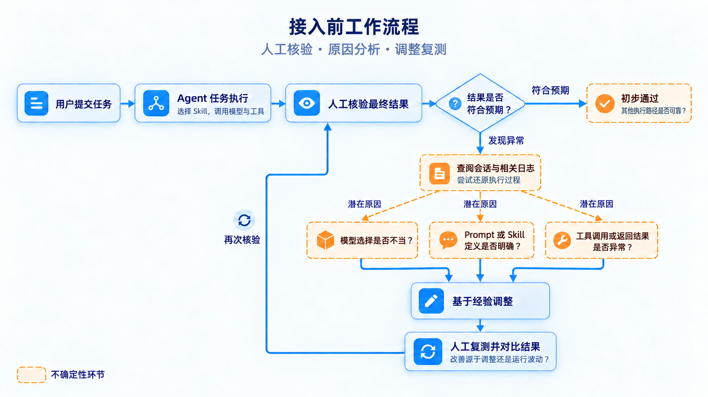

_图 1-1：接入前的工作流_

因此我们希望把 Agent 执行观测、效果评估和版本回归串起来：用统一标准判断修改效果，积累覆盖不同路径的测试样本，沿执行记录排查失败，并将典型问题纳入后续回归。而这也是宙斯接入 AgentLoop 要解决的问题。

## 二、为什么选择 AgentLoop，它能解决什么

### 2.1 方案选择

本次调研对比了 AgentLoop、DeepEval 和一套集团内部评测平台，主要关注与现有 Agent 框架的适配度，以及执行观测和回归评测能力。

| 方案 | 主要特点 | 优点 |
| --- | --- | --- |
| AgentLoop | 连接线上 Trace、质量评估、数据集和实验 | 观测、评估、回归一体化；通过 ARMS 探针无侵入采集 Trace，接入成本较低 |
| DeepEval | 通过测试代码维护用例、指标和回归流程 | 开源、代码化、接入灵活；适合纳入 CI 自动回归 |
| 内部评测平台 | 统一管理数据、任务和结果 | 一站式平台；部分应用免埋点或少量埋点；支持多类数据集、指标和实验对比 |

本次选择 AgentLoop：它可通过 ARMS 探针无侵入采集 Agent 执行链路，且观测、评估和样本回归能力符合宙斯当前需求。后文重点说明接入过程与实际验证结果。

### 2.2 观测：先看清一次请求怎样执行

AgentLoop 使用 Session、Trace 和 Span 组织调用日志记录：Session 对应一段多轮会话，Trace 对应其中一轮请求，Span 记录该轮请求中的模型调用、工具调用等具体操作。沿调用链可以检查各步骤的输入、输出、参数、结果和耗时，定位遗漏、误用、重复调用或性能瓶颈。

平台还可以把 Trace 加工成结构化 Agent 轨迹，按执行步骤展示模型与工具调用，供后续评估使用。这里的“白箱”指可检查的执行记录：能看到多少细节，取决于框架暴露和实际采集的数据。接入验收需要确认关键步骤是否齐全，不能只以控制台出现一条 Trace 为准。

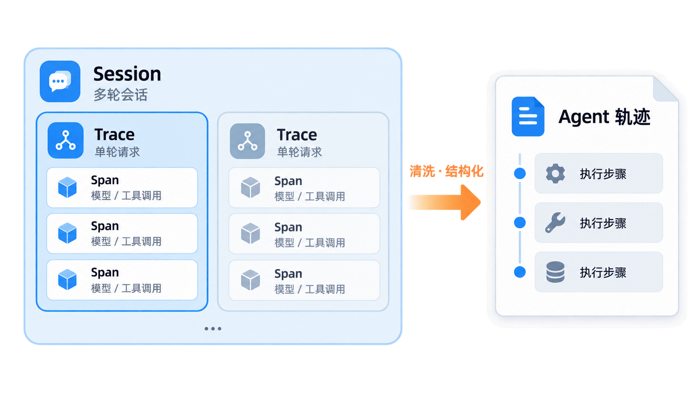

_图 2-1：AgentLoop 执行链路观测_

### 2.3 评估：调用成功之后，还要判断任务是否完成

工具调用成功，只能说明某个执行步骤正常结束，不代表任务真正完成。评估也不能只看接口和工具状态，还要判断用户要求是否满足、关键结论是否有证据、最终结果是否完整交付。

评估承接上一节的可观测数据：平台将用户输入、模型推理、工具调用和最终输出加工成数据集，再按准确性、任务完成度等标准给出分数和原因，快速定位低分样本。

平台支持 Code、LLM 和 Agent 三类评估器。明确的字段缺失、数值越界等规则可由 Code 评估器判断；简单的语义判断，可使用 LLM 评估器；涉及业务知识和多步核验时，可使用 Agent-as-a-Judge，并挂载知识库、业务 Skill 或 MCP，让裁判主动查询证据后再评分。评估结果还可用于版本实验：用回归集设置上线基线，对不同 Agent 或优化前后的版本进行对比；上线后继续从真实 Trace 中抽样评估和告警，形成“观测—评估—优化—回测”的循环。

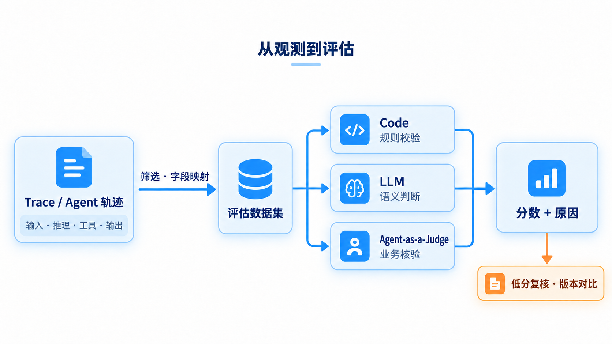

_图 2-2：AgentLoop 任务评估_

### 2.4 回归验证：让失败样本成为下一次测试的输入

我们希望先围绕一个问题跑通以下流程，再逐步扩大覆盖范围：从线上请求找到 Trace 和 Agent 轨迹，完成评估与人工复核；将失败样本加入测试集，修改 Prompt、Skill 或模型配置后，重新请求新版 Agent，并按相同标准比较结果。

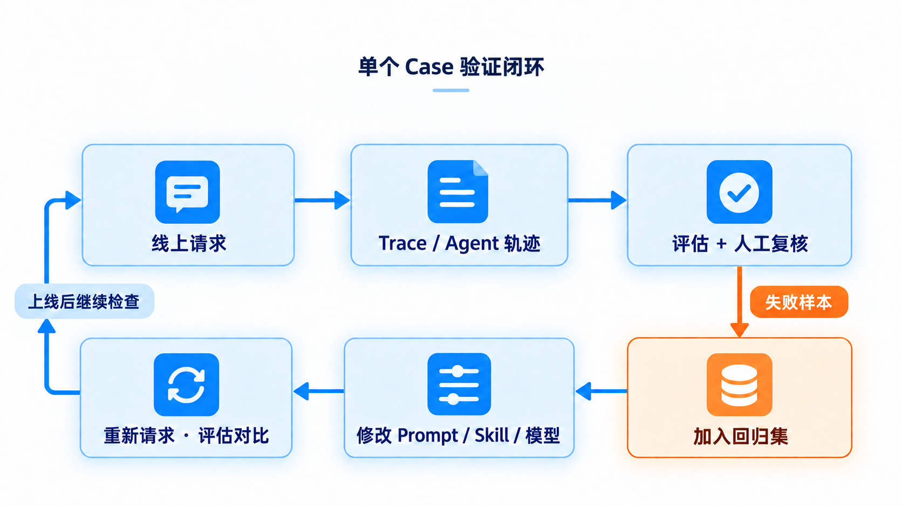

_图 2-3：失败样本回归验证流程_

数据集保存待验证的输入、参考信息和判定所需字段。修复后，必须重新请求新版本 Agent，获取新的输出和执行记录，再用相同标准评估；回归时还要保留必要的业务条件，避免数据或工具返回变化影响对比。

这条流程的验收可以落在一个具体 Case 上：能否根据请求找到完整记录，说明失败原因，把样本加入测试集，并确认修改后同一问题得到解决。流程跑通后，再扩充样本和评估范围。线上流量覆盖不到的低频或异常场景，再人工介入设计用例。

## 三、接入流程

本节按推进顺序说明选型、部署、染色、Trace 验收、评估配置与回归。

### 3.1 选型：ARMS GenAI Java Agent 探针

AgentLoop 提供 eBPF、LoongSuite 插件、语言框架探针三类接入方式。宙斯服务是基于 AgentScope2 构建的容器化 Java 应用，选择 **ARMS GenAI Java Agent 探针（jar 5.2.0-genai-1.0）**，以独立 AgentScope collector 运行。

选型理由：

- **无侵入**：通过 AgentScope 字节码插桩自动生成 invoke_agent / chat / execute_tool 语义 Span，业务代码零上报。
- **部署层一次配置**：通过增加启动参数完成挂载，与业务发布解耦。
- **开销可控**：通过插桩开关收敛，仅保留 AgentScope 链路所需数据。

探针向独立的 SLS workspace 上报，与内部日志、链路体系相互独立。

### 3.2 分步接入

#### 步骤一：开通 workspace 并通过启动参数挂载探针

在 AgentLoop 控制台开通 workspace，记录 workspace 标识并写入 `ARMS_WORKSPACE`。生产和预发可以用不同的应用命名以区分。

通过增加启动参数挂载 ARMS GenAI Java Agent 探针，不动业务代码。关键启动参数如下：

- `licenseKey`：ARMS 授权密钥，由环境变量注入，为空时打印 WARN 不挂载；
- `appName`：应用名，生产和预发分别设置；
- `workspace`：AgentLoop workspace 标识。

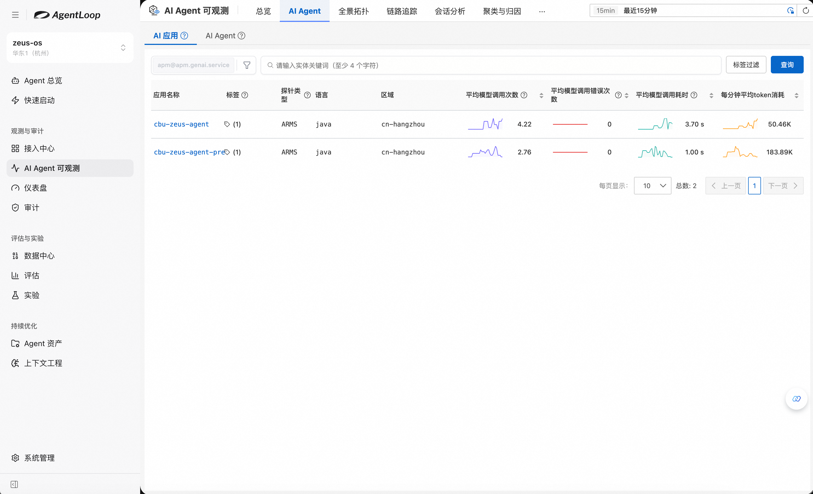

_图 3-1：ARMS GenAI Java Agent 启动参数配置_

#### 步骤二：验证 Trace 完整性

一条合格 Trace 的判定口径：

1. **步骤齐全**：模型调用、每次工具调用均有 Span，输入输出可读；
2. **嵌套正确**：子代理和异步任务不丢父 Span，无孤儿 Span 或断链；
3. **染色正确**：各种业务相关数据在传播过程中不丢，且正确挂在对应 Span。

双链路上下文冲突与解决（按需）：仅当业务已接入其他链路追踪组件（自建 SDK、内部 Tracing 系统等），且与 ARMS 探针同样基于 OTel Context 时才会遇到：两者直接共用同一上下文，会导致子代理 Span 挂错父级或同一请求断链。解决方式是为每套链路设置独立的上下文键与父链路恢复逻辑，与 ARMS 探针的 Context 互不读写。

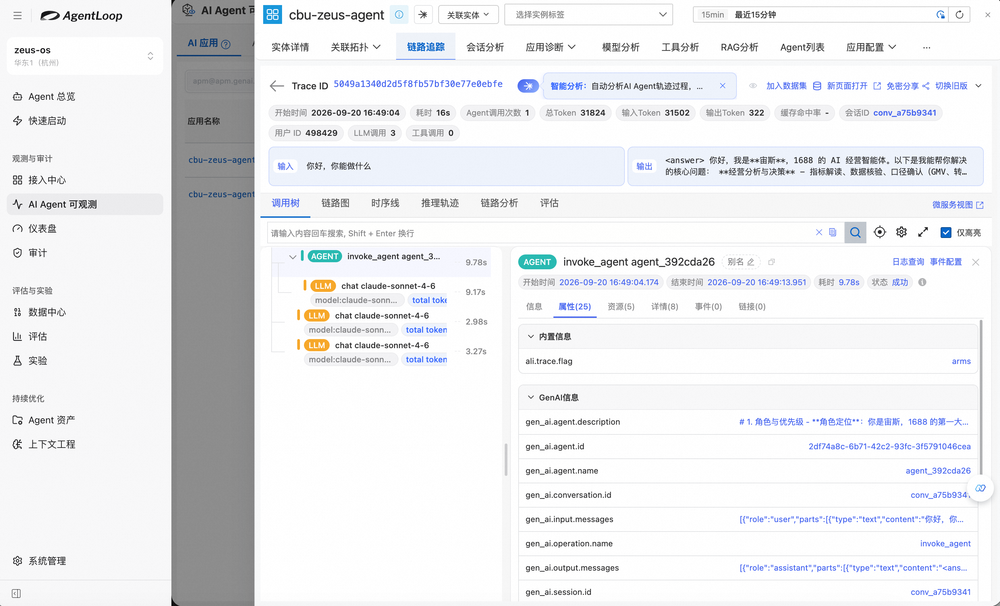

_图 3-2：AgentLoop Trace 完整性验证_

#### 步骤三：配置评估

AgentLoop 的评估本质是一条“数据加工流水线”：把线上真实的 Agent 轨迹逐步洗成可打分的数据集，再交给评估器输出多维度质量分（0~1）。整条链路分五个环节，建议按顺序打通：**Agent 轨迹 → 数据处理 → 数据集 → 评估任务 → 评估器 → 评估结果**。

**Agent 轨迹。** 轨迹是探针无侵入采集的 OTel 格式日志，平台把同一 Trace 的日志串联起来，还原一次完整调用：用户输入 → Agent 思考 → 工具调用 → 最终输出。线上每一次真实请求都会自动沉淀成一条轨迹，是后续所有评估的数据来源，无需额外造数。

**数据处理。** 数据处理负责把 Trace 日志和 Agent 轨迹加工成结构化数据集，核心做两件事：

- 日志筛选：按时间、Agent、调用状态等条件，挑出要评估的那批请求。
- 字段投影与变量映射：把轨迹里的字段抽取并映射成评估要用的变量，如 input、output 和中间过程信息。

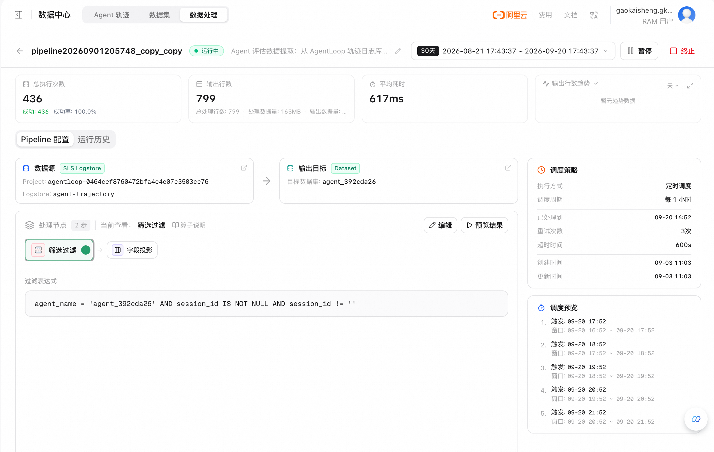

_图 3-3：Agent 轨迹的数据处理与字段映射_

**数据集。** 数据集是一批“输入 + 输出 + 过程信息”的样本集合，有两种来源：

- 自动转化（推荐）：由数据处理从真实轨迹生成，代表性强。
- 人工自建：用于冷启动、低频或关键业务场景，人工设计、筛选和标注以保证代表性。

按用途可沉淀为测试集、回归集、基准集等，服务不同评估目标。

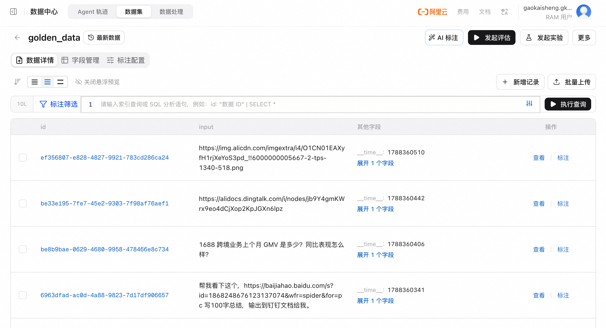

_图 3-4：评估数据集配置_

**建立评估任务。** 建立评估任务需明确两个核心要素：评估数据集与评估维度。

- 选择数据集：数据集决定了本次评估的样本来源。在实际任务中，可根据版本准出、横向对比或日常排查等具体评估目标，灵活选用对应的测试集、回归集或基准集。
- 选择评估维度：每个维度对应一套独立的评分标准（由评估器支撑），如回答准确性、任务完成度、工具调用正确率等。支持单维度或多维度并行评估，多维度模式下每条样本将分别生成各维度的独立评分，形成多视角的质量评估体系。维度选取越契合业务诉求，评估结果对后续优化的指导价值越高。

**选择评估器。** 评估器按维度评分，可单选或多选并行：

- Agent Judge：专家级自动评估。可学习企业私域知识、挂载 Skill 或 MCP 自行调用工具、先查证事实再打分。适合需要业务知识或多步核验的维度，如“回答是否符合最新政策”“结论是否有数据支撑”，也就是“懂业务的裁判”。
- LLM Judge：用一段评估 Prompt 直接调用大模型来打分。适合靠语义理解就能判断、无需外部查证的维度，如相关性、语气、是否答非所问，配置轻、见效快。
- Code Judge：用 Python 或 JavaScript 代码在沙箱中执行评估。适合规则明确、可程序化判定的维度，如输出格式校验、关键字命中、工具调用是否成功、数值是否落在阈值内，结果确定、零模型成本。

选定评估器后，完成变量映射，把数据集字段对应到评估器的输入。

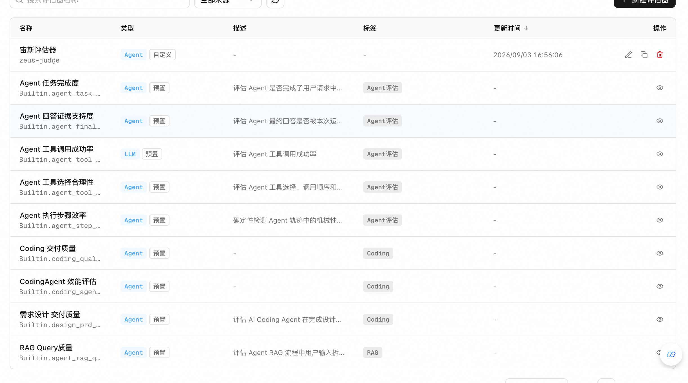

_图 3-5：评估器选择与变量映射_

**运行评估与验收。** 评估输出 0~1 的多维度质量分；低分样本可下钻回原 Trace 定位问题，并回流为测试集反哺下一轮迭代。

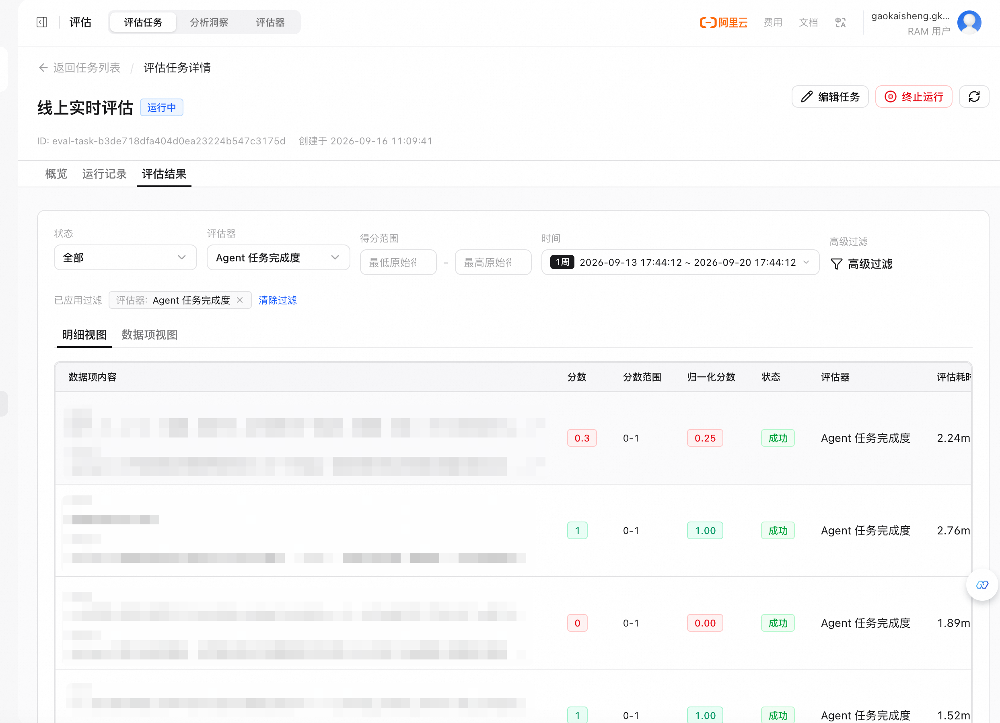

_图 3-6：评估任务运行结果_

### 3.3 踩坑清单

**一、环境未隔离。** 现象：评估任务混入不同环境的 Trace，结果不可比较。原因：生产和预发共用应用标识或 workspace。解决：为各环境配置独立的应用标识，并在评估任务中按环境筛选。

**二、插桩范围过宽。** 现象：低价值的基础设施 Span 淹没了业务链路，评估取数受干扰。原因：未限制默认插桩范围。解决：在“应用配置 → 自定义配置 → 探针开关设置”中，仅开启 Agent 所需的插桩，并显式关闭数据库访问等非必要组件。

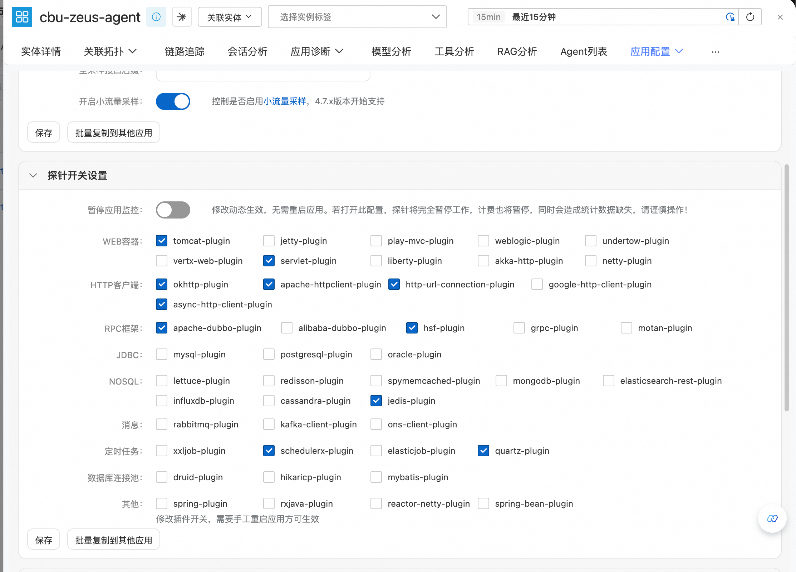

_图 3-7：AgentScope 探针开关配置_

**三、用户标识未随链路上报（按需）。** 现象：`user.id` 只出现在入口 Span，或后续模型、工具调用缺失。原因：Span Attribute 仅作用于当前 Span，异步执行中新建的 Span 不会自动继承。解决：仅在需要按员工维度检索、分析或关联 Trace 时，在请求入口将用户 ID 写入 OpenTelemetry Baggage，并在异步上下文切换前完成上下文捕获，使后续 Span 也携带该标识。

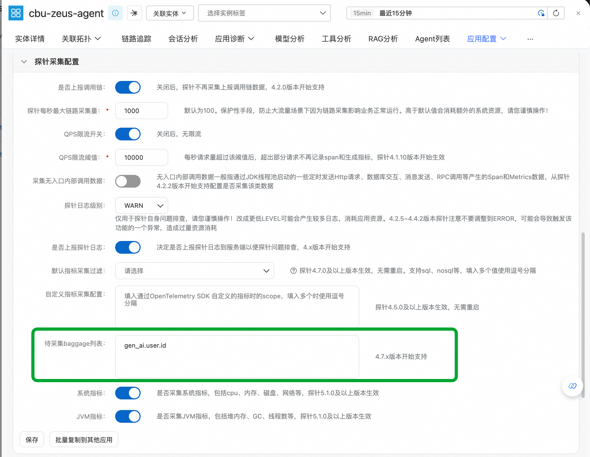

_图 3-8：用户标识的链路传递_

**四、多套链路上下文互相覆盖。** 现象：子任务挂到错误的父 Span，或同一请求出现断链。原因：多个追踪组件共用同一个上下文，并尝试恢复父链路。解决：为不同链路设置独立的上下文键与父链路恢复逻辑，并使用含异步子任务的请求验证父子关系。

**五、TraceId 不统一。** 现象：同一次请求在内部链路追踪系统和 AgentLoop 中各自生成 TraceId，无法通过单一 TraceId 跨系统检索，排障时难以把业务日志与 Agent 执行链路对应起来。原因：两套链路追踪体系各自生成并维护独立的 TraceId。解决：在请求入口及关键调用节点的日志中同时打印两个 TraceId，建立两者的映射关系；排障时先用任一 TraceId 定位对应日志，再通过日志中的另一个 TraceId 跳转到另一套链路，串联完整调用过程。

## 四、实际效果：数据与 Case 复盘

### 4.1 实际怎么用：线上巡检、实验验证与发布回归

宙斯当前把平台能力落在三个实际场景中。第一是**线上巡检**，从持续产生的真实请求中发现低分和异常样本；第二是**实验验证**，针对 Bad Case 提出优化假设，并用受控实验判断改动是否真的有效；第三是**发布回归**，在版本上线前使用固定数据集确认核心指标没有退化。三者串起来，才形成“线上发现—实验验证—上线准出—继续观测”的闭环。

**线上巡检。** 通过 Pipeline 将线上 Trace 和 Agent 轨迹加工成可评估数据，按固定周期运行评估任务。以本次任务为例，页面共显示 **2080 条评估记录**，覆盖执行步骤效率、回答证据支持度、任务完成度、工具调用成功率和工具选择合理性 **5 个维度**。在任务完成度维度筛选原始分不高于 0.6 后得到 **72 条候选样本**。这些记录不是直接认定为线上故障，而是进入人工复核，区分真实能力缺口、数据问题和评估误判。

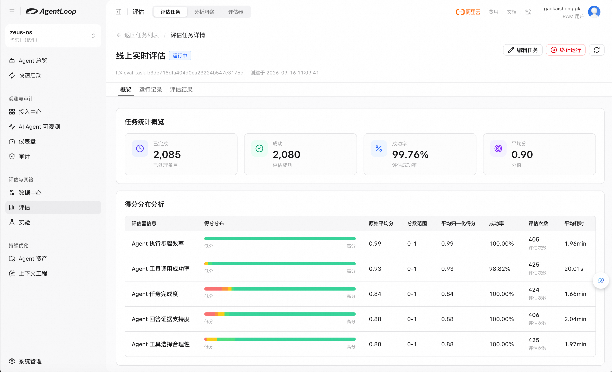

_图 4-1：线上巡检评估结果_

**实验验证。** 确认 Bad Case 后，不只回看 Trace 找根因，还会把代表性样本保存到实验数据集，并形成可验证的优化假设。例如，同一个问题可以分别尝试补充数据路由、调整 Prompt、修改 Skill、替换模型或改变工具配置。实验计划固定数据集、评估器和变量映射，将当前版本作为基线组，将一个或多个优化方案作为实验组，逐题比较输出与评分差异，同时观察**任务完成度、证据支持度、工具选择、延迟、Token 与成本**。如果只改善单条 Case、却让其他题目退化，就继续调整，而不是直接发布。

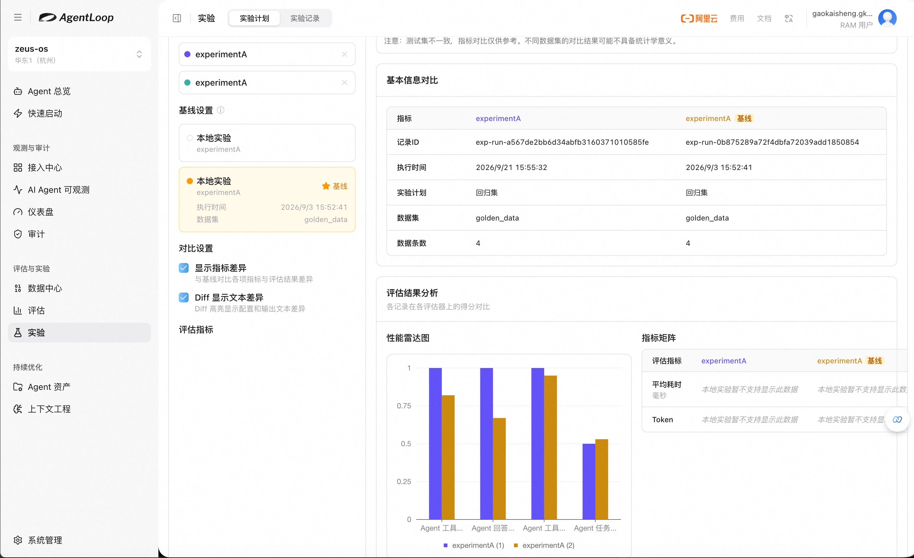

_图 4-2：Bad Case 实验验证_

**发布准出。** 待发布 Agent 进入上线前准出。回归集用于确认历史问题不复发，基准集用于观察整体能力是否下降；每次运行使用相同数据和评估口径，对比当前版本与准入基线。任务完成度、工具调用正确率等核心指标达到阈值且关键 Case 全部通过后，才进入灰度或发布。

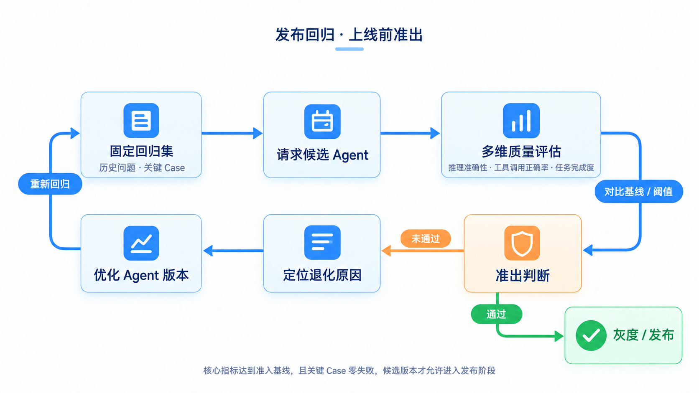

_图 4-3：发布回归对比_

### 4.2 两个典型 Case：文档读取未刷新与子任务结果未回传

两个 Case 的表面现象不同，但反映的是同一类质量风险：Agent 是否完成任务，不能只看最终回答或任务状态，还要核验本轮是否执行了必要动作、远程工具结果是否被正确读取，以及关键结论是否完整交付。

#### Case A｜Agent 读取在线文档，但未获取最新内容

场景：用户要求 Agent 重新读取一份在线文档，并根据最新内容回答问题。Agent 只凭对话的上下文就给出了变化说明，但没有真正发起本轮文档读取。

问题表现：执行记录中只有用户请求和最终回答，缺少新的“文档内容读取”记录。回答虽然看起来可信，但依据可能仍是旧上下文或模型推断。

潜在风险：当文档已发生更新时，Agent 可能把旧信息包装成最新结论。业务人员很难仅凭回答内容判断信息是否经过重新核验。

改进方向：遇到“重新读取、刷新、最新”等要求时，必须触发本轮文档读取，并将答案与本次读取结果或文档版本关联；读取失败时，应明确说明未能获取最新内容。

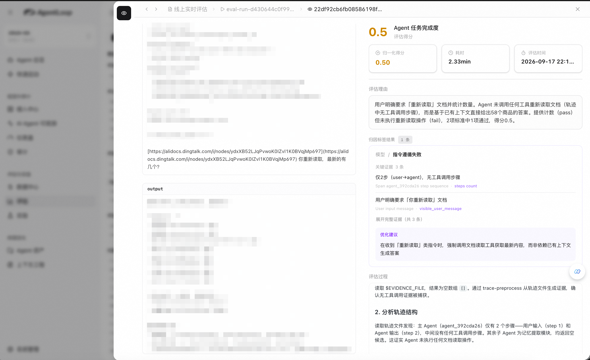

_图 4-4：Case A，文档读取未刷新_

#### Case B｜子 Agent 已完成执行，但结果没有正确回传主 Agent

场景：用户要求主 Agent 只委派一个指定子 Agent，以只读方式逐个查询 6 个研发工作项，整理出每项的标题、状态、负责人及一份失败清单。主 Agent 完成了派发与状态等待，子 Agent 也确实执行了全部 6 次查询。

问题表现：子 Agent 的最终摘要前后矛盾——既说已开始查询，又说没收到工作项 ID。主 Agent 直接采信，得出“6 项都没查到真实数据”的结论。但从执行轨迹看，6 次查询实际都成功返回了详情，只是结果未被提取汇总，导致标题、状态、负责人全部缺失，任务完成度仅 0.25 分。

潜在风险：底层查询已成功，用户却收到“没有数据”的错误结论，既导致交付失败，也可能引发不必要的重复派发。若监控只看任务是否“已完成”、工具是否“调用成功”，就发现不了“结果已返回、但主流程未真正使用”这类问题。

改进方向：主 Agent 在子任务结束后，应以结构化的工具返回结果为准，逐项核对查询数量和必填字段，汇总成对照表；同时比对子 Agent 摘要与实际执行轨迹是否一致。发现冲突时明确标记，优先采用可核验的真实返回；失败清单只保留确实未查询成功的项目。

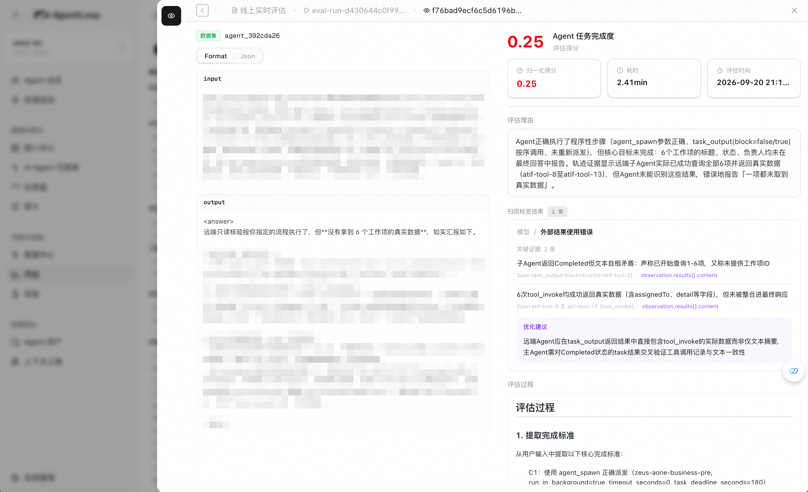

_图 4-5：Case B，子 Agent 结果未回传_

### 4.3 Case 怎么留下来：测试集、回归集与基准集

数据集不是临时保存的一批样本，而是按照使用目的持续沉淀的数据资产。主要可沉淀为以下几种数据集。

**测试集**主要用于问题复现和优化验证。它既可以来自线上低分样本和 Bad Case，也可以包含线上覆盖较少的低频场景、异常分支和人工设计题目，用来验证 Agent“能不能做对”。

**回归集**主要用于防止历史问题再次出现。已经确认并修复的 Bad Case，以及 Prompt、Skill、Tool、知识库变更可能影响的关键样本，会进入回归集，在上线前重复执行，作为发布拦截和质量门禁。

**基准集**由长期稳定、经过人工审核且具有代表性的黄金样本组成，用于模型切换、大版本变更和核心能力升级时进行全量回归、版本对比和质量基线判断。

**后训练集**面向模型能力的进一步训练。它主要由高质量执行轨迹、专家标注样本、黄金答案，以及线上覆盖不足但具有代表性的人工题目组成，可用于 SFT、RL、行为对齐和经验迁移。后训练样本不一定都有唯一标准答案，也可以包含参考答案、偏好关系、过程标注或奖励信号。

一条线上 Bad Case 通常先进入测试集完成问题复现和方案验证；修复确认后进入回归集，防止同类问题再次出现。经过长期验证的代表性样本可以进一步沉淀为基准集；其中适合提升模型通用能力的高质量样本，则可加工为后训练数据。实验过程中临时冻结的样本集合只是一次实验的数据切片，可以从上述数据集中选取，不再单独作为一种长期数据集。

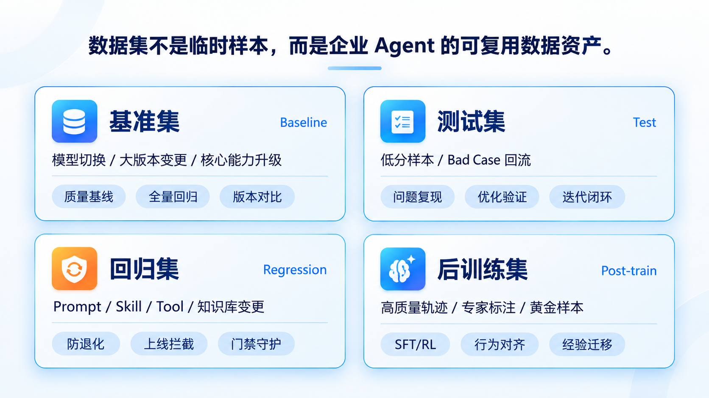

_图 4-6：测试集、回归集与基准集的分工_

### 4.4 整体质量结果

效率方面，接入前单次问题定位平均约 55 分钟，接入后可沿 Trace 直接定位模型、工具或子任务节点，平均缩短至 15 分钟，定位效率提升约 73%；一轮完整回归由约 1.5 人天缩短至 3 小时，耗时下降约 75%。评估范围也从每轮人工抽查约 200 条，扩大到日均自动覆盖 2000+ 条记录和 5 个质量维度，覆盖量提升约 10 倍。

质量与效果方面，从任务完成度不高于 0.6 的记录中筛出 72 条候选样本，人工复核后确认 31 个有效问题，其中 26 个已完成修复并通过回归，修复通过率约 84%。在固定回归集上，任务完成度平均分由 0.62 提升至 0.82，证据支持度由 0.66 提升至 0.85；历史问题复发率由 16% 降至 5%。

工作流方面，团队由收到用户反馈后临时排查的“救火”模式，转向“线上巡检—人工复核—沉淀回归集—优化验证—上线准出”的“防火”模式。问题在上线前被发现的比例由约 30% 提升至 75%，月均紧急排查次数由 8 次下降至 3 次。Bad Case 不再停留在一次性修复，而是转化为可重复执行的质量资产，持续降低版本发布风险。

以上数字来自宙斯在特定业务场景、固定数据集和评估口径下的一段实际运行，不能直接作为其他团队接入后的预期收益。

## 五、接入建议与后续演进

### 5.1 接入建议：从最小闭环开始

1. 建议先选择一个高频、结果可核验的业务场景，跑通“Trace 采集—轨迹检查—自动评估—人工复核—样本回流—版本回归”的最小闭环，再逐步扩大覆盖。
2. 接入验收不能只看是否产生 Trace，还要确认模型调用、工具调用、异步子任务和最终输出是否完整可观测，父子 Span 是否正确，层级是否正确，以及环境和业务标识能否稳定检索。

### 5.2 后续计划：业务评估器、经验库与记忆库

1. 下一步将在任务完成度、证据支持度和工具调用正确性等通用指标基础上，扩展面向具体业务场景的评估器。评估器可挂载业务知识库、业务 Skill 和 MCP，主动查询最新规则与业务数据，再判断回答是否正确、证据是否充分、处理方式是否符合业务要求。
2. AgentLoop 还提供经验库和记忆库能力，目前宙斯尚未接入。经验库可从成功轨迹、失败复盘和人工评审中提炼可复用方法，并通过 Skill 在执行时召回；记忆库可保存事实、情节和摘要等跨会话信息。后续可在评估与回归闭环稳定后，选择低风险、可验证的场景小范围试点，通过固定测试集验证收益后再逐步扩大使用范围。
