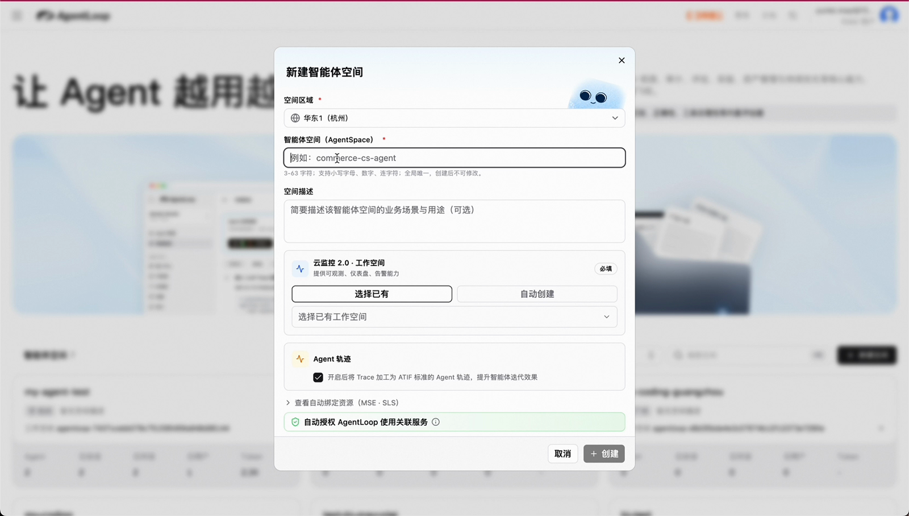
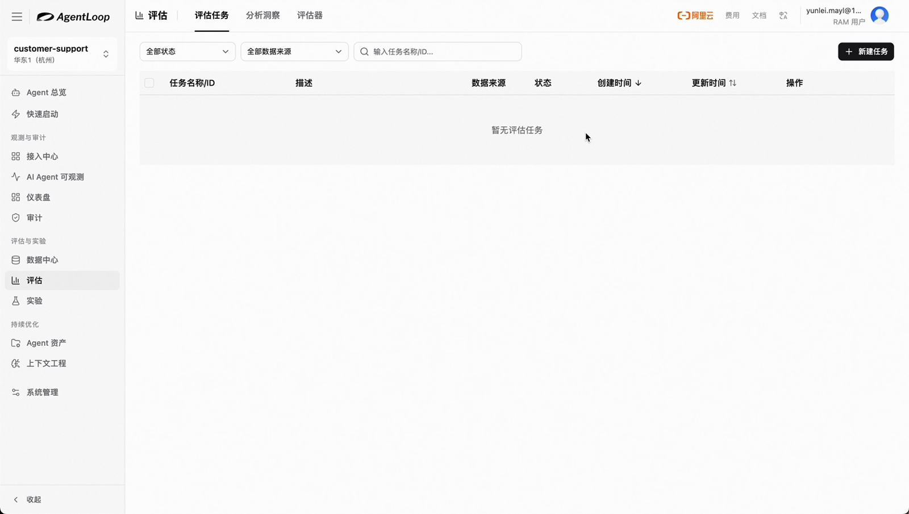
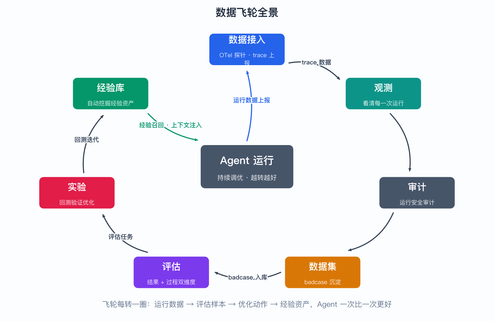
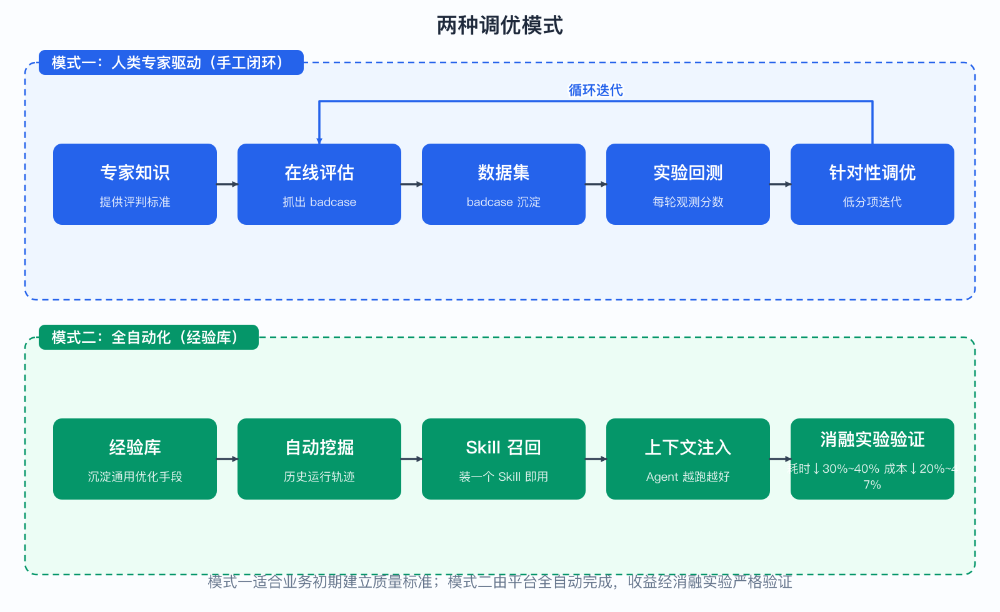

# AgentLoop 数据飞轮实践（一）：总览 —— 让 Agent 持续调优的闭环

> <strong>AgentLoop 数据飞轮实践系列</strong> · 第 1 篇 / 共 5 篇\
> 下一篇：[数据接入 —— 四种方式把 Agent 连进 AgentLoop](./04%20AgentLoop%20%E6%95%B0%E6%8D%AE%E9%A3%9E%E8%BD%AE%E5%AE%9E%E8%B7%B5%EF%BC%88%E4%BA%8C%EF%BC%89%EF%BC%9A%E6%95%B0%E6%8D%AE%E6%8E%A5%E5%85%A5%20%E2%80%94%E2%80%94%20%E5%9B%9B%E7%A7%8D%E6%96%B9%E5%BC%8F%E6%8A%8A%20Agent%20%E8%BF%9E%E8%BF%9B%20AgentLoop.md)

Agent 上线只是起点。真正决定 Agent 好不好用的，是上线之后能不能<strong>持续调优</strong>：用户反馈的问题能不能被系统性地发现、沉淀、验证、修复，并且让 Agent 一次比一次聪明。

这件事之所以难，是因为它天然是一个循环：不跑起来就没有真实数据，没有数据就不知道该优化什么，优化了又必须有办法证明真的变好了。很多团队的调优停留在"看几条用户吐槽、手动改改 Prompt"的阶段——零散、不可复现，也无法回答"这次改动到底是变好还是变坏"。

这正是 AgentLoop 要解决的核心问题。本文基于一次完整的实操演示（约 64 分钟，从创建工作空间到消融实验验证收益），带你总览 AgentLoop 的数据飞轮是怎么转起来的。后续四篇会把演示里的每一步拆开细讲，建议先读完本篇建立全景，再进入细节。

## 一、从一个客服 Agent 开始

演示从创建一个工作空间开始。我们创建一个客服场景的 Agent —— Customer Support，并选择自动创建工作空间：

*图 1：创建客服 Agent 工作空间（视频 00:07）*

工作空间（AgentSpace）是后续一切资源的边界：数据、数据集、评估器、实验都归属在某个空间之下。选择"自动创建"之后，平台会把客服场景常用的基础资源一并准备好，省去从零搭建的麻烦。

这个客服 Agent 基于 <strong>Claude Code / Claude Agent SDK</strong> 构建——它是 AgentLoop 自身的一个客服 Agent。选它做演示有一个好处：这类 Agent 的接入方式很有代表性（探针或 webhook 两条路），第 2 篇会借它完整走一遍接入流程。后续的评估、实验、经验注入，也都围绕这个 Agent 展开。

## 二、AgentLoop 的核心定位：持续调优

用一句话概括 AgentLoop 的核心事情：<strong>帮助用户调优 Agent，覆盖从 Agent 开发到上线之后的持续调优全过程</strong>。

注意"全过程"三个字。开发期的调优靠测试集和直觉还能应付，上线之后的调优面对的是真实、发散、持续涌入的用户请求——这时需要的不是几次手工调优，而是一套能<strong>自动发现问题、沉淀资产、验证效果</strong>的机制。AgentLoop 提供的就是这样一组端到端的原始能力，并把它们串成一个数据飞轮：

*图 2：接入、观测、审计、数据集、评估、实验等功能入口（视频 01:20）*

飞轮的转动路径是：
1. <strong>数据接入</strong>：把 Agent 的 trace 数据接入上来（在接入中心完成）。这是一切的地基——没有数据，后面所有环节都是空转；
2. <strong>观测</strong>：对 trace 数据做观测，看清 Agent 的每一次运行：调了哪些模型、用了哪些工具、走了什么路径；
3. <strong>审计</strong>：对运行数据做安全审计，覆盖合规视角的检查；
4. <strong>数据集</strong>：观测中发现的 badcase（回答糟糕、流程跑偏的个案），保存沉淀到数据集。数据集是飞轮的"弹药库"，后面实验回测用的就是它；
5. <strong>评估</strong>：创建评估任务，从<strong>结果</strong>和<strong>过程</strong>两个角度评估 Agent 的响应质量——不只看最终答案对不对，也看执行过程合不合理；
6. <strong>实验</strong>：评估之后挑出 badcase 存进数据集，通过实验一轮一轮回测，建立实验计划。每回测一轮观测一次整体分数，分数低就继续针对性调优；
7. <strong>经验库</strong>：后台算法自动化地从运行轨迹中挖掘经验，反哺 Agent——这是飞轮里唯一不需要人类专家介入的环节。

每转一圈，Agent 的运行数据变成评估样本，评估结论变成优化动作，优化效果又被下一轮评估验证——这就是"数据飞轮"的含义。飞轮的关键不在于某一个环节多强，而在于<strong>环节之间首尾相接</strong>：评估的产出是实验的输入，实验的结论又指回下一轮评估，经验库则让每一圈都比上一圈起点更高。

*图 3：数据飞轮全景：接入 → 观测 → 审计 → 数据集 → 评估 → 实验 → 经验库，经验再反哺 Agent（示意图，依据演示内容整理）*

## 三、两种调优模式

围绕这套能力，AgentLoop 把调优过程分成两种模式，对应不同阶段的诉求。可以理解为：模式一是"人开车"，模式二是"自动驾驶"，而演示会把两条路都走一遍。

### 模式一：人类专家驱动

有些调优需要人类专家输入——特别是特定行业、领域的知识。什么样的回答算"好"，在金融、医疗、客服等不同场景里标准完全不同，这些判断标准没法凭空自动化，必须由懂业务的人给出来。这种模式下：
- 人类专家提供<strong>评判标准</strong>（什么样的回答是好的），驱动整个调优流程的建立；
- 数据接入后，通过<strong>在线评估</strong>把 badcase 抓出来；
- badcase 保存进<strong>数据集</strong>；
- 通过<strong>实验</strong>一轮一轮回测，每轮观测整体分数；
- 发现哪个分数低，就继续<strong>针对性调优</strong>，循环迭代。

这是一条"专家知识 → 评估标准 → 数据沉淀 → 回测验证"的手工闭环，适合业务上线初期建立质量标准。它的价值不只是抓出几个 badcase，更重要的是把专家头脑里"这个回答不行"的隐性判断，固化成可复用、可回测的显性标准（Rubric）——这份标准本身就是团队的资产。

### 模式二：全自动化（经验库）

另一种是端到端的全自动模式，<strong>不需要人类专家介入</strong>：
- 把通用 Agent 常见的优化手段沉淀成<strong>经验库</strong>；
- 数据接入后开启经验库，平台自动从 Agent 的历史运行轨迹中<strong>挖掘经验</strong>；
- 在 Agent 里安装一个 Skill，就能自动把经验<strong>召回</strong>出来；
- 经验本质上是 Agent 运行历史轨迹中沉淀下来的<strong>经验资产</strong>，类似沉淀出来的 Skill 信息。

通用优化手段包括：工具调用的执行情况、延时、执行准确率、执行路径等通用场景。这些维度不依赖具体业务，任何 Agent 都会遇到，因此适合自动化挖掘。但面对真实业务场景时，往往还有自定义的业务需求，所以经验注入的效果需要用实验严格验证——经验到底帮没帮上忙、怎么注入收益最大，要用数字说话，这就是本系列最后一篇消融实验要讲的内容。

两种模式不是二选一，而是互补：模式一建立标准、兜住业务底线，模式二在标准之上持续自动增益。演示的顺序也正是这样——先走手工闭环，再开全自动化。

*图 4：两种调优模式：人类专家驱动的手工闭环 vs 经验库全自动化（示意图，依据演示内容整理）*

## 四、本系列的路线图

这次实操演示的顺序，恰好是数据飞轮转一圈的顺序。本系列将按以下路线展开：

| 篇目 | 主题 | 核心内容 |
|------|------|------------|
| 第 1 篇（本文） | 总览 | 核心定位、数据飞轮、两种调优模式 |
| 第 2 篇 | 数据接入 | OTel 探针四种接入方式；Claude Code \+ LoongSuite Pilot 实操 |
| 第 3 篇 | 评估 | 黄金指标 → Rubric → 评估器 → 评估任务 → badcase 闭环 |
| 第 4 篇 | 实验 | 实验计划、离线实验平台、题目级 Rubric、实验大盘 |
| 第 5 篇 | 经验库 | 经验自动挖掘、Skill 召回、消融实验与最终收益 |

演示将先完整走一遍"人类专家驱动"的手工调优链路（数据接入 → 评估 → 实验），再演示全自动化的经验库，最后用消融实验证明经验注入的真实收益：<strong>耗时降低 30%~40%，成本降低 20%~47%</strong>。

读这个系列你能拿到三样东西：一是<strong>可直接照做的操作路径</strong>（每一步演示里都有真实画面）；二是<strong>每个环节背后的设计逻辑</strong>（为什么要有采样、为什么要题目级 Rubric、为什么经验要做护栏）；三是<strong>一套验证方法论</strong>（怎么用实验和消融证明优化真实有效）。如果你正在负责一个已上线 Agent 的质量，这套流程基本可以原样搬过去。

---

<strong>下一篇预告</strong>：数据接入是整个飞轮的起点。AgentLoop 基于 OTel 标准协议和探针技术提供了四种接入方式，我们将亲手把 Claude Code 构建的客服 Agent 接入平台——[详见第 2 篇](./04%20AgentLoop%20%E6%95%B0%E6%8D%AE%E9%A3%9E%E8%BD%AE%E5%AE%9E%E8%B7%B5%EF%BC%88%E4%BA%8C%EF%BC%89%EF%BC%9A%E6%95%B0%E6%8D%AE%E6%8E%A5%E5%85%A5%20%E2%80%94%E2%80%94%20%E5%9B%9B%E7%A7%8D%E6%96%B9%E5%BC%8F%E6%8A%8A%20Agent%20%E8%BF%9E%E8%BF%9B%20AgentLoop.md)。
