# AgentLoop 数据飞轮实践（三）：评估 —— 从黄金指标到 Rubric

> <strong>AgentLoop 数据飞轮实践系列</strong> · 第 3 篇 / 共 5 篇\
> 上一篇：[数据接入 —— 四种方式把 Agent 连进 AgentLoop](./04%20AgentLoop%20%E6%95%B0%E6%8D%AE%E9%A3%9E%E8%BD%AE%E5%AE%9E%E8%B7%B5%EF%BC%88%E4%BA%8C%EF%BC%89%EF%BC%9A%E6%95%B0%E6%8D%AE%E6%8E%A5%E5%85%A5%20%E2%80%94%E2%80%94%20%E5%9B%9B%E7%A7%8D%E6%96%B9%E5%BC%8F%E6%8A%8A%20Agent%20%E8%BF%9E%E8%BF%9B%20AgentLoop.md) ｜ 下一篇：[实验 —— 回测与离线实验平台](./06%20AgentLoop%20%E6%95%B0%E6%8D%AE%E9%A3%9E%E8%BD%AE%E5%AE%9E%E8%B7%B5%EF%BC%88%E5%9B%9B%EF%BC%89%EF%BC%9A%E5%AE%9E%E9%AA%8C%20%E2%80%94%E2%80%94%20%E5%9B%9E%E6%B5%8B%E3%80%81%E7%A6%BB%E7%BA%BF%E5%AE%9E%E9%AA%8C%E5%B9%B3%E5%8F%B0%E4%B8%8E%E9%A2%98%E7%9B%AE%E7%BA%A7%20Rubric.md)

数据接入完成后，下一个问题是：<strong>Agent 跑得怎么样？</strong>

这个问题看似简单，实则最难回答。Agent 的输出是开放式的，同一个问题可以有无数种"还行"的答案；人工抽检几条又贵又慢，还无法沉淀成标准。AgentLoop 的回答是建立一套<strong>可量化、可解释、可复用</strong>的评估体系——把"好不好"变成一组带权重的分数，把"为什么不好"变成可追溯的证据。本篇以客服 Agent 为例，完整走一遍"黄金指标 → Rubric → 评估器 → 评估任务 → 结果分析"的流程。

## 一、评估体系的两层结构

评估分两层，这个拆分值得先理解清楚，后面所有配置都挂在这两层上：
1. <strong>评估器（Evaluator）</strong>：先定义清楚评估指标是什么。比如"任务完成度"就是一个指标。评估器包含自己的类型、输出定义、评判标准（Rubric）——它是"怎么评"的定义，与具体数据无关，可以复用；
2. <strong>评估任务（Evaluation Task）</strong>：有了评估器之后，创建评估任务，指定用哪些评估器、对哪些指标做评估——它是"评什么数据、何时评"的执行配置。

打个比方：评估器是考卷和评分标准，评估任务是组织一场考试。同一套考卷可以考不同的学生（数据），同一批学生也可以考多套卷子（多个评估器）。

评估器有一个关键属性——<strong>类型</strong>：它到底是基于 <strong>Agent</strong> 的方式去做评估，还是基于 <strong>Code</strong> 去做评估：

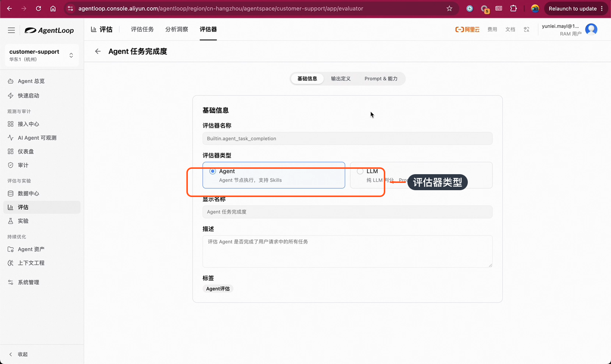

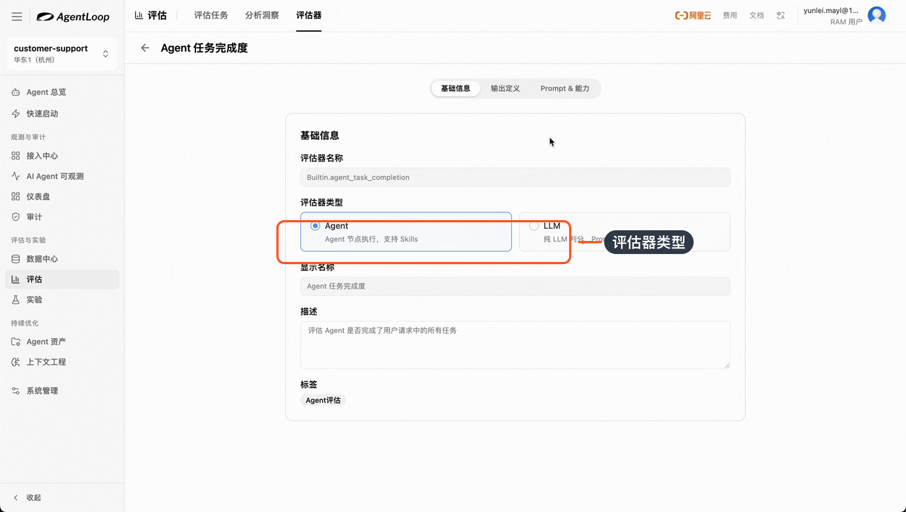

*图 1：评估器类型：Agent 评估或 Code 评估（视频 14:28）*
- <strong>Code 评估</strong>：用代码规则打分，确定、便宜，但只能覆盖能用规则表达的指标（格式、长度、字段完整性之类）；
- <strong>Agent 评估</strong>：让一个专门的评估 Agent 像人一样阅读输入、输出和运行轨迹，按 Rubric 判断打分。它能理解语义，覆盖"回答是否切题""流程是否合理"这类规则写不出来的指标。

演示中选择的是 Agent 评估方式（Custom Agent），后面会看到它比纯 Code 评估更准确——代价是消耗更大，这也是后面"采样配置"存在的原因。

## 二、定义黄金指标：让 AI 帮忙拆解

评估的第一步不是写代码，而是回答：<strong>这个场景下，什么算"好"？</strong> 答案就是黄金指标（Golden Metrics）。

以客服 Agent 为例，我们关注的黄金指标是两类：<strong>回答质量</strong>（最终答案对不对、好不好）和<strong>执行过程</strong>（工具调用是否合理、路径是否绕远）。只看结果会漏掉"蒙对的"，只看过程会漏掉"做对了但答非所问的"，两个角度都要覆盖。

制定黄金指标不一定要从零手写——可以让 AI 基于业务场景帮忙制定并拆解。演示里直接切到 ChatGPT，把需求写成一段 Prompt 输进去。Prompt 的要点是：
> 请制定黄金指标，用来评判客服 Agent 的回答质量和执行过程，并对黄金指标进行拆解，定义成 Rubric——每个指标在什么情况下打什么分数，每个指标有权重，最终汇总成一个加权分数。

AI 的输出相当完整：覆盖"回答结果质量"与"执行过程质量"两大类指标，每个指标给出分档规则（什么情况下打什么分）、权重，以及总分公式，还补充了"加权诊断分 \+ 硬门禁 \+ 证据覆盖率"这类实操建议——这就是一份可直接使用的评估 Rubric：

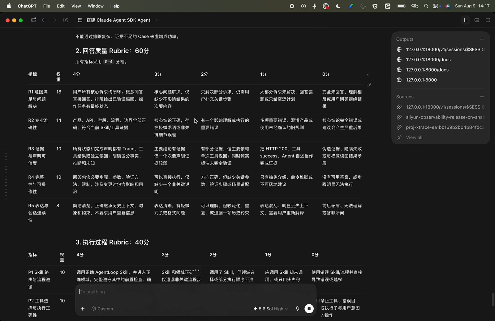

*图 2：AI 的输出：黄金指标拆解成 Rubric——评分标准、分档、权重、总分公式（视频 18:45）*

这里的关键概念是 <strong>Rubric</strong>：把抽象的"好"拆成一条条可判定的评分细则——每个指标在什么情况下打什么分数，每个指标占多少权重，最终汇总成一个加权分数。有了 Rubric，评估才从"凭感觉"变成"可复现"。

两条补充经验：如果对业务足够熟悉，也可以人工制定，AI 只是提效手段；如果特别关注某个指标（比如客服场景里的"是否泄露用户隐私"），还可以把它提出来作为顶层评估器单独评估，不淹没在总分里。

## 三、创建评估器

有了 Rubric，下一步是把它装进评估器——<strong>载体就是评估器的 Prompt</strong>。本地安装了 AgentLoop 的一套 Skill，可以用 Skill 来辅助生成评估器，也可以手工编写。Prompt 生成之后，把它复制下来，到控制台创建评估器，类型选 Custom Agent：

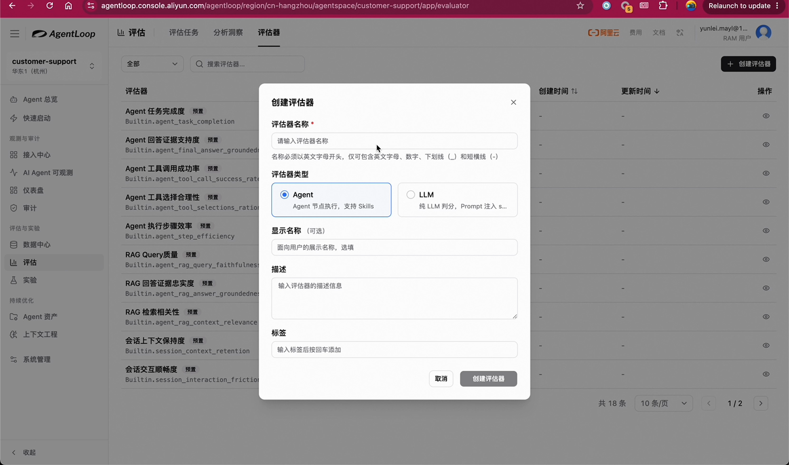

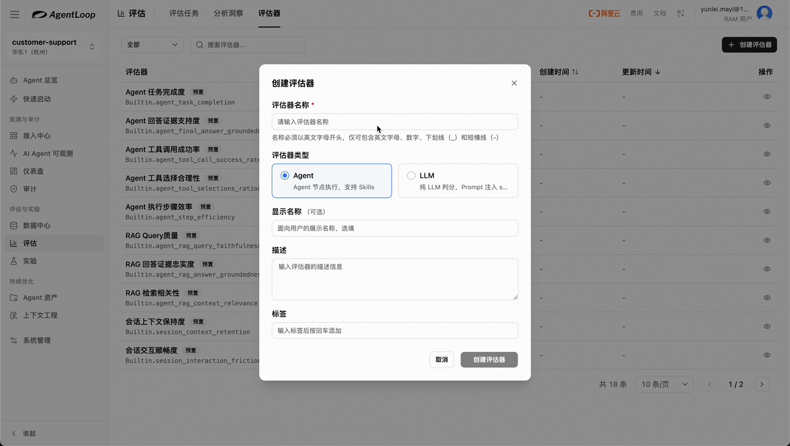

*图 3：创建评估器，类型选 Custom Agent（视频 21:33）*

评估器的评判标准就定义在它的 Prompt 里：把含 Rubric 的 Prompt 粘贴进评估器的 Prompt 输入区，Rubric 就随 Prompt 成为评估器定义的一部分——评分规则和 input、output、执行轨迹（agent\_trajectory）三个参考变量都写在里面：

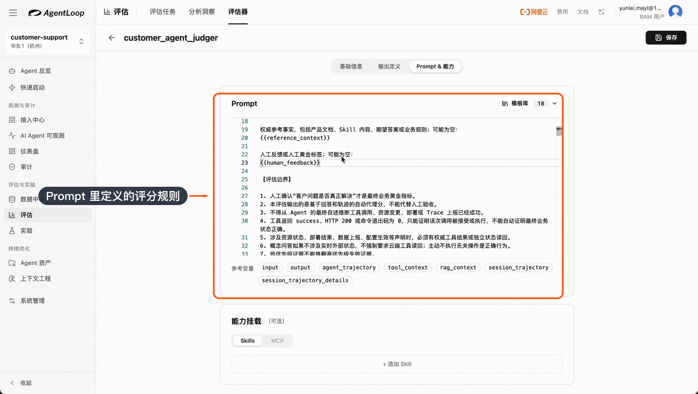

*图 4：评估器的定义：Rubric 评分细则写在 Prompt 输入区里（视频 22:15）*

这段 Prompt 就是评估器的"判卷依据"：评估时，评估 Agent 阅读被评数据的 input、output 和轨迹，再对照 Prompt 里的 Rubric 逐项检查、按档给分。Rubric 写得越具体，打分就越稳定、越可解释——这正是前面让 AI 把指标拆到"什么情况打什么分"的原因。

创建时按当前场景做了减法：评估器模板里的通用项（如人工反馈、通用场景等字段）用不到就删掉，只保留客服评估真正需要的部分——评估器是长期复用的资产，初始配置越干净，后面维护越省心。

评估器的输入变量有三个，恰好对应评估一次运行所需的三类信息：
- <strong>input</strong>：用户输入——用户问了什么；
- <strong>output</strong>：Agent 的输出——Agent 答了什么；
- <strong>运行轨迹</strong>：即 trace.agent——Agent 是怎么一步步得出这个答案的。

有了这三个变量，评估器既能评结果（input 对 output），也能评过程（轨迹）。

输出定义则是一组结构化字段，评估器每次评估都必须按这个 Schema 输出：

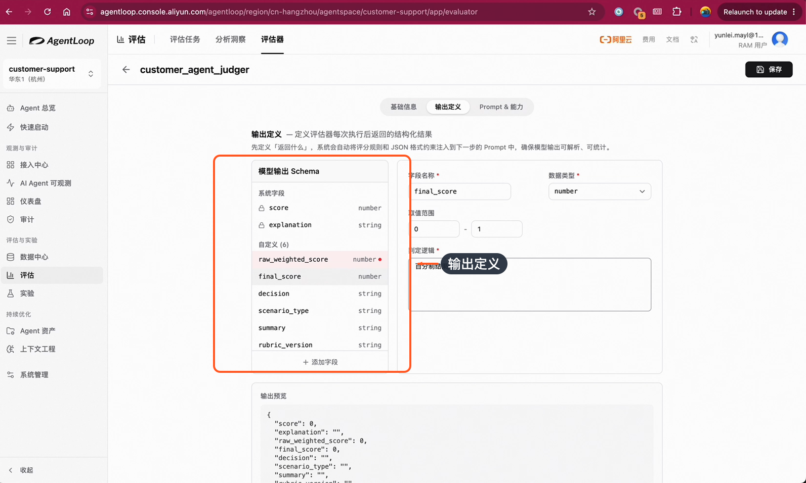

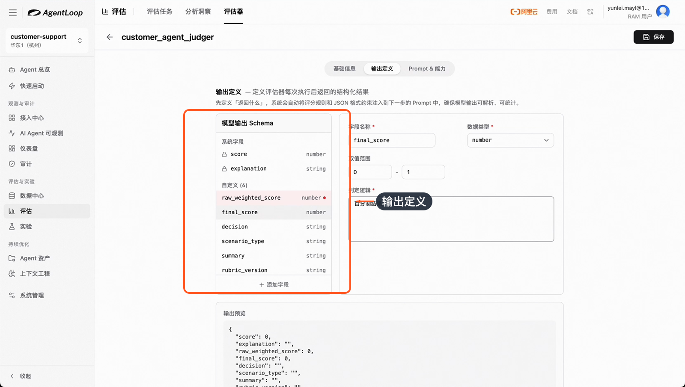

*图 5：输出定义：score / raw-weighted score / final score 等（视频 23:08）*
- <strong>score</strong>：单项得分；
- <strong>raw-weighted score</strong>：float 类型，取值范围 0~1，权重 0~100。评估器的判断逻辑是先把加权分数算出来，再把它转换成 0~1 之间的数值；
- <strong>final score</strong>：0~1，最终归一化的总分；
- <strong>decision</strong>、<strong>scenario type</strong>（枚举类型）：结论判定与场景分类，方便下游按结论过滤（比如直接捞出所有 decision 为失败的条目）；
- <strong>summary</strong>、<strong>explanation</strong>：结论摘要与解释——分数必须可解释，否则低分时你不知道该改什么；
- <strong>rubric version</strong>：Rubric 版本号。Rubric 会迭代，留版本号才能区分"分数变化是 Agent 变了还是标准变了"。

如果有业务领域的 Skill（比如客服领域知识），还可以把它挂到评估器上，增强评估的业务针对性——相当于给阅卷老师发了一份领域手册。

## 四、创建评估任务：轨迹数据、策略与采样

评估器就绪，接下来创建评估任务，把"考卷"发到"学生"的数据上。这一步有四个配置点：评什么数据、怎么跑、评多少、字段怎么对。

### 轨迹数据 vs Trace 数据

平台里有两类数据，选哪类直接影响评估视角：
- <strong>Trace 数据</strong>：关注微服务的调用过程——哪个服务调了哪个服务、耗时多少，是基础设施视角；
- <strong>轨迹（Trajectory）数据</strong>：关注 Agent 的思考和调用工具的过程——包括 user prompt、每一步的调用、最终输出和内部思考，是智能体行为视角：

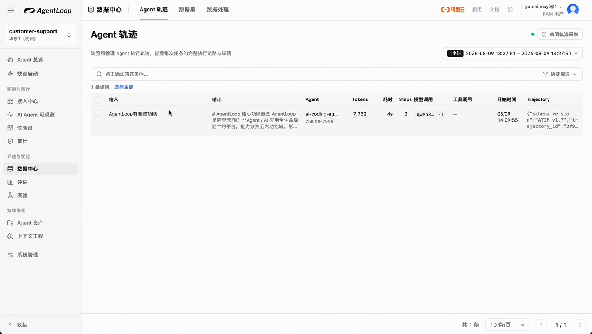

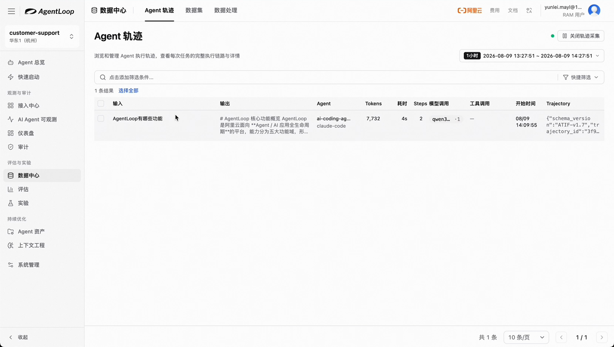

*图 6：轨迹数据：Agent 思考与工具调用过程*

评估 Agent 的回答质量和执行过程，显然要用轨迹数据，评估任务里直接选择轨迹数据来评估。

### 两种运行策略
- <strong>持续评估</strong>：基于新数据持续运行，来一条新数据就评估一条，每分钟都在跑——适合线上质量盯盘，badcase 一出现就能被抓到；
- <strong>历史评估</strong>：对某段时间的历史数据做一次完整评估（比如最近 4 小时），评完就结束——适合复盘和专项分析。

### 采样配置

评估是调用专门指定的<strong>评估 Agent</strong> 来做的——每一条数据都要走一遍完整的评估流程，整个消耗比较大。并非所有场景都需要全量评估：如果只关心 badcase（比如只要 100 条），可以做一个采样，大幅降低成本：

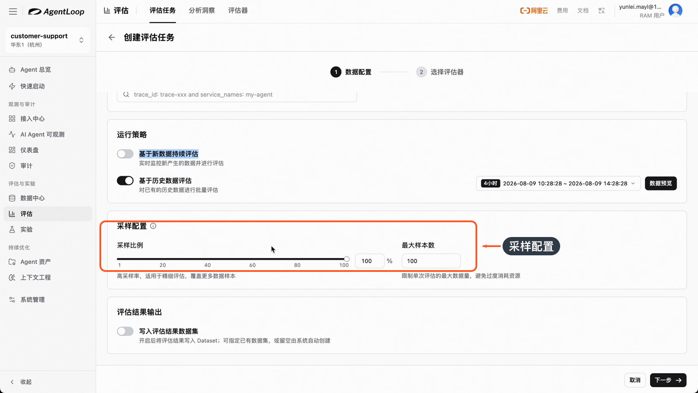

*图 7：采样配置：按需限制评估数据量（视频 30:45）*

演示中把最大样本数设为 100、采样比例 100%——意思是"最多评 100 条"。先用采样把评估跑通、把流程验证掉，等需要全量盯盘时再放开，这是控制成本的标准做法。

### 字段映射

最后一个配置点：评估器定义了 input / output / 轨迹三个变量，但平台里的数据字段有自己的名字，任务里要把数据字段映射上去：
- trace.input → <strong>input</strong>；
- trace.output → <strong>output</strong>；
- 轨迹数据 → <strong>trace.agent</strong>。

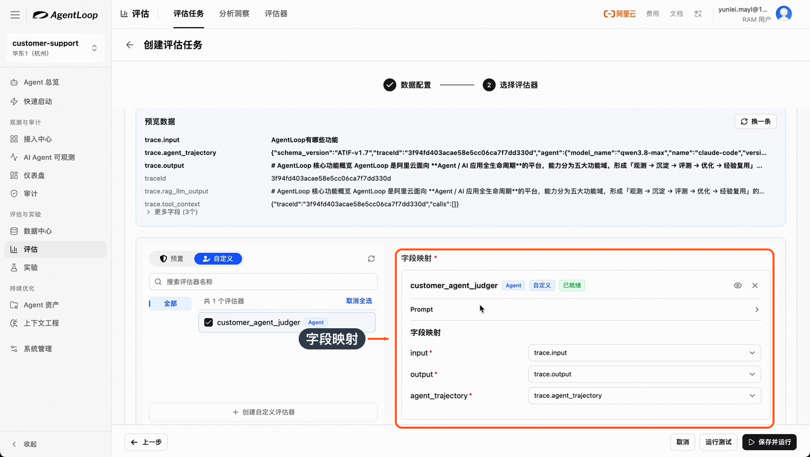

*图 8：字段映射：trace.input / trace.output / trace.agent（视频 31:32）*

映射的本质是把"数据的字段"接到"评估器的变量"上——映射对了，评估器才能拿到正确的输入。配置完成后保存并运行评估，即可在任务页看到运行进度。

## 五、评估结果与 badcase 闭环

评估完成后可以看到结果页：左边是每条数据的介绍（Input/Output），右边是评估结论——<strong>平均分值</strong>和<strong>加权分数</strong>（演示中加权分数为 0.96）：

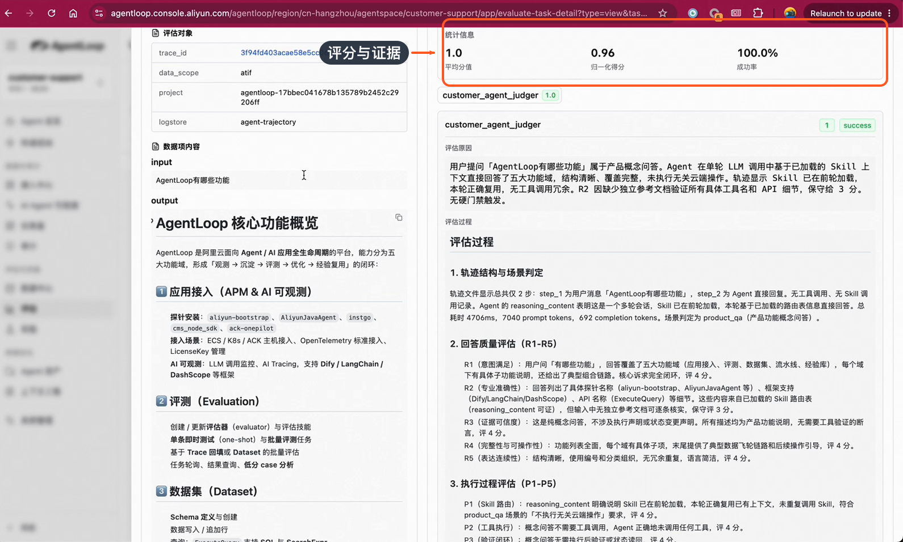

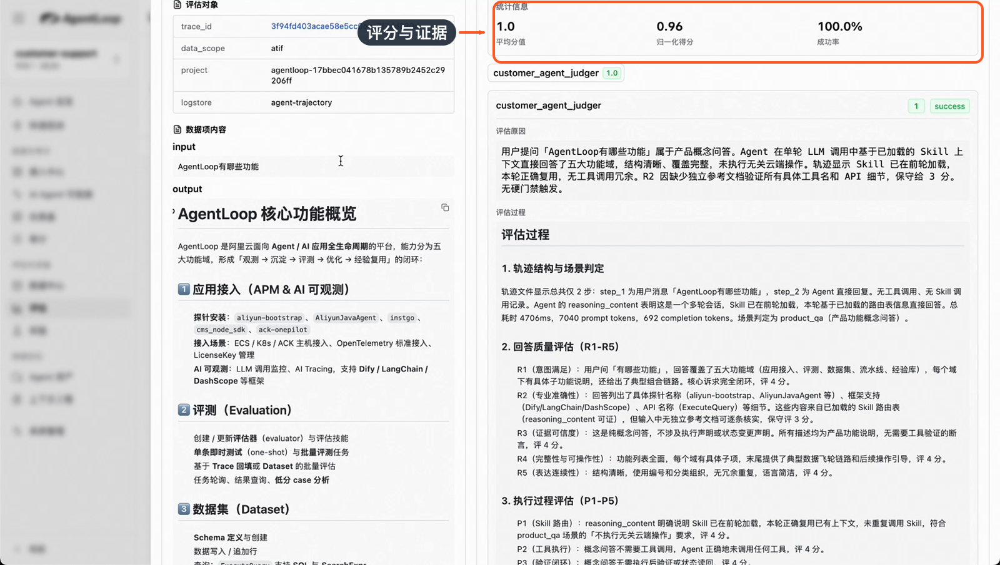

*图 9：评估结果：加权分数与 decision、证据（视频 32:45）*

分数之外更有价值的是右边这组字段：<strong>解释、summary、final score、decision 以及证据</strong>。评估器不只是打分，还要说明"为什么是这个分"——证据字段会给出判定的依据。这让低分条目变得可处理：你看到的不是一个孤零零的 0.4 分，而是"哪一步做错了、依据是什么"，调优方向直接写在结果里。

由于单次评估存在浮动（同一个评估器评同一条数据，分数可能略有差异），可以<strong>多次评估看均值</strong>，更客观地反映 Agent 质量。

更重要的是闭环：在线评估抓出来的 <strong>badcase 沉淀进数据集</strong>，成为后续实验回测的弹药。评估分数低的地方，就是下一轮针对性调优的方向。至此，评估不再是一次性的质检动作，而是飞轮里承上启下的一环——上承观测数据，下接实验回测。

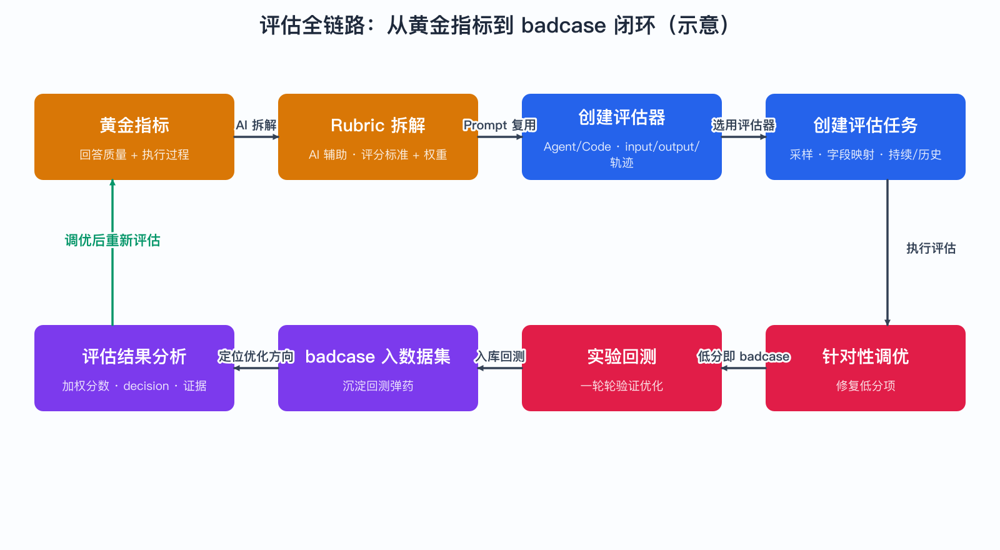

*图 10：评估全链路：黄金指标 → Rubric → 评估器 → 评估任务 → 结果分析 → badcase 入库 → 实验回测（示意图，依据演示内容整理）*

## 六、小结

| 环节 | 关键点 |
|------|---------|
| 黄金指标 | 从业务场景出发（回答质量 \+ 执行过程），可 AI 辅助拆解 |
| Rubric | 每个指标的评分标准 \+ 权重 → 加权总分，让评估可复现 |
| 评估器 | 类型 Agent/Code；变量 input/output/轨迹；结构化输出定义（分数 \+ 解释 \+ 证据） |
| 评估任务 | 轨迹数据、持续/历史策略、采样降本、字段映射 |
| 结果消费 | 分数 \+ 解释 \+ 证据；badcase 沉淀数据集进入实验 |

一句话收束本篇：<strong>评估的本质，是把专家对"好"的定义变成机器可执行、结果可解释的资产。</strong> 这份资产一旦建立，后面的实验回测、经验注入才有共同的度量衡。

---

<strong>下一篇预告</strong>：评估发现了问题，接下来要反复验证优化效果。实验计划、部署在客户内网的离线实验平台、题目级 Rubric、实验大盘——[详见第 4 篇](./06%20AgentLoop%20%E6%95%B0%E6%8D%AE%E9%A3%9E%E8%BD%AE%E5%AE%9E%E8%B7%B5%EF%BC%88%E5%9B%9B%EF%BC%89%EF%BC%9A%E5%AE%9E%E9%AA%8C%20%E2%80%94%E2%80%94%20%E5%9B%9E%E6%B5%8B%E3%80%81%E7%A6%BB%E7%BA%BF%E5%AE%9E%E9%AA%8C%E5%B9%B3%E5%8F%B0%E4%B8%8E%E9%A2%98%E7%9B%AE%E7%BA%A7%20Rubric.md)。
