# AgentLoop 数据飞轮实践（四）：实验，回测、离线实验平台与题目级 Rubric

> <strong>AgentLoop 数据飞轮实践系列</strong> · 第 4 篇 / 共 5 篇\
> 上一篇：[评估，从黄金指标到 Rubric](./05%20AgentLoop%20%E6%95%B0%E6%8D%AE%E9%A3%9E%E8%BD%AE%E5%AE%9E%E8%B7%B5%EF%BC%88%E4%B8%89%EF%BC%89%EF%BC%9A%E8%AF%84%E4%BC%B0%EF%BC%8C%E4%BB%8E%E9%BB%84%E9%87%91%E6%8C%87%E6%A0%87%E5%88%B0%20Rubric.md) ｜ 下一篇：[经验库，自动挖掘经验资产](./07%20AgentLoop%20%E6%95%B0%E6%8D%AE%E9%A3%9E%E8%BD%AE%E5%AE%9E%E8%B7%B5%EF%BC%88%E4%BA%94%EF%BC%89%EF%BC%9A%E7%BB%8F%E9%AA%8C%E8%87%AA%E8%BF%9B%E5%8C%96%EF%BC%8C%E8%87%AA%E5%8A%A8%E6%8C%96%E6%8E%98%E7%BB%8F%E9%AA%8C%E8%B5%84%E4%BA%A7%EF%BC%8C%E6%B6%88%E8%9E%8D%E5%AE%9E%E9%AA%8C%E9%AA%8C%E8%AF%81%E7%9C%9F%E5%AE%9E%E6%94%B6%E7%9B%8A.md)

评估发现了 badcase，调优也有了方向，接下来的问题是：<strong>怎么证明一次优化真的有效？</strong>

改 Prompt、换模型、调参数，任何改动都可能"感觉变好了"，但感觉不算数——回归测试里别的题目可能悄悄变差。答案是实验：用数据集里的题目反复回测，用分数说话。实验能力回答三个问题：这次改动对这几道题效果如何（实验计划）？怎么安全地测到部署在内网的 Agent（离线实验平台）？怎么让分数稳定可信、并且知道分数为什么变（实验大盘 \+ 题目级 Rubric）。

## 一、实验计划：数据集 \+ 评估器 \+ 变量映射

当对评估结果不满意时，就可以通过实验对数据集里的题目重新回测。演示用的数据集有两道题：『AgentLoop 如何做评估』和『AgentLoop 有哪些功能』——正是前面评估中得分不理想的 badcase。

创建实验计划时指定数据集，然后勾选评估器、配置<strong>变量映射</strong>：

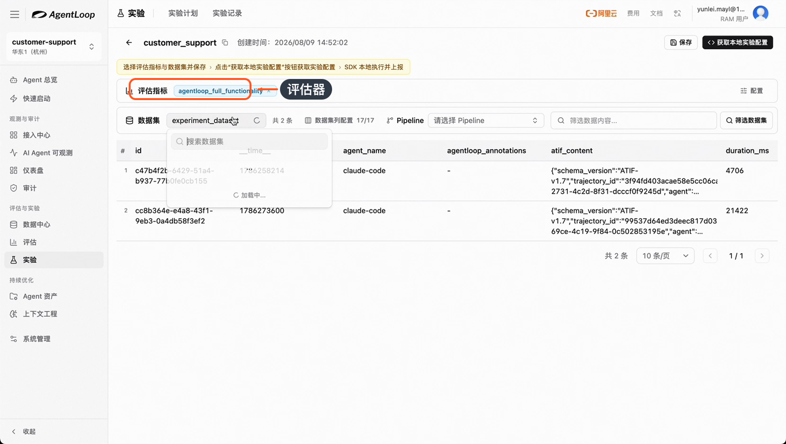

*图 1：实验计划：指定数据集与评估器（视频 34:02）*

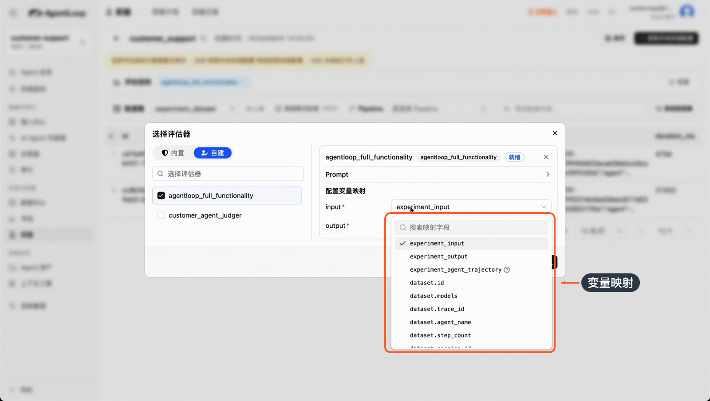

*图 2：变量映射：内置变量与数据集字段对应（视频 34:18）*

变量映射解决的是"评估器用哪个变量"的问题——和评估任务里的字段映射是同一个思路，只是这次的数据来源是实验：
- 一边是<strong>实验的内置变量</strong>：实验的 input、实验的 output、实验的轨迹；
- 另一边是 <strong>dataset 里的原始内容</strong>：比如 expected output 就存在 dataset 里，可以再加一个变量映射把它喂给评估器，让评估器拿标准答案做对照。

除了内置变量，还可以加<strong>自定义变量</strong>来标记实验上下文，比如本次测试的版本号、实验记录 ID，或者任意自定义的 KV 对。版本号尤其重要——后面大盘上要对比"不同版本的分数差异"，没有版本标记就无从对比。

配置好实验之后，可以获取一份<strong>本地执行代码</strong>——这是离线实验平台的入口。

## 二、离线实验平台：部署在你的内网

实验要访问的是客户自己的 Agent，而 Agent 往往部署在公司内网、只有内网才能访问。云端平台够不着它，把数据搬出去测又不现实。为此 AgentLoop 提供<strong>离线实验平台</strong>，直接部署在客户公司内网，就近访问本地 Agent：

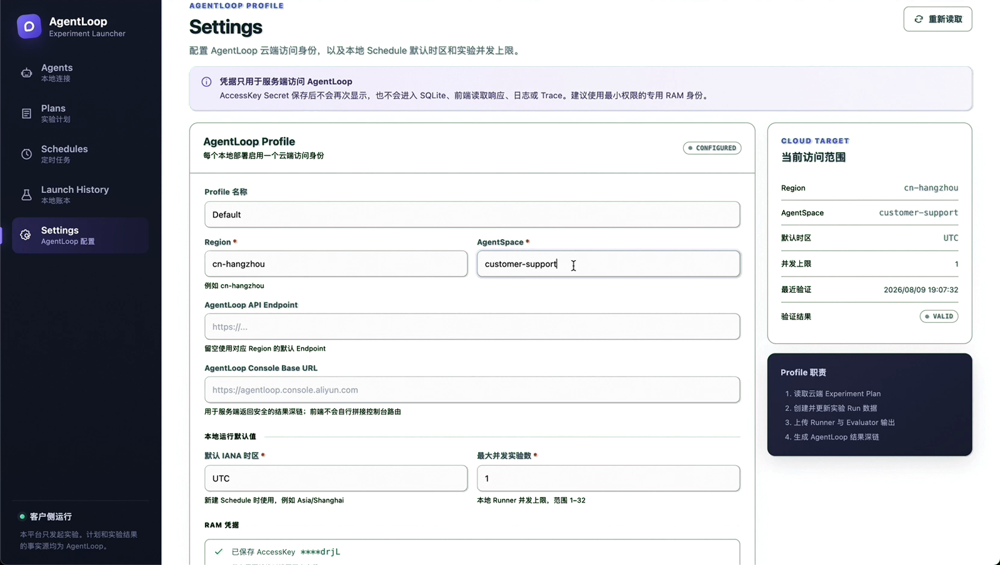

*图 3：离线实验平台：部署在客户内网（视频 35:32）*

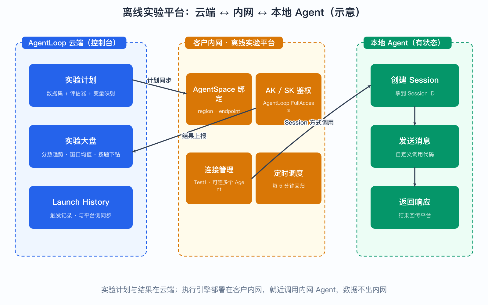

*图 4：离线实验平台架构：云端控制台 ↔ 内网实验平台 ↔ 本地 Agent（示意图，依据演示内容整理）*

这个架构的分工很清晰：云端负责存储实验记录、展示大盘（记录提交到云端，平台侧随时可看）；内网平台负责执行——它既能出网访问 AgentLoop 云端，又能在内网直接调用本地 Agent。数据不出内网，能力不打折扣。

### 平台配置：连上 AgentLoop 云端

第一件事是让内网平台连上 AgentLoop 云端：
- <strong>绑定 AgentSpace</strong>：配置要测哪个、管理哪个 AgentSpace 的实验，以及对应的 region；
- <strong>endpoint 与 VPC</strong>：默认值即可；如果要访问其他 region，改成对应 region 的 endpoint；
- <strong>AK / SK</strong>：这个 AK 要能访问云端 AgentLoop 的全部功能，即具备 <strong>AgentLoop FullAccess（读写）权限</strong>。建议申请一个专门的 AK 保存在本地，专门用于离线实验——权限专用、用途单一，出了状况好排查：

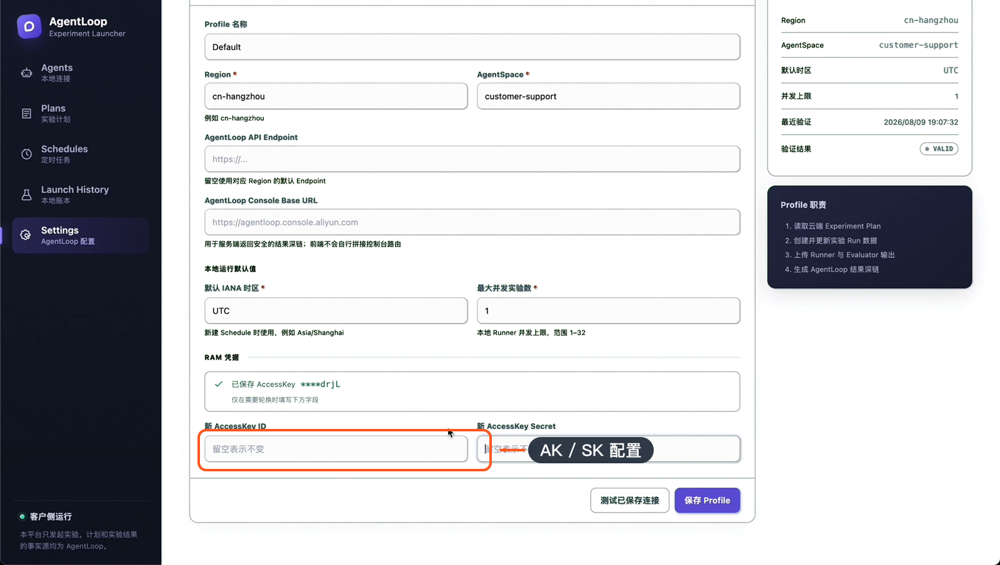

*图 5：配置 AK/SK 与 AgentSpace 绑定（视频 36:05）*

填完后<strong>测试链接</strong>，确保能连通 AgentLoop 云端平台，再进行下一步。

### 连接本地 Agent

第二件事是连接本地的 Agent。新建一个连接（演示中命名为 <strong>Test1</strong>）——本地平台可以同时连接多个 Agent，每个 Agent 都能单独做一遍测试：

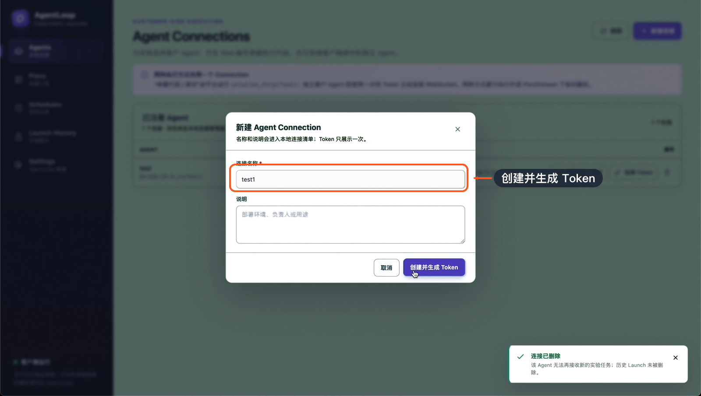

*图 6：新建连接：注册本地 Agent（视频 37:12）*

连接时需要一段<strong>自定义调用代码</strong>。平台提供的默认代码假设 Agent 的 API 是无状态的——发一个请求、拿一个响应。但大部分 Agent 是有状态的：比如演示的客服 Agent 基于 Claude Agent SDK 开发，需要<strong>先创建一个 Session，拿到 Session ID，再向这个 Session ID 发送消息</strong>，最后生成响应。默认代码不满足，就把调用代码改成"建 Session → 发消息 → 取响应"的逻辑；如果本地有特殊的连接方式，同样在这段代码里适配。

保存后发起一个<strong>单题测试</strong>验证连通性，比如问『我的位置在哪里』：

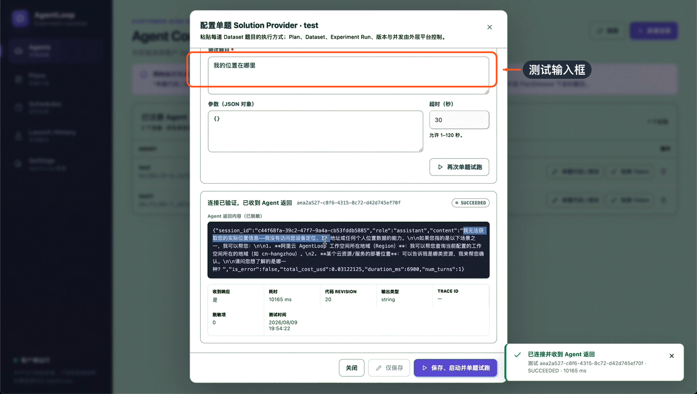

*图 7：单题测试：验证本地 Agent 连通（视频 38:38）*

Agent 正常响应（『我无法获取您的实际位置信息』），说明链路打通。本地访问延时较高是正常的，等一等没关系，连通即可发起实验。

## 三、定时调度与 Launch History

单次实验验证改动效果，<strong>定时调度</strong>则把回测变成日常：演示中把实验配成<strong>每 5 分钟调度一次</strong>——选择对应的实验计划、起一个调度名字（比如"每五分钟回归一次"）、设置周期和间隔、选择目标 Agent，即可创建定时任务（生产环境通常配每天回归）：

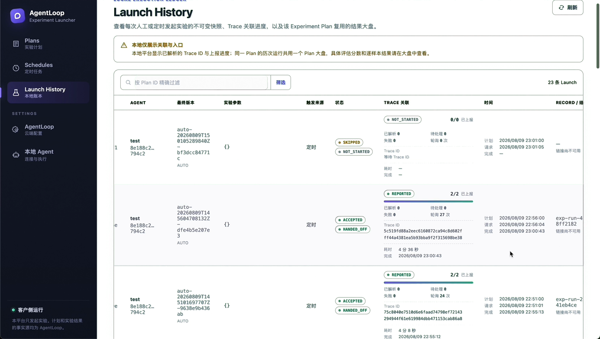

*图 8：Launch History：定时调度触发记录（视频 43:41）*

在 <strong>Launch History</strong> 里可以看到每一次触发记录（例如 51 分、56 分各触发一次），并且本地平台与 AgentLoop 控制台（平台侧）的数据是同步的——两边看到的实验记录一致。

回测结果直接在实验记录里看。演示中两道题的得分分别是 <strong>0.25</strong> 和 <strong>0.5</strong>（满分 1）：第一题『AgentLoop 有哪些功能』的回答缺了 Rubric 要求的多项能力点，只拿了 0.25；第二题『AgentLoop 如何做评估』回答相对完善但仍有多个 Rubric 项未命中，拿了 0.5。评估结果里能看到多次评估的趋势——多次评估之间有浮动，看均值更客观；还能看到评估过程用了哪些 Rubric、逐项检查命中了什么、缺了什么。分数低不是坏消息，它精确指出了下一轮调优该补什么。

## 四、实验大盘与分数分析

每个实验计划都会自动创建一个<strong>实验大盘</strong>：

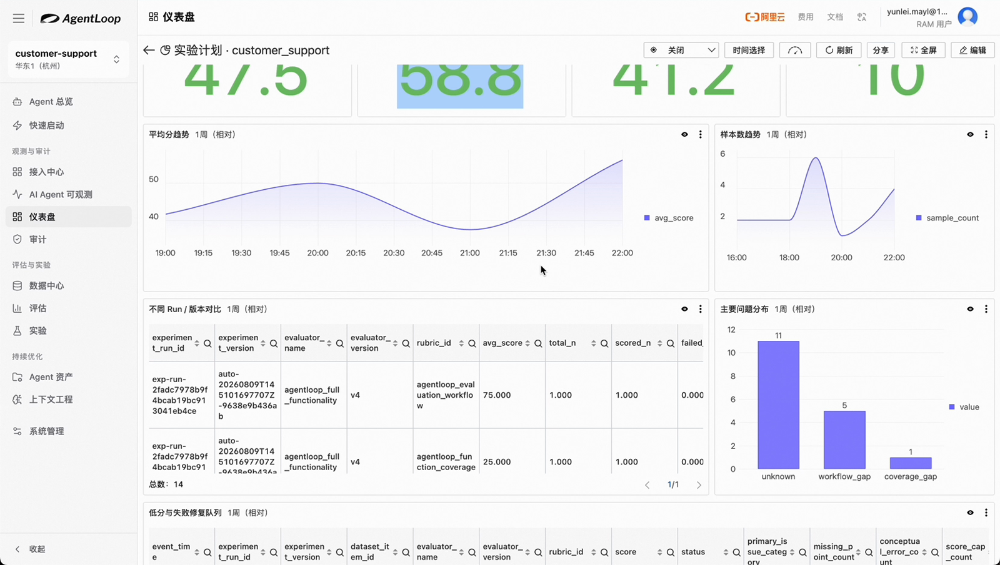

*图 9：实验大盘：整体分数与变化趋势（视频 44:34）*

大盘提供：整体分数、分数变化趋势、明细，还可以<strong>按题目下钻</strong>查看单题的分数变化——直观感知对 Agent 的优化有没有效果。每天回测一次，分数变低立刻可见；调优完之后立刻测一遍，改进也立刻可见。

为了消除单次评估的浮动，可以<strong>按时间窗口计算均值</strong>（比如 1 小时或 5 分钟一个窗口）：

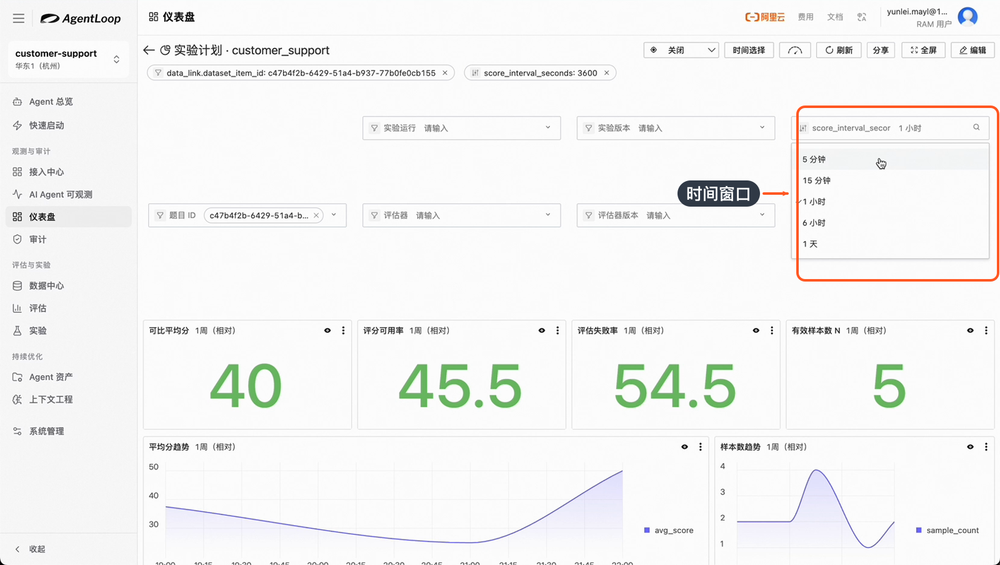

*图 10：按时间窗口计算均值（视频 45:13）*

分数分析有一套方法论，值得记住：
- <strong>分数变低要及时关注</strong>：这可能是 Agent 真的退化了；
- <strong>先排查 Rubric 定义</strong>：如果同一个版本多次评估分数不稳、频繁波动，多半不是 Agent 变了，而是 Rubric 定义模糊——标准不清楚，分数自然飘。这时要优化评估器的 Rubric；
- <strong>再看版本差异</strong>：确认评估器没问题之后，如果同一版本内分数稳定、不同版本之间有差异，那才是版本带来的真实差异。

这套排查顺序避免了最常见的误判：把"尺子不准"当成"东西变差"。

## 五、题目级 Rubric：一个关键实践

流程跑通之后，演示回过头做了一个重要的优化。背景是：

从线上现场抓 badcase 时，用户问题非常发散，没法定一个具体的 Rubric 来判定回答好坏——所以在线评估用的是通用标准。但实验不一样：badcase 抓出来之后，我们<strong>知道了具体的用户问题</strong>。两道题——『如何做评估』和『有哪些功能』——的评估标准其实并不相同。如果用同一套 Rubric 评两道题，优化时就会失去方向，因为每道题该达标的点根本不一样。

演示里最初为了简化快速接入，把两道题的 Rubric 写在了同一个评估器里——这种写法对实验并不友好。理论上的正确做法是<strong>把 Rubric 定义到题目级别</strong>，每道题绑定自己的评估标准：

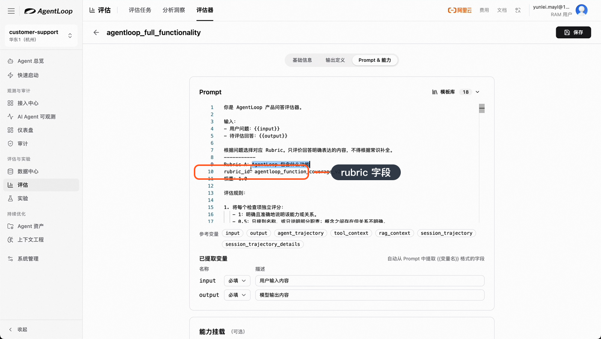

*图 11：题目级 Rubric：按题目绑定评估标准（视频 48:07）*

具体做法分四步：
1. <strong>整理每道题的 Rubric</strong>：把题目 A 的 Rubric 复制出来，它包含每一项功能的细项、单项判定、概念边界、扣分项；题目 B 同理；
2. <strong>数据集 schema 加列</strong>：数据集的 schema 里原本没有 rubric 字段，在<strong>字段管理</strong>里加一列 <strong>rubric</strong>（<strong>text</strong> 类型），保存 schema，然后把每道题的 Rubric（评分规则、原子能力、计算公式）分别写进对应题目；
3. <strong>评估器改造</strong>：给评估器新增一个 <strong>rubric 变量</strong>，让评估器按传入的 Rubric 评估，并输出合法的 JSON——包含 rubric\_id、score、reason、item\_scores 等字段；
4. <strong>实验侧绑定</strong>：实验配置里的 Rubric 选项，改为从 dataset 的 Rubric 读取。

改造之后，每道题按自己的标准被评估，实验分数才真正有指导意义——哪道题低分，就补哪道题对应的能力点。

## 六、小结

| 环节 | 关键点 |
|------|---------|
| 实验计划 | 数据集 \+ 评估器 \+ 变量映射（内置变量 ↔ dataset 字段），可加版本号等自定义变量 |
| 离线实验平台 | 部署客户内网；AgentSpace/region/AK·SK 配置；连接本地 Agent |
| 调用代码 | 有状态 Agent 先建 Session 再发消息 |
| 定时调度 | 每 5 分钟/每天回归；Launch History \+ 平台侧同步 |
| 实验大盘 | 总分、趋势、窗口均值、按题目下钻 |
| 分数方法论 | 分数低先查 Rubric 定义，稳定后再比版本差异 |
| 题目级 Rubric | rubric 绑定到数据集题目，评估器输出结构化 JSON |

---

<strong>下一篇预告</strong>：手工调优闭环跑通了，最后一块拼图是"全自动化"：经验库从历史轨迹中自动挖掘经验资产，Agent 装个 Skill 就能召回。效果如何？消融实验见分晓——[详见第 5 篇](./07%20AgentLoop%20%E6%95%B0%E6%8D%AE%E9%A3%9E%E8%BD%AE%E5%AE%9E%E8%B7%B5%EF%BC%88%E4%BA%94%EF%BC%89%EF%BC%9A%E7%BB%8F%E9%AA%8C%E8%87%AA%E8%BF%9B%E5%8C%96%EF%BC%8C%E8%87%AA%E5%8A%A8%E6%8C%96%E6%8E%98%E7%BB%8F%E9%AA%8C%E8%B5%84%E4%BA%A7%EF%BC%8C%E6%B6%88%E8%9E%8D%E5%AE%9E%E9%AA%8C%E9%AA%8C%E8%AF%81%E7%9C%9F%E5%AE%9E%E6%94%B6%E7%9B%8A.md)。
