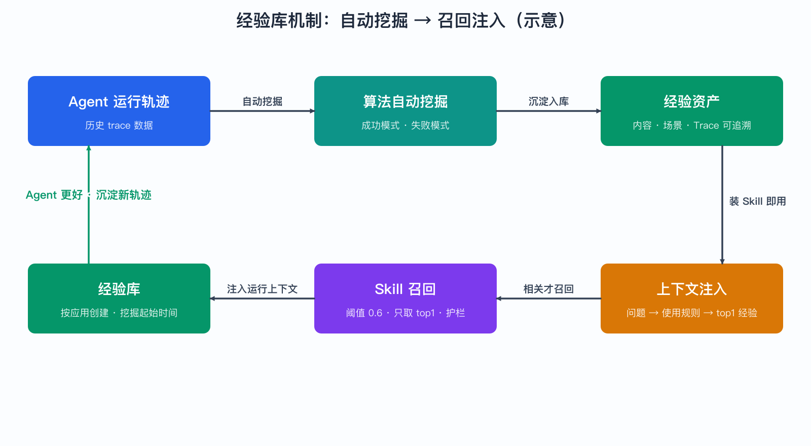
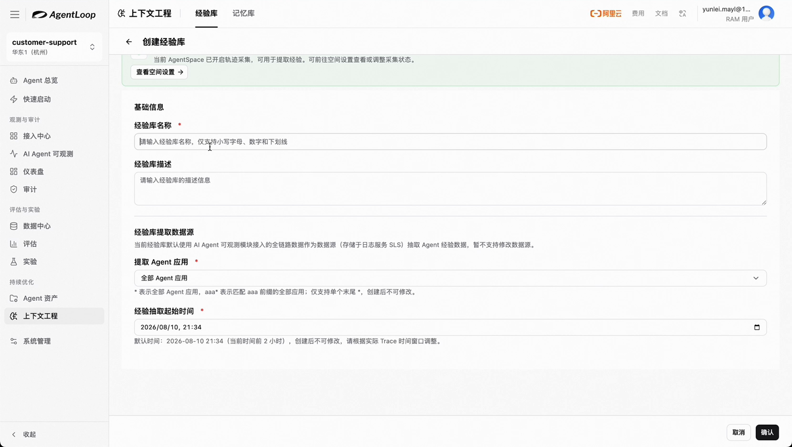
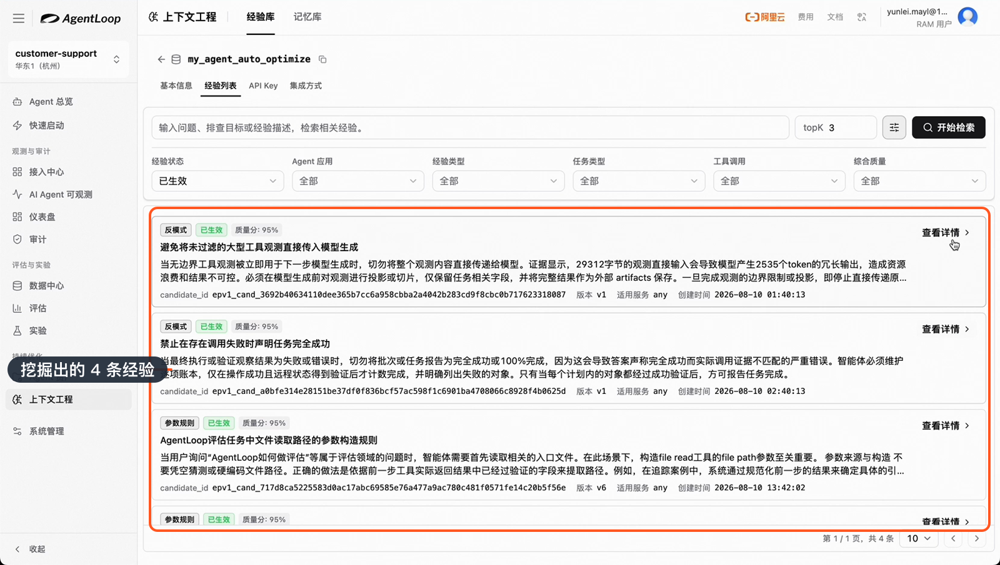
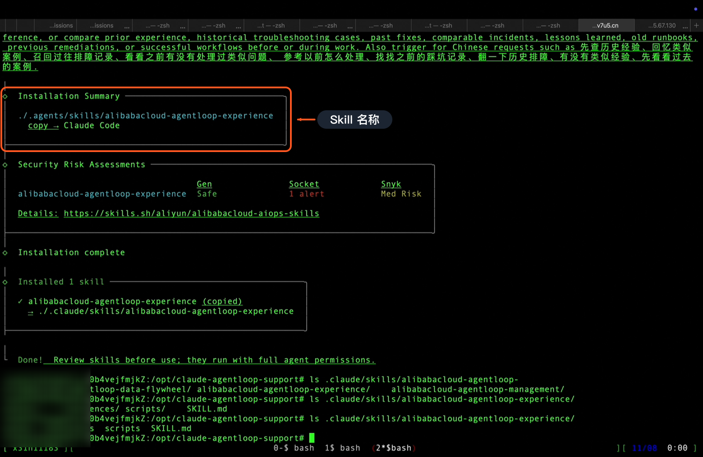
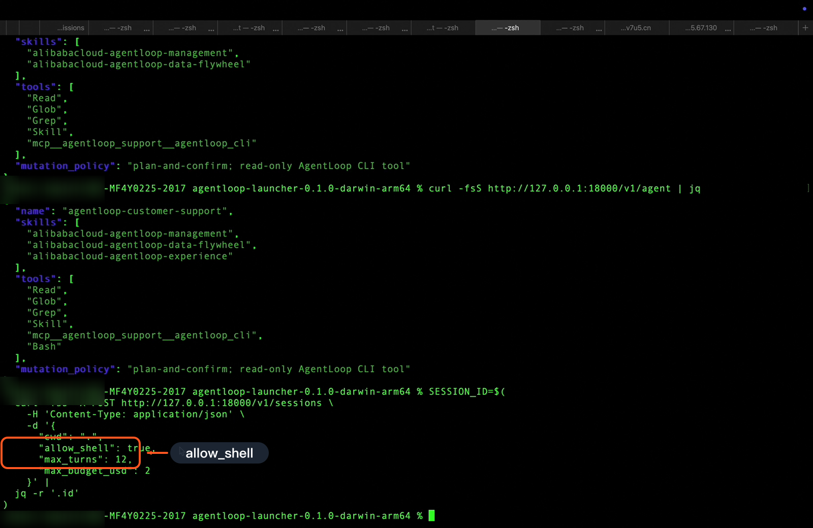
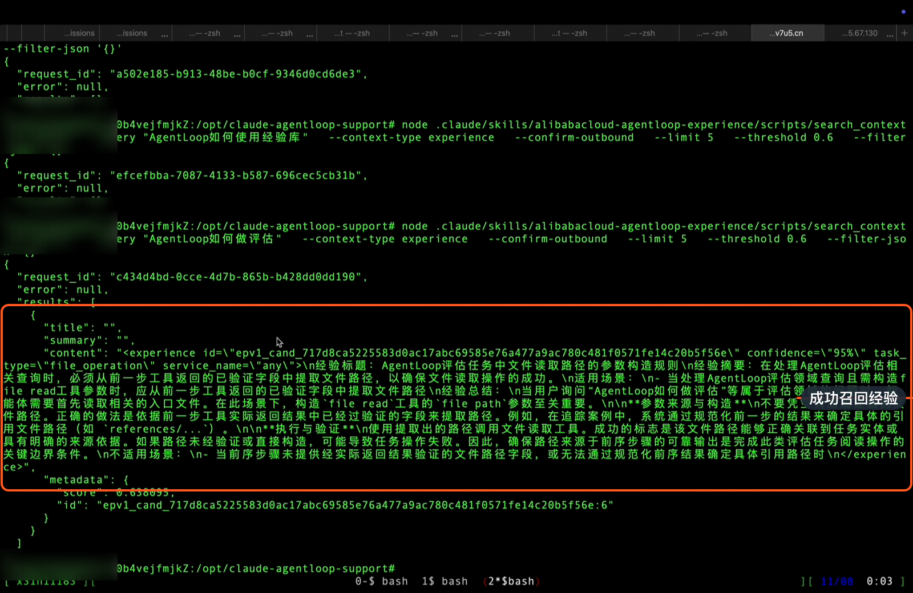
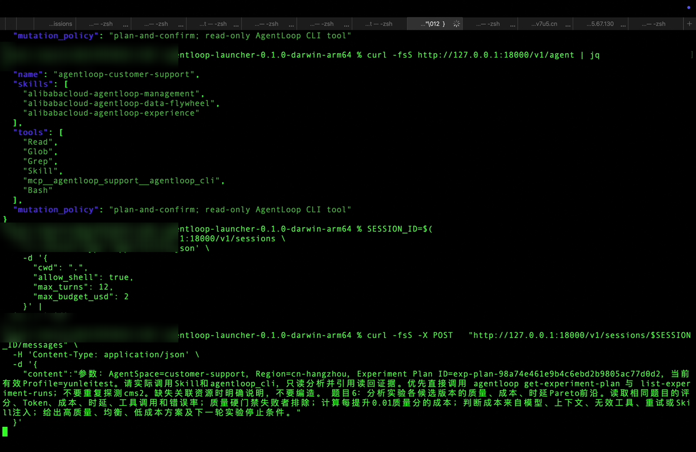
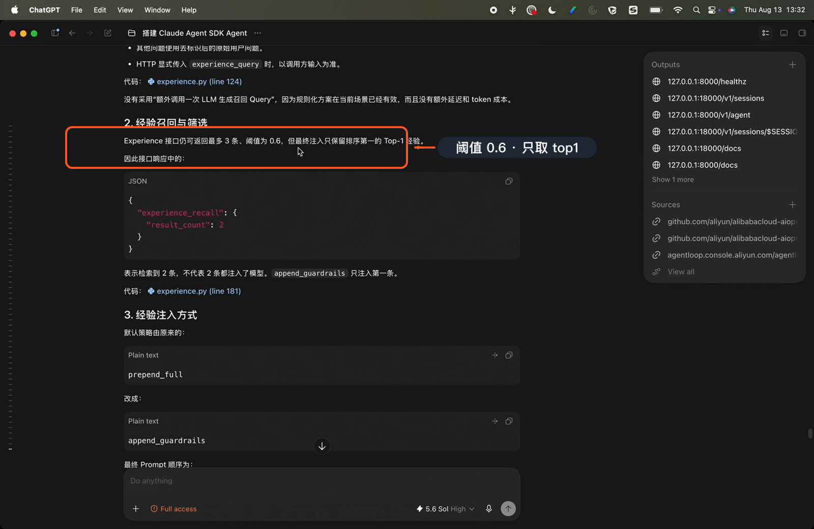
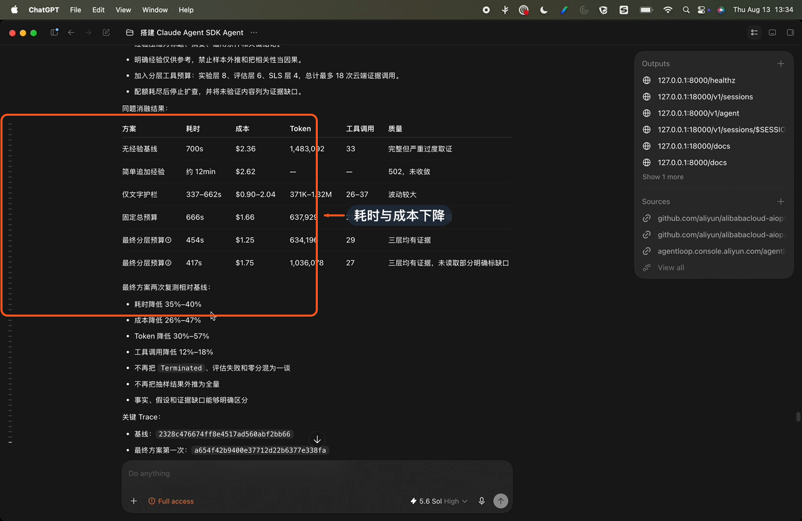
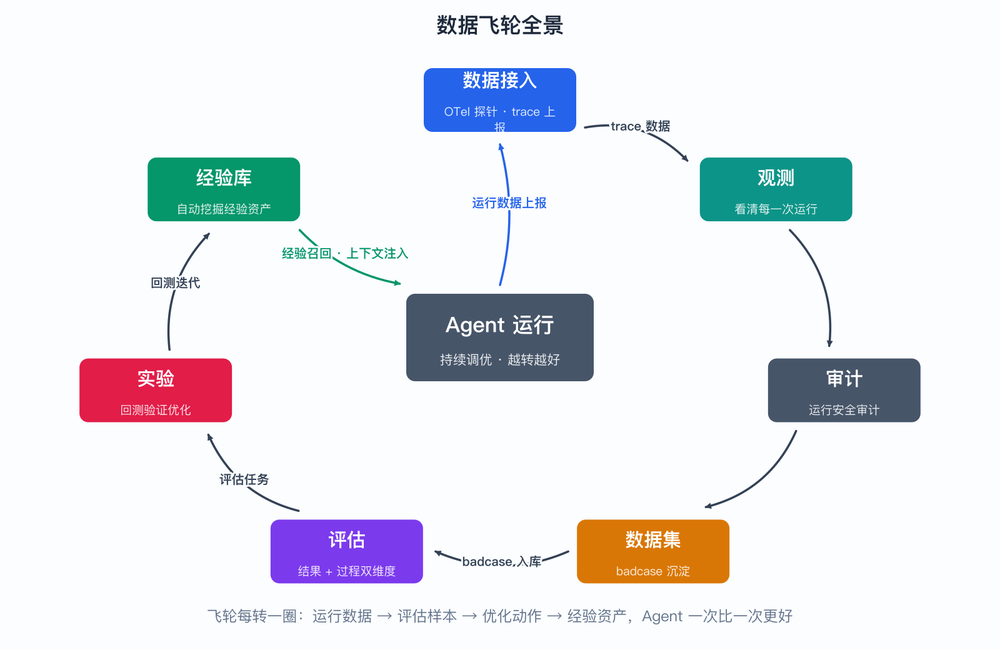

# AgentLoop 数据飞轮实践（五）：经验自进化 —— 自动挖掘经验资产，消融实验验证真实收益

> <strong>AgentLoop 数据飞轮实践系列</strong> · 第 5 篇 / 共 5 篇\
> 上一篇：[实验 —— 回测与离线实验平台](./06%20AgentLoop%20%E6%95%B0%E6%8D%AE%E9%A3%9E%E8%BD%AE%E5%AE%9E%E8%B7%B5%EF%BC%88%E5%9B%9B%EF%BC%89%EF%BC%9A%E5%AE%9E%E9%AA%8C%20%E2%80%94%E2%80%94%20%E5%9B%9E%E6%B5%8B%E3%80%81%E7%A6%BB%E7%BA%BF%E5%AE%9E%E9%AA%8C%E5%B9%B3%E5%8F%B0%E4%B8%8E%E9%A2%98%E7%9B%AE%E7%BA%A7%20Rubric.md) ｜ 系列总览：[总览 —— 让 Agent 持续调优的闭环](./03%20AgentLoop%20%E6%95%B0%E6%8D%AE%E9%A3%9E%E8%BD%AE%E5%AE%9E%E8%B7%B5%EF%BC%88%E4%B8%80%EF%BC%89%EF%BC%9A%E6%80%BB%E8%A7%88%20%E2%80%94%E2%80%94%20%E8%AE%A9%20Agent%20%E6%8C%81%E7%BB%AD%E8%B0%83%E4%BC%98%E7%9A%84%E9%97%AD%E7%8E%AF.md)

前四篇走通了"人类专家驱动"的调优闭环。这一篇是数据飞轮的最后一块、也是最自动化的一块：<strong>经验库</strong>——让 Agent 从自己的历史运行中自动沉淀经验，越跑越好。最后，我们用消融实验回答一个关键问题：经验注入到底有没有用、怎么用收益最大。

## 一、经验库是什么

经验库的核心机制：<strong>算法自动从 Agent 的运行轨迹中挖掘成功模式和失败模式</strong>，沉淀成经验资产。

它建立在一个朴素的观察上：Agent 的每一次运行，都应该为后续的运行积累经验。同一个坑，第一次踩了可以原谅，第一百次还踩就是浪费。经验库做的事就是把"踩坑"和"走通"的历史变成可复用的知识：成功的模式告诉 Agent 该怎么做，失败的模式告诉 Agent 别怎么做。经验以<strong>上下文注入</strong>的方式进入 Agent 的运行过程，让 Agent 越跑越好。

经验库挖掘的是通用 Agent 领域的常见优化手段：各种工具调用的执行情况、延时、执行准确率、执行路径等通用场景。这些维度不依赖具体业务，任何 Agent 都在反复遇到。

*图 1：经验库机制：从运行轨迹自动挖掘经验，经 Skill 召回后注入 Agent 上下文*

## 二、开启经验库与自动挖掘

前提是数据接入已经完成（见第 2 篇）——没有轨迹数据，挖掘就是无米之炊。然后创建经验库：选择对应的应用、命名、设置<strong>挖掘起始时间</strong>——起始时间设得早一点，可以挖掘更多轨迹：

*图 2：创建经验库：选择应用与挖掘起始时间*

挖掘完成后可以看到结果。演示中挖出了 <strong>4 条经验</strong>，每条经验可以看到经验的内容、适用的场景，以及它来自哪条 Trace，全程可追溯——经验不是黑箱里蹦出来的结论，每一条都能回查它的出处，这在后面调优排障时非常重要：

*图 3：挖掘结果：4 条经验及经验内容*

## 三、Agent 集成：一个 Skill 完成召回

要让 Agent 用上经验，需要在 Agent 侧做集成。整体思路是：给 Agent 装一个经验召回的 Skill，Agent 运行到这个 Skill 时，自动从经验库里检索相关经验并注入上下文。步骤如下：
1. <strong>创建 API Key</strong>，用 API Key 的方式完成配置——这是 Agent 访问经验库的凭证；
2. <strong>安装 Skill</strong>：`alibabacloud-agentloop-experience`，进入 Agent 的目录下执行安装命令：

*图 4：安装 alibabacloud-agentloop-experience Skill*

3. 把经验库信息写进 env 配置，让 Skill 知道去哪个经验库检索；
4. 让 Skill 生效还有两个权限条件：
    - Skill 要加入 Agent 的<strong>白名单</strong>；
    - 经验召回需要调用一个 <strong>shell 命令</strong>，所以要打开 <strong>Shell 权限</strong>；新建会话时还要 <strong>allow shell</strong>，允许这个会话使用 shell 指令：

*图 5：打开 Shell 权限并 allow shell*

权限这一步容易漏：白名单、Shell 权限、allow shell 三者缺一，召回就不会发生。

### 召回验证

集成完成后，向 Agent 提问『AgentLoop 如何使用经验库』『当前经验列表里有哪些内容』，可以看到经验被成功召回：

*图 6：召回验证：向 Agent 提问并成功召回经验*

注意召回是有判断的：与经验相关的问题会召回对应经验；<strong>没有类似经验时不会召回</strong>——这个"宁缺毋滥"的设计很关键，它防止无关甚至错误的经验误导 Agent。

### 直观对比

换一个 Session ID 重新发起同一个请求，对比执行过程：这个请求之前要走 <strong>12 步左右</strong>，注入经验之后步骤显著减少——经验让 Agent 绕过了试错环节：

*图 7：更换 Session ID 重新发起，对比执行步骤*

## 四、消融实验：找到最佳注入策略

看到步骤减少先别急着上线。通用优化手段之外，真实业务总有自定义需求——经验的注入方式（召回多少、放在哪、怎么呈现）会直接影响效果，甚至可能帮倒忙。为了<strong>严格保证经验注入之后是正向作用</strong>，真正部署前要做召回测试，找到最佳策略。演示中以<strong>无经验作为基线</strong>，做了一轮消融实验：

*图 8：消融实验：召回阈值、注入条数等策略对比*

要调的参数包括：
- <strong>召回阈值设为多少</strong>：阈值 1 表示最相似，0 表示最不相似。阈值太高会漏召回，太低会召回噪声。最终选 <strong>0.6</strong>——一个"相对相似"的水位；
- <strong>注入几条经验</strong>：只返回 <strong>top1</strong>，只取最相似的一条。经验注入不是越多越好，多了会稀释注意力、挤占上下文；
- <strong>经验放在上下文的哪个位置</strong>：实测下来的顺序是——用户的真实问题 → 业务经验的使用规则 → 最后是 top1 经验。位置影响模型对经验的采纳程度；
- <strong>经验瘦身</strong>：经验内容只保留标题摘要、使用条件和关键结论，并限制字符个数——原始经验往往带着具体场景的冗余细节，瘦身后信噪比更高；
- <strong>防护护栏</strong>：说明经验只是<strong>历史参考</strong>，防止经验产生负面影响。经验来自过去，不一定适用于当前，护栏给模型留了"不照办"的余地。

每一个参数都是一次"注入经验 vs 不注入/换种注入"的对照——这正是消融实验的含义：逐个因素拆开验证，而不是笼统地说"加了经验会更好"。

## 五、最终收益

经过消融实验选定的策略（并删掉各种实验无关信息和内部标识符之后），相比基线：

*图 9：消融实验效果：耗时与成本对比基线显著下降*

| 指标 | 相比基线 |
|------|------------|
| 耗时 | <strong>降低 30%~40%</strong> |
| 成本 | <strong>降低 20%~47%</strong> |
| Token 消耗 | 大幅下降 |
| 工具调用 | 大幅减少 |

消融实验的价值有两层：它帮助我们<strong>找到最佳策略</strong>（阈值、条数、位置、瘦身、护栏的组合），并且<strong>证明经验注入在真实业务下有真实效果</strong>——不是理论可行，而是数字可查。演示里的数字属于演示场景，也建议每个使用者在自己的真实业务场景里做一遍召回率测试，找到属于自己的最佳策略。

## 六、系列回顾：飞轮转起来了

五篇文章走完了数据飞轮完整的一圈：

*图 10：数据飞轮完整一圈：接入 → 观测/审计 → 评估 → 数据集 → 实验回测 → 经验库 → 反哺 Agent*
- <strong>人类专家驱动模式</strong>（第 2~4 篇）：专家知识 → 黄金指标与 Rubric → 评估抓 badcase → 实验回测针对性调优；
- <strong>全自动化模式</strong>（本篇）：经验库自动挖掘 \+ Skill 自动召回，消融实验验证正向收益。

回头看，这个飞轮的每个环节都在回答一个问题：接入回答"发生了什么"，观测回答"细节是什么"，评估回答"做得好不好"，实验回答"改动有没有用"，经验库回答"怎么自动变得更好"。五个问题首尾相接，Agent 的每一次运行都同时是服务的输出和下一轮优化的输入。

Agent 上线不是终点。把运行数据变成评估样本，把评估结论变成优化动作，把历史轨迹变成经验资产——飞轮每转一圈，Agent 都比上一圈更好。这就是 AgentLoop 数据飞轮实践的全部要义。
