# AI Coding 全生命周期的企业级FDE工程实践

> **文档性质**：技术实践分享 
> **案例来源**：某国企数科公司「IPO 板块符合性对标平台」项目全生命周期复盘 
> **脱敏声明**：客户名称、人名、内部系统标识、业务数据已做脱敏处理；方法论、流程与量化指标均为真实项目还原 
> **适用读者**：正在或即将在企业中引入 AI Coding 的FDE、架构师、技术负责人、研发工程师

## 实践摘要

快速看懂本文的核心内容。忙碌的读者读完这一部分内容即可掌握全貌，后续章节是逐层展开说明的内容。

### 核心论点

**AI Coding 走进企业级交付的深水区，瓶颈已从"能不能生成"转移到"能不能对齐、能不能验证"。破局之道不是更强的模型，而是一套工程规范：以 Spec-Driven Development（规格驱动开发）为主线，用"三阶段·三产物·三闸门"把 AI 的高产出锁定在可追溯、可验收、可信的轨道上。**

### 结论分析

| 维度 | 内容 |
| --- | --- |
| **情境 (S)** | 一句话交办任务："把公司经营现状与各上市板块发行上市要求做符合性对比，输出可观测报表"。AI 让"从 0 到 1 生成文档与代码"变得极其便宜。 |
| **冲突 (C)** | 生成越快，失控风险越大：口径幻觉（一个 AND/OR 之差导致判定引擎结论相反）、跨文档不一致（一次业务决议牵动全链 25 处）、AI 误删核心功能页签、验证被夸大为"已通过测试"。AI 的高产出会同时放大正确与错误。 |
| **问题 (Q)** | 如何让 AI Coding 在**对可追溯性、合规性有强要求**的企业级场景中，既拿到效率红利，又不把风险带进生产？ |
| **答案 (A)** | Spec-Driven Development：需求(requirement)→设计(design)→任务(task) 三阶段结构化规格，每阶段设质量闸门，全链路编号可追溯，验证诚实分层。人从"执笔者"转为"基线守护者"。 |

### 关键成果看板

| 指标 | 数值 | 含义 |
| --- | --- | --- |
| 代码生成实现率 | **88.3%** | 达到进入联调门槛，AI 承担了近九成代码产出 |
| 整体完成度 | **97.4%** | 需求-设计-编码-联调全链的完成水位 |
| SRS 基线迭代 | **5 轮升版** (V1.0→V1.5) | 每一版都有评审输入与修订记录，非一次生成 |
| EARS 用户故事 | **120 条** | 全编号、可测试、与验收标准双向追溯 |
| PRD 联合评审 | **7 阻断 + 16 重要** | 一轮五角色评审拦下的问题，若在编码期发现均为数天返工 |
| 联调前静态拦截 | **13 个接口缺陷** | 文档-代码一致性排查提前发现，避免现场调试 |
| 团队规模 | **2 人小团队** | 完成以往多人项目工作量，但无法靠加人并行提速 |

### 三条核心建议

1. **把约束写进流程，而不是指望自觉**。Plan 前置审核、产出即校准、验证真实性、质量门即停不绕过——这些规则是 88.3% 实现率的真正来源，而非运气。

2. **为 AI 设计基础设施，而不只是给 AI 提要求**。人工预验证环境、Mock 免登开关、结构化输入锚点、模板代码示例——AI 的作业质量上限，由它所处环境的确定性决定。

3. **承认并划定 AI 的能力边界**。展示型模块（数据大屏）不做端到端交给 AI，复杂业务口径必须领域专家背书。找到边界不是保守，而是让 AI 的强项充分发挥。

## 第一部分　背景与方法论总纲

### 1. 引言：AI Coding 的真问题不在"代码生成"

提及 AI Coding，多数讨论聚焦于代码补全、函数生成、单元测试编写。但当我们把 AI 真正放进一个企业级交付的完整流程后，得到一个反直觉的结论：

**生成从来不是瓶颈，"对得齐"才是。**

原因并不复杂。编码阶段的问题大多是局部的、可验证的——测试跑不过、编译报错，反馈链路以秒计。而需求-设计阶段的问题都是系统性的：口径歧义、跨文档不一致、业务规则遗漏、依赖信息缺失等。这些问题一旦流入编码阶段，返工成本会放大一个数量级。传统模式下，这个阶段高度依赖资深人员的经验与责任心，恰恰是最难标准化、最容易"带病流转"的环节。

AI 的介入没有消除这个问题，反而放大了它——因为 AI 生成的产物"长得太像真的"：格式规范、编号完整、逻辑自洽，只有对照原始材料逐条核验才能发现偏差。**当产出的边际成本趋近于零，质量的边际成本反而成了主要矛盾。**

本项目全程以 AI 作为主要作业工具，人负责决策与评审，完整走过了需求→设计→任务→编码→测试→联调部署→复盘的全生命周期。本文以金字塔结构逐层展开：先给结论（内容摘要），再讲方法论总纲（第一部分），然后深度解析六个阶段的实践（第二部分），最后落到组织、度量与推广（第三部分）。

### 2. 项目全景：一个案例，两代产物

**任务起点**：老板一句话交办——将公司经营现状与各上市板块（沪深主板/科创板/创业板/北交所）的发行上市要求做符合性对比分析，输出可观测报表。从这一句话到可指导开发的完整基线，中间隔着 SRS、用户故事、详细设计、开发规范、高保真原型、代码、测试、部署一长串交付物。

**业务复杂度**：四个上市板块 × 多套财务/创新/合规标准 × 数十项指标要素（56 个财务要素、27 个上行要素，收敛为 43 项内置指标），且存在多层 AND/OR 嵌套的条件组（北交所某标准嵌套达 4 层）。这类"规则密集 + 强合规 + 可追溯"的业务，正是检验 AI Coding 工程化能力的理想场景。

**两代产物**：项目在实践中迭代出两代——一代"分析平台"（诊断引擎 + 评分推荐 + 报表导出）与二代"观测平台"（可观测报表 + 指标大屏 + 资格对比矩阵）。两代共享同一套方法论内核，本文以其完整演进为样本。

**交付物全景**：

| 阶段 | 交付物 | 规模/状态 |
| --- | --- | --- |
| 需求 | SRS（权威基线） | V1.0→V1.5 五轮升版 |
| 需求 | EARS 用户故事 | 120 条，八大模块码 |
| 设计 | 详细设计方案 | 12 章 + 3 附录，6 项关键设计决策 |
| 设计 | 前后端开发规范 SPEC | 对照真实源码校验后升版 |
| 设计 | 高保真原型 | 双视图 HTML，浏览器实测通过 |
| 编码 | 前后端业务代码 | 实现率 88.3% |
| 测试 | 测试用例 + 自动化验证 | 左移生成，验证三件套 |
| 部署 | Docker 编排 + UAT | 一键启动，去 Mock 切真 |

### 3. 方法论总纲：Spec-Driven Development

本项目的全部实践可归纳为一个方法论内核——**Spec-Driven Development（SDD，规格驱动开发）**：

先以结构化规格（需求→设计→任务）把"要做什么、怎么做、分几步做"固化下来，再驱动 AI 编码。目的是让 AI Coding 从"凭感觉生成"转为"照规格实现、可追溯、可验收"。

SDD 的骨架是**三阶段·三产物·三道闸门**：

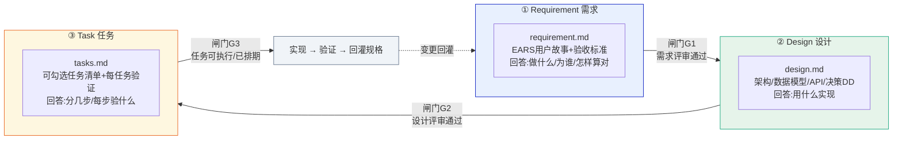

贯穿全程的**三条铁律**：

1. **单一基线**：requirement 是权威源；design/task 的变更若触及需求，必须回灌 requirement，不允许下游私自圆场。

2. **可追溯**：需求编号 → 设计条目 → 任务 → 验收/测试 全链路双向可追溯。

3. **闸门不放水**：每阶段产物过评审闸门才进下一阶段；带阻断项不进入编码。

### 4. AI Coding 全生命周期地图

SDD 三阶段主要覆盖"编码前"，而完整交付还要延伸到编码、测试、部署、复盘。下图是本项目实际走过的全生命周期流水线，也是第二部分的章节地图：

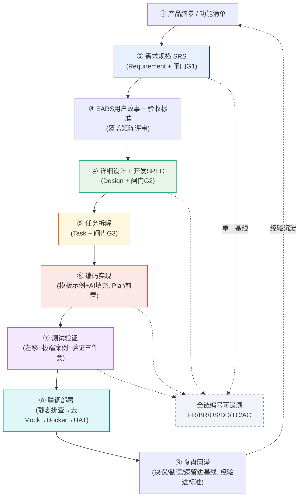

**经验**：AI Coding 不是"把提示词写好让 AI 多生成点代码"，而是一套有阶段、有闸门、有追溯、有回灌的工程体系。理解了这个总纲，才能理解后续每个阶段的规范为何必要——它们不是繁琐的形式，而是把 AI 的高产出转化为可信交付的"变压器"。

## 第二部分　六阶段实践深度解析

本部分是全文主体。每一阶段遵循统一的金字塔结构：**核心结论**（先行）→ **难点**（冲突）→ **最佳实践**（对策）→ **案例实证**（数据/事件）→ **经验**（提炼）。

### 5. 需求阶段：从一句话任务到受控基线

**核心结论**：AI 在需求阶段的幻觉不是"能力问题"，而是"输入结构问题"。与其反复提示 AI"不要编造"，不如用结构化锚点和权威源把编造的空间堵死。

#### 5.1 难点：AI 会"善意地编造"业务口径

让 AI 基于监管材料整理上市板块的财务指标阈值，它大概率能给出格式漂亮的表格——但个别数字可能是"合理推测"而非原文摘录。更隐蔽的是业务逻辑层面的偏差：

- **连接词之差，结论相反**：北交所创新性的组合条件，AI 曾按"AND"理解，而监管原文实际是"OR"。一个连接词的差异，会让整个判定引擎的输出完全相反。

- **自造公式**：AI 为符合性评分自造了一套加权公式，而业务真实需要的是"二元达标判定"（达标即满分，否则 0 分）。

- **分支混淆**：混淆了某板块标准一的 A/B 分支条件。

- **术语混用**："业务板块"与"上市板块"在上下文中被混用，指向不同层级。

需求阶段的幻觉之所以危险，是因为它**长得太像真的**——格式规范、编号完整、逻辑自洽，只有对照原始材料逐条核验才能发现。而需求是整条交付链的源头，此处的偏差会被下游逐级放大。

#### 5.2 最佳实践：用"锚点 + 权威源 + 留白"堵住编造空间

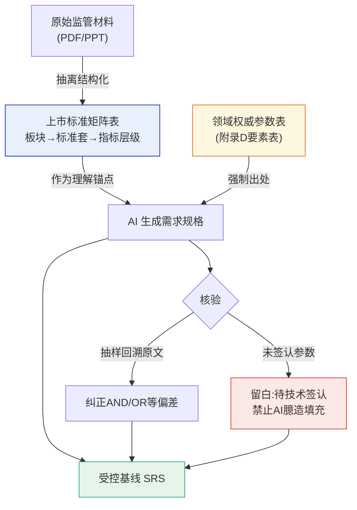

**实践 1：结构化输入约束理解。** 不把原始 PDF 丢给 AI 让它自由发挥，而是先把关键业务材料抽离成结构化表格（本项目是"上市标准矩阵"：板块→标准套→指标三层结构），作为 AI 理解业务的锚点。56 个财务要素、27 个上行要素全部进入受控的要素表，AI 在锚点上工作，而非在模糊原文上"想象"。

**实践 2：要素级权威源 + 强制出处。** 建立唯一权威附录，每个要素强制携带"源材料原文 + 条件组 + 指标编码 + 阈值 + 出处页码"，并声明**生效顺序**——正文与附录冲突时以附录为准。这让每个业务参数都可回溯到原始出处，幻觉无处遁形。

**实践 3：留白纪律。** 尚未获得签认的参数（性能指标、并发规模、RPO/RTO）一律留白标注"待技术签认"，明令禁止 AI 臆造填充。

**宁可文档有遗漏，也不可出现文档有假。** 有遗漏可以后续补，有假会带问题流入生产。

**实践 4：上游歧义回提，不在下游消化。** AI 或评审发现 SRS 有歧义时，走"确认→勘误→升基线"流程，不在详设、代码里擅自解释圆场。衍生物私自消化歧义，是一致性腐化最常见的起点。

**实践 5：AI 补全需人工裁剪。** 一个容易被忽视的反向问题：让 AI 模拟用户行为审查 PRD、补全场景遗漏时，它会"过度补全"——把本不需要闭环的场景也画上闭环（如给 MVP 阶段补全完整的版本化管理）。**AI 找遗漏很强，但取舍必须人来决策。**

#### 5.3 案例实证：EARS 用户故事的产出即校准

需求细化阶段用 EARS（Easy Approach to Requirements Syntax）句式生成用户故事，把模糊诉求转成无歧义、可测试的规格。EARS 的五种句式：

| 类型 | 模板 | 用途 |
| --- | --- | --- |
| 普遍型 | 系统应〔动作〕 | 恒定行为 |
| 事件驱动 | 当〔触发〕时，系统应〔动作〕 | 响应事件 |
| 异常型 | 如果〔异常条件〕，则系统应〔处理〕 | 异常兜底 |
| 状态驱动 | 在〔状态〕下，系统应〔动作〕 | 状态相关行为 |
| 可选型 | 当〔功能可用〕时，系统应〔动作〕 | 特性开关 |

生成 120 条用户故事后，团队执行"产出即校准"：用脚本清点条目数、编号连续性、模块分布，与汇总表交叉核对——**发现旧统计表少计了 5 条**（115→120），当轮勘误并在修订记录注明来源。这就是"机器清点不靠目测"的价值：人工目测"差不多 115 条"会放过这个偏差，脚本清点则精确捕获。

#### 5.4 总结

需求阶段对 AI 的正确使用方法，不是"让 AI 多写点"，而是"给 AI 一个不能编造的工作环境"。结构化锚点、权威源出处、留白纪律三者叠加，把 AI 的创造力约束在事实边界内。这个阶段有一句团队原话值得铭记：**"PRD 里一个字的描写有差异，都会直接导致后面的结果偏差被放大。"** AI 时代需求文档的重要性不是下降了，而是上升了——因为它现在是机器直接消费的"源代码的源代码"。

### 6. 设计阶段：跨文档一致性是最大的系统性风险

**核心结论**：设计阶段的交付物是一张网而非一条线。AI 单点修改能力极强，但不会自动知道"还有哪些地方引用了旧口径"。解决之道是采用"单一基线 + 先源头后衍生 + 全库定位"的变更控制。

#### 6.1 难点：一次决议，全链联动

SRS 改一个评分规则，用户故事、详细设计、DDL、权限种子数据、API 定义、前端页面、测试用例、原型 mock 数据全都要联动。本项目"评分二元化需求"一次业务决议，仅详细设计一份文档就有**约 25 处**引用需要回灌。若靠记忆或"顺手改掉"，几乎必然遗漏，且遗漏是静默的——直到联调或上线才暴露。

#### 6.2 最佳实践：受控的变更回灌

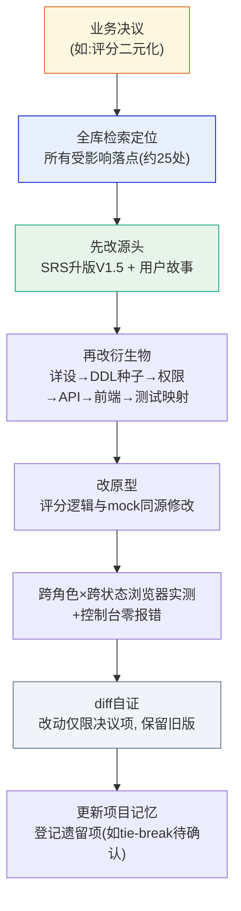

- **单一基线**：确立 SRS 为唯一权威基线，所有衍生物声明自己的基线版本（"本文档基于 SRS V1.5"）。

- **先源头后衍生**：严格按 SRS/用户故事 → 详设 → DDL → 原型 的顺序修改，绝不反过来在下游"顺手改掉"。

- **全库定位**：修改前先用全文检索（Grep）定位所有受影响落点，形成清单再逐一修改，而非凭记忆。

- **diff 自证**：每次升版保留旧版文件 + diff，改动是否越界一目了然。

**版本治理的一个细节**：本项目采用"文档内版本号与文件名解耦"——一代 SRS 文件名标注 -V1.4.md 但内含 V1.5，历史版本独立留存。这让版本演进连续可查，不因文件名变更而断裂。

#### 6.3 最佳实践：两个设计阶段的实用做法

**做法一："执行用详设、归档含概设"双轨文档。** AI 生成详设时受输出长度限制，一次生成 12 章大文档会截断；且写到后半部分时，前文的编号约定、口径定义开始漂移（长上下文衰减）。对策：大文档**分章生成追加**，每章生成前先通读全部上游；把"给 AI 执行用的详设"和"给人审计用的含概设版本"分开维护，兼顾生成精度与合规要求。

**做法二：SPEC 以真实源码为准。** 编写开发规范时，AI 依据的往往是 README 或历史印象，而脚手架实际版本、依赖清单、包名约定可能早已变化。本项目通过代码仓库 API 直接抓脚手架配置、依赖清单、目录树、关键类源码，逐条比对 SPEC 声明，校验结论用分级表呈现：

| 标记 | 含义 |
| --- | --- |
| ✅ 一致 | 文档声明与真实源码相符 |
| ⚠ 已修正偏差 | 发现不符，已据实修正并标注采集日期与来源路径 |

据此修正了包名、FeignClient 命名、依赖清单等多处偏差，还发现了文档从未覆盖的真实依赖（Lombok、knife4j、flowable 等）。**规范的生命力在于它描述的是"真实"，而不是"应该"。**

#### 6.4 最佳实践：角色化联合评审——AI 时代的质检不能省

不同阶段配不同评审团，在提示词里显式赋予角色和评审标准，产出物是"问题清单（严重度/角色/位置，分阻断/重要）+ 覆盖矩阵"，而不是一句"看起来不错"。

| 评审 | 对象 | 评审团 | 产出 |
| --- | --- | --- | --- |
| PRD 联合评审 | SRS V1.1 | 产品/架构/高管/财务/开发 | **7 阻断 + 16 重要**，闭环后升 V1.2 |
| EARS 故事评审 | 故事×SRS | 业务/需求分析/架构/测试/安全 | 覆盖矩阵 + 问题清单 F1~F4 → SRS 勘误 |
| 业务联合评审 | SRS×故事 | 业务合议 | 评分二元化，回灌全链 |
| 统一方案复核 | 观测平台 SRS | **只读子代理独立复核** | 12 项规则闭环，修复 1 项高严重度不一致 |

其中"只读子代理复核"是 AI 时代的质检创新：让另一个只有读权限的 AI 会话做独立复核，与主作业会话形成**写审分离**。本项目二代 SRS 升版时，正是子代理复核发现了一处高严重度规则遗漏（否决优先条件缺失，会导致判定结果错误落位），当轮修复。子代理天然不会越界改文件，复核结论更客观。

评审还有一条诚实性纪律：**区分"文档核验"与"系统测试"**。只读一致性核对不能表述为"已通过测试"，未执行的验证层级必须显式标注。AI 倾向于给积极结论，验证的诚实性要靠流程强制，不能靠自觉。

#### 6.5 总结

设计阶段的价值不在"AI 写得快"，而在"变更可证明完整"。单一基线让每个衍生物知道自己该对齐谁，先源头后衍生让变更有序不遗漏，全库定位让影响面无死角，diff 自证让越界无处藏身。**AI 让"改"变得极其便宜，于是"改哪里、按什么顺序改、改到什么边界"就成了新的稀缺能力。**

### 7. 任务阶段：把设计翻译成 AI 可执行的实施方案

**核心结论**：任务阶段是 SDD 从"文档"走向"代码"的关键转换层。一个好的任务清单，本身就是一份"为 AI 写的施工组织设计"——它决定了 AI 编码的边界、顺序与验收标准。

#### 7.1 难点：从设计到代码的"最后一公里"最容易失控

设计文档写得很完备，但直接让 AI"照着实现"，往往出问题：AI 不知道先做哪个、每个改动的影响边界在哪、做完怎么算验证通过。结果就是要么一次改太多引入冲突，要么"报告成功"但实际没跑验证。

#### 7.2 最佳实践：任务拆解的四要素

把设计拆成可独立执行、可验证、有序的任务清单。每个任务必带四要素：

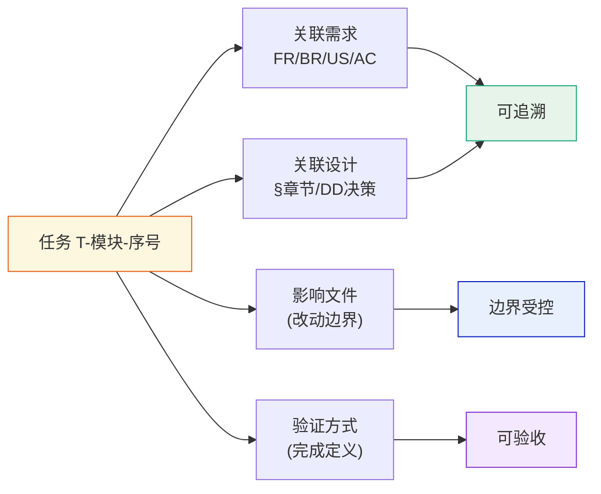

- **粒度**：一个任务 = 一个可独立提交、可独立验证的最小工作单元。过大必拆，过小合并。

- **依赖显式化**：用 blockedBy 标出顺序；能并行的标注可并行。

- **可勾选**：checkbox 形式，状态 pending→in\_progress→completed，未验证通过不得标完成。

#### 7.3 最佳实践：每个任务必带"验证方式"（关键）

任务完成的定义 = 代码写完 **且** 验证通过。验证分三层，按任务类型选用：

| 层 | 手段 | 适用 |
| --- | --- | --- |
| 静态 | lint / typecheck / build / 语法校验 | 所有代码任务 |
| 单元/接口 | 单测、接口用例、算例回归 | 逻辑/算法/API |
| 端到端 | **浏览器实测 + 控制台零报错**；跨角色×跨状态走查 | 前端/页面 |

#### 7.4 最佳实践：针对 AI 的风险对策表

这是任务规划中很少见但极其重要的一部分——专门为"AI 作为执行者"设计的风险管理：

| 风险 | 对策 |
| --- | --- |
| 单会话上下文过长导致遗忘约定 | **步骤间以设计文档为唯一记忆源，不依赖会话上下文** |
| 数据库迁移脚本冲突 | 单写者约定，迁移脚本只由当前步骤生成 |
| 工具链缺失导致静默跳过测试 | 即停不绕过，缺什么装什么 |
| 实现与设计冲突 | **先改设计文档再改代码，不允许改代码绕过设计** |

最后一条是整个 Spec-Driven 的灵魂：设计文档是唯一契约源，代码与文档冲突时，解决方向永远是"文档先行升版"，而不是"代码悄悄跑偏"。

#### 7.5 总结

任务阶段把"AI 帮我写代码"升级为"AI 按施工图分步施工、每步验收"。它的本质是用工业化的方式组织 AI 的生产——先规划、再执行、步步验证。**没有任务层的约束，AI 编码就是"随机执行"；有了任务层，AI 编码才是"计划实施"。**

### 8. 编码阶段：给 AI 修护栏，而不是放开跑

**核心结论**：AI 编码失控的根源不是模型能力，而是缺乏"变更前置约束"。用 Plan 前置审核、模板代码示例、规范自查三道护栏，可以把"意外破坏"降到接近零。

#### 8.1 难点一：AI 改代码的"意外破坏"

编码实操中发生过一次典型事故：**AI 在修改代码时误删了核心功能页签**。单看是低级错误，但它揭示了结构性问题——AI 的修改范围感知基于上下文，而上下文是有损的；改动越大、文件越多，"顺带破坏"的概率越高。更麻烦的是这类破坏往往不报错，只在运行时表现为"某个入口不见了"。

#### 8.2 最佳实践：Plan MD 前置审核

从此立规：**AI 改代码前必须先产出一份 Plan 文档**——改哪些文件、每个文件改什么、不改什么——人工审核范围后才执行。

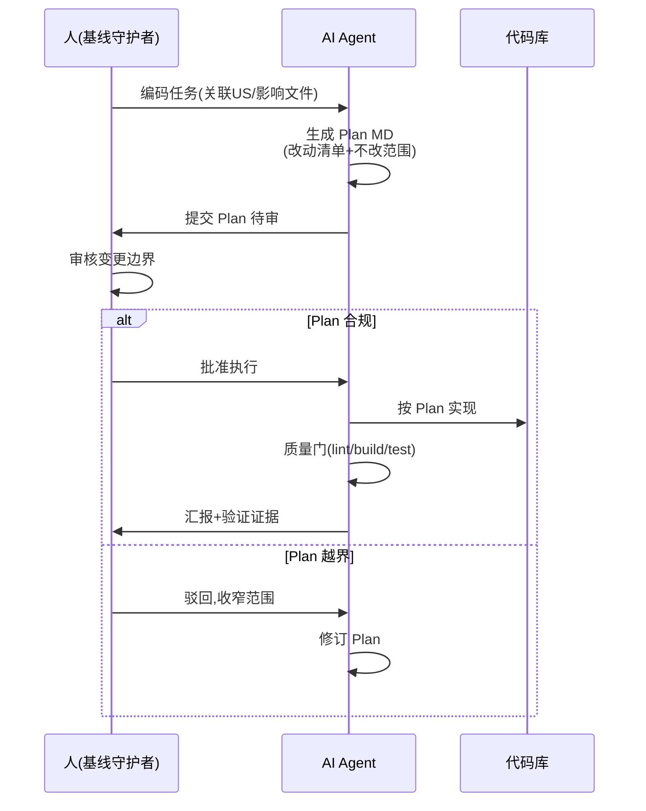

这相当于把"变更边界受控"从文档阶段延伸到代码阶段，成本极低（多一次确认），收益极高（误删类事故归零）。

#### 8.3 难点二：规范、模板、生成代码的三方冲突

团队有存量前端模板和编码规范（rules 文件），AI 生成代码时出现几类典型冲突：AI 引入的 CSS 写法违反规范（如 npm 引入 CSS 包）；旧模板遗留写法与规则文件互相矛盾；生成代码出现枚举拼写歧义（MET/MEET）、死代码（定义了枚举未使用）、文档声明与实现不一致（文档写分页对象 PageResult、代码返回 List+Total）。

#### 8.4 最佳实践："示例代码模板拷贝 + AI 填充"

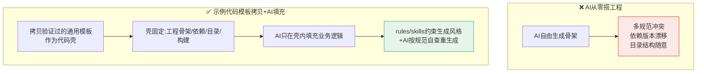

工程骨架、依赖版本、目录结构、构建配置全部来自模板，AI 的自由度被限制在业务实现层——多规范冲突问题大幅收敛。前端约定单一 UI 出口（禁用其他组件库直接引入）、单一 HTTP 出口；后端约定分层单向依赖、防腐层、错误码分段。这些约束写进 rules 文件，让 AI"照着规矩来"。

对这类"隐蔽问题"，团队有个很真实的心态记录：**"这种问题很隐蔽的……关关难过关关过。"** AI 生成代码的审查，重点不是逐行读，而是**验证功能行为 +核心逻辑实现 + 静态排查一致性**（枚举、命名、分页、接口契约）。

#### 8.5 最佳实践：前后端联动修改 + 务实的能力边界

**允许 AI 前后端联动修改**：只约束单端会导致接口不匹配的循环修改（前端改完对不上后端，后端改完又对不上前端）。让 AI 在同一次变更里协调两端接口契约，反而更稳。

**承认能力边界**：指标大屏（重展示、重视觉还原）形成了明确共识——**展示型模块不要让 AI 端到端负责视觉还原**。对策是"先人工锁定视觉样式定型，AI 只负责数据接口联调"，把 AI 用在它擅长的逻辑层，把它不擅长的像素级还原交还给人。功能性模块优先、展示型模块后置精调，成了模块排序的默认策略。

承认 AI 的边界不是保守，而是让 AI 的强项充分发挥。项目FDE的原话：**"它肯定不是万能的，一定要找到合适的边界……不到这个力度你是还原不出来的。"**

#### 8.6 总结

编码阶段的核心不是"让 AI 写得多快"，而是"让 AI 写得可控"。Plan 前置管住变更边界，模板壳管住工程一致性，能力边界管住投入产出。三道护栏的共同逻辑：**把 AI 的自由度约束在它擅长且可验证的范围内，剩下的交给人和模板。**

### 9. 测试阶段：左移、极端案例、诚实报告

**核心结论**：AI 时代测试用例的生成成本趋近于零，测试的价值重心从"写用例"转移到"设计可测性"和"保证验证诚实"。基础设施要为 AI 而设计。

#### 9.1 最佳实践：测试左移——用例与代码并行生成

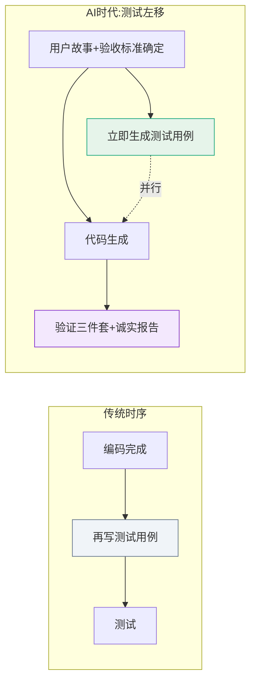

用户故事和验收标准确定后，测试用例立即生成，与代码生成并行推进；测试人员提前介入验收标准评审。一个有意思的细节：当用户故事有多个版本时，团队选择了**逻辑拆分更清晰的版本**作为测试用例生成基础——拆分清晰意味着每个故事可独立验证。**选型标准不是"写得好"，而是"可测试"。**

#### 9.2 最佳实践：极端案例法

业务规则测试选"最复杂 + 最简单"双向覆盖。本项目选北交所某标准（**4 层 AND/OR 嵌套**条件组）作为最复杂案例，配最简单案例，两端覆盖能暴露大部分边界逻辑问题。**测试数据请行业专家评审**——AI 可以生成用例，但用例的业务正确性要靠领域专家背书。

实践中也发现用例缺陷：AI 初版偏重失败场景、缺成功场景的正向验证，用 AI 结合 PRD 补全。**生成后必须做一次"正反覆盖"审查，这本身应进 checklist。**

#### 9.3 最佳实践：为 AI 测试而设计的基础设施

这是很少被讨论但极其重要的一层。AI 跑自动化测试时最大的干扰不是测试逻辑，而是**环境**。团队沉淀了三件基础设施：

| 基础设施 | 解决的问题 | 做法 |
| --- | --- | --- |
| 人工预验证环境 | AI 陷入环境调试死循环 | AI 测试前，人工先在专用电脑把前后端完整跑通一遍 |
| Mock SSO 免登 | 端到端测试依赖真实集团鉴权 | 开发期提供 Mock SSO，模拟两个角色账号，测试不依赖真实登录 |
| 浏览器插件图形化测试 | UI 用例难以稳定自动执行 | 插件读取页面结构，按用例自动输入、点击、验证，替代脆弱的手工点击 |

人工预验证环境的原因很实际——团队原话：**"环境是个比较大的问题，它一测发现环境有问题就去处理环境问题，正式任务完不成。"** 环境问题会让 AI 把测试会话烧在装依赖、修配置上。**环境确定性是 AI 测试的前置条件，不是 AI 的责任。**

#### 9.4 最佳实践：验证三件套 + 诚实的测试报告

前端与端到端验证统一走"验证三件套"：① 浏览器实测（覆盖全路由 × 跨角色 × 跨状态）② JS 语法/结构校验 ③ **控制台零报错**。截图能力不可用时，降级为**结构化 DOM 校验**（断言关键节点的存在、文本、类名）；调试页面改动时给 URL 加查询参数**强制重载**，避免沿用上一轮 state 误判。

无论自动化还是人工验证，最终都输出逐条对照验收标准的结论表，如实分层：

| 标记 | 含义 |
| --- | --- |
| ✅ | 通过，附验证证据 |
| ⚠️ | 有缺口，说明具体问题 |
| ➖ | 未覆盖，说明原因 |

并诚实标注已知缺口（如真实集团 SSO 免登在测试环境不可测、个别性能/并发参数待技术签认）。**AI 测试报告不粉饰、标注局限**——这份报告的可信度恰恰来自它承认了什么没测。这也呼应了设计阶段的诚实性纪律：**区分"文档核验"与"系统测试"，未跑过的验证不得标为已通过。**

#### 9.5 最佳实践：问题追踪 SOP

联调阶段建立的缺陷追踪纪律：每个问题必须附**截图 + Request ID** 发到协作群，作为后台排查的唯一凭证。听起来朴素，但在"AI 改得快、人看得不过来"的节奏下，可复现的凭证链就是排查效率的生命线。

#### 9.6 总结

测试阶段的最大转变是：**AI 把"写用例"的成本打到接近零，于是测试工程师的价值转移到"设计可测性"和"守护验证诚实"。** 为 AI 而设计的基础设施（人工预验证环境、Mock SSO、浏览器插件测试）是稀缺投入，诚实分层报告（✅/⚠️/➖）是可信底线。测试不再是编码的下游补丁，而是与编码并行的质量左移。

### 10. 联调与部署：从 Mock 到真实的最后一公里

**核心结论**：联调阶段是"文档一致性问题"的集中暴露阶段。联调前的静态排查每提前发现一个问题，联调就少一次现场调试。

#### 10.1 难点：详设评审通过后，联调前仍有 13 个接口问题

即便详细设计经过评审，正式联调前的静态排查仍发现了 **13 个接口**存在字段缺失/折叠问题，还有 message 字段命名在多个调用点不一致的风险。这说明：**评审通过 ≠ 文档-代码完全一致，联调前必须再做一次机器化的一致性排查。**

#### 10.2 最佳实践：联调路径

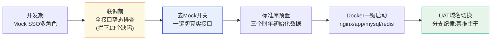

- **开发期 Mock SSO**：模拟多角色账号，让权限逻辑可在无真实鉴权环境下开发测试；真实 SSO 对接上线前由主项目统筹。

- **联调前静态排查**：正式联调前先对全部接口做文档-代码一致性排查——**静态排查每提前发现一个问题，联调会上就少一次现场调试。**

- **去 Mock 开关**：联调时一键切换真实接口，标准库预置三个财年的初始化数据，保证切真后有数可查。

- **部署标准化**：Docker 镜像 + docker-compose 一键启动全套服务，UAT 环境域名切换；环境配置进 dev 配置文件 + rules 约束，长期方案是镜像分发统一环境。

- **分支纪律**：禁推主干，功能拉独立分支。踩过一次坑——某分支前端代码推送失败为空，差点在空目录上联调，**分支完整性检查应进部署 checklist**。

#### 10.3 总结

联调部署阶段的核心是"把不确定性前移消化"。Mock 让开发期不阻塞，静态排查让接口缺陷在联调前暴露，Docker 标准化让环境可复制。**这个阶段的效率，取决于前面阶段沉淀的一致性质量——它是整条交付链的"验收关口"，而非独立环节。**

## 第三部分　组织、度量与推广

### 11. 组织协作：AI Coding 是团队工程，不是个人技巧

**核心结论**：AI Coding 落地失败的组织原因远多于技术原因。从"个人提效工具"变成"组织交付能力"，靠的是一系列标准与规范管理动作。

#### 11.1 五项组织级实践

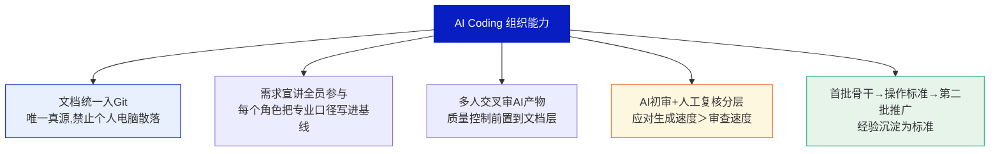

**实践 1：文档统一入 Git 仓库。** 禁止文档散落在个人电脑。所有 AI 可消费的基线（SRS、SPEC、设计文档）必须版本化、可检索、可 diff。这不仅是管理要求，更是 AI 作业的技术前提——AI 需要读到"唯一真源"，而非各人本地的私有副本。代码修改必须同步更新文档，文档是唯一事实来源。

**实践 2：需求宣讲全员参与 + 多人交叉审。** 需求宣讲不再是产品经理对开发单向传递，而是项目组全员参与——因为 AI 时代每个角色都要能把自己的专业口径写进基线。AI 生成的文档由多人交叉审查，质量控制前置到文档层。

**实践 3：应对"AI 生成速度 &gt; 人工审查速度"。** 这是所有团队都会遇到的核心矛盾。解法是分层审查：让另一个 AI 会话（只读子代理）做**形式审查**（一致性、覆盖度、编号完整性），人只做**判断性审查**（业务口径、取舍决策）。**人的审查带宽是稀缺资源，要花在刀刃上。**

**实践 4：首批骨干 → 操作标准 → 第二批推广。** 首批成员把踩坑经验沉淀为操作标准（Plan MD 模板、质量门清单、问题追踪 SOP），通过分享会培养第二批成员。**经验不沉淀为标准，AI Coding 就永远是"高手的个人技巧"，无法变成组织能力。**

#### 11.2 成本结构的重新认识

| 成本类型 | 传统模式 | AI Coding 模式 |
| --- | --- | --- |
| 显性成本 | 人力工时（大头） | Token 消耗（单次深度调用可观，但对比人力仍有数量级优势） |
| 隐性成本 | 沟通/返工 | **人花时间审文档**（新的最大隐性成本） |
| 团队规模 | 多人分工 | **2 人小团队**完成以往多人工作量 |
| 提速方式 | 加人并行 | **无法靠加人并行**（阶段间严格依赖，瓶颈在决策带宽） |

这个成本结构决定了 AI Coding 团队的人员画像：**需要的是有判断力的资深角色（能审、能拍板），而不是更多的执行者。** 前期文档规范投入增加，但后期编码时间大幅缩短——成本曲线整体前移。

#### 11.3 总结

AI Coding 的组织落地，本质是"把个人与 AI 的高效协作，制度化为一支团队的稳定产能"。文档入仓、全员宣讲、写审分离、标准沉淀——这些管理动作决定了 AI Coding 能否规模化复制。**技术决定单点效率，组织决定规模上限。**

### 12. 度量体系：让改进有据可依

**核心结论**：没有度量就没有改进。每个项目收尾用同一套指标，才能横向比较、持续优化。

本项目的复盘度量框架（可作为团队标准）：

| 维度 | 度量指标 | 本项目实测 |
| --- | --- | --- |
| **规格质量** | 评审阻断项数 / 需求返工次数 / 歧义勘误次数 | PRD 评审 7 阻断 + 16 重要；SRS 五轮升版 |
| **可追溯性** | FR→AC 覆盖率 / design→需求回链完整率 | 120 条故事全编号可追溯 |
| **一致性** | 跨文档版本引用不一致数 / 统计漂移次数 | 发现并勘误统计少计 5 条；1 处版本引用漂移待勘误 |
| **实现验证** | 一次通过验证的任务占比 / 控制台报错数 / "文档核验 vs 实现测试"混淆次数 | 代码实现率 88.3%，整体完成度 97.4% |
| **协作纪律** | 越界改动次数 / 并发写冲突次数 / 待签认参数臆造次数 | 检测到 1 次 HTML 并发写冲突（保留他方变更）；参数留白未臆造 |

**度量驱动的持续优化闭环**：

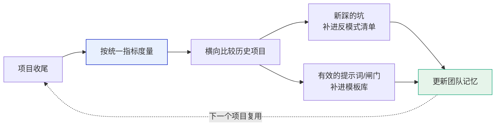

**关键洞察**：88.3% 的实现率不是终点指标，而是过程健康度的体现。真正值得盯的是"评审阻断项在编码前的拦截率"和"联调前静态排查的缺陷数"——这些**前置指标**才决定了下游的返工成本。

### 13. 风险与边界：什么情况下不适用 SDD

诚实地划定方法论的适用边界，比一味鼓吹更有价值。

| 场景 | 是否适用重规格 SDD | 说明 |
| --- | --- | --- |
| 中大型功能/系统 | ✅ 强适用 | 多轮迭代、多角色协作、可追溯要求高 |
| 金融/合规/内部管理系统 | ✅ 强适用 | 对可追溯性、合规性有硬性要求 |
| 多人/多 Agent 协作 | ✅ 强适用 | 需要单一基线与变更边界控制 |
| 一次性脚本 | ❌ 不适用 | 直接对话式编码即可，重规格是负担 |
| 纯探索性 demo | ❌ 不适用 | 需求本身在流动，过早固化规格反而束缚 |
| 极小改动 | ❌ 不适用 | 成本收益不划算 |

**AI 能力边界的务实结论**（本项目验证）：

- **展示型模块慎用 AI 全流程**：数据大屏等重视觉还原的模块，人工定型样式，AI 只做数据接口。

- **AI 会过度补全需求**：需人工裁剪，取舍由人拍板。

- **存量项目先让 AI 读旧代码生成基准理解再迭代**：避免 AI 在不了解存量的情况下"想当然"。

- **严格前后依赖的任务无法加人并行**：瓶颈在决策带宽，不在产出带宽。

### 14. 结论与推广建议

#### 14.1 全文核心论点回顾

回到实践摘要的核心论点，现在它有了完整的论证支撑：

**AI Coding 走进企业级交付的深水区，靠的不是更强的生成模型，而是更严的工程规范。** Spec-Driven Development 用"三阶段·三产物·三闸门"把 AI 的高产出锁定在可追溯、可验收、可信的轨道上。生成能力每半年迭代一次，工程规范一旦建成却是长期资产。

#### 14.2 五点体会

**第一，AI 改变的是瓶颈位置，而不是消灭瓶颈。** 瓶颈从"写得慢"转移到"对得齐"，再转移到"审得过来"。围绕新瓶颈重建流程（单一基线、编号追溯、Plan 前置、写审分离），收益远大于单纯提升生成速度。

**第二，人的角色从"执笔者"变成"基线守护者"。** 全程人没有逐字写过一份文档、一行行敲过业务代码，但每个关键决策（评分二元化、矩阵方案、模板壳策略、大屏边界）都由人拍板，每次变更边界都由人声明。**AI 负责产出与自检，人负责决策与守门。**

**第三，把纪律写进流程，而不是指望自觉。** 产出即校准、Plan 前置审核、哈希写保护、验证诚实性、留白不臆造、质量门即停不绕过——这些规则单看都是小事，但没有它们，AI 的高产出会同时放大正确和错误。**88.3% 的实现率是纪律的产物，不是运气的产物。**

**第四，基础设施要为 AI 而设计。** 人工预验证环境、Mock SSO 免登、浏览器插件测试、结构化输入锚点、模板代码壳——这些投入在传统模式下未必划算，在 AI 模式下是决定成败的前置条件。**AI 的作业质量上限，由它所处环境的确定性决定。**

**第五，组织能力建设与工具落地同等重要。** 文档入仓、全员宣讲、交叉评审、骨干沉淀标准再推广——AI Coding 从"个人提效工具"变成"组织交付能力"，靠的是这些管理动作。

#### 14.3 给准备落地的团队的三条起步建议

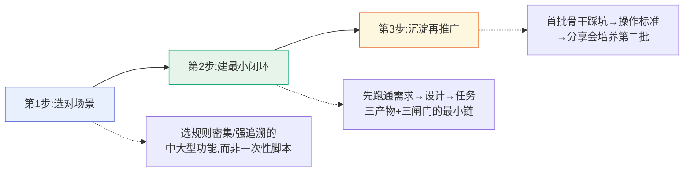

1. **选对场景**：从规则密集、可追溯要求高的中大型功能切入，不要拿一次性脚本或探索性 demo 试水——前者能体现 SDD 价值，后者会得出"规格太重"的错误结论。

2. **建最小闭环**：不要一上来追求全流程完美，先跑通"需求→设计→任务"三产物 + 三闸门的最小链，用度量指标验证效果。

3. **沉淀再推广**：首批骨干把踩坑经验固化为操作标准，再通过分享会规模化，避免"人走方法走"。

#### 14.4 结语

这个项目还在路上——SRS 的正式评审签署、性能参数签认、两代产物的基线关系确认，都还在遗留项清单里。但它已经完整验证了一件事：**AI Coding 的企业级落地，是一场工程纪律的胜利，而非模型能力的炫技。**

Spec-Driven 的契约源、编号体系的可追溯、质量门的自动化、验证报告的诚实——这些传统软件工程的"老规矩"，在 AI 时代不是过时了，而是从"最佳实践"升级成了"生存必需"。

本文章来源于笔者长期基于Qoder产品多个AI Coding项目实践经验分享，与大家共勉和交流。

## 附录

### 附录 A　可复用资产清单

本项目沉淀的、可直接迁移到其他项目的资产：

| 资产 | 形态 | 用途 |
| --- | --- | --- |
| SDD 流程与标准规范 | 方法论文档 | 三阶段三产物三闸门的完整标准 |
| 需求工程作业手册 | 流程文档 | 各阶段标准作业 + 复盘检查清单 |
| 三产物模板骨架 | requirement/design/tasks 模板 | 直接套用生成规格文档 |
| 提示词模板库 | 6 类提示词 | 把纪律压缩进每次 AI 调用 |
| 反模式清单 | 13 项踩坑对照表 | 规避已知陷阱 |
| 复盘度量框架 | 5 维度指标表 | 项目收尾回填、横向比较 |
| Plan MD 模板 | 变更前置审核单 | AI 改代码前的边界声明 |

### 附录 B　反模式清单（来自真实踩坑）

| 反模式 | 后果 | 纠正 |
| --- | --- | --- |
| 原型/实现细节写进需求（硬编码日期、"第2条"） | 需求脆弱、绑死实现 | 需求只写"做什么"，细节留给设计 |
| 口径缺口（时间窗/精度/单位/空值/历史覆盖） | 系统性误判 | 需求专设"计算口径"节 |
| 统计汇总表与正文条目数不符 | 追溯失真 | 每次改完脚本清点校准 |
| 超长 design 单次 Write | 内容截断丢失 | 分章追加 |
| design 引用的上游版本号过期 | 基线错乱 | 发布前核对引用版本 |
| 差异在下游静默消化 | 需求与设计分叉 | D-xx 备案 + 勘误升版 |
| AI 改代码无 Plan 前置 | 误删核心功能 | Plan MD 审核变更边界 |
| 任务无验证方式 / 验证夸大 | 假完成 | 每任务附验证证据；文档核验≠系统测试 |
| 截图工具不可用就跳过 UI 验证 | 漏掉渲染问题 | 结构化 DOM 校验兜底 |
| 改页面未强制重载 | 用旧 state 误判 | 加查询参数强制重载 |
| AI 测试遇环境问题死循环 | 正式任务完不成 | 人工预验证环境 |
| 越界顺手改无关代码/阈值 | 变更失控 | 严守任务影响文件边界 |
| 多 Agent 并行互相覆盖 | 丢他方改动 | 写前检测哈希/mtime，不覆盖 |
| 待签认参数臆造默认值 | 带病上线 | 留白 + 标注负责人 |
| SPEC 照抄 README/文档站 | 与真实代码不符 | 以真实源码为准，分级标注偏差 |
| 展示型模块交给 AI 端到端 | 视觉还原不可控 | 人工定型样式，AI 只做数据接口 |

本文由 IPO 板块符合性对标平台项目全生命周期复盘整理而成，作为 AI Coding 企业级实践的方法论沉淀。文中客户与项目信息已脱敏，方法论、流程与量化指标均为真实项目还原。欢迎有类似实践的同学联系交流。
