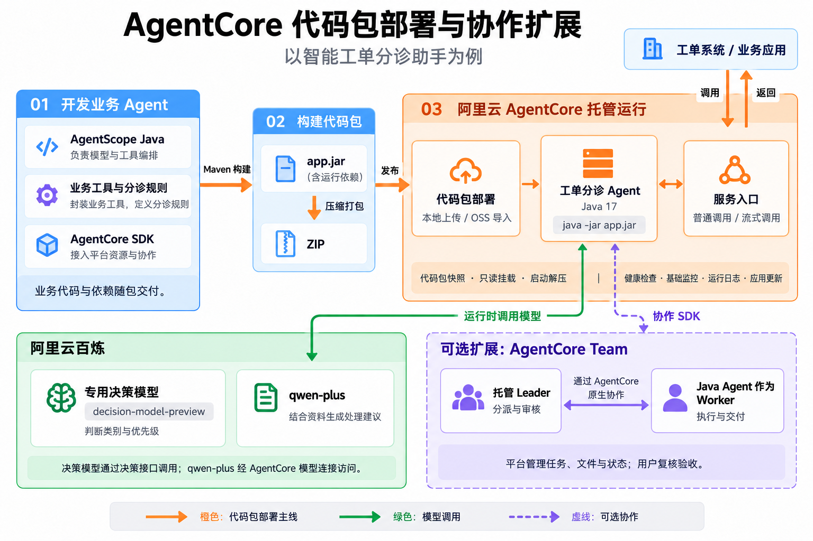
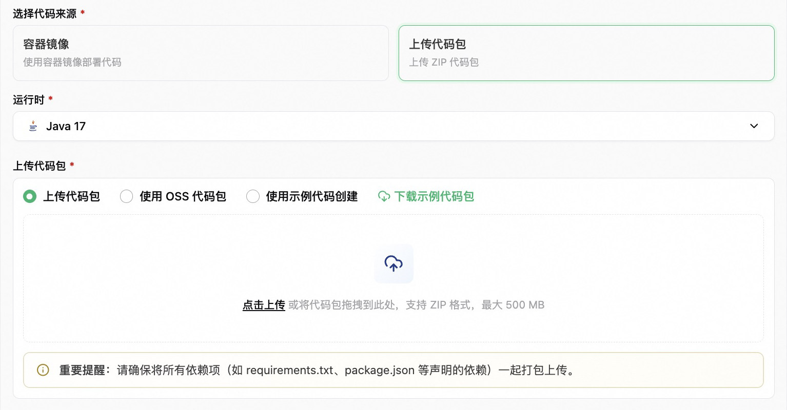
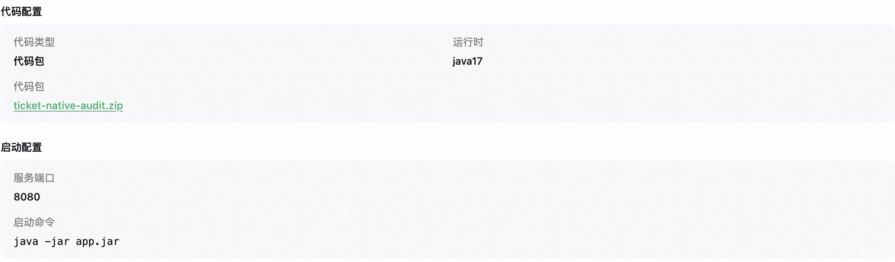
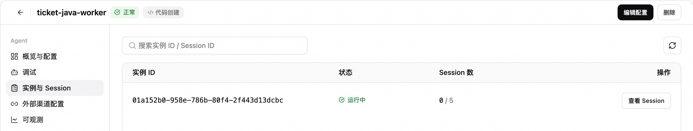
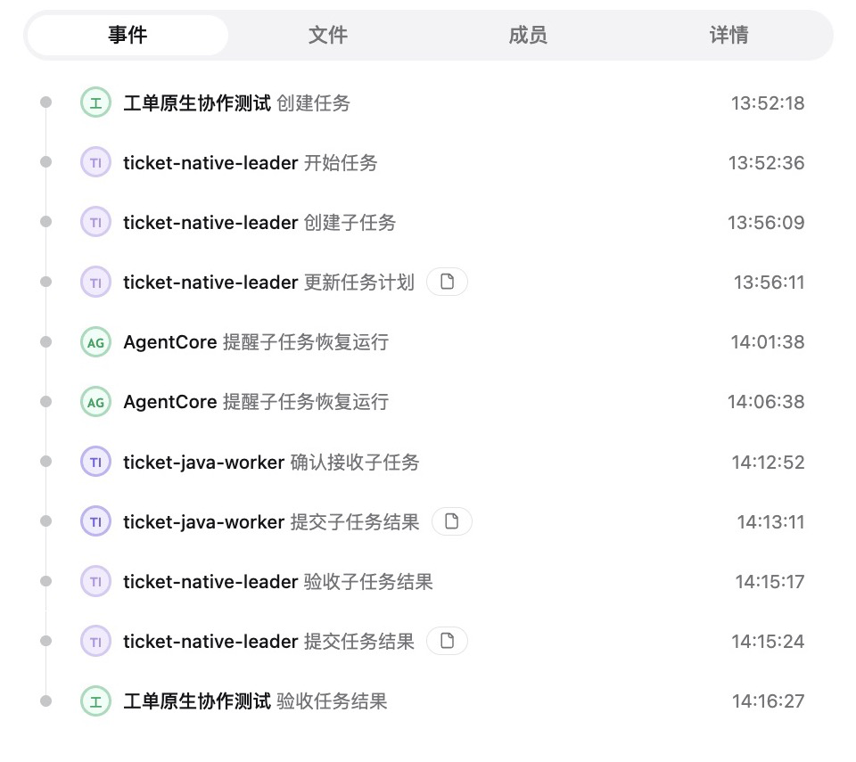
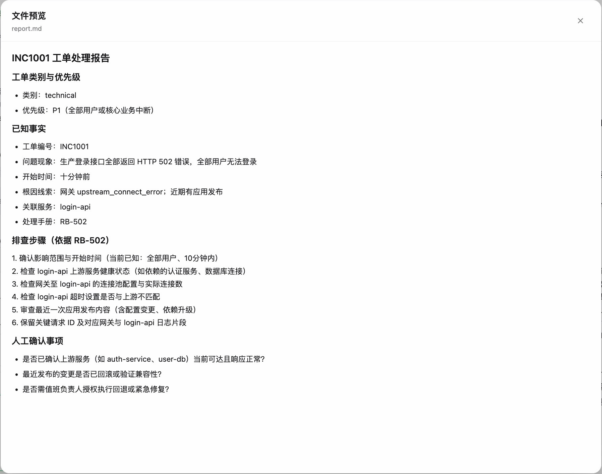

# 基于Jev 范式决策模型，构建智能工单分诊助手

我们在《[开发框架：让 Agent 学会判断，从 Jev 接入到完整 Harness 决策流程](<./开发框架：让 Agent 学会判断，从 Jev 接入到完整 Harness 决策流程.md>)》分享过，如何在 AgentScope Java 接入 Jev 决策模型，将类型化请求、结果解析和校验封装在 JevClient 中。

本文将以一个工单分诊助手为例，把开发、打包和上线的过程串起来：用 AgentScope Java 与百炼决策模型（国内网络无法使用 Jev）实现分诊，通过代码包部署到阿里云 AgentCore，再验证普通调用和流式调用。文章最后，再看这个助手如何加入 Team，参与任务分工与报告审核。

Agent 在本地跑通后，准备运行环境、发布更新、排查线上问题仍然需要投入精力。AgentCore 同时支持代码包和容器镜像部署，并提供后续的运行管理。选择代码包部署，开发者将应用和运行期依赖一起打包，基础运行环境由平台提供，无需再为这个 Agent 单独制作和维护镜像。

## 工单分诊场景与业务需求

在企业常见的业务场景中，一个工单队列里，可能同时有登录故障和发票申请。处理人员要先判断问题类别、影响范围和紧急程度，再交给相应团队跟进。比如下面两张工单：
> 生产登录接口全部返回 502，所有用户无法登录，十分钟前开始，尚未确认根因。\
> 申请补开上月发票，没有服务中断。

登录故障需要尽快排查，发票申请则要核对账期、订单主体和发票状态。排好轻重缓急之后，还得查询工单记录、找到对应的处理手册，才能给出具体建议。

工单助手可以先把这部分信息准备好。百炼专用决策模型负责判断类别与优先级，助手再结合工单记录和处理手册整理建议，交给处理人员复核。分级条件、结果校验和查询工具都需要按企业规则调整，还要接入已有工单系统，因此这里采用高代码方式，在业务工程中维护这些逻辑。

整个应用的分工如下：AgentScope Java 组织模型与工具调用，百炼提供决策与生成能力，AgentCore 负责部署和运行。代码包连接起本地工程与云上服务，Team 则是后续按需接入的协作扩展。



图 1：代码包部署贯穿开发与上线；百炼提供运行时模型能力，Team 是按业务需要接入的协作扩展。

## 工单分诊 Agent 开发

开发工单助手时，AgentScope Java 负责定义 Agent、组织模型与业务工具的调用。需要使用 AgentCore 管理的模型、MCP 工具或 Skill 时，再通过 AgentCore SDK 访问平台资源，并适配到框架中。

AgentCore SDK 提供 Python、JavaScript / TypeScript 和 Java 版本，也适配了常用 Agent 框架。已有工程可以继续使用原来的技术栈，按需接入平台上的模型、MCP 工具、Skill、记忆和凭证。下表列出了各语言的框架适配情况：

| 开发语言 | 已提供适配的框架 |
|------------|------------------------|
| [Java](https://help.aliyun.com/zh/agentcore/agentcore-java-sdk-usage-guide) | AgentScope Java、Spring AI、LangChain4j |
| [Python](https://help.aliyun.com/zh/agentcore/agentcore-python-sdk-user-guide) | AgentScope、LangChain / LangGraph、Google ADK、Pydantic AI、CrewAI |
| [JavaScript / TypeScript](https://help.aliyun.com/zh/agentcore/agentcore-node-js-sdk-user-guide) | LangChain / LangGraph、Google ADK、Mastra、AI SDK |

这些 SDK 均已开源：[Java](https://github.com/ai-agentcore/agentcore-sdk-java)、[Python](https://github.com/ai-agentcore/agentcore-sdk-python)、[JavaScript / TypeScript](https://github.com/ai-agentcore/agentcore-sdk-nodejs)。工单助手使用基础 SDK 和 AgentScope 适配模块，依赖示例如下：
```xml
<properties>
    <agentcore.version>0.1.3</agentcore.version>
</properties>

<dependencies>
    <dependency>
        <groupId>io.github.ai-agentcore</groupId>
        <artifactId>agentcore-sdk</artifactId>
        <version>${agentcore.version}</version>
    </dependency>
    <dependency>
        <groupId>io.github.ai-agentcore</groupId>
        <artifactId>agentcore-sdk-agentscope</artifactId>
        <version>${agentcore.version}</version>
    </dependency>
</dependencies>
```

接入 SDK 后，原有的工单查询工具可以继续使用，再与平台管理的模型、MCP 或 Skill 组合。上面列出的是 SDK 依赖，模型 Provider 等仍按业务需要引入；协作模块会在后文用到。

### 决策模型接入与分诊判断

判断一张工单属于“技术类”还不够。“全部用户无法登录”和“个别用户登录缓慢”都属于技术问题，处理优先级却不同。因此，除了类别选项，还需要把影响范围对应的分级条件告诉模型。

决策模型适合处理这类有明确选项和判断标准的任务。它面向分类、评分和是非判断，返回结构化结果及概率信息。应用拿到类别和优先级后，就可以安排后续的查询与处理。

AgentScope Java 已提供 [Jev 决策模型扩展](https://github.com/agentscope-ai/agentscope-java/blob/main/docs/v2/zh/jev/guides/client.md)，将类型化请求、结果解析和校验封装在 `JevClient` 中。开发者也可以选用 TypeSafe 的 Jev，按扩展文档配置服务凭据和模型，把决策能力接入现有 Agent 流程。

本例选用[百炼决策模型](https://help.aliyun.com/zh/model-studio/decision-model-api)`decision-model-preview`，在工程中封装 `DecisionClient` 调用其 System One 接口，将工单描述与分类条件一起提交，获得结构化的类别和优先级结果。

这里将全部用户或核心业务中断列为 P1，普通咨询或无服务中断的请求列为 P3。收到决策结果后，助手还会校验类别和优先级是否属于预设选项，再进入后续处理。

### 业务工具接入与处理建议生成

确定了优先级，接下来要找到处理依据。工单查询和手册检索分别封装为两个 AgentScope 工具：`lookup_ticket` 提供影响范围、日志线索和近期发布记录，`lookup_runbook` 提供对应的处理方法。`qwen-plus` 再结合这些资料和决策结果生成建议，并列出需要人工确认的事项。

下面这段代码把两个环节接在一起：`decisionClient` 先取得分诊结果，Agent 再调用 `toolkit` 中的查询工具生成报告。报告需要引用哪些资料、保留哪些待确认事项，由 `prompt` 约束：
```java
var decision = decisionClient.classify(input);
String content = input
    + "\n百炼决策模型分诊结果（分类不是根因结论）：" + Main.json(decision);
var agent = ReActAgent.builder().name("triage")
    .model(model).toolkit(toolkit)
    .sysPrompt(prompt).maxIters(6).build();
String text = agent.call(List.of(new UserMessage(content)), context)
    .block(Duration.ofSeconds(150)).getTextContent();
```

其中，`model` 通过 AgentScope 原生客户端访问 AgentCore 工作空间中的模型连接，调用 `qwen-plus`。生成的建议交由处理人员复核。

工单助手对外提供兼容 OpenAI Chat Completions 的 HTTP 接口。本地验证通过后，就可以将它发布到 AgentCore，供工单系统调用。

## AgentCore 代码包部署

发布这个助手，不必先为它准备一套镜像构建流程。AgentCore 的代码包部署提供 Python、Node.js 和 Java 运行环境，基础镜像由平台维护。开发者沿用已有的构建方式，将应用与运行期依赖打成代码包，就能交给平台部署。

如果已有成熟的镜像流水线，或需要定制系统组件，也可以选择[容器镜像部署](https://help.aliyun.com/zh/agentcore/high-code-agent-deployment-guide)。这个工单助手使用平台提供的 Java 环境即可运行，因此选择代码包部署。

打包仍然使用 Maven：将业务代码、AgentScope 和 SDK 等运行期依赖一起打入 `app.jar`，再把 JAR 放到 ZIP 根目录。这份 ZIP 就是要发布的代码包。

这次实践直接上传本地 ZIP。如果代码已经通过流水线构建，也可以将产物存入 OSS，再从 OSS 导入。无论采用哪种来源，交付的都是应用本身的构建产物。



图 2：代码包创建入口，支持选择运行环境、本地上传和 OSS 来源。

上传后，应用仍按原来的命令启动。这个助手选择 Java 17，启动命令为 `java -jar app.jar`，服务端口为 8080。AgentCore 负责解压代码包、启动应用，并通过健康检查确认服务状态。



图 3：工单助手的部署配置，集中展示代码包、运行环境和应用启动参数。

应用就绪后，在 AgentCore 配置服务入口，工单系统便可以通过相应的访问地址和鉴权信息发起请求。原先在本地验证的分诊逻辑，现在有了可供业务调用的服务入口。

## 服务调用与分诊效果验证

部署完成后，再把开头的登录故障和发票申请交给助手，看看实际输出。验证覆盖了两种调用方式：普通调用一次返回完整报告，方便后端接收后继续处理；流式调用逐步返回内容，用户可以在工单页面中边生成边查看建议。

以下结果来自实际调用，工单和处理手册均为演示数据。

对于“所有用户无法登录”的工单，助手给出“技术类、P1”的判断，并引用工单记录和故障处理手册。以下摘编自实际生成的报告：
> 工单类别与优先级：技术故障，P1。已知事实：登录接口返回 502，影响全部用户；日志线索为 `upstream_connect_error`，近期有应用发布。排查建议：检查上游健康、连接池、超时设置和近期发布，保留请求 ID 与相关日志。人工确认事项：上游当前是否可达，近期变更是否有关联，是否需要由值班负责人授权修复或回退。

换成“申请补开上月发票、无服务中断”，助手给出的判断是“计费类、P3”，引用的也变成了发票处理手册。建议围绕账期、订单主体和发票状态展开。这样，处理人员拿到的除了优先级，还有与这类问题相匹配的处理依据。

## 弹性运行与可观测

登录服务发生故障时，相关工单可能短时间内集中涌入；恢复后，请求量又会回落。AgentCore 支持按需弹性伸缩，可以根据业务并发需求配置策略，在高峰时扩展资源，负载回落后收回空闲资源，减少长期按高峰预留资源的压力。[了解 AgentCore 弹性运行能力](https://www.aliyun.com/product/agentcore)

一次分诊迟迟没有返回时，排查也需要有入口。AgentCore 将实例与 Session、基础监控和运行日志放在同一个 Agent 下，方便先确认运行状态，再沿着应用日志追查具体请求。[高代码 Agent 运行与排障说明](https://help.aliyun.com/zh/agentcore/high-code-agent-deployment-guide)



图 4：工单助手的运行实例与 Session 数，便于了解当前运行状态和会话占用。

为工单助手启用日志采集并配置 SLS 日志库（Logstore）后，团队就能在 AgentCore 控制台查看运行日志，追查异常请求。

工单助手会记录请求 ID、执行耗时、决策结果和工具调用。以登录故障为例，日志中可以核对它查了哪张工单、用了哪份手册，以及最终采用的类别与优先级。如果建议不符合预期，就能带着这些记录回到业务代码中排查。

## 分诊规则迭代与代码包更新

如果要接入真实工单接口，或调整登录故障的分级条件，仍然回到原有工程中修改和测试。验证通过后，重新构建代码包，通过 AgentCore 更新 Agent，新的逻辑就可以投入使用。

使用 OSS 来源时，上传新包和更新 Agent 是两个独立动作。AgentCore 会在创建或更新时保存代码包快照，因此覆盖 OSS 源文件不会改变正在运行的代码。只有发起 Agent 更新，才会读取新包并部署，发布时机仍由团队决定。

## 进阶实践：AgentCore Team 原生协作

到这里，工单助手已经能独立提供分诊服务。但一张高优先级故障工单，往往还需要有人分派工作、补充信息、审核报告。任务交给了谁、分析进行到哪一步、结果是否通过验收，也需要留下记录。这时可以再接入 AgentCore Team，让已有助手参与后续协作。
> 注：高代码 Agent 协作能力目前采用白名单开放机制。有体验需求的客户，可提交工单联系支持团队申请开通。

### Team 任务分工与交付审核

在 Team 中，Leader 安排工作，Worker 承担具体分析，用户可以查看进展、补充要求并验收结果。子任务、执行记录和报告文件都关联在同一任务下，接手的人能看到前面的处理过程，也能直接针对报告提出修改意见，减少反复转述和追问进度的工作。[了解 Team 任务](https://help.aliyun.com/zh/agentcore/using-team-tasks)

这次登录故障任务采用以下分工，工单助手复用前文已部署的 Agent：

| 参与者 | 职责 |
|---------|------|
| 托管 Agent，担任 Leader | 分派登录故障分析任务，审核 Worker 提交的报告 |
| 工单助手（高代码 Agent），担任 Worker | 查询故障工单与处理手册，完成分诊并提交报告 |
| 用户 | 补充任务要求、参与复核，验收最终报告 |



图 5：登录故障工单的任务记录，呈现子任务分派、Worker 提交结果、Leader 审核和用户验收的过程。

### 协作 SDK 接入

这个助手沿用了原有分诊逻辑，通过协作 SDK 增加领取任务和交付文件的工具，并加入已开通协作的 Workspace 下的 Team。工程新增的依赖如下，基础 SDK 与 AgentScope 适配模块仍使用前文的 0.1.3：
```xml
<dependency>
    <groupId>io.github.ai-agentcore</groupId>
    <artifactId>agentcore-collaboration</artifactId>
    <version>0.1.0</version>
</dependency>
```

SDK 将领取任务、文件交付等能力作为工具接入现有 Agent，并补充 Worker 协作规则。下面的 `toolkit` 保留业务查询工具，`businessPrompt` 保留分诊与报告要求；`collaboration` 随应用复用，并在关闭时释放：
```java
var workspace = Path.of(".");
var collaboration = Collaboration.auto(workspace);
var workerTools = new ArrayList<>(collaboration.tools().block());
Skill.tools(collaboration.skills().block(), workspace).stream()
    .filter(tool -> !"execute_command".equals(tool.name()))
    .forEach(workerTools::add);

workerTools.forEach(tool ->
    toolkit.registerAgentTool(AgentCoreAgentScope.tool(tool)));
var worker = ReActAgent.builder().name("ticket-worker")
    .model(model).toolkit(toolkit)
    .sysPrompt(collaboration.composePrompt(businessPrompt))
    .maxIters(18).build();
```

任务上下文随本次调用传入，让分析和报告归属正确的任务。以下 `trustedHeaders` 来自可信的平台请求，普通调用与流式调用采用同样的传递方式：
```java
var taskContext = CollaborationContext.fromHeaders(trustedHeaders);
var contextBuilder = RuntimeContext.builder().sessionId(sessionId);
if (taskContext != null) {
    contextBuilder.put(CollaborationContext.KEY, taskContext);
}
var context = contextBuilder.build();
var response = worker.call(List.of(new UserMessage(input)), context)
    .block(Duration.ofSeconds(150));
// 流式调用使用 worker.streamEvents(new UserMessage(input), context)
```

接入后，仍通过重新构建代码包、更新 Agent 来发布。完整接口见 [Java 协作 SDK](https://github.com/ai-agentcore/agentcore-sdk-java/blob/main/collaboration/README.md)。

任务最终交付的报告如下。P1 分级的依据、已知的工单事实、建议的排查步骤和待人工确认的事项都列在其中。Leader 和用户可以对照报告复核，不必再从多轮对话里拼凑结论。



图 6：任务中交付的 report.md，审核人员可以直接预览并核对分诊依据与处理建议。

## 总结

回到开头的两张工单，助手要帮助处理人员尽快识别登录故障的紧急程度，也要为发票申请找到合适的处理依据。分级规则和业务工具会随着实际使用不断调整，发布这些改进也应当成为日常开发的一部分。

AgentCore 代码包部署让团队沿用原有工程，将验证后的应用与依赖交付到平台，省去为每个 Agent 单独维护镜像的工作。运行环境和服务管理由 AgentCore 承接，开发者可以把精力留给分诊规则、查询工具和实际处理效果；需要跨角色跟进复杂工单时，再用 Team 扩展协作。

欢迎前往[阿里云 AgentCore 控制台](https://agentcore.console.aliyun.com/)，将自己的业务 Agent 以代码包方式部署运行。
