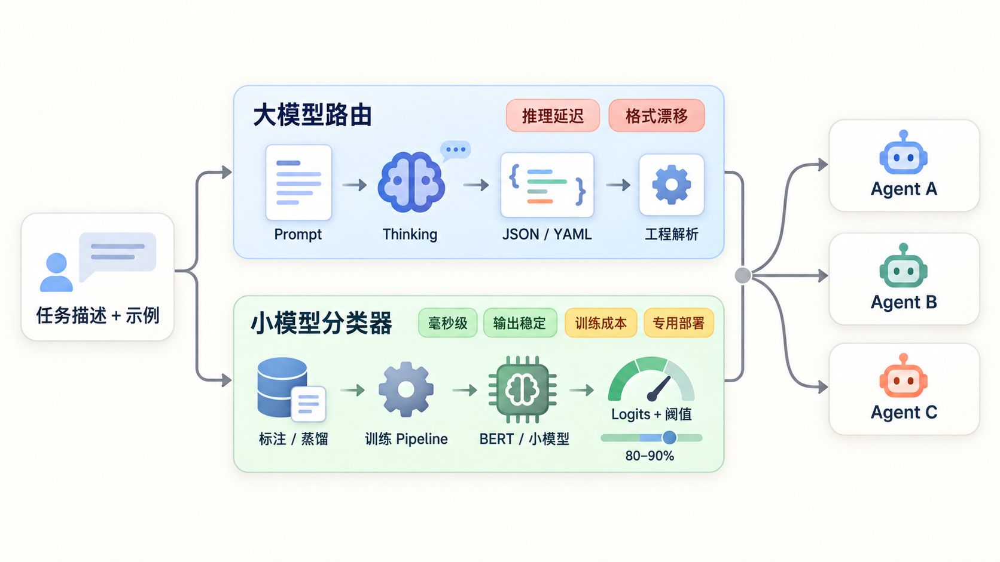
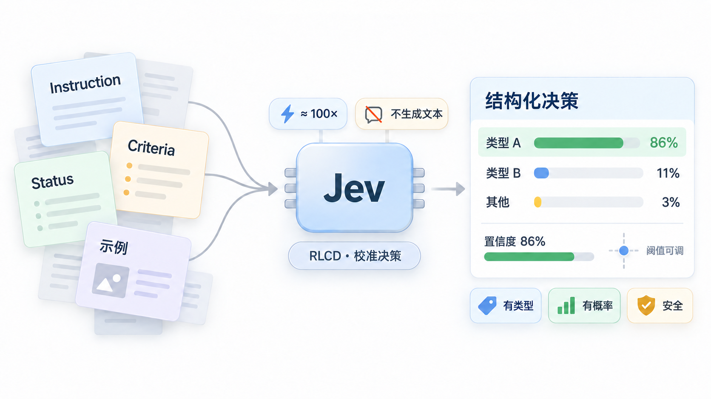
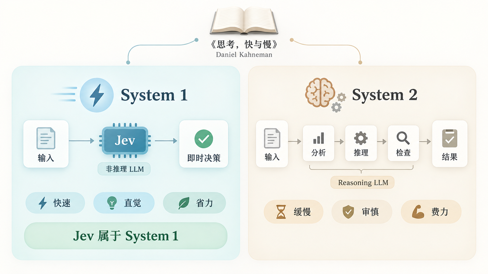
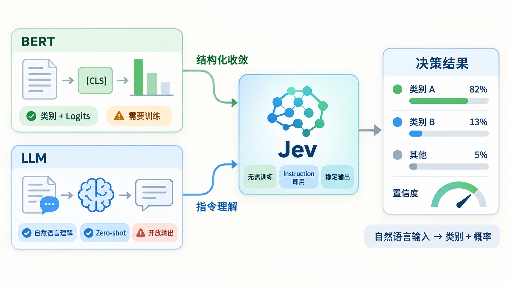
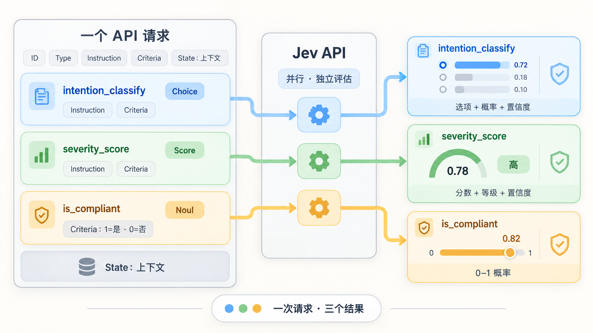
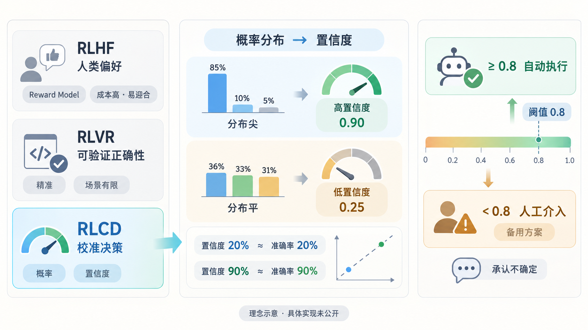

# 深度解析 Jev 模型：如何快速做结构化决策

## 背景


最近，AI 圈又双叒叕冒出了一个很火的新模型，叫做 **Jev 模型**。它的开发团队是 **TypeSafe**，这家公司的创始人叫 **Diogo Almeida**，之前也是 OpenAI 的研究员。


那这个模型为啥突然就火了呢？官方给它的定位很有意思，叫做 **“System One Model”**，也就是**系统1模型**。接下来，咱们就来深入聊聊：到底什么是“系统1”？以及为什么这个叫 Jev 的模型会突然这么火？

## Agent 决策类任务的痛点
我们在日常构建 Agent Harness 的过程中，是不是经常遇到这样的痛点？就是我需要非常多的子模块或者子 Agent 来帮我做决策。比如，用户问了一个问题，我该怎么去做意图识别和路由？我可能会有很多个 Agent 去处理不同的逻辑或意图，那么在最前面，我必须得有一个意图识别或者说路由模块，把用户的问句准确地分发到对应的系统或 Agent 上去。



在这种情况下，通常我们有两种做法。**第一种做法，是直接用大模型。**我们写一段 Prompt，要求它做一个分类或者路由的任务，并且强制要求它的 Output 必须是一个结构化的格式，比如直接输出分类结果，或者通过 JSON、YAML 的结构化形式输出。然后让工程代码去解析这个结果，再映射到我们想要调度的那个 Agent 上。但这种基于大模型的做法，效率其实并不高，经常遇到几个痛点：

+ **速度慢。** 因为大模型要推理嘛。你要想让它分得准，往往就得开启 "Thinking"（思考模式）。如果你不开思考，速度可能会快一点，但如果你的 Prompt 写得很长、要求很复杂，它输出整个 JSON 的过程依然会很漫长。
+ **指令遵循不稳定。** 某些情况下，它还是很可能会输出错误的 JSON 结构，或者不按照你预期的字段来输出。这种情况虽然偶发，但确实存在。哪怕我们加了一些 Format 约束，让模型按约定解码，也难免会出岔子。

**第二种做法，是为了追求极致的速度和稳定性，去训练一个小参数模型。**我们可以把大模型的结果进行蒸馏，或者通过人工标注，快速训练一个小的 LLM。目的就是为了节省推理时间，加快速度，同时提高准确性。在更极致的场景下，甚至可以训练一些像 BERT 这样的传统机器学习模型。这样能在毫秒级就输出一个分类结果以及对应的置信度（Logits）。有了这个置信度，我们就可以通过阈值来灵活控制。比如，我可以设定置信度 90% 以上才认为是某种决策，或者 80% 以上。这个阈值可以根据业务需求动态调整，这是 BERT 这类模型的一个优势。

这种做法的好处很明显：**速度快，且对特定任务非常有效。**但坏处也很明显：**训练成本相对较高。**你需要有相应的 GPU 卡，需要有一定量的数据集，还需要搭建训练 Pipeline，不停地调优参数、做评测，最后才能获得这样一个模型。而且，这个模型的迁移能力通常有限，只能用在当前这一个单任务场景上。为此，你还得专门部署一个模型，占用推理资源。无论是训练还是推理，都需要消耗一定的 GPU 算力。我们之前也有很多任务是这样做的。

这类任务，本质上就是一个典型的**分类、决策任务**：输入是一段任务描述（可能包含样例），输出是一个结构化的分类结果，由工程侧去解析。其实，这种场景非常多。比如根据问题的难度，路由到不同参数的模型，比如简单问题用小模型，中等用中模型，复杂用大模型；判断某个 Agent 的输出结果是否有风险等等，这也是一种分类决策。

也就是说，在构建 Agent Harness 的过程中，除了解决用户核心场景（如 Coding、问答、工单解答）的那些主力 Agent 之外，我们有**非常多**的场景需要做这种“小而快”的决策。所以说，面对 Agent 里这么多类似的场景，到目前为止，其实没有一个特别完美的解法。用大模型写 Prompt，好处是落地快，能迅速用上；但坏处是稳定性差、推理速度慢。而训练专用小模型，好处是快且准；但坏处是成本高，耗费算力资源和人力都比较多。

## Jev 的定位：专为结构化决策而生
那么，还有没有别的办法呢？

有的，Jev 这个模型就是为了解决我们刚才说的那些痛点而提出的。它并不是一个传统意义上的 LLM。传统 LLM 的特点是你输入任何 Instruction（指令）或描述，它也能对应输出各种形式的内容。但 Jev 不一样，它的输入可以是你的各类任务要求 Instruction，但**输出是针对特定场景的结构化决策结果；Choice 和 Score 还会附带置信度**。这就是它的核心定位。

这个模型开发团队的创始人 Diogo Almeida 在 OpenAI 期间就参与了很多让语言模型“听得懂指令、能和人对话”的 AI 研发工作，也成就了 ChatGPT 这样跨时代的产品。当时他也认为，这种基于 Chat 的模型是通往 AGI 的一条路径。但经过最近这些年的发展，他发现了一些问题：**纯粹通过 Chat 的方式可能是不够的。**

纯靠聊天这种模式，很难做到完全的自动化。就像我们刚才讲的那些场景，在很多地方需要做决策时，如果纯靠 Chat，你很难把它收敛到一个非常稳定的状态。所以，如果想要做到真正的自动化，很多必要的、重要的模块，我们需要让它能**结构化**，并且能够输出对应的**概率和置信度**，以及分类结果。只有这样，我们才有了一个非常好的判断依据：这个结果的可信程度到底有多高？分类结果可能是怎样的？

基于这个思路，Jev 采用了一种全新的模型架构，追求极致的运行效率。更重要的是，他们使用了一种全新的强化学习算法，叫做 **RLCD**（Reinforcement Learning for Calibrated Decisions，面向校准决策的强化学习）。Jev 是他们第一款公开的模型，目前面向早期用户开放试用。



按照官方的说法，Jev 的智能水平和现有大模型 LLM 差不多，但**速度和效率却快了整整两个数量级，大约 100 倍左右**。Jev 没有生成文字的能力，但它对结构化输出做了专门调优。这带来几个好处：**输出不会超出预定义的类型和选项；Choice 和 Score 能给出概率与置信度；方便进行阈值调整。**模型仍可能在选项内做出错误判断。

所以，你可以把 Jev 理解为一个**前沿智能级别的函数调用**，或者说是一个**决策函数**。它的 Input 可能是杂乱无章的任务要求描述，但它的 Output 是一个**有概率、有类型约束**的决策结果。

## Jev 与 LLM 的核心差异对比
那既然，Jev 与 LLM 差异挺大的，那我们就先来做一下对比。为了更直观，我整理了一个表格：

| **对比项** | **LLM (大语言模型)** | **Jev (System One Model)** |
| --- | --- | --- |
| **输入/输出** | **输入**：非结构化数据（文本），侧重连续对话消息；   **输出**：非结构化字符串，灵活但需专门约束，仍可能不遵循指令 | **输入**：可以非结构化描述任务要求，但侧重结构化格式（如 Instruction/Criteria）；   **输出**：**类型安全**的结构化数据，所有输出结构预定义，无类型错误，结果在候选范围内，且附带校准过的概率分布 |
| **优化方法** | 基于**RLHF**（人类反馈的强化学习） ，或 **RLVR** （基于可验证奖励的强化学习） | **RLCD**（面向校准决策的强化学习） |
| **优化目标** | **人类偏好**：产出评分员更喜欢的文章和聊天回复；   **可验证奖励**：通过程序验证输出对错（如 Coding、数学推理） | **校准后的决策**：基于 System One 任务，给出诚实、可靠的概率答案 |
| **采样方式** | **串行**：基于 Next Token Prediction，一次生成一个 Token，依赖前文 | **并行**：一次查询即可生成所有想要的类型结果，效率极高 |
| **速度与成本** | 速度**慢**、成本**高** | 速度**快**、成本**极低** |
| **置信度** | **无原生置信度**，难以判断准确性或自信程度，且往往**过度自信** | Choice 和 Score 附带由概率分布计算的**置信度**；Noul 返回“是”的概率。实际准确性需要在业务数据上验证 |
| **适用场景** | 需要人类参与的任务（聊天、Copilot、Coding Agent）、可验证场景（数学、内核优化）、快速 Demo 等难量化场景 | AI 驱动的 **Workflow**、需要 **If/Else 判断**的场景、对响应耗时要求极高的**实时应用** |

简单来说，LLM 更像是一个“全能选手”，适合和人打交道或者处理开放性问题；而 Jev 则像是一个“精密仪器”，专门为自动化流程中的那些需要快速、准确、结构化决策的环节而生。

## 什么是“系统1”？为何叫“Jev”？
在 Jev 的官方文档和描述里，经常提到一个词：**System One**（系统1）。这个名字是怎么来的呢？它其实借用了心理学家 **Daniel Kahneman** 在其名著**《思考，快与慢》（Thinking, Fast and Slow）**中提出的概念。在这本书里，人类的思维被分为两种模式：

+ **系统一（System 1）**：快速、直觉式的思维。它能立即做出反应，省力且瞬时。
+ **系统二（System 2）**：缓慢、审慎的思维。它需要经过深思熟虑和逻辑推理，费力且耗时。



以前，那些没有开启深度思考的 LLM，我们一般也认为属于“系统1”；而开启了深度思考（Reasoning）的 LLM，则被视为“系统2”。Jev 显然属于**系统1**，因为它追求的是立即、快速的反应，而不是去进行深度的逻辑推演。

我们也通过表格的方式简单对比一下这两者：

| **对比项** | **系统1 (System 1)** | **系统2（System 2)** |
| --- | --- | --- |
| **思维方式** | 直觉的、瞬时判断的 | 刻意的、多步推理的 |
| **速度与成本** | 快、省力 | 慢、费力 |
| **人类案例** | 看到对方情绪立刻识别喜怒哀乐；快速认出熟人面孔 | 计算复杂的数学题；使用公式进行逻辑推导 |
| **AI 案例** | Jev 模型；或未开启思考模式的普通 LLM | 开启了 Reasoning/思维链 (CoT) 的 LLM |
| **擅长任务** | 分类、打分、决策路由等“一眼就能判断”的任务 | 数学逻辑证明、多步复杂规划 |

所以，“系统1”擅长的就是那些分类、打分、路由这类需要“一眼定乾坤”的任务；而“系统2”则更擅长处理数学、逻辑证明以及多步的复杂规划。

那么，**Jev** 这个名字又是怎么来的呢？

它是以经济学家 **William Stanley Jevons**（威廉·斯坦利·杰文斯）命名的。这背后涉及到一个著名的经济学现象：**杰文斯悖论（Jevons Paradox）**。

TypeSafe 这家公司预期，机器智能会走上和当年工业革命时期的煤炭产业类似的路径。在蒸汽机时代，随着效率的提升，煤炭的需求并没有因为“够用了”而减少，反而因为效率提升带来了更广泛的应用，导致需求大幅增长。这就是杰文斯悖论的核心：**效率的提升并不会导致需求的饱和，反而会促进需求本身的增长。**应用到 AI 领域，这意味着：**智能的成本每下降一个数量级，就会解锁出多个数量级的新应用场。**TypeSafe 认为，AI 的产生并不会让大家做的事情变少，反而会催生出更多的需求。

这一点我倒是也挺赞同的，我们可以看到现在的 AI 发展十分迅速，似乎我们也并没有因为 AI 的出现而变得轻松。相反，AI 发展得越快，随之涌现的新需求也就越多，我们能做的事反而越多，反而导致更加疲惫。这是因为，原来在开发资源有限的时候，一些需求可能因为实现成本太高或排期太久而被舍弃；但现在有了 AI，研发迭代速度过快，导致各类需求都可以去尝试实现，结果反而引发了**需求层面的爆炸**。我觉得这是一个非常有趣且值得深思的现象。

## 集 LLM 与 BERT 两者之长
讲到这里，有同学可能会产生一个新的疑问：**这个 Jev 跟传统时代的 BERT 挺像的啊。**BERT 的输入也是一段文本，输出是一个 CLS 头上的分类结果。这个分类同样能输出 Logit，并可由此计算概率分布。

那么，Jev 和 BERT、LLM 的关系就变得非常有意思了。我刚接触 Jev 的第一反应就是：**这个模型其实是取了 BERT 和 LLM 各自的长处，来实现特定任务的。**你会发现：

+ 它能够像 **BERT** 一样，将输出收敛到结构化的类别和概率，不发散；
+ 它又能够像 **LLM** 一样，理解任意的自然语言，做到 **Zero-shot（零样本）** 调用。



这意味着我们**不需要去训练它**，直接通过写 Instruction 的方式就能实现使用。这就解决了一个很大的痛点：我可以快速、低成本地用这样一个模型去解决问题，既不需要训练，又能拿到一个稳定、可用的结果。那么，下面我们把 **BERT、LLM、Jev** 三者再做一个详细对比：

| **对比维度** | **BERT (传统小模型)** | **LLM (大语言模型)** | **Jev (System One Model)** |
| :--- | :--- | :--- | :--- |
| **输入** | 任意文本 | 任意文本 | 结构化定义的任意文本（含 Instruction/Criteria） |
| **输出** | 固定的分类标签 + Logit 或概率 | 任意的生成文本 | **结构化决策** + 概率；Choice 和 Score 另有置信度 |
| **任务实现** | **需专门训练**：为每个任务训练分类的 CLS 头 | **无需训练**：通过 Prompt 实现 Zero-shot / Few-shot | **无需训练**：通过写 Instruction 或临时定义 Criteria，实现 Zero-shot，选项可动态修改 |
| **通用性/灵活性** | **低**：换一个任务就要重新训练 | **极高**：一个模型干所有事，但准确性/指令遵循有弊端 | **高**：一个模型加临时定义的要求，可覆盖多样需求，同时保证稳定性和准确性 |
| **概率校准** | **未校准**：容易过度自信 | **无概率输出**，只有每个 Token 概率 | **专门校准过**：置信度越高，准确率越可靠 |
| **幻觉风险** | 不会生成标签外的文本，但可能误分类 | 可能编造内容或不遵循格式 | 输出被限制在预定义类型与选项内，但仍可能误判 |
| **速度与成本** | **速度快**，但**训练成本高**（需 GPU、数据集） | **速度慢**，且**推理成本高** | **速度快**，且**成本低**（无需训练，推理极快） |
| **适用场景** | **定制训练：**需要为每个任务定制分类器，对速度和准确率要求极高且可承担训练成本的场景 | **通用场景：**人机交互对话、内容生成、Coding、复杂需求实现 | **决策函数场景**：AI 驱动的 Workflow，需要快速、稳定实现 If/Else 逻辑判断的场景 |

简单来说，**BERT** 像是“特种兵”，每个任务都得单独练，练好了极快极准，但换任务就得重练；**LLM** 像是“全能博士”，什么都能聊，但干活慢、贵，还偶尔会“胡言乱语”；**Jev** 则像是“智能调度员”，既有博士的理解力（不用训练就能懂指令），又有特种兵的执行力（快、准、稳、便宜），专门为自动化流程中的决策环节而生。

## 如何定义一个“决策函数”？
我们来细看一下这个模型的输入结构。它主要由几个关键字段组成，设计得非常清晰：

### ID：结果的“身份证”
你需要自己取一个键名（Key），比如 `intention_classify`。这个 ID 的作用是在返回结果时，让你能准确地取到对应的结果。

### Type：三种决策类型
`type` 字段定义了你要让模型做什么样的决策，主要有三种类型：

+ **Choice（选择）**：从一组选项中选出一个。输出**选中的项（Choice）、每个选项的概率（Probability）以及置信度（Confidence）**。典型场景有**意图路由、文档分类、模型识别**等。
+ **Score（打分）**：判断内容落在哪个等级或分数段。输出是**具体的分数（Score）、等级标签（Legend）、概率和置信度**。典型场景比如严重程度分级、敏感程度评估、情绪强度打分等。
+ **Noul（是非判断）**：判断这句话是真的吗？或者这件事是对还是错？输出0 到 1 之间的概率值。越接近 1 代表“是”，越接近 0 代表“否”。典型场景是二分类任务，比如“是否合规”等等。

### Instruction / Criteria：告诉模型“做什么”和“怎么选”
+ **Instruction**：你具体要问的问题或任务描述。例如：“请判断用户的这句意图属于哪个分类。”
+ **Criteria**：可能的选项列表或评分标准。
    - 如果是 **Choice**，这里写上分类 1、分类 2、分类 3 等选项列表。
    - 如果是 **Score**，这里写上分数段或等级的定义表。
    - 如果是 **Noul**，对于有歧义的是非判断，建议写清楚“是”与“否”各代表什么。比如“客户是否有情绪异常”，应说明 1 代表异常还是 0 代表异常，避免判断方向含糊。

### State：上下文数据导入
这个字段虽然叫“状态”，其实就是“上下文”。你要让模型评估的具体内容就放在这里。例如：在做意图理解时，你可以把整个对话的对象数组、Message 的具体细节或者一大段文本传进 `state`。你可以在 `instruction` 里通过特定的格式去引用 `state` 里的某些字段。比如：“请根据 `state` 中最后这一句对话，判断它属于哪一类。”当然，你也可以不引用具体字段，直接说“根据这段对话进行分类”，模型都能处理。



最有意思的是，这三类问题（Choice, Score, Noul）可以**一起放在同一个 API 请求里去访问**。这意味着你可以一次性让模型既做选项分类，又做程度打分，还做是非判断。这些问题是并行、独立评估的，避免了串行调用带来的延迟，极大地提升了效率。最后，模型会根据你定义的字段输出分类、分数或概率；Choice 和 Score 还返回由概率分布计算的置信度。

## RLCD：面向校准决策的强化学习
接下来，我们深入聊聊 Jev 背后的核心训练方法 **RLCD**（Reinforcement Learning for Calibrated Decisions，面向校准决策的强化学习）。在介绍它之前，我们先回顾一下大模型后训练（Post-training）的两条主流路径，这样你就能明白为什么需要这个新算法了：

+ **RLHF（基于人类反馈的强化学习）**：这是 OpenAI 推出 ChatGPT 时的招牌做法。它的优化目标是“人类偏好”，通过训练一个 Reward Model 来拟合人类的打分，让模型输出更像人、更讨喜的回复。但是，标注和训练 Reward Model 的成本极高，而且很难完全拟合人类的真实意图。
+ **RLVR（基于可验证奖励的强化学习）**：随着 Coding Agent 的兴起，这种方法变得流行。它适合那些能通过程序化验证对错的场景（如代码、数学推理）。虽然速度慢一点，但效果精准，因为对错是客观可验证的，但适用场景有限。



而 Jev 采用的 **RLCD** 的优化目标非常明确：**校准过的决策和概率。**那么，**什么是“校准”（Calibrated）？**这里需要注意，很多人会混淆**“概率”和“置信度”**：

+ **概率（Probability）**：模型会对每个选项给出一个概率值。比如分类 1、2、3，模型会告诉你选 1 的概率是 60%，选 2 是 30%... 但这只是模型内部的倾向性，不代表它一定是对的。
+ **置信度（Confidence）**：Choice 和 Score 的结果还会提供一个由概率分布计算的 0～1 数值，用来概括分布有多集中。它不是“这次判断有多少概率正确”的直接读数。例如置信度为 0.8，不能直接解释成这次判断有 80% 的正确率。**概率校准**讨论的是：在大量同类预测中，模型赋予某结果的概率能否与其实际发生频率相符。

那么，**置信度又是怎么来的？**它是基于概率分布计算出来的一个 0~1 的值（除了 Noul 类型外都有），如果**分布越尖**（集中在某一个结果上）：模型越自信，置信度越高；如果**分布越平**（各个选项概率差不多）：模型越不确定，置信度越低。这给了模型一个**“承认我不确定”**的机制。这对于构建可靠系统至关重要，**较高的置信度**可以作为自动化决策的一个信号；**较低的置信度**提示系统考虑人工介入、补充信息或备用方案。具体阈值仍需结合业务风险和评测结果确定。

不同业务场景下，需要通过评测来确定具体的阈值（比如是否在某个阈值以上才放行），但不能把单次返回的置信度直接当作该次判断的正确率；还需要在目标业务的数据上检查校准效果。

那为什么不用 RLHF 或 RLVR呢？因为对于“决策”任务来说，这两种方案很容易出问题：**RLHF** 容易让模型去“迎合”人类偏好，而不是追求客观真理，导致幻觉；**RLVR** 虽然准，但只适用于有标准答案的场景，且缺乏对“不确定性”的量化。

而 RLCD 的目标是让模型同时给出结果与可供系统利用的不确定性信号。当然，目前官方并未公开 RLCD 的具体实现细节和底层架构，以上分析都是基于其官方文档透露的理念来分析的。

## 官方最佳实践：如何用好 Jev？
在官方的 “How to Build” 文档里，强调了几条非常实用的方法论，我总结了一下：

1. **能用代码就别用模型**：对于逻辑性强、规则明确的任务（比如日期阈值判断），直接用代码写死。不要试图让任何模型去算这个，代码永远比模型准且快。
2. **精简 State，避免 Context Rot（上下文腐烂）**：只把当前问题**真正需要**的上下文塞进 `state`。无关信息不仅浪费 Token，还会引入噪声，拉低准确率。这就是所谓的“上下文腐烂”（Context Rot）。
3. **精准引用字段：**`state` 里的字段可以通过反引号或路径的方式，直接在 `instruction` 里引用。这样能让模型聚焦到具体的数据点上，而不是在一堆文本里大海捞针。
4. **拆解问题：问原子问题，别问大问题：**这是最关键的一点。**一定要在 Jev 里问最原子、最具体的问题。**比如说不要问：“这封邮件是不是垃圾邮件？” 而是要问：“这封邮件是否在索要密码？”、“是否承诺了额外奖励？”、“发件人身份与内容是否矛盾？”让模型对这些小问题做精确判断，然后你再用代码去做综合的加权决策。这种“模型判断+代码聚合”的模式，效果远好于让模型直接给一个大结论。
5. **结构化你的 Instruction 和 Criteria：**复杂的指令或选项，别堆成一长串文字。用带命名字段的对象来组织，把每个选项的定义写清楚（属于什么、不属于什么），甚至可以加几个例子（Few-shot）。模型对结构化信息的理解力远强于大段自然语言。
6. **一次多问，并行处理：**把同一个 `state` 相关的所有问题——哪怕有些你现在可能用不上——都打包放进一个请求里并行跑。比如用户对话进来，意图分类、情绪识别、风险检测可以一次性全做了。这样的效率最高，且多个问题是独立评估的，组合在同一请求中不会让一个问题受其他问题干扰。最后结合返回的 `confidence`、任务风险与业务评测结果来决定是否采纳结果。

虽然 Jev 很强，但它不是万能的。以下场景请谨慎使用或避开：

+ **数学与日期计算**：它算不准。这类任务请务必交给代码或专门的工具。
+ **多跳推理与双重否定**：涉及多层间接逻辑、双重否定等复杂语义理解时，准确性会下降。
+ **庞大且嘈杂的 State**：如果上下文过长、干扰项过多，模型的注意力会被稀释，准确率变差。
+ **对抗性内容**：如果 `state` 里包含注入攻击或恶意诱导信息，可能导致决策失效。
+ **结构不变性不保证**：同一个问题，你用 `noul`（是非）问和用 `choice`（选择）问，结果可能不完全一致。因为它们是独立校验的，决策路径不同，输出可能有差异。不要假设两种方式的输出必然等价。

总的来说，Jev 是一个极其强大的**决策函数**，但它需要你像工程师一样去设计输入、拆解任务、并用代码兜底。把它当成一个“超级传感器”而非“全能大脑”，才能发挥它的最大价值。

## 具体案例详解
在拿到了官方的 API key 之后，我们就可以根据官方文档的调用规范来实际运行了。我用一个“医疗分诊台”案例来介绍一下，如何给 Jev API 入参， 以及实际运行之后的JSON是什么样子的。

我们先从入参开始看起，将一个患者用户描述的症状输入到科室`department`、紧急性`is_emergency`、严重性`severity`三个维度的分类决策中，入参格式如下：

```json
{
  "model": "jev-latest",
  "state": {
    "source_text": "最近右下腹剧痛，还有点发热、恶心难受"
  },
  "questions": {
    "department": {
      "type": "choice",
      "instructions": {
        "question": "根据病人的症状描述，应该分到哪个诊室？",
        "focus": "基于 `source_text` 中的核心症状进行科室路由判断"
      },
      "criteria": {
        "外科": {
          "what": "阑尾炎、外伤等需要手术的情况",
          "examples": ["右下腹剧痛", "刀割伤"]
        },
        "内科": {
          "what": "感冒、发烧、肠胃炎等非手术类疾病",
          "examples": ["持续低烧", "腹泻呕吐"]
        },
        "急诊科": {
          "what": "危及生命、需要立即抢救的情况",
          "examples": ["意识模糊", "大出血", "呼吸困难"]
        },
        "皮肤科": {
          "what": "皮疹、过敏、外观异常等皮肤相关问题",
          "examples": ["全身红疹", "瘙痒起包"]
        }
      }
    },
    "is_emergency": {
      "type": "noul",
      "instructions": {
        "question": "病人症状是否需要立即就医？",
        "inspect": "source_text"
      },
      "criteria": {
        "true": {
          "what": "存在危及生命或需紧急干预的症状",
          "examples": ["剧烈胸痛", "昏迷", "大量出血"]
        },
        "false": {
          "what": "症状平稳，可常规门诊就诊",
          "examples": ["轻微腹痛", "低烧", "轻度恶心"]
        }
      }
    },
    "severity": {
      "type": "score",
      "instructions": {
        "question": "评估病人病情的严重程度",
        "inspect": "source_text"
      },
      "criteria": [
        {
          "summary": "轻微",
          "signals": ["症状不影响日常生活", "无发热或仅低热"]
        },
        {
          "summary": "中等",
          "signals": ["症状明显但可控", "伴有发热或持续不适"]
        },
        {
          "summary": "严重",
          "signals": ["症状剧烈或持续加重", "高热、剧烈疼痛、功能受限"]
        }
      ]
    }
  }
}
```

经过真实的 `jev-1.13.0` API 调用，我们拿到了“结构化类别 + 校准置信度”的出参结构：

```json
{
  "model": "jev-latest",
  "answers": {
    "department": {
      "type": "choice",
      "choice": "外科",
      "probabilities": {
        "外科": 0.97,
        "内科": 0.0,
        "急诊科": 0.0,
        "皮肤科": 0.03
      },
      "confidence": 0.96
    },
    "is_emergency": {
      "type": "noul",
      "noul": 0.95
    },
    "severity": {
      "type": "score",
      "score": 1.95,
      "legend": {
        "0": "轻微",
        "1": "中等",
        "2": "严重"
      },
      "probabilities": {
        "0": 0.0,
        "1": 0.05,
        "2": 0.95
      },
      "confidence": 0.93
    }
  },
  "usage": { "input_tokens": 1051, "output_tokens": 85 }
}
```

从输出可以看到，`department.choice` 为“外科”，其选项概率是 0.97，`confidence` 为 0.96；`is_emergency.noul` 的 0.95 表示“是”的概率；“严重性” `severity` 是 1.95 分。该示例仅演示 API 用法，不作为医疗建议。

## 总结
本文讲到这里就差不多结束了。通过这次对 Jev 模型的分析，我们其实更多的是发现了一种**全新的解决分类和决策型任务的方式**。它让我们看到，在 LLM 的“全能”和 BERT 的“专精”之间，还存在一个专门为自动化决策而生的中间地带。当然，需要说明的是，当前所有的分析都是基于目前已有的文档资料整理的，不一定跟实际情况完全一致。而且这个模型还在不停地更新迭代中，后续版本可能会有差异，大家参考就好。

我估计，接下来会有很多模型厂商跟进这一类模型。因为它确实在我们构建 Agent Harness 的各种细节中，展现出了极高的价值和意义。我期待这类模型能尽快普及起来，让我们有更多的选择去做更快速、更有效、更准确的决策。

更进一步想，基于 Jev 这种原子化的决策能力，我们完全可以通过组合形成**调用链**，把复杂的 Agentic Workflow 通过这类轻量又快速的决策模型承载。用多个**高置信度的小决策**，拼接成一条稳定、准确的**复杂任务决策链条**。我觉得基于这类模型的 Harness 新玩法和场景探索，还有非常大的空间和前景。让我们拭目以待，也不停地跟随业界发展的方向去学习和跟进。希望未来能看到更多基于这类模型的业务场景落地，以及实际价值体验的提升。

以上就是本次分享的所有内容了。行文仓促，肯定会有瑕疵，如果大家有任何建议和意见，欢迎在评论区指正出来。我们互相学习、互相交流，一起在 AI 时代不停奔涌向前！

## 参考资料
[1] Introducing System One Models & Jev：[https://typesafe.ai/blog/introducing-system-one-models-and-jev](https://typesafe.ai/blog/introducing-system-one-models-and-jev)

[2] TypeSafe Docs：[https://docs.typesafe.ai/introduction](https://docs.typesafe.ai/introduction)

[3] TypeSafe API Reference：[https://docs.typesafe.ai/api](https://docs.typesafe.ai/api)

[4] TypeSafe Confidence：[https://docs.typesafe.ai/confidence](https://docs.typesafe.ai/confidence)
