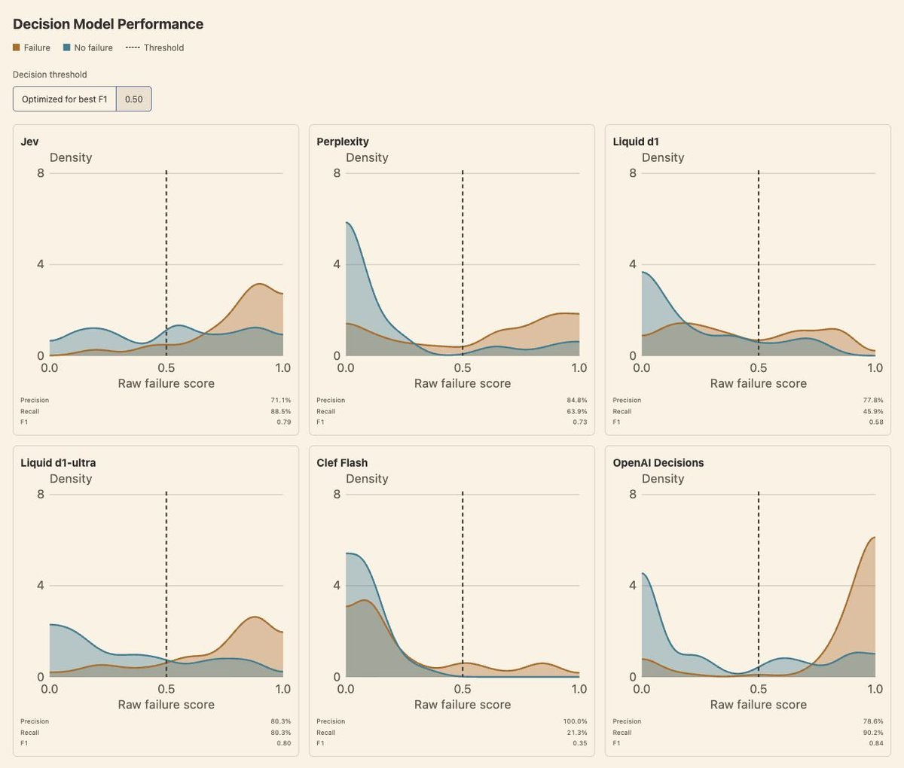
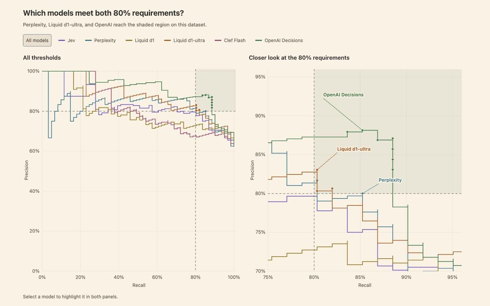
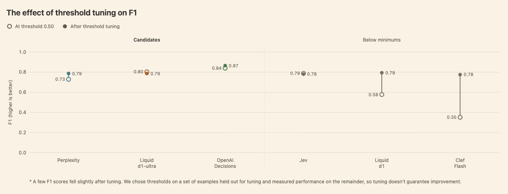
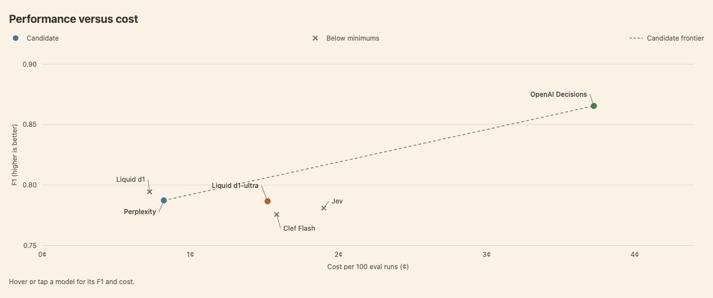
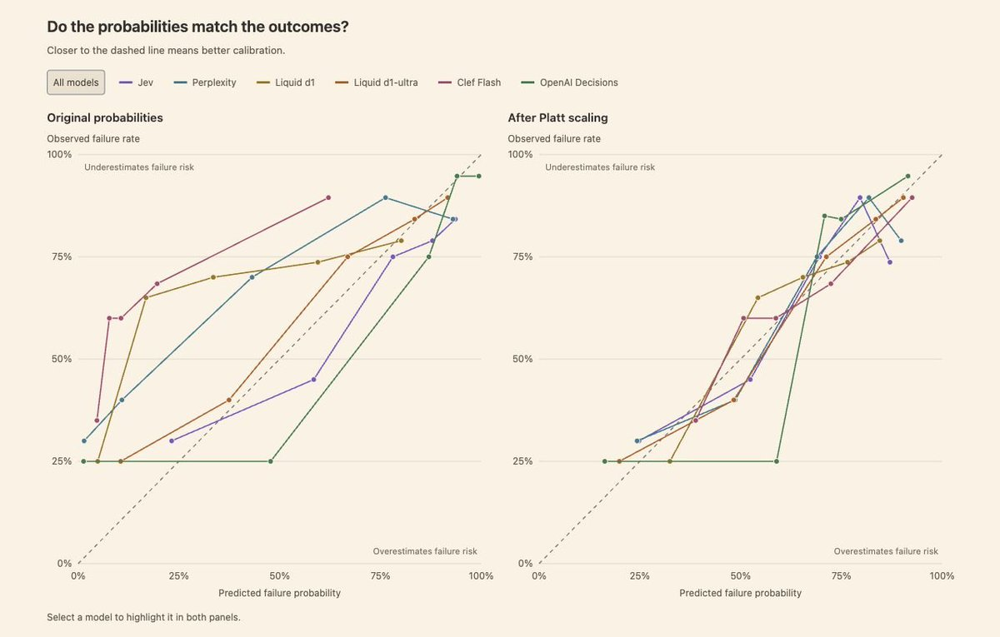

# 用决策模型替代传统生成式 LLM-as-a-Judge 做自动化评测/决策

> 作者：陈梓康；来源：[阿里技术微信公众号](https://mp.weixin.qq.com/s/NLfsVHKy_m6mZF6aq0Ut5A)，2026 年 11 月 6 日。
> 原文标题：《决策模型 Jev 可以直接上生产？用实验和公式理解 logit 调优与训练要领（长文干货）》。本文保留原文正文与技术图表，调整标题和阅读排版。

## 前言

Decision Model（jev-like）有一些深层次的潜力可以挖掘。并且，在上线业务前，有一些前置的调教工作要做。

本文的前半部分转载并整理自 Hamel Husain 与 Antaripa Saha 合著的《How To Use Decision Models for Evals》。

我们将围绕一个核心工程问题展开：**用决策模型（Decision Models）替代传统生成式 LLM-as-a-Judge 做自动化评测（Automated Evals）/决策时，如何避免「直接用默认阈值和原始输出概率」带来的性能折损与误判？**

后半部分是作者的一些洞见和见解。

## 01 Why use decision model to decide

在自动化评测（Automated Evals）中，我们过去习惯直接拿生成式大模型当裁判（LLM-as-a-Judge）。但真正往线上铺开时，传统生成式 LLM Judge 很快就会撞上两个底层瓶颈：

第一是**生成开销大**。哪怕我们最终只需要一个 `Pass` 或 `Fail` 的二元结论，自回归模型也必须逐个 token 把推理过程或 JSON 结构写出来，时延和 API 成本都很难压下来。

第二，也是更容易被忽视的一点：**传统 LLM Judge 给不出连续、可信的置信度（Confidence）**。

- 如果让 LLM 直接输出离散的 `Pass` / `Fail` 文本，就等于让模型在黑盒内部做了一次不可见的硬截断——我们拿不到任何概率信息，既没法根据业务需求去微调误报（False Positive）与漏报（False Negative）的比例，也没法识别哪些样本处于模棱两可的灰区。
- 如果改成在 Prompt 里让模型“口头报出置信度”（例如输出 `{"score": 0.85}`），它本质上只是在采样数字字符 token。受预训练语料先验影响，生成的数字会高度扎堆在 `0.50`、`0.80`、`0.90` 等少数离散档位上，既不连续，也不代表真实的错误频率。
- 即便我们直接去读取生成式 LLM 在答案 token（如 `Yes/No`）上的 `logprobs`，由于通用大模型普遍经历了多轮偏好对齐（RLHF）或 0/1 奖励的 GRPO 训练，它的词表 logits 早已被强烈推尖——输出概率动辄坍缩在 `0.999` 或 `0.001`，同样失去了灰区样本的校准度。

这正是<strong>决策模型（Decision Models）</strong>试图解决的问题。从 TypeSafe 的 Jev 开始，随后 Perplexity 的 Decider、Liquid 的 d1、Cloudflare 的 Clef 以及 OpenAI 的 Decisions API 相继推出。这类模型砍掉了自回归生成文本的循环，**单次前向计算直接从决策头读出 logits，并映射为 $0$ 到 $1$ 之间的连续概率分数**。

一旦拿到了连续、且经过专项训练的 logits / 概率分数，我们在做自动化评测时就多出了很多操作空间：不仅可以省下生成 token 的成本，还能**自由移动决策阈值**来适配业务的误报/漏报容忍度，甚至直接把分数当成**风险置信度**来做分级处置。

但问题也恰恰出在这里：我们观察到，很多人在接入这些决策模型后，**直接照搬了 API 默认的 `0.50` 决策阈值，也没有检验模型报出的概率数字是否真的可靠**，结果把一大截性能白白留在了桌面上。

下面我们就用一组真实的评测实验，一步步拆解：怎么调阈值、怎么结合成本选模型，以及什么时候才能真正相信模型输出的概率。

## 02 How decision model decides

### 1. 我们测了什么：任务设定与参评模型

我们从一套公寓租赁 Agent 系统中抽出了 **100 条真实轨迹（traces）**，每条轨迹包含完整的对话历史和 Agent 执行动作的日志。评测任务是在这些轨迹里找出包含错误的案例——比如预订失败，或者本该转交人工客服却漏转的情况（这也是我们在之前自动化评测文章里用过的“广义找错”数据集）。

我们把同一套评测准则发给了 6 个决策模型，让它们各自返回每条轨迹的失败概率（failure probability）：

- **TypeSafe Jev 1.13**（使用适配 Jev 的结构化输入）
- **Perplexity Decider 1.1 27B**
- **Liquid d1** 与 **Liquid d1-ultra**
- **Cloudflare Clef Flash**
- **OpenAI Decisions（底层为 GPT-6 Luna）**

接着，我们从两个维度对比这些模型：

1. **性能（Performance）**：拿模型的预测结果与人工逐条审阅标注的 `pass` / `fail` 真值对比，衡量模型在抓出错误的同时能不能少报假警。
2. **成本（Cost）**：根据实际 token 消耗量和各家官方定价计算 API 成本。

（为了聚焦核心问题，这次实验暂不对比时延，因为时延很大程度上取决于实验控制之外的服务端因素。）

### 2. 理解决策阈值：为什么默认的 `0.50` 会坑人？

在这项评测里，我们给每条轨迹打的是二元标签：`pass` 或 `fail`。做自动化评测时，我们一向推荐这种二分类设定，因为它能倒逼我们把评判标准写清楚，也更容易和人类的偏好对齐。

每个决策模型收到一条轨迹后，会返回一个 $0$ 到 $1$ 之间的分数，用来估计这条轨迹包含错误的可能性。为了把这个连续分数变成最终的 `pass/fail` 决定，各家 API 默认都会卡一个 **`0.50` 的决策阈值（decision threshold）**：分数 $\ge 0.50$ 的轨迹就被标记为失败（fail）。

但如果不拿自己的数据检验一下就直接用 `0.50`，结果可能会非常糟糕。

不妨想一个最简单的例子：假设某个模型给每一条真正的失败轨迹都打了 `0.40` 分，给每一条正常通过的轨迹都打了 `0.10` 分。你看，这个模型其实把正负样本分得一清二楚——只要我们把阈值设在 `0.30`，它就能做到 100% 完美分类；可如果沿用默认的 `0.50` 阈值，它连一条错误都抓不出来。

在真实场景里，失败轨迹和正常轨迹的分数分布不可避免会有重叠。这时候把阈值往低处调，虽然能抓到更多真正的错误，但也会顺带捞进更多误报。所以，选择决策阈值的过程，本质上就是在权衡两个指标：

- **Precision（精确率 / 查准率）**：被模型标记为失败的轨迹里，真正包含已知错误的比例（控制误报）。
- **Recall（召回率 / 查全率）**：所有已知的真实错误轨迹里，被模型成功抓出来的比例（控制漏报）。

到底该偏向哪一头，取决于具体的业务目标。比如刑事审判对定罪设了极高的门槛，宁可漏判也不能冤枉无辜，这强调的是 Precision；而早期癌症筛查则宁可多做几次复查也要尽量少漏掉患者，这强调的是 Recall。

为了在同一起跑线上对比这 6 个模型，我们先给 Precision 和 Recall 赋予相同的权重，用它们的调和平均数——**F1 分数**（范围 $0$ 到 $1$，越高越好）来衡量整体表现。当我们把每个模型给失败轨迹（橙色）和正常轨迹（蓝色）打出的分数分布画出来，并把阈值从默认的 `0.50` 切换到针对各自最优 F1 调优后的位置时，可以直观看到：**OpenAI Decisions 在这个任务上把两类样本的分布拉开得最干净**，这也反映在它更高的 F1 分数上。

### 3. 先立规矩再谈优化：设定业务的最低可用门槛

需要注意的是，这里很容易踩进另一个坑：**千万不要脱离业务底线去盲目最大化 F1**。在动手调阈值之前，我们得先想清楚：这个分类器至少要做到什么程度，在业务上才算「能用」？

举个例子，假如我们要拿这个分类器去搭一套**自动化线上告警系统**，那我会要求 Precision 和 Recall 都必须至少达到 80%——只有这样，才能在尽量少发假警报骚扰团队的同时，抓住足够高比例的线上故障。

倘若我们把各个模型在不同阈值下的 Precision-Recall 变化曲线画在一张图上，右上角“Precision $\ge 80\%$ 且 Recall $\ge 80\%$”的矩形阴影区就是我们的合格线。观察这张图，6 个模型立刻分出了高下：

- **进入合格区的候选模型（3 个）**：**Perplexity Decider 1.1 27B**、**Liquid d1-ultra** 和 **OpenAI Decisions** 的曲线成功穿过了阴影区，满足我们的最低要求；
- **未达标模型（3 个）**：**Jev 1.13**、**Liquid d1** 和 **Cloudflare Clef Flash** 无论怎么调整阈值，都无法同时迈过双 80% 的门槛，可以直接排除出本次候选池。

即便对留下的三个候选模型，它们各自的曲线也只是有一小段落在了阴影区里——我们依然需要在这片合格区域内，为每个模型精准定下那个最佳阈值。

### 4. 动手调优决策阈值（Threshold Tuning）

既然下游应用对 Precision 和 Recall 都有明确要求，而调阈值只能选择既有 PR 曲线上的工作点，那么**自训时，我们就应在数据覆盖、训练目标和模型选择中提前考虑误报与漏报的要求**，并在独立验证数据上检查是否存在同时达标的阈值。提高目标工作点附近的区分能力值得尝试，但概率校准或阈值加权损失本身，都不能保证 P/R 达标。

接下来我们就以最大化 F1 为目标来调阈值。对于刚才入围的三个候选模型，我们在**训练数据上加上硬约束**：**只允许在同时满足 Precision $\ge 80\%$ 和 Recall $\ge 80\%$ 的阈值里挑选**；至于另外三个未达标的模型，我们不加约束直接最大化 F1，用来展示调阈值本身能带来多大变化。

为了防止在测试集上“看答案调参”导致过拟合，这一步必须使用交叉验证。只要手里已经存好了人工标注标签和各模型的原始打分，可以直接把下面这段 Prompt 交给 Coding Agent 来跑完整个流程：

> Using my saved model scores and binary labels (1 means failure), tune a decision threshold to maximize F1 while requiring at least 80% precision and 80% recall. Use stratified five-fold cross-validation, choosing thresholds on the training examples and measuring performance on the remaining examples. If comparing models, use the same splits for each. Only select thresholds that meet both minimums on the training examples. If none qualifies, report that rather than relaxing either requirement. Report validation precision, recall, and F1, along with any splits where no threshold qualified or validation performance fell below my minimums. Compare with the default threshold of 0.50. Reuse the saved scores without making new model calls.

对比默认 `0.50` 阈值与五折交叉验证调优后的结果，可以看到一个有意思的现象：

- 入围的三个候选模型（Perplexity、Liquid d1-ultra、OpenAI）从 F1 调优中获得的提升幅度，反而比被淘汰的 Liquid d1 和 Clef Flash 要小（后两者的默认阈值偏离最佳点太远，调完阈值后 F1 大涨，但依然够不到双 80% 线）。
- 尽管如此，对候选模型做阈值调优依然不可或缺——在实际业务里，哪怕 Precision 和 Recall 只有几个百分点的移动，也会直接牵动业务成本或用户体验。
- 另外请记住：现实业务里 Precision 和 Recall 几乎不可能像 F1 假设的那样恰好等权。如果更看重 Precision，可以用 $\beta < 1$ 的 **$F_\beta$ 分数**；如果更看重 Recall，则用 $\beta > 1$。换一个优化指标，选出来的最佳阈值和最终排序都会随之改变。

简单有效: )

### 5. 性能与成本的较量（Performance vs. Cost）

把每个模型的阈值都调到最佳状态后，我们终于可以把留下的三个合格候选摆到同一张图上，对比它们调优后的 F1 与 API 成本了：

| 达标候选模型 | 调优后 F1 （5-fold CV） | API 成本 （每 100 次评测） | 在帕累托前沿上的定位 |
| --- | --- | --- | --- |
| **Perplexity Decider 1.1 27B** | **0.79** | **0.82 美分** | 合格候选中最便宜的方案，守住双 80% 底线的极致性价比之选 |
| **Liquid d1-ultra** | 介于 0.79～0.87 之间 | 介于 0.82～3.72 美分之间 | 性能与成本均处于中间档，且原生概率校准极佳 |
| **OpenAI Decisions (GPT-6 Luna)** | **0.87** | **3.72 美分** | 分类性能断层领先，但成本约为 Perplexity 的 **4.5 倍** |

连接这三个点的虚线就构成了候选池的**帕累托前沿（Pareto frontier）**：对于我们想要的任何 F1 水平，这条线都能指出达到该性能所需的最便宜模型。虽然这里只有三个点。

### 6. 我们能直接相信模型报出的概率吗？（Calibration）

除了做非黑即白的 `pass/fail` 分类，很多时候我们还会想把决策模型的分数直接当成<strong>置信度估计（confidence estimate）</strong>来用。但问题是：我们能按字面意思相信那个数字吗？如果模型报出 `0.80`，真的意味着“80% 的可能性有错”吗？

要满足这个条件，在所有被模型打出 `0.80` 左右分数的轨迹里，必须真的有大约 80% 包含错误。

我们把每个模型的预测概率按高低分桶（每个点代表大约 20 条得分相近的轨迹），横轴画模型的平均预测概率，纵轴画这批轨迹里实际观察到的失败比例，就得到了**概率校准曲线（Calibration Curve）**：

- 落在**对角线**上，说明预测概率与实际错误率严丝合缝；
- 落在对角线**上方**，说明真实错误率高于预测值，模型**低估**了失败风险；
- 落在对角线**下方**，说明模型**高估**了失败风险。

观察校准前的原始曲线，各家模型的脾气大相径庭：

- **Jev 1.13 和 Liquid d1-ultra** 在这个数据集上天生就已经校准得非常好，几乎不需要调整；
- **Cloudflare Clef Flash、Perplexity 和 Liquid d1** 则明显偏离对角线。最夸张的是 Clef Flash：其中一组轨迹的模型平均预测失败概率只有约 8%，但实际上这组轨迹里有 **60%** 都包含了错误！

如果模型的预测概率和真实结果对不上，我们可以在外层再套一个简单模型把概率校准回来。最经典的方法是 **Platt scaling**——在留出数据上拟合一条简单的 S 型曲线来修正概率偏差。

经过 Platt scaling 校准后，Perplexity、Liquid d1 和 Clef Flash 都显著向对角线靠拢了。但也要特别当心：**Platt scaling 并不总是合身**。比如在我们的实验里，**OpenAI Decisions 的概率在套用这一版 Platt scaling 后反而略微变差了**。所以做完校准一定要用指标说话。我们可以用下面这段 Prompt 让 Coding Agent 自动跑完交叉验证校准并给出 Brier score（越低越好）对比：

> Using my saved failure probabilities and binary labels (1 means failure), test whether Platt scaling improves each model’s probabilities. Use stratified five-fold cross-validation with the same splits for every model. Fit the calibration mapping on each training split and apply it to the remaining traces. Fit on log-odds, clipping probabilities away from 0 and 1 first. Plot predicted probabilities against observed failure rates before and after calibration. Report Brier scores (lower is better), and explain which models improved or got worse. Reuse the saved scores without making new model calls.

### 7. 评测器粒度与落地迭代闭环

在这次实验里，为了让不同模型之间的差距更容易看清，我们故意把评测任务设得很宽泛（“找出任何错误”）。**但在实际工程落地中，我们强烈建议为每一种具体的失效模式单独构建一个 Judge**（比如把“预订失败”和“漏转人工”拆成两个独立的 Judge）。当任务范围收窄、评判指令更具体之后，我们预期不同模型之间的性能差距会大幅缩小。

在日常做项目时，我喜欢先从一个性能能达标的大模型开始跑通，然后再尝试换用更小、更便宜的模型，看它们能不能在更低成本下追平大模型的表现；如果手里有高质量的标注数据，配合 Prompt 调优往往也能帮小模型往上提一大截。

大家可能也会好奇：决策模型和通用 LLM 到底怎么选？在我们的实验里，底层调用 GPT-6 Luna 的 OpenAI Decisions 以最高成本拿到了最高 F1，说明遇到高难度的复杂评测任务时，多花钱上大模型依然是值得的。而在 Randy Olson 做的一项更广泛的对比中，**决策模型在分类（classification）和路由（routing）任务上能够以更低成本追平 LLM，但在需要知识储备与多步推理（knowledge and reasoning）的任务上，LLM 依然明显领跑**。

最后把整套方法浓缩成四步迭代闭环：

1. **定门槛筛模型**：打磨好 Judge Prompt 后，先根据业务场景定下 Precision 和 Recall 的最低合格线，直接淘汰达不到底线的模型；
2. **先调阈值再比性能**：在对比各模型之前，先结合业务目标（认真思考该用什么权衡指标，别仅仅因为本文用了 F1 就照搬 F1！）在交叉验证下调优每个模型的决策阈值；
3. **按需检验并校准概率**：如果想把分数当成置信度来用，先检查预测概率是否匹配实际观测结果；校准（如 Platt scaling）能帮上忙，但必须用 Brier score 实测确认它确实带来了改善；
4. **综合权衡与持续迭代**：结合工作负载对性能、成本和时延的要求拍板。而且记住这是一个循环——一旦后续优化了 Prompt，前面调好的阈值和校准映射都需要重新跑一遍。

## 03 Insights for decision model logits training

> 以下系作者结合前文的评测现象，以及《Jev-like技术方案调研》《RLCD：校准决策的目标函数、约束与训练算法》（工作内部文件）整理的延伸笔记，非原文转载。

由浅及深，我们将会从统计与优化理论的数学推导的视角，和算法设计的视角来对评测现象做一些进阶的分析和指导。

### 3.1 校准度与排序能力：为什么 Jev 1.13 的概率很准，PR 曲线却进不了双 80%？

我们先从前面评测里的一个反直觉现象说起：在校准曲线图上，**Jev 1.13 的预测概率几乎紧贴对角线，但在“Precision $\ge 80\%$ 且 Recall $\ge 80\%$”的筛选中却未能入围**；反倒是原始概率明显失准的 Perplexity Decider 27B 先过了双 80% 门槛，随后补一步简单的 Platt scaling 就把概率也修准了。

为什么“概率准”不等于“分类好”？因为模型输出的连续分数 $S \in [0, 1]$ 其实同时承担着两项不同的任务：**一是把正负样本排开（排序/区分能力），二是如实报出每个分数对应的真实错误率（校准度）**。

记真实失败标签为 $Y \in \{0, 1\}$，总体失败基率为 $\pi = \mathbb{E}[Y]$，模型报出分数 $S = s$ 时的真实条件失败率为 $m(s) = \Pr(Y = 1 \mid S = s)$。衡量概率质量的 Brier 分数在总体分布上可以精确拆解为三项（Murphy 分解）：

- **$\mathrm{REL}$（Reliability，校准误差）**：衡量模型报出的字面概率 $S$ 与该分数组真实失败率 $m(S)$ 之间的偏差；完美校准时 $S = m(S)$，$\mathrm{REL} = 0$。
- **$\mathrm{RES}$（Resolution，分辨率）**：衡量不同分数组的真实失败率 $m(S)$ 能拉开多大差距。极端情况下，如果一个模型对每条轨迹都无脑报总体基率 $\pi$，它的校准误差 $\mathrm{REL} = 0$（说有 $\pi$ 的概率错，还真就错了 $\pi$），但它的 $\mathrm{RES} = 0$，一张告警单都分不出来。

理解了这两项的拆分，就能明白事后校准的边界：**如果我们对所有样本施加同一个严格递增变换 $S' = g(S)$（例如温度缩放 $T > 0$，或斜率 $a > 0$ 的 Platt scaling），样本之间的分数高低顺序完全不变**。原分数在阈值 $\tau$ 下选出的告警集合，与新分数在阈值 $g(\tau)$ 下选出的集合是同一批样本：

$$
\{S \ge \tau\} = \{g(S) \ge g(\tau)\}
$$

因此，在同一批数据上遍历所有阈值时，**严格递增变换不会改变 AUROC、整条 PR 曲线以及最优 F1**；同时由于可逆变换不改变 $S$ 的信息划分，总体分辨率 $\mathrm{RES}$ 也保持不变，Brier 分数的变化全部来自 $\mathrm{REL}$。

这也顺带澄清了一个常见误区：**单纯把 logits 乘以一个放大系数，只是拉大了分数的数值跨度，并不会提高 $\mathrm{RES}$ 或改善 PR 曲线**。在训练决策模型时，第一要务是让模型学到能够区分正负样本的特征表示（把真正含错的轨迹排到前面），在此基础上再保证输出概率与真实频率对齐。

### 3.2 默认阈值 `0.50` 为什么会失灵？从贝叶斯先验与误判代价理解 Platt Scaling

在评测中，不少模型直接用默认阈值 `0.50` 截断时效果很差，或者像 Clef Flash 那样“平均报 8% 失败率，实际却有 60% 失败”。把概率还原到对数几率（log-odds / logit）空间，很多现象就会变得非常直观。

记模型输出概率为 $s = \sigma(z) = \frac{1}{1 + e^{-z}}$，对应的 logit 为 $z = \operatorname{logit}(s) = \log\frac{s}{1 - s}$。默认阈值 $s \ge 0.50$ 恰好对应 $z \ge 0$。而事后做 Platt scaling，本质上是在 logit 空间做了一次线性仿射变换：

$$
s_{\mathrm{cal}} = \sigma(a z + b)
$$

其中斜率 $a$ 负责拉伸或压缩 logit 尺度（当 $b = 0, a = 1/T > 0$ 时就是单一温度缩放），截距 $b$ 负责整体平移对数几率。在实际拟合中，模型误差和各类分布漂移都会同时影响 $(a, b)$；但有一个非常重要的特例可以精确推导——**先验基率偏移（Prior / Base-rate Shift）**。

假设模型在训练分布 $\mathrm{tr}$ 上已经学到了准确的真实后验 $q_{\mathrm{tr}}(x) = \Pr_{\mathrm{tr}}(Y = 1 \mid X = x)$，到了下游评测集 $\mathrm{te}$ 上，正负类的特征生成机制没有变（即 $\Pr_{\mathrm{te}}(X \mid Y) = \Pr_{\mathrm{tr}}(X \mid Y)$），唯独正例出现的总体比例从 $\pi_{\mathrm{tr}}$ 变成了 $\pi_{\mathrm{te}}$。由贝叶斯公式两边取对数几率，可以直接推出新分布下的真实后验 logit：

$$
\operatorname{logit} q_{\mathrm{te}}(x)
= \operatorname{logit} q_{\mathrm{tr}}(x) + \underbrace{\operatorname{logit}(\pi_{\mathrm{te}}) - \operatorname{logit}(\pi_{\mathrm{tr}})}_{\text{由基率变化引起的常数偏置 } b}
$$

你看，哪怕模型的判别能力一点没变，只要下游业务的故障基率 $\pi_{\mathrm{te}}$ 和训练数据不同，真实对数几率就会整体平移一个常数 $b$。如果照搬原来的分数并死守 `0.50` 阈值，自然会出现系统性的漏报或误报（这也印证了《Jev-like技术方案调研》第 2 节的现象：Jev 在多个基率各异的基准上混合算 ECE 只有 0.047，但单拿每个基准出来算，中位 ECE 升到了 0.168）。

再往深处想一步：**就算概率已经针对当前数据集完美校准了，默认阈值 `0.50` 就是最优的吗？依然不一定。**

1. **调阈值与加偏置在二元分类上等价**：对任意阈值 $\tau \in (0, 1)$，有

   $$
   s \ge \tau \iff z - \operatorname{logit}(\tau) \ge 0
   $$

   也就是说，把决策阈值定在 $\tau$，等价于在 logit 上加偏置 $b_\tau = -\operatorname{logit}(\tau)$ 后再用 `0.50` 截断（但注意：调阈值只改变分类切分点，本身不等于把概率校准准了）。
2. **业务代价决定了最优阈值的位置**：假设判断正确的代价为 0，误报（FP）代价为 $C_{\mathrm{FP}} > 0$，漏报（FN）代价为 $C_{\mathrm{FN}} > 0$。当分数 $s$ 已完美校准时，一条分数为 $s$ 的样本报 Fail 的期望代价是 $(1-s)C_{\mathrm{FP}}$，报 Pass 的期望代价是 $s C_{\mathrm{FN}}$。令两者相等，最小化期望代价的贝叶斯最优阈值为：

   $$
   \tau^* = \frac{C_{\mathrm{FP}}}{C_{\mathrm{FP}} + C_{\mathrm{FN}}}
   $$

   只有误报与漏报代价完全相等（$C_{\mathrm{FP}} = C_{\mathrm{FN}}$）时，最优阈值才是 `0.50`；若优化目标是最大化 $F_\beta$ 或满足特定的 P/R 下限，最优工作点同样会偏离 `0.50`。因此，**一套通用模型权重不可能预先写死所有下游业务的基率与代价结构**，部署时留出少量带标样本在交叉验证下调阈值、验校准，是必不可少的标准动作。

### 3.3 训练损失怎样塑造概率：为什么严格正常评分规则是校准的锚点？

既然我们希望模型输出的 $s = \sigma(z)$ 尽可能接近真实条件概率 $q = \Pr(Y = 1 \mid X = x)$，那么在训练阶段，损失函数的设计到底提供了怎样的数学保证？

固定一条输入 $x$，设真实失败概率为 $q \in (0, 1)$，模型预测为 $s = s_\theta(x) \in (0, 1)$。对比二分类最常用的 Brier 损失 $\ell_{\mathrm{Brier}}(s, y) = (s - y)^2$ 与交叉熵损失（CE / log loss）$\ell_{\mathrm{CE}}(s, y) = -y\log s - (1 - y)\log(1 - s)$，它们在给定 $x$ 下的条件期望损失对 $s$ 的导数分别为：

$$
\frac{\partial}{\partial s}\mathbb{E}[\ell_{\mathrm{Brier}} \mid x] = 2(s - q), \qquad
\frac{\partial}{\partial s}\mathbb{E}[\ell_{\mathrm{CE}} \mid x] = \frac{s - q}{s(1 - s)}
$$

这两个式子非常漂亮：只要 $0 < q < 1$，它们的导数都在 $s = q$ 处唯一为零，且在 $s < q$ 时为负、$s > q$ 时为正（当 $q = 0$ 或 $q = 1$ 时最优点落在对应边界）。换句话说，**在模型容量足够、优化充分且训练分布与目标一致的理想条件下，最小化 Brier 或 CE 都会驱使模型如实报出真实后验概率 $q$**。具有这一性质的评分规则，就叫做**严格正常评分规则（Strictly Proper Scoring Rules）**。

反过来，如果我们在训练目标里加入一些常见的修改，期望最优点会发生什么偏离？我们可以直接算出来：

1. **标签平滑（Label Smoothing）会把概率向 `0.50` 压缩**： 在二分类中，如果把硬标签 $Y \in \{0, 1\}$ 平滑成 $\tilde{Y} = (1 - \varepsilon)Y + \frac{\varepsilon}{2}$（其中 $0 < \varepsilon < 1$），再去最小化 CE，条件期望损失的零点就会直接变成：

   $$
   s^* = (1 - \varepsilon)q + \frac{\varepsilon}{2}
   $$

   这意味着真实高风险样本（$q > 0.5$）的概率会被系统性压低，低风险样本（$q < 0.5$）则被抬高。
2. **只看对错的 0/1 奖励会把概率推向极端顶点**： 如果在强化学习中按模型分布 $p_1 = s, p_0 = 1 - s$ 采样动作 $A \in \{0, 1\}$，只根据动作是否正确给奖励 $C = \mathbf{1}[A = Y]$（不加 KL 等其他正则约束），那么条件期望奖励是 $s q + (1 - s)(1 - q)$，对 $s$ 的导数是常数 $2q - 1$。只要 $q > 0.5$，梯度就一直把 $s$ 往 `1` 推；只要 $q < 0.5$，就一直往 `0` 推——这正是只优化分类准确率而不顾校准的典型后果。
3. **带校准项的 RLCD 策略梯度，以及为什么不能套 GRPO 的组内标准差归一化**： 在 RLCD（如社区 eve-rlcd 实现）中，如果把标量奖励设计为 $r = \mathrm{sg}(C - p_A)$（$\mathrm{sg}$ 表示求梯度时把奖励视为常数），那么策略梯度在期望上恰好等价于 Brier 损失的负梯度：

   $$
   \mathbb{E}_{A \sim p}\big[r \nabla_\theta \log p_A \mid x\big]
   = 2(q - s)\nabla_\theta s
   = -\nabla_\theta \mathbb{E}\big[(s - Y)^2 \mid x\big]
   $$

   这里有两个极易踩坑的细节：

   1. 有完整标签时无需绕道采样式 RL：当训练数据直接给出了标签 $Y$（甚至在二分类里，只要知道采出的动作 $A$ 和对错 $C$，就能立刻还原 $Y$），直接对 $(s - Y)^2$ 或 CE 求导就能拿到零采样方差的精确梯度；用采样 RL 估计同一个梯度只会平白引入动作采样方差。

   2. 组内标准差归一化会抵消 $-p_A$ 的校准作用：如果照搬 GRPO，对同一道题采出的 $G$ 个动作减去组内均值再除以组内标准差，会发生什么？在二分类硬标签 $y$ 下，答对时 $r = 1 - p_y$，答错时 $r = -(1 - p_y)$，合并写出来就是：

   $$
   r = (1 - p_y)(2C - 1)
   $$

   由于 $(1 - p_y) > 0$ 对同一题的 $G$ 个采样是同一个正数，而标准化操作 $(r - \bar{r})/\sigma_r$ 对正仿射变换完全不变，因子 $(1 - p_y)$ 在分子分母中被直接约掉！归一化后的优势函数与纯 0/1 奖励 $C$ 完全相同，原本用来锁住校准不动点的 $-p_A$ 项就此失效，不动点再次坍缩到 0 或 1。

### 3.4 当业务同时卡死 P 和 R 下限时，训练阶段该怎么发力？

在前面的阈值调优小节里，我们提到了一个关键问题：事后调阈值只能在模型既有的 PR 曲线上找点；如果整条 PR 曲线都没进“Precision $\ge 80\%$ 且 Recall $\ge 80\%$”的阴影区，事后怎么调都没救。那么在自训模型时，我们能如何提前响应这种业务诉求？我这里给出一些训练的trick。

#### 第一步：把“双 80%”写成明确的数学约束，用对验证指标

设模型在阈值 $\tau$ 下的告警规则为 $h(x) = \mathbf{1}[s_\theta(x) \ge \tau]$。记总体真正例比例为 $u = \mathbb{E}[Y h(X)]$，总体假正例比例为 $v = \mathbb{E}[(1 - Y)h(X)]$，总体正例基率为 $\pi = \mathbb{E}[Y]$。当 $u + v > 0, \pi > 0$ 时，业务要求的 Precision $\ge P_0$ 与 Recall $\ge R_0$ 可以改写为关于 $(u, v)$ 的两个线性不等式：

$$
\begin{aligned}
\mathrm{Precision} = \frac{u}{u + v} \ge P_0 &\iff (1 - P_0)u \ge P_0 v,\\
\mathrm{Recall} = \frac{u}{\pi} \ge R_0 &\iff u \ge R_0 \pi
\end{aligned}
$$

写成这样，就能一眼看出两个常犯的概念混淆：

1. **“P 和 R 都达到 80%”是跨样本的总体排序约束，绝不等于“把概率阈值 $\tau$ 设成 0.80”**。
2. 在训练过程中挑选 Checkpoint、设计困难样本挖掘（Hard Negative / Hard Positive Mining）或调整数据配比时，不能只盯着整体平均 NLL / Brier，而应在验证折上直接追踪**受约束工作点指标**——例如“在满足 $\mathrm{Precision} \ge 80\%$ 的所有阈值中，模型能达到的最大 Recall（或最大 F1）是多少”。

#### 第二步：如果已知部署阈值区间，可以用 Schervish 加权损失重点照顾边界

在容量有限的小尺寸决策模型上，如果我们已经知道下游大致会在某个概率阈值 $\tau \in (0, 1)$ 附近做切分（或者设有类似 `0.20～0.80` 的人工复核灰区带），能不能让训练损失把梯度预算重点花在阈值 $\tau$ 附近，同时又不破坏“如实报概率”的性质？

这里必须对比两种截然不同的平滑写法：

- **陷阱写法（固定代价 + 直接把指示函数换成 sigmoid）**： 阈值为 $\tau$ 的代价敏感损失在 $y=0$ 时罚 $\tau\mathbf{1}[s > \tau]$，在 $y=1$ 时罚 $(1-\tau)\mathbf{1}[s \le \tau]$。因为指示函数梯度几乎处处为 0，有人会直接把 $\mathbf{1}[s > \tau]$ 替换成软决策 $d(s) = \sigma\!\left(\frac{s - \tau}{\delta}\right)$（$\delta > 0$ 为平滑宽度），写成：

  $$
  \ell_{\mathrm{naive}}(s, y) = \tau(1 - y)d(s) + (1 - \tau)y\big(1 - d(s)\big)
  $$

  对它的条件期望求导就会发现问题：

  $$
  \frac{\partial}{\partial s}\mathbb{E}[\ell_{\mathrm{naive}} \mid x]
  = \frac{\tau - q}{\delta}\,\sigma'\!\left(\frac{s - \tau}{\delta}\right)
  $$

  导数的符号只取决于真实概率 $q$ 在 $\tau$ 的哪一侧！只要 $q > \tau$，梯度就一直为负，把预测 $s$ 往 `1` 推；只要 $q < \tau$，就把 $s$ 往 `0` 推。它不仅没有校准阈值附近的概率，反而把概率强行推离了阈值 $\tau$。
- **正确写法（Schervish 阈值积分加权）**： Schervish 定理指出，任何二元正常评分规则都可以表示为不同阈值 $t \in [0, 1]$ 下代价敏感损失的加权积分（例如标准 Brier 损失对应均匀权重 $w(t) = 2$，CE 对应 $w(t) = \frac{1}{t(1-t)}$）。如果我们预先选定一个在 $[0, 1]$ 上非负、可积的权重密度 $w(t)$——比如在目标阈值 $\tau$ 附近放一个窄高斯峰，并叠加一个正的基础权重 $\varepsilon_0 > 0$（相当于并上 $\frac{\varepsilon_0}{2}\ell_{\mathrm{Brier}}$）：

  $$
  \ell_w(s, 1) = \int_s^1 (1 - t)w(t)\,dt, \qquad
  \ell_w(s, 0) = \int_0^s t\,w(t)\,dt
  $$

  根据微积分基本定理，它对预测概率 $s$ 和 logit $z$ 的条件期望梯度极其干净：

  $$
  \begin{aligned}
  \frac{\partial}{\partial s}\mathbb{E}[\ell_w \mid x] &= (s - q)\,w(s),\\
  \frac{\partial}{\partial z}\mathbb{E}[\ell_w \mid x] &= (s - q)\,w(s)\,s(1 - s)
  \end{aligned}
  $$

  由于 $w(s) > 0$，**逐点期望损失的唯一最优点依然严格停在真实概率 $s = q$ 上**；同时，当预测分数 $s$ 落在目标阈值 $\tau$ 附近时，$w(s)$ 较大，模型会对这一区域的校准残差赋予更高的梯度权重。
- **权衡与边界（有限容量下的“误差搬家”效应）**： 需要清醒认识的是，“逐点最优点为 $s = q$”的前提是每个输入的概率可以独立自由优化。当模型容量有限、不同输入共享参数时，提高阈值 $\tau$ 附近的权重 $w(s)$，本质上是**把宝贵的拟合预算优先保给阈值 $\tau$ 附近，代价是其他非关键区域的校准误差可能变大**。

  我们可以算一个极简的构造例：假设数据里有等权的两组样本，真实失败率分别为 $q_1 = 0.80$ 和 $q_2 = 0.60$，但受限于模型表达能力，预测被耦合为 $s_1 = \theta, s_2 = \theta - 0.30$（$\theta \in [0.30, 1]$）：

  1. 用均匀权重的标准 Brier 训练，最优解折中在 $\theta = 0.85$，此时两组预测分别为 0.85 和 0.55，各自承担 0.05 的偏差，整体校准误差 $\mathrm{REL} = 0.0025$；

  2. 若改用集中在 $\tau = 0.80$ 附近的权重 $w(t) = 0.2 + \varphi_{0.80, 0.03}(t)$（$\varphi_{\mu, \sigma}$ 为正态密度），最优解会移动到 $\theta \approx 0.8015$——第一组在阈值 0.80 附近准到了极致的 0.8015，但第二组预测被拉低到了 0.5015（偏差近 0.10），整体 $\mathrm{REL}$ 反而升至约 0.0049。 因此，Schervish 阈值加权是一个把校准精度集中到刀刃上的工具，但它本身不能代替特征区分度的提升；是否能切实推高验证集上的受约束 P/R，仍需靠实验检验。

### 3.5 拆分原子 Judge 与共享前缀：如何兼顾判别粒度与推理成本？

最后，我们来看评测结尾提出的那条工程原则：**“不要用一个宽泛的 Judge 抓所有错误，而是为每一种具体的失效模式单独建一个 Judge。”** 把这条原则放到单次前向决策模型（如 Jev-like 架构）里，会引出非常有趣的计算与概率组合问题。

#### 为什么要拆细？给单次前向模型降低推理跨度

在前面的实验中，任务被定义为“找出 20 轮公寓租赁轨迹里的任何错误”。对于不生成思维链（CoT）、只做一次前向计算的决策模型来说，这相当于要求它在固定层数内同时完成“检索各轮对话状态、核对多种业务规则、再做逻辑或（OR）汇总”。如果我们将它拆成 $M$ 个职责单一的原子二元判断（例如 $q_1$：“用户明确要求转人工时是否未调用转接接口”、$q_2$：“双方确认看房时间后是否未调用预订工具”、$q_3$：“Agent 给出的报价是否与房源表冲突”），每一道子题的判据就变得具体而局部，标注与归因也更加清晰。

#### 拆成 $M$ 个 Judge 后，怎么把调用成本压下来？（共享前缀隔离读出）

如果按传统方式把 1 个宽泛 Judge 拆成 $M$ 个独立 Judge 分别请求 API，同一段长长的 Agent 轨迹就要被重复编码 $M$ 次，成本会直接翻 $M$ 倍。

而在支持**共享前缀预填充（Shared State Prefill）与题间隔离读出**的决策模型架构中（参考内部文件《Jev-like技术方案调研》第 3 节 QwenJev-Lite 方案），长轨迹材料只需 Prefill 一次，随后把 $M$ 个原子问题作为互相隔离的分支接在共享 KV 缓存后面并行读出。设长轨迹预填充的计算开销为 $C_{\mathrm{pre}}$，每个短问题头的增量开销为 $C_q$，则：

$$
C_{\mathrm{shared}} \approx C_{\mathrm{pre}} + M C_q, \qquad
C_{\mathrm{separate}} \approx M(C_{\mathrm{pre}} + C_q)
$$

当轨迹上下文很长、而原子问题本身很短（即 $C_{\mathrm{pre}} \gg M C_q$）时，一次前向并行读出 $M$ 个原子 Judge 的总计算成本将非常接近单次调用。

#### 汇总多个原子概率时的数学陷阱：题间隔离 $\ne$ 事件统计独立

当我们通过一次前向拿到了 $M$ 个原子失效模式的预测概率 $p_1, p_2, \dots, p_M$（其中 $p_j \approx \Pr(E_j \mid X)$ 代表第 $j$ 种错误发生的条件概率），如果下游想要回答“整条轨迹至少发生一种错误的总概率 $P_{\mathrm{any}} = \Pr\!\left(\bigcup_{j=1}^M E_j \;\middle|\; X\right)$ 是多少”，该怎么算？

很多人会本能地写出 $1 - \prod_{j=1}^M (1 - p_j)$。但请特别注意：**注意力掩码上的“题间隔离”只保证模型在回答第 $j$ 题时偷看不到第 $k$ 题的题面，绝不意味着真实世界里的失效事件 $E_1, \dots, E_M$ 在给定轨迹 $X$ 后是条件独立的！**（例如 Agent 一旦误解了用户的核心意图，可能在同一条轨迹里既报错价格、又漏调接口，两类错误高度正相关。）

在不知道各失效事件之间的条件相关性时，仅凭各自的边际概率 $p_j$，数学上只能框出 Fréchet–Boole 上下界：

$$
\max_{1 \le j \le M} p_j
\;\le\; \Pr\!\left(\bigcup_{j=1}^M E_j \;\middle|\; X\right)
\;\le\; \min\!\left(1, \sum_{j=1}^M p_j\right)
$$

不妨算一个只有两个原子 Judge 的直观例子：假设在某类轨迹上，两个子错误的真实发生概率都是 $p_1 = p_2 = 0.30$：

- 如果这两类错误总是由同一个底层故障同时引发（事件完全重合），那么“至少发生一种错误”的真实概率就是 $\max(0.30, 0.30) = \mathbf{0.30}$；
- 如果两类错误在给定轨迹下恰好相互独立，真实并集概率才是 $1 - (1 - 0.30)^2 = \mathbf{0.51}$；
- 如果两类错误互斥（绝不会同时发生），真实并集概率则是 $0.30 + 0.30 = \mathbf{0.60}$。

可以看到，单靠“每个原子 Judge 各自校准得很好”，并不能自动推出合成后的总失败概率也是校准的。那么在工程落地时，我们手头这 $M$ 个原子概率 $p_1, \dots, p_M$ 到底该怎么消费？最稳妥的路径有两条：

- **路径一（只做告警，不求总概率）：按原子 Judge 独立调阈值**。为每个失效模式 $j$ 单独在验证集上调优阈值 $\tau_j$，线上只要任一 $p_j \ge \tau_j$ 就触发对应类别的告警（不仅能抓错，还能直接给出细粒度错因标签），最后在轨迹级测试集上统一验收整体告警的 P/R。
- **路径二（既要子项诊断，又要输出整条轨迹的总风险概率）：做一层轻量的“二次聚合校准”**。

#### 怎么把手头的 $M$ 个原子分数合成一个靠谱的轨迹级总概率？（二次聚合校准）

所谓“二次聚合”，就是把第一层 $M$ 个原子 Judge 输出的分数当作输入特征，直接用整条轨迹的 `pass/fail` 真值标签 $Y \in \{0, 1\}$ 做监督，再拟合一个极轻量的第二层概率模型来预测整条轨迹的失败风险。

在动手之前，先明确一个很容易混淆的前提：**这 $M$ 个原子 Judge 是 $M$ 个各自独立的“是/否（Sigmoid）”二分类器，而不是“多选一（Softmax）”的类别分布**。每个 $p_j \in [0, 1]$ 只和它自己的反面 $1 - p_j$ 加起来等于 `1`；同一条轨迹完全可以同时犯下多种错误，因此不同子题的概率之和 $p_1 + p_2 + \dots + p_M$ 完全可以大于 `1`。

要把这 $M$ 个分数合成一个校准过的总概率，我们可以对比两种从简到繁的做法：

**1. 做法 A（极简基线）：先用固定公式拍扁成一个标量 $r$，再做一维 Platt scaling**

当手头带轨迹级标签的校准样本很少（比如只有几十到上百条）、不敢拟合多参数模型时，最省事的办法是分两步走：

- **第一步（人工公式汇总）**：先选一个现成的启发式公式，把 $p_1, \dots, p_M$ 压成一个候选风险分 $r \in (0, 1)$。比如取最大值 $r = \max_j p_j$，或者借用独立性假设的形式算出：

$$
r = 1 - \prod_{j=1}^M (1 - p_j)
$$

（以前面两个子错误概率均为 $p_1 = p_2 = 0.30$ 为例，先算“两项都不错”的乘积 $(1 - 0.30)\times(1 - 0.30) = 0.49$，再用 1 减去它，就得到原始汇总分 $r = 1 - 0.49 = \mathbf{0.51}$。）

- <strong>第二步（一维刻度校准）：</strong>既然错误之间往往并不独立，直接拿 $r = 0.51$ 当概率用肯定会失真（比如两类错误完全重合时，真实失败率其实只有 0.30）。于是我们把 $r$ 当作单一特征，用轨迹级真值标签 $Y$ 拟合两个校准参数 $(a, b)$： $\widehat{P}_{\mathrm{any}} = \sigma\!\big(a\,\operatorname{logit}(r) + b\big)$

校准层从标注数据里看到“凡是原始汇总分 $r \approx 0.51$ 的轨迹，实际只有 30% 失败”，就会自动调整 $(a, b)$ 把输出概率压回 0.30 附近。

**为什么做法 A 只是一个妥协的基线？**

因为它有两个明显硬伤：

- 拍扁成标量时丢掉了组合结构：无论是 $(p_1, p_2) = (0.30, 0.30)$ 的两项完全重合错误，还是两项真正相互独立的错误，算出来的 $r$ 都是 0.51，一维校准无法区分到底是谁触发了这个 0.51；

- 只修读数刻度，改不了排序和 PR 曲线：当 $a > 0$ 时，$\sigma(a\,\operatorname{logit}(r) + b)$ 是关于 $r$ 的严格递增函数——原本 $r_A > r_B$ 的两条轨迹，校准后必然还是 $\widehat{P}_A > \widehat{P}_B$。这意味着所有轨迹的高低排序完全被你第一步手选的汇总公式锁死了：遍历所有阈值画出来的整条 PR 曲线分毫未动，只改变了每个工作点上显示的概率数值（例如原本卡 $r \ge 0.51$ 抓出的告警集合，和校准后卡 $\widehat{P}_{\mathrm{any}} \ge 0.30$ 抓出的集合完全是同一批样本）。

**2. 做法 B（更合理的标准做法）：保留全部子项分数，用多变量逻辑回归同时学“组合权重”与“概率校准”**

既然先把 $M$ 个分数拍扁成一个标量会白白扔掉信息，更自然的思路是：**跳过手工汇总公式，直接把 $M$ 个原子 Judge 的输出（例如各自的 $z_j = \operatorname{logit}(p_j)$）作为 $M$ 维特征向量**，在轨迹级标签 $Y$ 上拟合一个带正则化的多变量逻辑回归：

$$
\widehat{P}_{\mathrm{any}} = \sigma\!\left(b + \sum_{j=1}^M \beta_j z_j\right)
$$

相比做法 A，把 $M$ 个子项摊开交给聚合器有三个实质性的好处：

- 能区分“单项孤立存疑”与“多项并发报警”：假设两条轨迹在两个原子 Judge 上的得分分别是 $(p_1, p_2) = (0.60, 0.10)$ 与 $(0.60, 0.40)$（甚至 $(0.60, 0.60)$）。如果按 $r = \max_j p_j$ 拍扁，它们都只剩下一个 0.60，一维校准后概率也必然相同；而保留全部子项后，模型能直接利用第二项的增量信号，给多项同时存疑的轨迹打出更高的风险。
- 能自动给冗余或高噪的原子 Judge 调整话语权：在实际评测中，不同原子 Judge 的质量与相关性千差万别。如果第 1 题和第 2 题高度重合（经常一起报高分），逻辑回归会自动压低各自的系数 $\beta_1, \beta_2$ 以避免双重计分；如果某个原子 Judge 判别很准，它的 $\beta_j$ 就会更大；若某个子题纯属噪声，其权重会自动向 0 收缩。
- 真正重学了轨迹级排序，有机会抬高 PR 曲线：由于不同子项被赋予了从数据中学出的不同权重 $\beta_j$，轨迹之间的综合得分先后顺序本身发生了改变（若校准集样本充足，还可进一步加入 $z_j z_k$ 等交叉项来捕捉特定错误对的共现效应）。因此，它不仅是在修概率刻度，更是在轨迹粒度上重新优化了一次分类排序。

不过，无论选用做法 A 还是做法 B，**第一层原子特征的覆盖度始终决定了上限**：第二层聚合器只看得到这 $M$ 个分数，看不到原始轨迹文本。如果某类错误根本不在已拆出的 $M$ 个原子 Judge 之内，两条在现有子题上打分完全相同的轨迹就可能一成一败；此时聚合器算得再精，也只能报出混合后的平均风险——要突破这个天花板，就得回到前面的错误分析闭环，把漏网的失效模式补成第 $M+1$ 个原子 Judge。

## 04 写在最后

回头看整套流程，决策模型给自动化决策带来的最大改变，是让我们重新拿回了一个**连续、可调的分数**。

过去用生成式 LLM 做决策，模型直接吐出一个 `Pass/Fail`，把“正负样本分得开分不开”、“概率数字准不准”和“阈值切在哪”全包办在黑盒里了。现在这三件事终于可以拆开处理：底子能不能把好坏轨迹排开，看 PR 曲线；报出来的数字能不能当真实错误率信，看校准曲线和 Platt scaling；业务上宁可多审几条误报还是宁可漏掉故障，靠移动阈值来拍板。

很多时候，便宜的模型并不是不能用，而是需要做一些调教工作。得在交叉验证下调好阈值、配上一层简单的校准，它才能勉强上生产。我更喜欢把基本工作做扎实。

当然，我在这里也留下了两个还没有想得太明白如何去解决的问题：

1. **Thinking Decision Model的必要性**（更高的上限）： 决策模型省钱是因为砍掉了生成推理过程（CoT），一次前向直接读出概率。但如果 20 轮轨迹里的错是“第 3 轮答应的折扣，到第 18 轮算总价时漏扣了”，或者要先算出两个日期差几天再判断是否违规，不写中间步骤，小模型单靠一次前向很难算对。这类问题光靠把 Judge 拆细恐怕还不够，要么得用代码把中间数字先算好塞进输入，要么还得退回带推理的模型。以及，如何训练一个有thinking能力的decision model，也是一个待定的问题。
2. **如何让调好的阈值和校准，不随着场景的变化而变化**（真实业务）： 无论是最佳阈值还是 Platt scaling 的参数，都建立在当前这批数据的错误比例上。等线上 Agent 修掉了几个高频 bug、或者换了一版 Prompt，错题的比例和分布一变，原来锁死的阈值和校准映射就会偏掉。线上怎么低成本发现分数漂了、隔多久需要补标数据重调一次，目前还没有一个auto的解法。
