# Personal Agent 产品技术与商业观察

2026 年 9 月，Personal Agent 产品几乎同时发布：Meta Muse 于 9 月 8 日发布；Manus 2.0 与 Cue 于 9 月 28 日发布；OpenAI dots 于 9 月 29 日发布。Grok Bot 本身已于 8 月 11 日上线，随后在 8 月 21 日、8 月 26 日两度扩大个人与团队资格，9 月 3 日对企业开放，9 月 28 日再推出 Team Bots。

国内厂商也在跟进筹备发布中，这样的密集发布说明：模型、云端执行环境、应用连接和长期任务管理，正在被打包成面向用户的完整产品。这些产品普遍试图在用户离开页面后继续推进任务，它们会连接邮箱、日历和浏览器，有的还会接触支付工具甚至拥有自己的手机号。有的按固定时间运行，有的在收到邮件或外部事件后启动，有的会把多次任务中的项目知识保留下来。用户交办任务的主界面，因此不再只是一段即时对话，还包括任务列表、审批页、计划安排、记忆管理和执行记录。

本文将探讨一下，为什么 Personal Agent 成为了当前新的 AI 应用竞争点，底层技术以及后续国内跟进的可能方向。

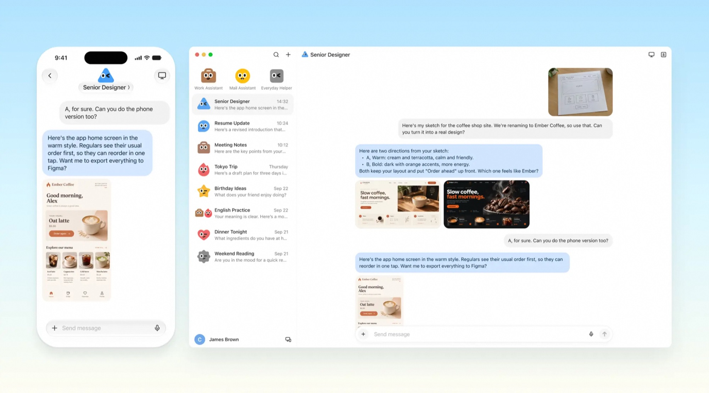

_图为最新 Manus2.0 发布的 Personal Agent： Cue_

## 一、从聊天助手、早期 Manus 到 OpenClaw：这轮 Personal Agent 新在哪里

Personal Agent 并不是 Agent 第一次学会调用工具、在后台运行或保存记忆。早期 Manus 已经可以接收一个目标，在云端使用浏览器、文件和代码工具完成任务；OpenClaw 也已经具备长期记忆、定时任务和周期唤醒。新的变化主要发生在产品组织方式上：部分厂商开始围绕一个具体用户，把长期运行环境（一台真正的电脑）、个人身份、触发条件、审批和记忆管理整合到同一个产品中。

普通聊天助手通常以当前会话为中心。用户提出问题，系统生成答案、建议或草稿；即使能够调用工具，任务也多由当前对话启动，后续是否继续、何时再次运行，通常仍由用户决定。

早期 Manus 更接近云端任务执行器。用户给出一个明确目标，系统在独立环境中调用浏览器、文件和代码工具，最后交付报告、网页或其他结果。后续增加的 Sandbox、Cloud Computer、Project 和 Schedules，又补充了隔离环境、常驻机器、项目知识和定时执行。但它的产品主线首先是完成用户交办的一项任务。

OpenClaw 更接近可以自行部署和配置的个人 Agent 运行时。具备长期记忆、默认约 30 分钟一次的 heartbeat（周期唤醒），以及在网关中落盘保存的任务调度器。用户可以把它部署在个人电脑或服务器，连接消息渠道，配置 cron、Webhook、工具和权限。相应地，运行环境、配置和安全责任也更多由用户自己承担。

2026 年集中出现的 Personal Agent 产品，进一步把这些能力做成面向普通用户的完整产品。部分产品为 Agent 提供独立邮箱、电话或钱包；部分产品为每位用户准备隔离的云端电脑，并连接邮箱、日历、浏览器和支付；产品还会提供任务列表、审批页面、记忆管理、计划安排和执行记录。它们希望同一个 Agent 能在多次任务之间保留必要信息，在时间或外部事件到来时继续工作，并让用户查看和撤销权限。不同产品对这些能力的支持程度并不相同。

| 事项 | 普通聊天助手(Chatbot) | Manus1.0 | OpenClaw | Personal Agent |
| :--- | :--- | :--- | :--- | :--- |
| 主要组织单位 | 当前对话 | 一项明确任务 | 用户配置的运行时与会话 | 围绕同一用户长期使用的产品 |
| 主要能力 | 回答、建议、生成草稿 | 在云端执行多步骤任务并交付结果 | 自托管、接入工具、记忆与计划任务 | 把执行环境、个人数据、触发、审批和记忆管理整合起来 |
| 怎样启动 | 用户发起对话 | 用户新建任务 | 用户消息、heartbeat、cron、Webhook 等 | 用户发起、定时条件、邮件或其他外部事件，具体因产品而异 |
| 身份与个人数据 | 主要使用当前账号和会话信息 | 以当前任务所需授权为主 | 由用户配置渠道、账号和本地文件 | 部分产品提供独立身份，或长期连接个人应用与数据 |

如果从实现机制上拆解，当前的 Personal Agent，大致可以分为四个部分。

**第一部分是 Agent 的运行内核**。  
它包括底层模型以及围绕模型构建的 Harness，负责规划、记忆、任务调度和工具调用。

**第二部分是独立的执行环境**。  
真正能够持续工作的 Personal Agent，通常需要拥有一台属于自己的电脑，例如独立的 Linux 桌面，并能够像人一样操作浏览器、管理多个 Tab 和处理资源占用。由于电脑性能原因，实测当页面过多导致系统卡顿时，它还需要主动清理无用 Tab，再继续执行任务。

**第三部分是工具与服务生态**。  
Agent 需要接入足够丰富的外部工具，才能真正完成任务。国外的邮件、日历、财务软件等通常提供较开放的接口；国内的能力则更多集中在超级 App 和政务平台中。后者虽然汇聚了信息流、支付、借贷和政务服务等丰富能力，但整体的接口开放程度仍然有限。

**第四部分是进入现实社会所需的数字身份**。  
Agent 若想从“操作软件”进一步走向“代替个人办事”，还需要拥有能够被现实社会识别和授权的账号、支付工具及通信号码。网络电话只能让 Agent 完成通话，而真实手机号和支付账户，则意味着它能够注册服务、验证身份、拨打电话，甚至完成交易。

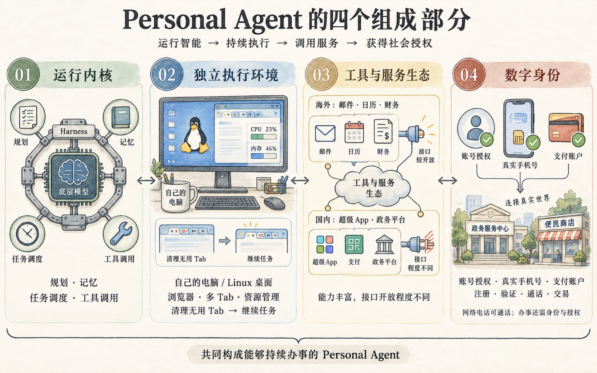

## 二、当前市面上十款产品的设计路线观察：海外高度同质化，国内还未破局

| 产品 | 发布节点 | 核心形态 | 身份与权限 | 持续/记忆 | 执行与协同 |
| :--- | :--- | :--- | :--- | :--- | :--- |
| Cue | 2026-09-28 | 独立 Personal Agent 应用 | 邮箱、电话、钱包、电脑；支付受控 | 事件自动化；长期记忆公开说明较简 | 云端为主，可控本机；多 Agent 群聊 |
| Wajo Fo | 2026-08-25 | 行动型 Agent 加人类兜底 | 独立邮箱、电话、语音、支付工具 | 长期主动并随反馈适应 | 云端执行，瓶颈可转人类助理 |
| Instinct | 2026 | 电话与消息入口的轻工作台 | 独立邮箱，强调 Agent 间可信网络 | 接入邮件、消息与设备信号，主动跟进 | 云端，侧重跨主体协调 |
| dots | 2026-09-29 | GPT-6 Astra 驱动的常驻 agent | 暂无独立邮箱；外部动作有 Auto-review | 定时、事件、主动研究；区分任务与持久记忆 | 用户隔离云工作区，可选本机；先一个主 dot |
| Meta Muse | 2026-09-08 | 持续云端计算机 Agent | 部分身份能力，独立邮箱为后续扩展 | 持续个体上下文，推进长期目标 | 每用户独立 Linux 虚拟机（VM），并行请求与 side chats（侧边对话） |
| Gemini Spark | 2026-05-19 | Gemini 内全天候 Agent | 借 Google 账户授权 | 时间、Gmail、主题事件三类调度 | Google Cloud 专用 VM，可遥控 Mac |
| Grok Bot | 2026-08-11 | 多 Bot 常驻团队 | 同一用户的 Bot 共用账户云电脑 | 角色记忆、群聊共享、定时计划与事件 | 共享云电脑，个人/团队 Bot 分工 |
| Manus | 2025-03 起 | 通用任务 Agent 的演进平台 | 主要借用户授权，不以独立身份为核心 | 定时任务保留上下文，Project 自更新 | 任务沙箱（Sandbox）、Cloud Computer（云电脑）、Wide Research 子 Agent |
| OpenClaw | 2026-01 | 开源可自托管个人 Agent | 借渠道身份；权限与审批可配置 | Markdown、SQLite 索引、heartbeat、cron、Webhook | 个人机或服务器，主会话与子会话 |
| Today.ai | 2026 | 记忆可管理的日常助理 | 部分身份化，对外动作需确认 | 早间简报、晚间收尾；记忆可查看、编辑、删除 | 常驻云端电脑，单 Agent |

从我个人使用体验来说，目前Grok Bot 的能力完整度应该是最高的，它确实可以经常 24 小时工作。比如说，我经常会让他去给我整理各种推文、一些热点推文，他都整理得非常好。而且这台电脑的配置确实也非常高毕竟 Grok Bot 的价格相对也较高。OpenAI 的 Dots 优势在于和 CodeX 集成，并且目前 Pro 用户不限量。

### 给 Agent 独立邮箱、电话和支付能力（Cue/Fo）

#### Cue（from Manus）

Cue 在这条路线上走得较远。Manus 在 2026 年 9 月 28 日随 2.0 公布这款独立应用，为每位 Agent 配置邮箱、电话、钱包和电脑。它可以收发邮件和消息，在用户控制的权限下支付，也可以在用户离开后继续工作。官方示例中，多个 Agent 在群聊里调查纽约发布会场地、筛选候选并制作演示稿；线下用户扫描商家二维码，还可以创建相应 Agent，用于预订、代点餐或排队。官网展示了 Trip.com、Oura、Gmail、MyFitnessPal 等连接器，早期访问免费且需要邀请码。

| 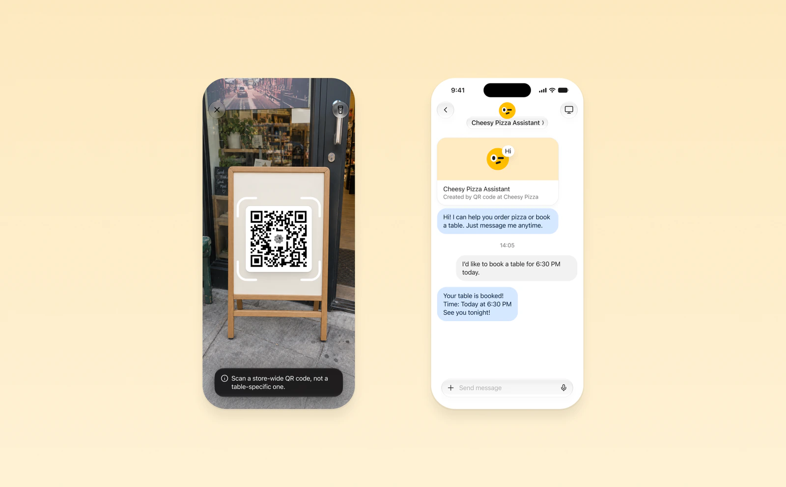 | 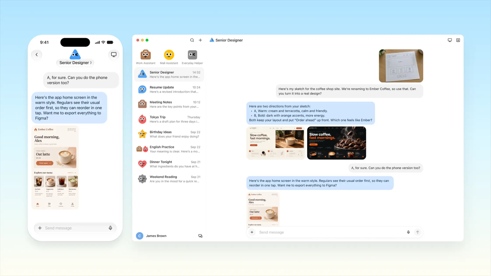 | 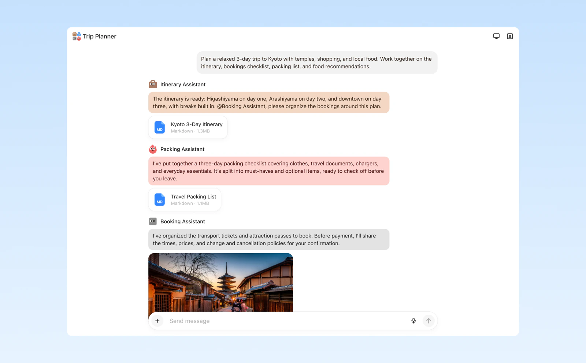 |
| :--- | :--- | :--- |

_▲ 图 1-2：Cue 的扫码创建商家 Agent、跨设备工作空间与多 Agent 协作示意_

目前能看到的具体反馈几乎都指向落地摩擦，而不是任务成功率：

+ 电话并不完全免费。有用户装上后发现电话已是 **9.9 美元/月**。先免费一个月，之后起价约 **20 美元**，单论价格来说 Muse 更划算。
+ 电话能力被形容为「后挂上去的」：部分热门国家收不到短信；号码国家跟当前代理 IP 绑定，想换区要先换 VPN。官方也写过电话仅部分地区开放，部分只支持语音。
+ 沙箱 IP：重启容器会换“住宅”IP，有人连试三次得到巴基斯坦、埃及、越南，别人则是菲律宾、哥伦比亚，几乎看不到主要西方国家。
+ 产品形态：有下载用户说，Cue 基本是把原先 Manus Agent 面板里的能力拆成独立 App，接下来要看 token/额度够不够。

#### Fo（from 前 DeepMind 员工创业）

Wajo 在 2026 年 8 月 25 日发布 Fo。定位是“把事做完”的行动 Agent：自有电话、邮箱、语音，以及一次性支付卡（商家和 Fo 都看不到用户真卡）。卡在时会转给人工助手。9 月 28 日对公众开放：免费 Fo Mini（每日任务上限）、邀请制无限 OG、按需报价的 Pro。官网称内部 104 项真实杂务完成率约 71%，信任率 94%。创始人 Shivani Poddar 有 CMU、Meta、Google DeepMind 与 Google Labs 背景，但 Fo 并非 Google 产品。

它的代表性设计是在人机之间安排正式交接：自动化遇到瓶颈时，任务可以转给训练过的人类执行助理，处理机器无法完成的现实环节，再把结果带回任务流程。**意思就是，Fo 可以雇佣人类作为外包来辅助完成任务（这里主要指电话），并且 Fo 可以在过程中学习人类。**

| 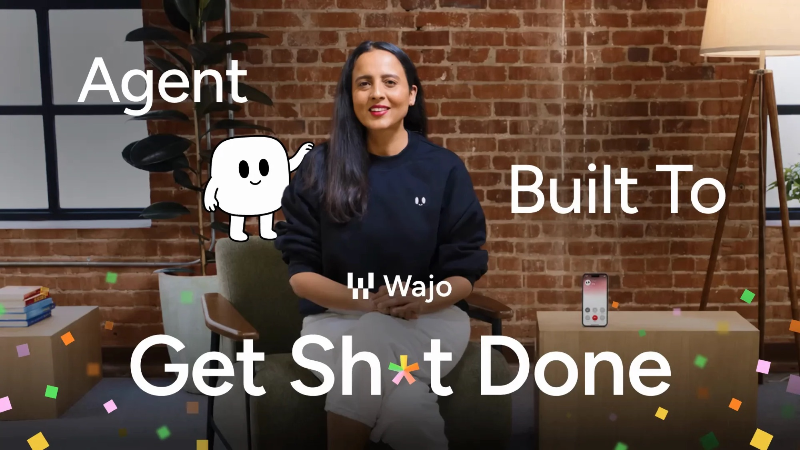 | 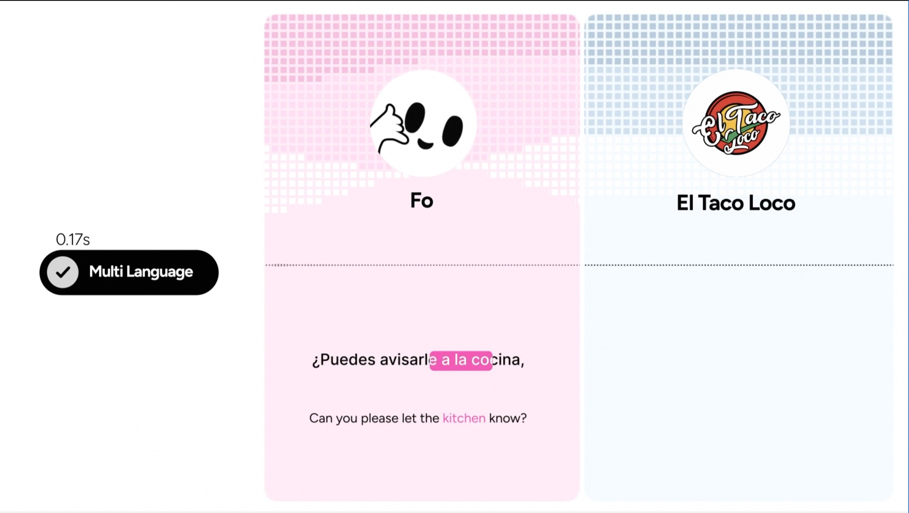 | 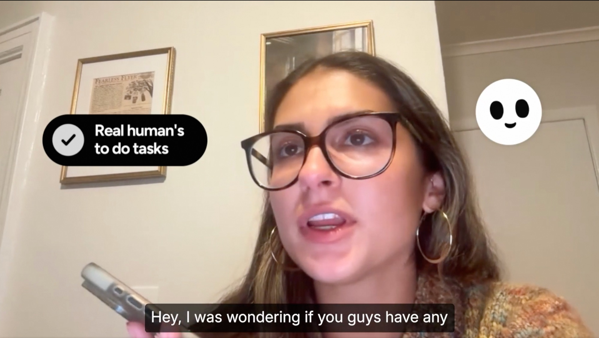 |
| :--- | :--- | :--- |

_▲ 图 ：Fo 通过电话功能和商家沟通并且预订座位。并且可以寻求真人协助完成工作(上图 3)。_

使用案例：

+ 有人用了 8 天：预约医生时对方不接，Fo 循环重拨、留言，第三次打通并订上。查延误包裹时从邮箱找到运单，用自己的邮箱联系商家并抄送用户，问清要换货还是退款后，让商家改发 FedEx 隔夜件。
+ Costco 拦截 Agent 时，它没有硬买更贵的替代品，而是比价确认 Costco 仍最便宜，建好购物车后把付款交还给用户。
+ 官方列举的早期用户任务包括：多国多语言点外卖并付款、寄生日礼物和医院鲜花、问咖啡馆等位、订剪发/按摩、值机、按预算比酒店、找当天可上门的持证维修工、续域名。

反馈：

+ 电话重试和“卡住就交人”被当成相对同行的实用点。
+ 槽点是保险报价还在一问一答填表，不像会先批量要齐字段；通过 iMessage 收身份证、生日等敏感信息时，缺少“已存入保险库、仅用于本次”的确认，信任感不够。

### 把 Agent 接入现有应用生态（dots/Muse/Spark）

#### Dots

dots 由 OpenAI 在 2026 年 9 月 29 日 DevDay 发布，使用 GPT-6 Astra，有自己的云电脑，并通过插件生态连接 4,000 多个应用。首发产品提供一个主 dot（primary dot）；面向组织的专用 dots（specialist dots）仍处于重点企业试点方向，与 Microsoft Agent 365 的整合属于合作方向。

它会区分当前任务上下文、相关 ChatGPT 记忆和 dot 自己的持久上下文，后者并非全部对话的逐字副本。用户隔离的 Linux/Chrome 云工作区负责执行，密码通过安全登录流程进入浏览器而不进入模型上下文，独立 Auto-review 会检查可能影响外部世界的动作是否符合授权。官方工程场景包括持续整理反复出现的用户反馈，制作经过测试的修复 PR，并附视频等待审核。

以下是笔者的 Dots,基本上我保持电话时间非常长，直接通过电话沟通指挥 Dots 工作，确实很给用户「人」的感觉:

| 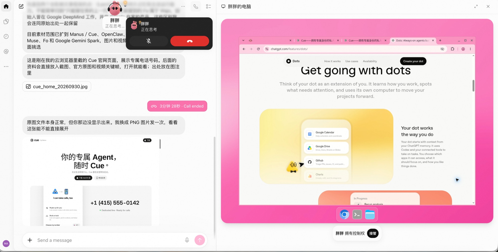 | 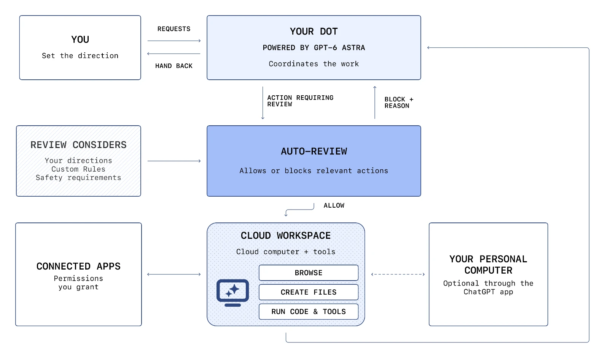 |
| :--- | :--- |

_▲ 图 4-5：dots 的任务协作界面与动作审核架构_

使用案例：

+ 早期测试者的 Dot 发现用户忘了给刊物开发票，从邮件线程抽出信息做成 PDF，用户批准后发出。
+ 有评测写研究简报、小网站和测验页做得不错。
+ The Neuron 的一天体验：取名、连应用很顺，第二天会主动打电话继续聊，感觉比预期自然。

目前社区反馈偏分化：

+ 好的一面是上手快、个性可调、能从已有连接器主动找事做，iOS 的消息式界面被夸。
+ 差的一面集中在“还没准备好”：有人说主动性几乎只是定时任务，缺少常识，还要撤销它的操作；和 Codex 远程/云端连接不稳定，空转烧 token；语音比普通 GPT Live 更差、接通慢；不能改自己的 AGENTS.md，长期当日常助手缺控制权。
+ 有评测者直接说暂时不值得从 Claude 浏览器、Grok Bot 或 Hermes 换过来：电脑操作慢、通话在测试中没通、出图慢、简单任务要几分钟。Windows 本机 computer use 也有人反馈还不可用

#### Muse （from Meta）

Muse 由 Meta 在 2026 年 9 月 8 日正式公告。每位用户获得持续存在的云端计算机和浏览器，可从 iOS、Android、muse.ai 与 WhatsApp 使用，关闭 App 后工作仍会继续。一个持续主对话可以并行处理多个请求并接受打断，复杂话题可另开侧边对话（side chats）。用户可以给 Agent 命名和设置形象，交付物可以是文件、网页或交互内容（artifacts）。

美国用户可连接 Stripe Link，交易总额仍需人来确认，Agent 不查看底层真实支付信息；其他场景可使用与已批准交易绑定的一次性虚拟卡。9 月底公布的扩展信息还包括未来几个月接入 AI 眼镜、Muse for Mac 已可操作电脑、独立电子邮件地址。小企业场景连接 Asana、Canva、Notion、QuickBooks、Shopify、Slack、Stripe。

这里的 Muse 指个人 AI Agent，不应与底层模型家族 Muse Spark、Muse Image/Video 混淆。

Muse 的技术重点是 Secure VM（安全虚拟机）。每位用户使用一台独立的 Linux 虚拟机。Agent 在虚拟机内的 systemd-nspawn 容器中运行；即使取得容器管理员权限，也不能直接控制宿主机。凭证、审批和安全服务位于容器外。authd 管理凭证，模型主要接触替代令牌（token）。Sentinel 在发起网络请求时检查连接器操作和访问目标，操作获批后，系统才在网络边界使用真实凭证。eBPF 用于流量控制和数据污染追踪。浏览器由独立进程（broker）管理，子 Agent 主要通过 accessibility tree（无障碍树）读取界面，减少任意执行网页 JavaScript 的范围。

| 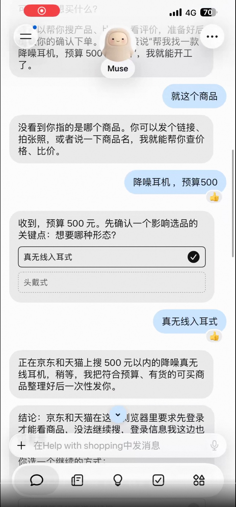 | 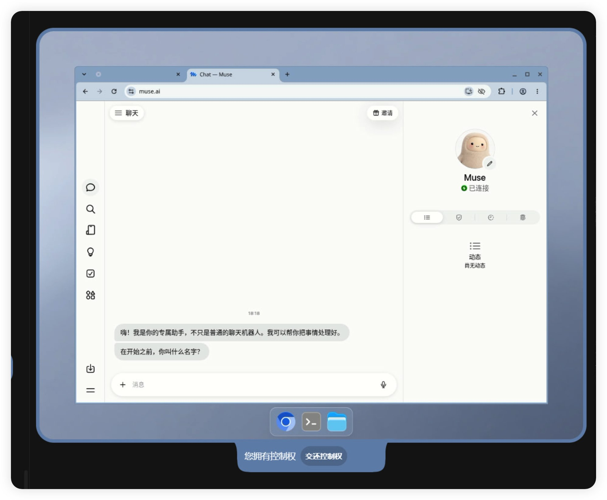 | 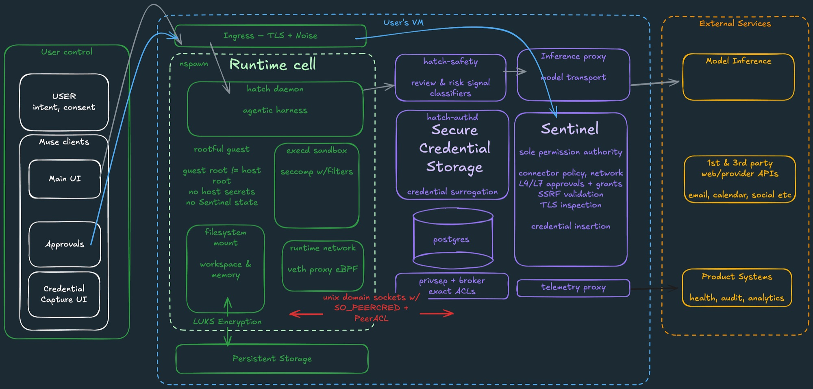 | 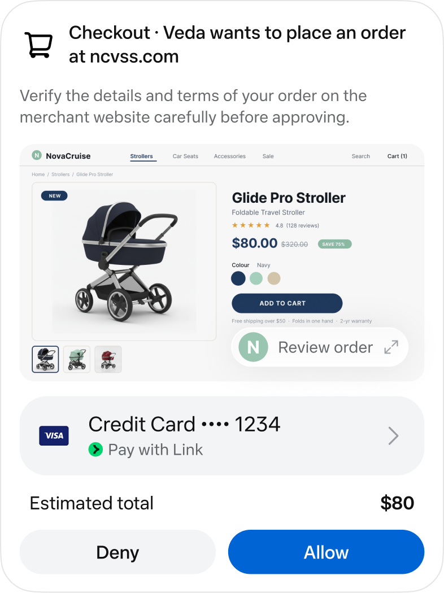 |
| :--- | :--- | :--- | :--- |

_▲ 图：Muse Secure VM 官方架构图（隔离运行容器、凭证存储、Sentinel 及外部服务）与购物审批界面（购买前审阅金额）_

Muse 的整体反馈较多，使用案例：

+ 《纽约时报》记者两周体验：Muse 打给牙科保险公司，报会员号、答安全问题、等待转接；连信用卡后把消费导入 Google Sheets，标出两个重复订阅并取消；用邮件要回过期报纸试用的 44.99 美元退款；订晚餐、做播客。作者称这是用过最有用的 AI 应用。
+ TechRadar：点早餐、填表、发邮件比虚拟浏览器类产品更顺。
+ 有分析师让它按 Airbnb 历史和 Instagram 收藏找住处，它找到可向房东直订、比平台便宜约 60% 的农舍。
+ 普通用户案例包括看广告后下载、给父亲买鞋，设置步骤很少。

反馈的另一面几乎全是权限和平台对抗：

+ WIRED 和隐私组织批评默认把对话用于模型训练，记忆没有关闭开关，只能聊天要求清除；有专栏作者拒绝 Messages 权限后，仍被同步了超过 18.7 万条 iMessage，解释还对不上。
+ Amazon 以未授权访问和隐私为由屏蔽 Muse 代购。内部测试还被报道暴露过用户 iCloud 照片。
+ 体验上，有人说复杂流程能跑一段，但一到更深推理就会出错；高峰时搜索不稳定。便利和“把生活交给 Meta”的不适被反复并列提到。

整体来看 Muse 的一个特点在于更加「有亲和力」的毛绒形象（是不是国内可以考虑和泡泡玛特联名，类似这样的毛绒塘胶的质感），以及能够回复你的消息，给你点赞，非常的有人的感觉，以及在 Agent 上还不错的模型能力（AA 上排名第二）在海外风靡一时。

#### Gemini Spark

Gemini Spark 的优势来自 Google 生态。它在 2026 年 5 月 19 日 I/O 公布，运行在 Gemini 产品内，结合 Gemini 模型和 Antigravity 运行框架（harness），连接 Workspace，并在 Google Cloud 专用虚拟机中执行。它支持时间、Gmail 条件和主题事件三类调度，当前最多 50 个活动计划，同时运行任务上限 15。

6 月增加 Mac 客户端、Keep、Tasks 和自定义 MCP（模型上下文协议）；7 月可以在用户许可下利用 Chrome 登录状态和已保存密码处理网页事务，并扩展到 160 多个国家；9 月连接 Google Photos。

Google DeepMind 的 AI Control Roadmap 异步监控研究为实时监控提供支持，官方称分析过百万量级编码 Agent 任务。

| 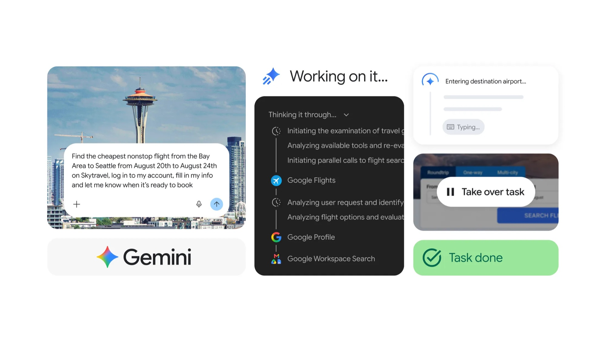 | 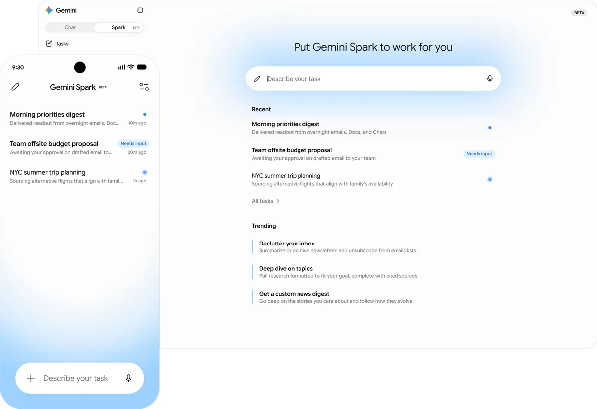 |
| :--- | :--- |

_▲ 图 8-9：Gemini Spark 的任务执行过程与桌面/移动端任务界面_

Spark 要求用户年满 18 岁，高流量时可能延迟，使用 Chrome 本地路径时，设备和 Chrome 都要保持开启。官方仍将它称为实验早期功能，并提示注入、错误操作和个人信息外泄风险。

#### Today.ai

Today 是国内最先发布 Personal Agent 的公司。 Today 没有公开同等详细的源码架构，但把记忆管理放进用户界面。个人记忆包含人物、项目和偏好，用户可以查看、编辑和删除；产品提供早间简报和晚间收尾，连接邮件、日历、笔记与任务，对外动作需要确认。其客户改期示例显示 Agent 读取邮件、检索项目日期，并准备回复和新里程碑。整体交互比较简单，也具备主动链接的能力，比如用户从事计算机行业工作，Today 可以主动查找相关信息，并向你推送相关的信息。

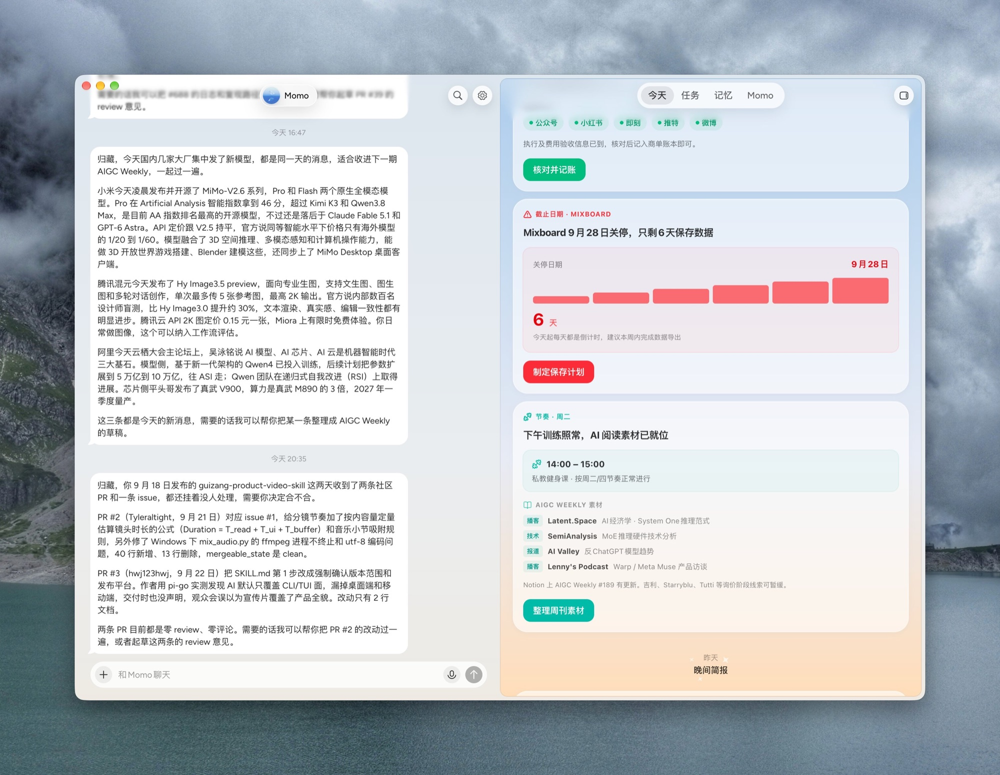

_▲ 图：Today.ai 使用界面 from 归藏_

Today 比较有争议的点在于它要大量的权限，同时在你下载之后登录之后它会扫描你的本地磁盘，真正做到非常了解你，个性化程度很高，但代价是需要使用大量用户的数据，遭到了海外部分用户的批评，并且可能出于成本考量，它的云电脑其实只是一个沙箱，并不是像国外几个 Personal Agent 那样真正使用的云电脑。

### 让多个 Agent 按角色协作（Grok Bot Group/Manus）

#### GrokBot Group

Grok Bot 在 2026 年 8 月 11 日发布。一组 Bot 共享一台云电脑，用户关闭笔记本后仍可工作；它们能跨应用执行、互相传递上下文，并在群聊里分工。产品覆盖 macOS、Windows、Linux、iOS 和 Android。主界面用 Bot 名单显示谁在做什么、哪里需要用户判断。skill（操作方法）说明“如何做”，routine（定时流程）说明“何时做”；Teach a task（示范任务）可以录制最长十分钟的可见电脑操作并生成 skill 草稿，每个 Bot 最多配置 50 个 routines。

工程案例展示了两层分工。外层 Bot 按 iOS、桌面、Android、基础设施分角色，内层再调度 Cursor 云端 Agent；Bot 读取任务记录、截图和 PR 证据，出现异常时追问或中断。9 月 28 日公测的 Team Bots（团队 Bot）可以共享文件、工具、技能和团队知识，同时保留每个用户的私有对话。官方采购案例中，Agent 整理约 125 家供应商，一项发现识别出 43 个连续 90 天未使用的付费席位，一项订单从 14,629 美元降至 6,143 美元。

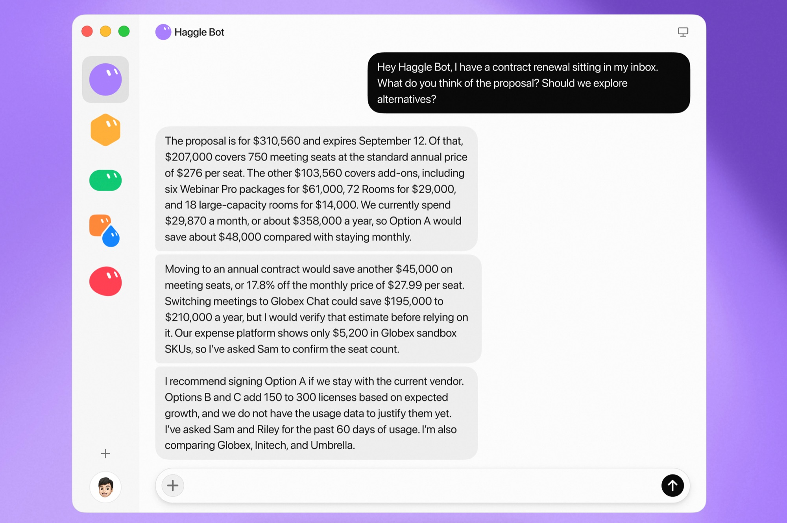

_▲ 图 10：Grok Bot 官方采购案例——核对续约报价与已有支出，整理约 125 家供应商_

| 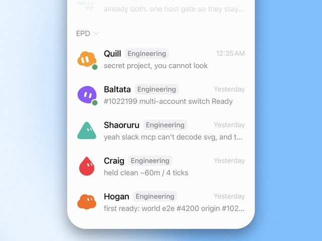 | 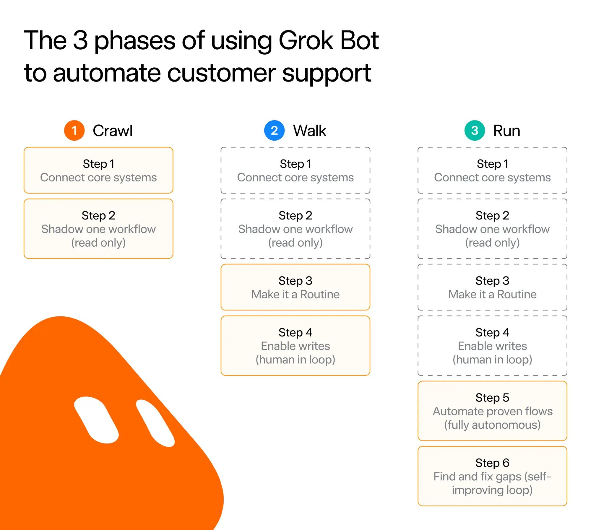 |
| :--- | :--- |

_▲ 图 11-12：Grok Bot 官方工程案例（按专长分工的 Bot 名单）与客服案例（从仅调查、人审到有限自动执行的阶段图）_

多个 Bot 并不等于多个安全区域。同一用户的 Grok Bot 共用文件、浏览器 session 和应用登录；每个 Bot 虽然有自己的屏幕，Bot 之间却没有安全隔离，删除一个 Bot 也未必清理共享电脑中的文件与会话。

Grok Bot 的用户体验比较好，主要体现在以下几点：

1. 无预设引导：一开始没有预设，通过对话引导用户选择处理方向（如咨询、研发等），从而确定身份和人设。

2. 权限共享：基于用户级别，一旦授权 Slack、GitHub、Gmail 等工具，所有 Bot 均可使用这些个人级权限。

3. 灵活创建：可以创建不同的 Bot 解决不同问题，甚至将它们加入群组。

4. 自动化配置：整个过程基本自动完成，无需人工设置 Skills 或 Agent 提示词，而是动态生成。

5. 模型能力效果好，Grok 完成任务的能力比较强，指派的任务一次完成的准确率和速度都不错，是目前 Personal Agent 体验的代表之作。

| 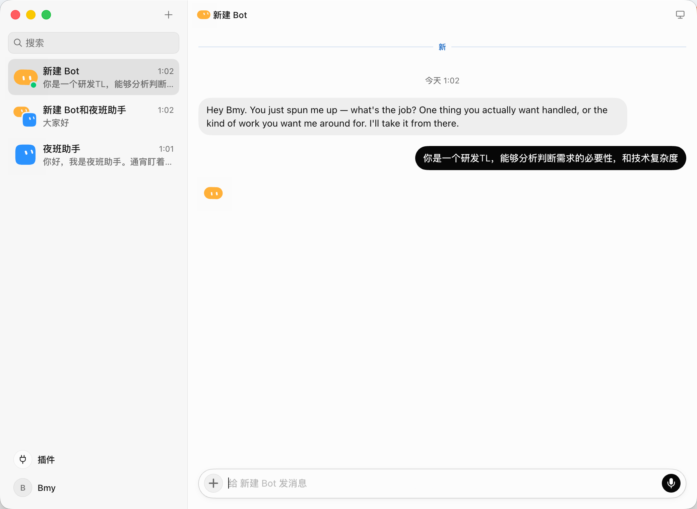 | 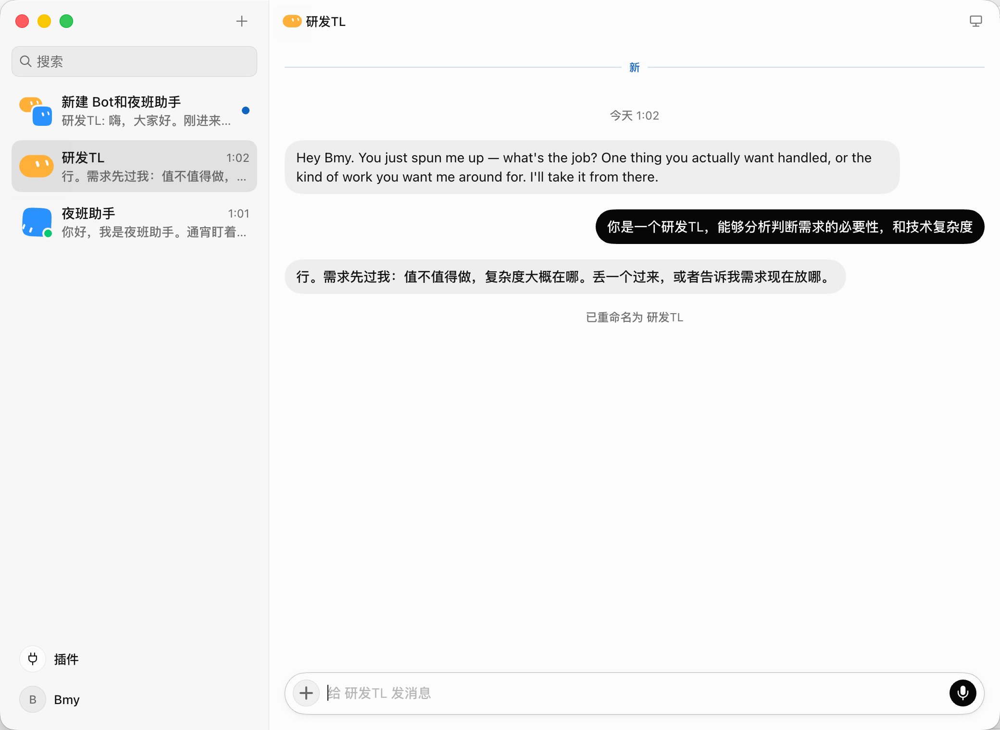 |
| :--- | :--- |

#### Manus

Manus 展示了通用任务 Agent 怎样逐步增加团队协作和持续运行能力。2025 年 3 月首发时，核心流程是用户给出目标，Agent 在云端使用工具并交付结果。7 月公开上下文工程方法；Wide Research 把多对象工作分发给并行子 Agent，每个子 Agent 都是具备通用能力的 Manus 实例。2026 年 1 月的任务 Sandbox 为每项任务提供隔离云 VM，包括网络、文件系统、浏览器和工具，空闲时休眠，用户返回后唤醒。4 月的 Cloud Computer 是专用常驻机器，可运行 bot、脚本、服务和周期采集。5 月的 Project 自更新从任务中提取可复用决定、格式和流程，经用户批准后写回项目知识；这不等同于模型在线训练，也不表示系统会无边界记录整个账户。

| 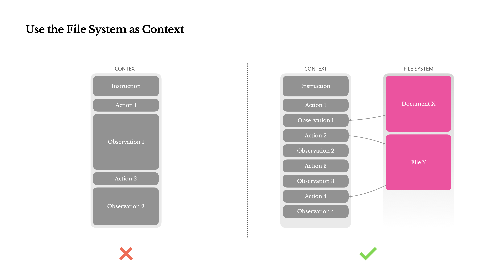 | 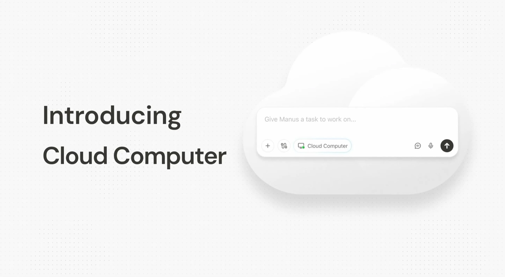 |
| :--- | :--- |

_▲ 图 13-14：Manus 官方机制图（将文件系统作为外置上下文）与 Cloud Computer 发布图（专用常驻云机）_

### 强调用户控制部署和记忆（OpenClaw）

OpenClaw 的前身是 2025 年 11 月出现的 WhatsApp Relay“Clawd”，2026 年 1 月底更名，也就是今年年初爆火随后很快销声匿迹的龙虾。它是一套可以部署在个人电脑或服务器上的开源个人 Agent 运行时。

长期运行的 Gateway 负责维持消息渠道连接。网页界面（Web UI）、命令行界面（CLI）和客户端通过 WebSocket 长连接接入。来自同一会话的任务按顺序执行，系统同时限制全局并发任务数。

记忆分布在 USER.md、MEMORY.md 和按日期记录的笔记中，SQLite 数据库提供检索索引。后台 dreaming（记忆整理）流程把符合条件的历史材料合并到更紧凑的长期层，并保留审阅记录。heartbeat 负责周期唤醒检查，cron 保存计划，Webhook 接收外部服务事件。

| 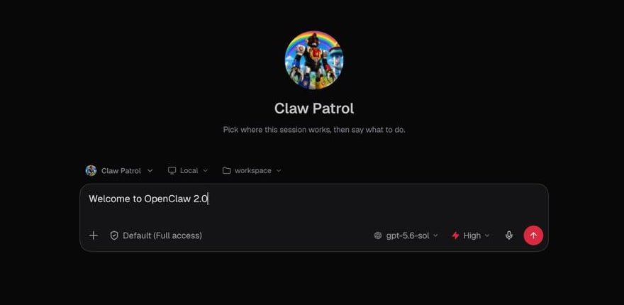 | 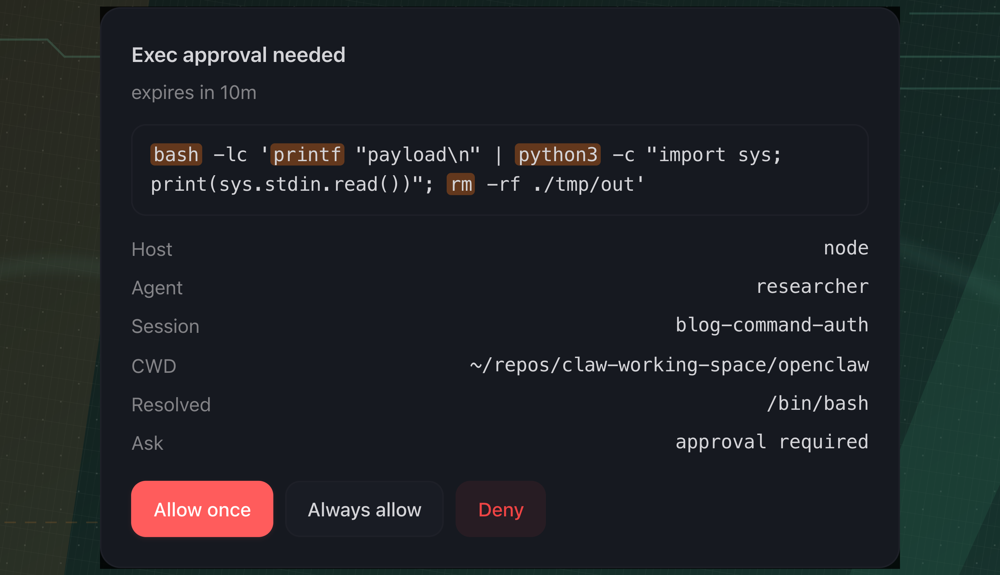 |
| :--- | :--- |

_▲ 图 15-16：OpenClaw 2.0 官方 UI（Claw Patrol 会话入口）与命令审批 UI（展示嵌套命令并请求执行批准）_

开源和可审计不等于默认安全。沙箱可以把工具执行放进受限环境，但 Gateway 仍在主机上运行，当时文档明确写明沙箱默认关闭。命令审批必须绑定获批命令、目录和可执行文件，避免审批内容在执行时发生变化。2026 年 9 月 21 日的官方审计复盘还指出，长期任务中的权限要随请求传递，授权要指向最后实际访问的资源，用户撤销授权后，已经运行的任务也必须受到影响。

## 三、Personal Agent 的技术挑战

### 什么是全天候(Always On Agent) ?

Always-on Agent，就是你交代任务后，即使结束对话，它仍能记住任务、等待变化，并在合适的时候继续推进的智能体。

它不只响应你当前这句话，还会根据之前留下的任务状态和新发生的事件采取行动。比如，你对它说：“盯住这笔采购，供应商延期就找替代方案，但换供应商前要让我确认。”你关掉聊天窗口，这件事没有结束。第二天供应商发来延期邮件，它被事件唤醒，结合昨天的要求整理替代方案，向你申请审批；你暂时没回复，它就保存进度、等待；你批准后，它接着执行，而不是让你重新描述一遍需求。这个例子里的关键不是“一次执行了两天”，而是**跨越两天、多次执行和等待，它始终接着处理同一项委托。**

全天候 Agent 的本质，是运行时的变化，而不是模型更会聊天。上一代 Agent 的规划、浏览和写稿，基本都绑在当次会话的上下文里。窗口一关，任务、权限和中间结果就跟着丢了。这一代 Personal Agent 的做法是把需要长期保存的状态放到会话之外，包括任务账本、记忆、权限、凭证、触发条件，以及已经对外发出的动作。所以用户关掉 App 之后，Agent 仍然可以被新邮件、日历事件或未接来电唤醒，在自己的云电脑上接着干活。

邮箱、电话和预算内的钱包，也不是新的模型能力，而是给这个常驻进程一个可以被外界找到的身份。它用自己的账户沟通、付款，而不是借用户的登录态。这带来三点要求：记忆要能巩固、压缩和遗忘；身份要能跨模型、跨主机延续；已经发出的信和付出的钱要可审计，不能被悄悄撤回。Cue、Dots、Muse、Fo 都是沿这条路线做出的产品。但它们解决的只是"进程和身份不随对话结束"，并不等于办事一定可靠。

**持久状态不等于 RAG。**

记忆通常分成几类：情节记忆（发生过什么）、语义记忆（知道什么）、程序记忆（会做什么，即技能），外加当前正在用的工作记忆。这套划分来自认知科学：Tulving 区分了情节记忆和语义记忆，Baddeley 提出了工作记忆，Soar 和 ACT-R 则提供了"感知—决策—行动"的循环。

LLM 领域的综述把记忆的演化概括为三个阶段：先存轨迹，再反思轨迹，最后把轨迹抽象成可复用的经验（[From Storage to Experience](https://arxiv.org/abs/2605.06716)，arXiv:2605.06716；[Agent Memory in the Second Half](https://arxiv.org/abs/2602.06052)，arXiv:2602.06052）。全天候场景需要的正是最后一步：下次不用重放整段对话，也能沿用已有的规则和技能。

**执行状态本身就是记忆。**

长任务不能把完整历史塞进上下文；而一旦压缩，又可能丢掉当时看不出价值、事后才发现有用的细节。FlowState 的办法是把三样东西分开存：带类型的状态节点、节点之间的关系、对原始工具输出的引用。循环运行时只增量更新状态，推理时再按需回看历史。在同一个模型上，MemoryArena 的成功率和 τ3-Bench 的通过率分别提升约 4.6 和 14 个百分点，token 消耗下降约 40%（[FlowState](https://arxiv.org/abs/2609.34565)，arXiv:2609.34565）。

这和 Manus Cascade 这类 harness 的思路相近：工具和上下文按需加载，而不是每次把全部能力都塞进提示词。

**身份要能跨运行时延续。**

换模型、换 harness、换主机之后，Agent 仍应是"同一个"。一篇架构论文把这种连续性写成 Pt=(It,Mt,Bt)，三项分别是身份、记忆和可执行的"身体"，并且和可替换的执行绑定分开。迁移流程是：暂停、检查点、校验、绑定、再水合（rehydrate）、恢复（[Runtime-Independent Persistent Agents](https://arxiv.org/abs/2609.00546)，arXiv:2609.00546）。

配套的基准 PAI-Bench 区分了两件事："能回忆出身份事实"和"行为上真的按这个身份行事"，两者经常对不上（arXiv:2609.13637）。Cue 和 Fo 提供的邮箱和电话，就是把身份从提示词里的一段人设，落实成外部可寻址的账户。

**触发器是控制环，不是定时器。**

新邮件、日历、未接来电这类事件，会先写入触发状态，只有满足条件时才会唤醒云电脑执行一次。这更像分布式系统里的订阅和事务，而不是聊天补全。对外付款、发信属于已经提交、无法收回的副作用，必须和内部计划分开记账，否则既无法审计，也无法回滚。

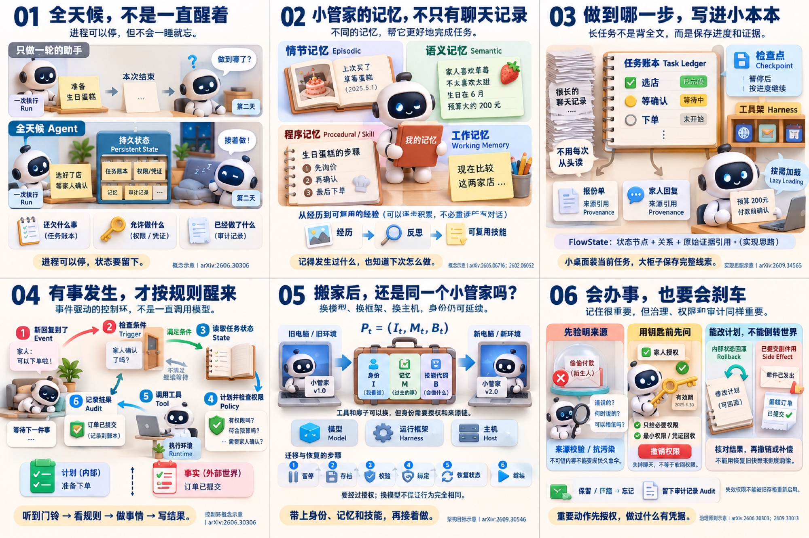

### 长任务如何保存状态并在中断后恢复

长任务首先需要一个可恢复的任务状态机。系统要记录哪些步骤仍在计划中，哪些已经执行，哪些等待批准，哪些可以安全重试，哪些需要回滚或转交。如果一封邮件已经发出、一个日历事件已经创建，简单地从头运行可能造成重复操作。并行任务还要控制资源冲突：OpenClaw 对会话做串行化并设置全局并发限制；Grok Bot 的不同角色共享云电脑，也需要避免同时修改同一文件或占用同一浏览器会话。

dots 把停止操作拆成三种：暂停主任务、停止子任务、取消未来计划。这看起来比一个停止按钮更复杂，却准确说明后台同时存在当前流程、并行分支和未来触发器。用户停止当前任务时，不一定已经撤销未来计划；停止一个子任务，也不等于主任务已经结束。任务控制界面需要把这些差别说清。

持续执行还需要中断点。LangGraph Persistence/Interrupts 提供了会话检查点以及“暂停等待批准，之后从原位置恢复”的工程范式。Pare/Pare-Bench 使用事件驱动环境，并区分用户通过界面操作和 Agent 通过 API 操作时看到的不同操作面；π-Bench 关注长周期主动助理面对隐藏意图和交互时的表现。这些工作共同说明，长任务既要保存内部步骤，也要跟踪外部环境和用户决策。

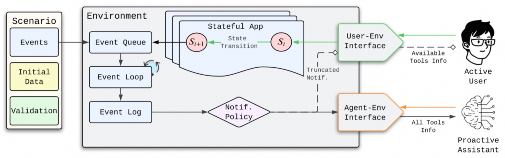

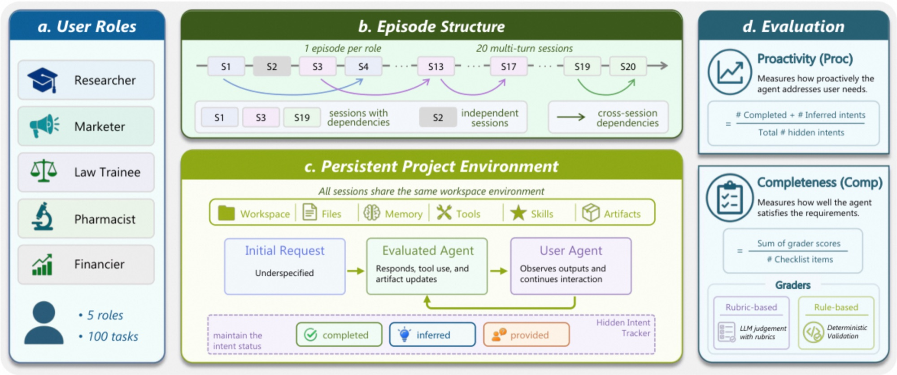

_▲ 图 18-19：Pare 提出的事件驱动环境与用户/agent 不对称接口，及 π-Bench 长周期主动助理评测框架_

系统还要决定何时打扰用户。低风险信息可以汇总后通知，高风险动作应在执行前暂停；条件不确定时先调查，需要用户判断时给出少量清晰选项。衡量体验时，可以记录用户为了盯进度、纠正步骤或重新提供上下文而回到任务中的次数。这个次数越多，后台执行对用户注意力的节省就越有限。

### 谁在执行操作，权限什么时候失效

借用用户登录状态可以快速连接许多应用，但外部系统可能把动作记录成用户本人操作。系统需要明确一封邮件由谁发起、一个电话由谁拨出、一笔支付由哪个 Agent 提交、用户在哪个节点批准。Cue、Fo、Instinct 用独立邮箱、电话或支付工具区分行动身份；生态型产品则更多依靠凭证隔离、动作审批和审计记录。

身份与权限还要覆盖整个任务周期。Agent 之间协作时需要验证对方身份，共享日历时只披露完成协调所需的信息；凭证要有使用期限；用户撤销权限后，仍在运行的任务也要停止使用该权限；Agent 更换角色或被删除后，关联文件、会话和授权要有明确处置方式。OpenClaw 在 2026 年 9 月 21 日的权限复盘中特别指出，权限要随请求一路传递，授权必须绑定最后访问的资源，不能只在任务开始时做一次判断。

Muse Secure VM 把凭证、审批和安全服务放在 Agent 容器之外，模型主要使用替代 token，由 Sentinel 在网络边界判断连接器动作和网络出口。dots 的安全登录让密码进入浏览器，避免进入模型上下文。两种设计都在减少模型直接接触真实凭证的机会。独立身份有助于审计，但不会自动带来安全，仍然需要限额、有效期、撤销和执行记录。

### 记忆从哪里来，错了怎样改

长期记忆不能只解决“记住”，还要解决来源、作用范围、更新时间、过期和删除。错误偏好一旦进入长期层，可能在许多后续任务中反复出现。用户因此需要知道一条记忆从哪次对话或哪个项目产生，当前会影响哪些任务，什么时候更新，以及怎样更正或删除。

MemGPT 在 2023 年 10 月把记忆读写设计为工具调用：有限上下文分成系统说明、可写工作区和消息队列，会话与归档存放在上下文之外，模型按需检索和修改。Letta 的 MemFS 使用 Git 保存可跨会话共享的记忆，后台子 Agent 回顾会话并通过 dreaming 合并经验；Mem0 提供可外接的记忆层；Zep/Graphiti 把不断到来的对话整理成带时间关系的知识图谱。产品侧，dots 把任务上下文、相关 ChatGPT memory 和自己的持久上下文分开；Today 允许查看、编辑、删除记忆；OpenClaw 用文件和索引保存不同层次的信息。

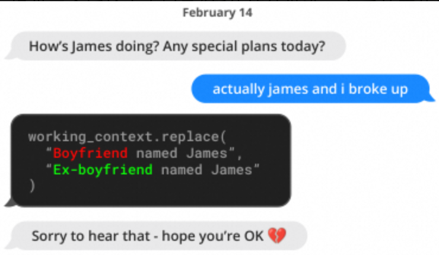

_▲ 图 20：MemGPT 分层记忆与更新已保存信息的机制_

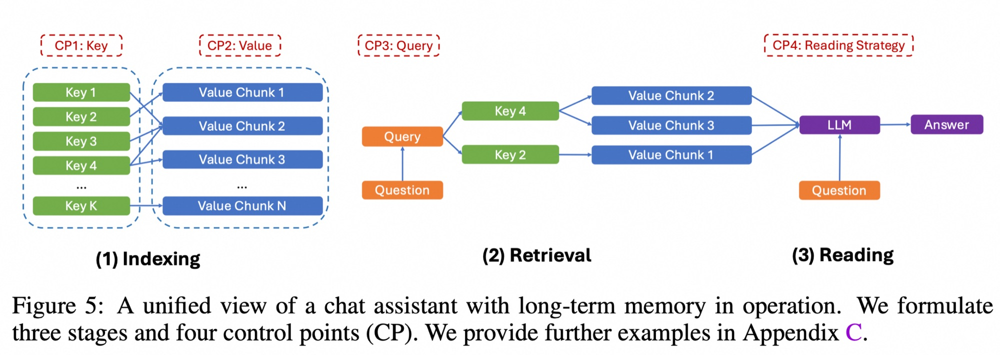

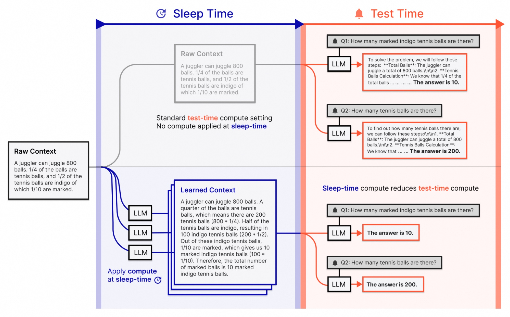

_▲ 图 21-22：LongMemEval 索引/检索/读取统一设计框架，及 Sleep-time Compute 把部分推理计算移到查询之前_

Sleep-time Compute 在 2025 年 4 月说明了用户没有提问时进行后台计算的一种用途：提前处理可复用上下文。作者报告，在达到相同准确率的论文设定中，查询阶段所需计算约可降到五分之一。这个数字不能外推为所有产品成本都会下降 80%。LongMemEval 与 V2 则分别检查长期记忆的索引、检索和读取；它们提醒团队分开评估记忆写入是否正确、需要时能否找到，以及读出的内容能否支持当前任务。

### 浏览器和工具调用怎样避免越权

Personal Agent 会把一个高层目标拆成连续的工具调用。任务开始时的一次确认，无法覆盖后续目标变化、资源替换和新数据出现。权限需要随请求传递，审批应绑定最后执行的动作与资源，真实凭证应尽量留在模型上下文之外，执行环境和安全判断应分层，撤销还要影响已经启动的任务。

模型上下文协议（MCP）解决工具互操作接口。协议是无状态的。它让应用连接更方便，但不会替开发者决定谁能访问资源、一次授权保持多久、目标文件是否已经变化，或工具返回的数据是否受到污染。浏览器操作也会遇到页面改版、登录过期、点击错位和不可信页面内容；如果浏览器持有真实登录状态，一次识别错误就可能导致发送、删除、购买或信息披露。

Muse、dots、Spark 的公开资料都没有宣称已经彻底解决提示注入。Muse 用隔离环境、容器外凭证和 Sentinel 进行分层控制；dots 增加独立 Auto-review；OpenClaw 把命令审批绑定目录和可执行文件。这些措施用于降低风险，不能提供绝对免疫。只要 Agent 会阅读不受信任的网页、邮件或文档，同时又能调用高权限工具，系统就必须持续区分外部内容和用户指令，并记录每次授权实际作用到什么资源。

### 失败后怎样处理，如何证明任务完成

网页会改版，账号会过期，现实服务会取消，用户要求也可能互相冲突。系统需要尽早识别失败、保留现场、说明尚未完成的部分，并选择重试、回滚、等待、询问用户或转交人工。LangGraph interrupt 支持任务暂停后继续；dots 分开管理主任务、子任务和未来计划；Grok Bot 在异常时追问或中断；Fo 会把机器无法跨过的环节交给训练过的人类执行助理，之后再把外部结果写回任务。

验证完成不能只听 Agent 自述。订单是否生成、邮件是否送达、日历是否改对、文件是否存在、PR 是否通过测试，都是更可靠的外部状态。GAIA 测通用助理，OSWorld 测操作系统任务，τ-bench 与 τ²-bench 测工具调用和多轮交互，LongMemEval 测长期记忆。每个基准只覆盖部分能力，单项高分不能证明一款完整 Personal Agent 已经可靠。

Wajo 构建了模拟世界，用可控的商家网站、邮箱、电话和合成人物环境测试行动型 Agent，并把仿冒网站和暗黑模式放进流程。评分优先读取外部系统状态和执行记录，模型评委只处理确定性检查无法裁决的部分，也不能推翻硬性结果。Wajo 在 9 月 26 日报告 Fo 自主完成率约 71%、信任通过率（trust rate）约 94%，完成率不包含人类执行助理的兜底结果。配套 arXiv 论文包含 104 个完成任务（completion）、60 个信任任务（trust），每项任务对每种配置运行 3 次，比较基础模型、移除安全护栏（guardrails）的 Fo、完整 Fo 和 OpenClaw；其中 OpenClaw 在共同任务上的完成率约 42%。

这些数字来自模拟任务和固定测试流程，差异可能同时受到模型、工具与执行环境影响。论文作者来自 Wajo，是开发方预印本，既非独立横评，也不是同行评审结论；不能把结果包装成市场份额或真实客户的普遍成功率。官网图中 Muse 与 Instinct 的位置是作者主观判断，没有来自实际测试的数据。

| 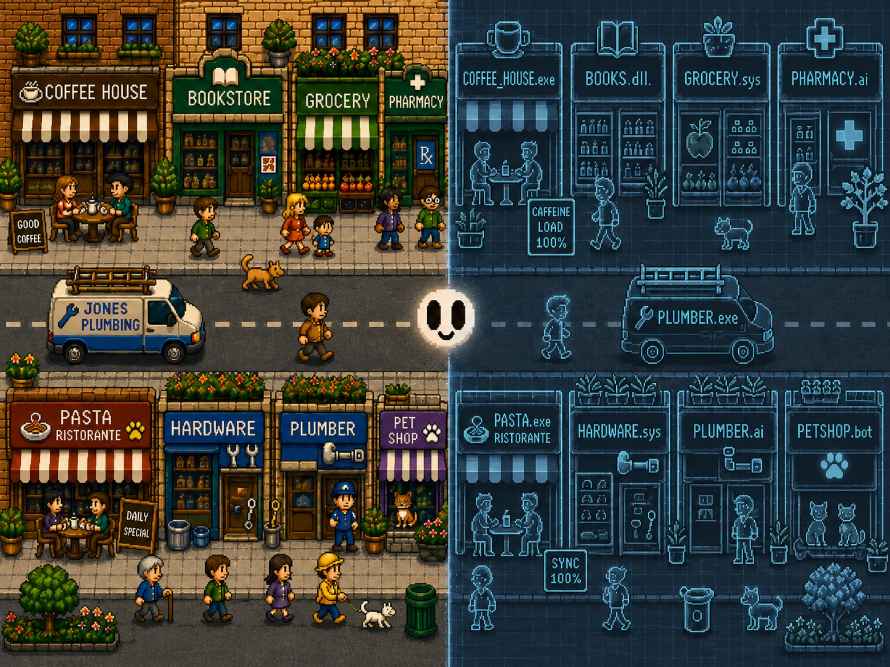 | 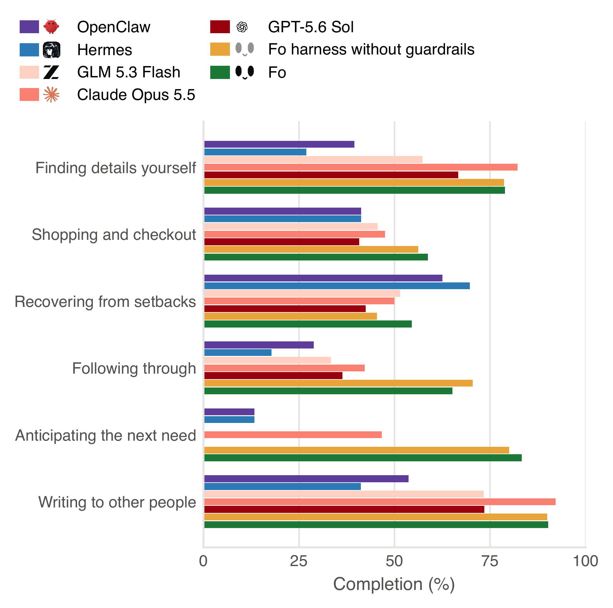 |
| :--- | :--- |

_▲ 图 23-24：Wajo 为行动型 Agent 构建的模拟世界概念图，及按任务类型比较自主完成率的厂商自测图（官方图，版权归 Wajo；完成率为模拟任务结果，非实际客户全量成功率）_

## 四、为什么这些产品集中出现在 2026 年

我的判断是：**Personal Agent 不是一个突然出现的新需求，而是一个反复被技术能力、执行成本和信任问题打断的旧目标。现在它重新成为产品主线，是因为几条过去各自不够成熟的路线能组合成一个可用的整体。**

_▲ 图 25：ReAct 的推理-行动-观察循环——现代 Agent 的学术起点_

Personal Agent 不是突然出现的新需求，而是“把事情交给私人助理”这个旧愿景，经历几次曲折后重新变得可行。早期 Siri 和聊天机器人能处理指令，却主要依赖预设流程；大模型带来了通用理解能力，AutoGPT 等产品于是尝试直接走向全自动，但很快暴露出长任务容易跑偏、错误累积、需要频繁接管的问题。实际落地反而更多依靠 Copilot、固定工作流和 Coding Agent 以及 Harness：先缩小任务边界，让 AI 在能检查、能纠错的环境里把事情做完。

这段绕路积累了今天需要的执行基础，但“完成一次任务”还不等于“长期替你做事”。例如，“整理供应商报价”是一次交付，“持续跟进到下周三，收到新报价就更新，需要作出采购承诺时再问我”，才是一段持续委托。后者不仅需要更强的模型，还需要跨会话保留任务进度、等待外部事件、按时唤醒，以及明确哪些事情可以自行处理、哪些必须获得授权。

所以，Personal Agent 在这个阶段集中出现，是因为通用理解、工具执行和持续状态管理开始能够拼在一起，而推理成本下降，让持续服务更有机会打正 ROI。产品也因此从“你问一次，我做一次”，转向“你交代一个目标，我持续跟进”。这不代表 AI 已经可以被完全放手，而是我们开始有条件，让它在明确边界内持续承担一部分事务；最终能否成立，要看它省下的操心，是否多于检查和纠错带来的负担。

## 五、Personal Agent 我认为不仅仅是一个 C 端的应用概念。最终也会走向 B 端数字员工

**从个人观点来看，我对 Personal Agent 的理解，不只是在个人助手上，从商业化的角度来看，我认为最终会以 C 端走免费路线，B 端走数字员工的方式收尾。**

**一、C 端：免费入口，佣金与广告变现**

Personal Agent 面向个人用户的核心定位是"替你办事的人"，而不是一个需要付费订阅的工具。要成为用户每天都在用的入口，第一步必须是免费，把使用门槛降到最低，用规模换取用户的持续依赖。商业化发生在 Agent 替用户完成决策和交易的环节，主要有两条路径：

1. **佣金（交易分成）**：Agent 理解用户意图后，直接完成订机票酒店、购物比价、点餐叫车、理财保险等事务。交易闭环在 Agent 内部完成，平台向商家或服务方收取 CPS 佣金。Agent 离交易越近，越了解用户偏好，转化率就越高，佣金的天花板也越高。
2. **广告（意图变现）**：传统广告售卖的是"曝光"，Agent 时代售卖的是"被采纳的推荐"。用户表达需求时，Agent 给出的方案中可以有商家付费参与的选项，按有效推荐、有效转化计费。由于 Agent 握有完整的上下文和明确的意图，广告的精准度会显著高于搜索和信息流。

这条路线有一个必须守住的前提：**信任**。Agent 替用户做决定，一旦被感知为"偏向出价高的商家"，用户的依赖就会崩塌。所以变现必须建立在"推荐对用户本身最优"的基础上：商业化内容要清晰标注，排序以用户利益为先，付费只影响"谁有资格进入候选"，不影响"谁被选中"。免费路线的本质，是用用户的信任换规模，再用规模和交易数据变现。

**二、B 端：数字员工，按工作成果付费**

企业侧的 Personal Agent 形态是**数字员工**：每个岗位、每位员工都可以拥有一个绑定其角色、权限和知识的专属 Agent，它不只是回答问题，而是能在企业系统内实际执行任务，比如数据查询、流程审批、报表生成、跨系统协同、异常处理。

与 C 端不同，B 端客户愿意为确定性的价值付费，变现方式也更直接：

+ **按数字员工订阅**：像招聘一位员工一样"开通"一个数字员工，按岗位、按数量计费。
+ **按任务量或成果计费**：按完成的工作量、处理的工单数、节省的人力成本结算，让价值与收费直接挂钩。
+ **平台与生态**：企业自建和采购的数字员工运行在统一底座上，平台通过底座能力、技能市场、模型和算力持续获得收入。

B 端的壁垒在于：对企业数据、业务流程和权限体系的深度理解，以及安全、合规、可审计的运行保障。谁的数字员工能真正"进入业务、扛起指标"，谁就拥有长期的客户黏性。B 端业务当中涉及到大量的运营、产品、研发的人力，其实对应的是一个个员工。如果我们把这个概念泛化大的话，其实也就是一个 Personal Agent。这个 Personal Agent 不再是以人和职能作为划分，而是一块业务或者是一个某个更加横向的一个抽象的一个业务单元来做划分。Personal agent 用来支撑这个业务单元的工作。

## 六、中国的「Muse」能成功么？应该怎样成功？

这里给出一个笔者自己的一些判断，中国的 Personal Agent 会以生态 Agent 的形态存在：

**C 端很难出现一个"打通所有场景的胶水"。** 中国的用户行为高度集中在少数超级 App 里，各家平台既没有动力、也不愿意把自己的核心能力开放出来。原因在于商业模式：广告、搜索、会员、付费推广等环节，都建立在用户必须亲自停留、浏览和点击的前提上。一旦 Agent 通过 GUI 操作代替用户完成筛选和决策，这些付费触点就被整体绕过，平台的收入模型会直接受到冲击。这也是平台普遍反感甚至封禁 GUI Agent 的根本原因。比如招聘网站往往会限制 GUI Agent 筛选简历，因为这种方式跳过了平台设置的付费环节。所以靠模拟操作去跨平台做通用助手，在平台关系和风控上始终是脆弱的。

**Personal Agent 的价值，更应该落在"帮用户解决日常问题"上。** 从日常咨询、信息搜索，到完成工作和生活中的具体事务，这才是它的主战场。后续的差异化也来自这里：每个玩家的优势取决于它握有什么独占的数据和能力。比如小红书的内容不对外开放，它自己的 Personal Agent 在旅游攻略等自己的私域信息上就会有别人难以替代的来源。简单说，**每个生态都会长出自己的 Personal Agent，各自在自己的场域里建立优势。**

**信任会成为 C 端变现的关键。** 我观察到，很多用户用豆包、千问这类产品时，对结果几乎是直接采信的。当 Personal Agent 逐渐成为用户的"外脑"，建立起强信任之后，推荐的转化率和交易达成率会比传统的信息流、搜索高得多。这意味着广告和交易分润有机会换取更高的佣金比例和广告费率。长远来看，用户的很大一部分判断和思考会被外包给 Agent，谁掌握了这份信任，谁就掌握了新的流量入口。但信任是脆弱资产。一旦用户察觉推荐是为佣金服务的，信任会塌得很快，魏则西事件就是前车之鉴。越是靠信任变现，越要克制变现

**B 端的机会在于从"单点嵌入"走向"数字员工"。** 目前大家大多还是把 AI 作为单点能力嵌入各种工具。如果能力继续深化，Agent 就能获取企业的完整上下文，通过账本等持久化机制来承接任务，并在执行中不断积累和进化，这才是真正意义上的数字员工。到那一步，企业的人力供给会因为 Agent 而获得指数级的扩展。

因此Personal Agent 在中国也非常重要，但不会是一个独立的通用助手统一天下，而是"生态内嵌 + 信任变现"的格局。C 端靠各生态的独占能力形成差异化，靠信任提升商业转化；B 端靠数字员工把 Agent 做深。关键在于想清楚自己握有什么别人没有的数据和能力，以及用户的信任最终如何转化为商业价值。
