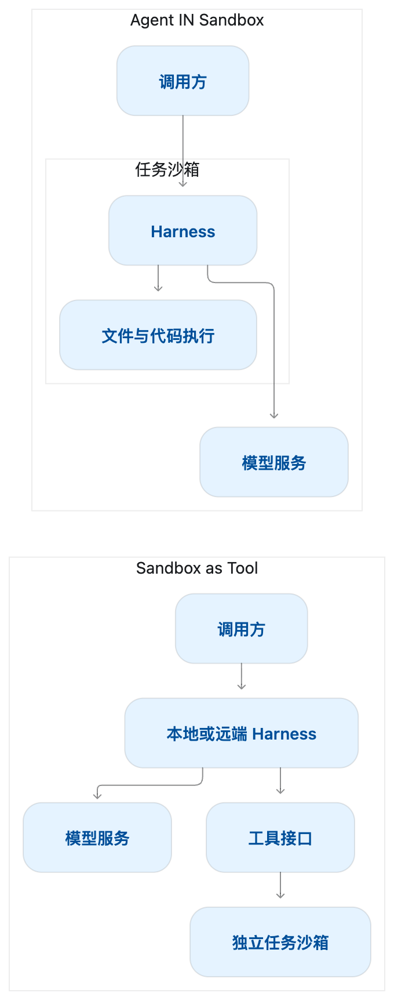
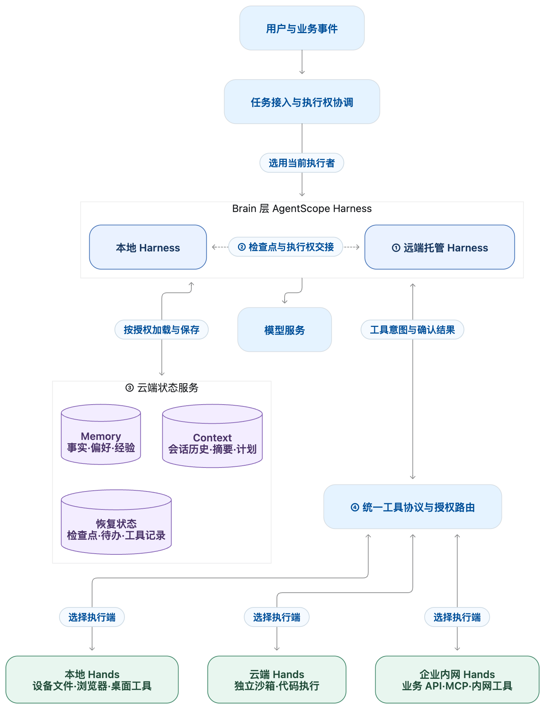
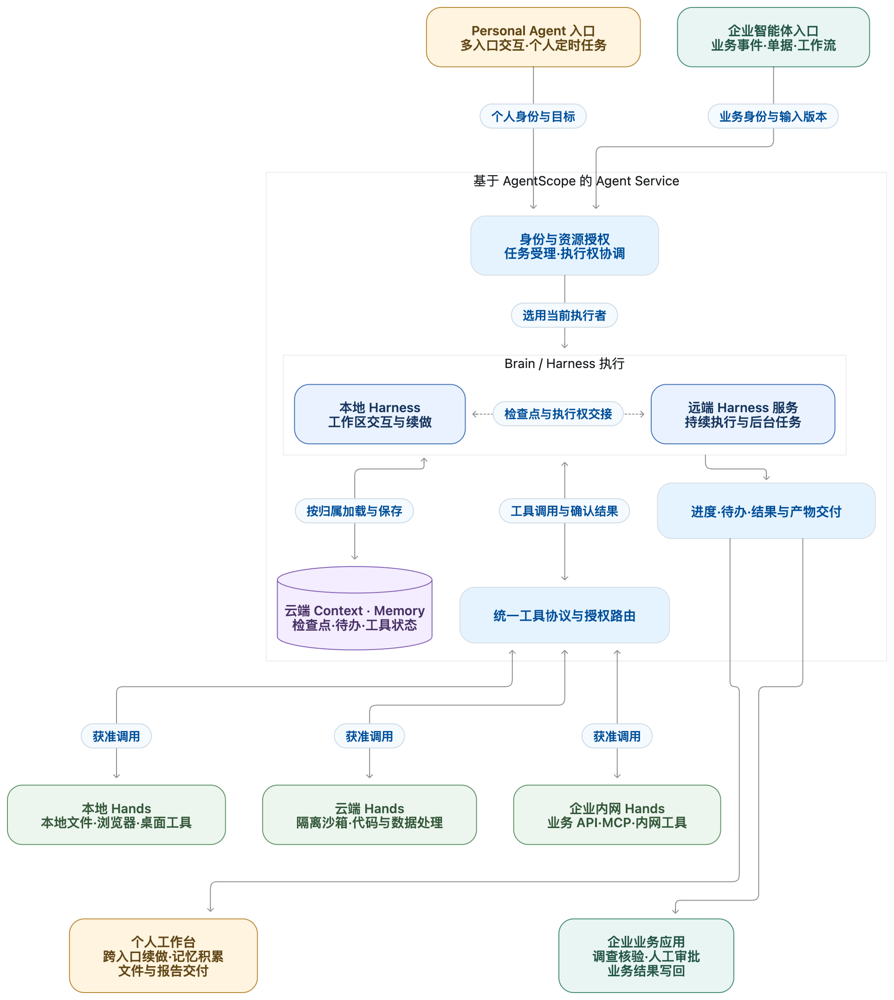
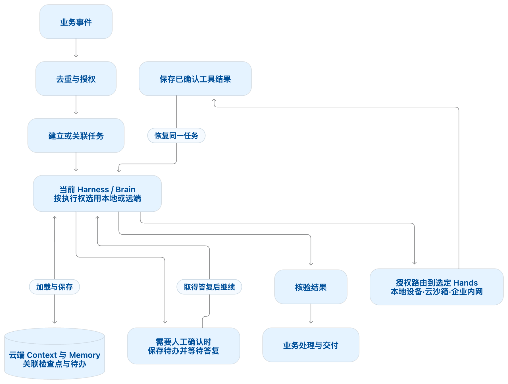

# 从 Personal Agent 到企业智能体：AgentScope 的 Agent as a Service 架构

要同时满足 Personal Agent 与企业智能体的需求，我们需要一套 Agent as a Service 架构，让任务能够在不同入口、执行节点和工作环境之间持续推进：

+ **Personal Agent** 需要在用户离开电脑后继续整理资料，并在用户回来时由本地 Harness 接续同一项工作，保留此前的上下文与记忆。
+ **企业智能体** 需要在远端组织调查，根据数据和权限要求将工具调用交给云沙箱或企业内网执行端，并在工具等待、人工确认或执行节点切换后继续处理。

两类场景的共同要求，是让 Agent 的身份、任务状态与长期积累独立于单个客户端、Harness 实例和执行环境。为此，需要分别组织 Harness 的运行、Context 与 Memory 的云端管理，以及工具的实际执行，再通过稳定的任务标识和执行协议将它们衔接起来。

本文以 AgentScope 为基础，围绕 Sandbox as Tool 展开这条建设路径：将 Harness 托管为远端服务，将 Context、Memory 与恢复状态接入云端状态服务，通过执行权交接支持本地与远端续做，再通过 Brain／Hands 分离连接不同位置的工具执行端。沿着这些边界，把持久的任务状态、按需运行的计算和可切换的执行环境组织为完整的任务交付链路。

## 从 Personal Agent 到企业智能体的共同需求
### 持续工作需要怎样的 Agent 服务
无论面向个人还是企业，调用方都需要能够提交工作、读取进度、补充要求、处理确认，并在稍后取回结果。服务需要承接这些交互，同时保存任务已经完成什么、正在等待什么，以及下一步如何继续。

本文所说的 Agent as a Service，就是这样一种围绕任务交付的服务形态。Managed Agent 则进一步明确运行责任：由平台承载约定范围内的 Harness、执行调度与状态管理，应用团队提供业务工具、授权与验收标准。平台可以部署在企业自己的基础设施上。

这使得一个 Agent 至少涉及几个不同的生命周期：Agent 定义可以长期复用，用户会话可以跨越多个任务，某次推理实例可能只运行一段时间，沙箱则根据文件和进程的需要保留或回收。把这些生命周期拆开，是 Managed Agent 平台的重要设计工作。

## 面向服务化的两种部署模式
### 构建入口与部署模式是两个维度
明确了服务需要承担的责任，接下来可以回到 Agent 的构建与部署。围绕模型组织任务循环、上下文、工具、状态和控制的工程系统，通常称为 Harness。构建 Agent 时，团队可以根据定制需求和愿意承担的运行责任，选择不同的起点。

**第一种，使用高代码框架自主构建 Harness。** 框架提供模型、消息、工具和状态等代码抽象，开发团队在其上组合任务循环、上下文策略与业务能力。这条路径便于深入定制 Agent 的工作方式，也要求团队自行实现或对接相应的存储、运行与恢复机制。AgentScope 就提供了这样的构建基础。

**第二种，复用产品化的 Harness。** 成熟的 Coding Agent 或工作区助手，已经组织好了规划、文件操作、命令执行、上下文管理和权限交互。团队可以直接使用 CLI，也可以通过 SDK 将这些能力嵌入应用，再接入业务工具、身份与验收规则，减少通用执行机制的重复建设。

**第三种，围绕模型定义 Agent，由平台托管 Harness 与运行过程。** 开发者配置模型、指令、工具、Skill 和执行环境，通过 API 提交任务并消费事件与结果。平台承接约定范围内的运行责任，应用侧重点转向数据与工具接入、授权，以及结果交付和业务验收。

**第四种，使用云产品的预置能力快速构建 Agent。** 团队通过产品界面或开放接口，把模型、知识、记忆、工具和凭据等资源装配为 Agent，并进入平台提供的版本、发布与管理流程。这条路径更强调构建与治理入口的集成；它与托管运行可以由同一平台同时提供。

这四种方式可以组合使用。企业可以用框架定制核心 Agent，复用成熟 Harness 完成工作区任务，再通过统一平台接入和管理。关于各类方式的适用边界，以及 Harness、Runtime、Sandbox 与企业责任的划分，可以参阅[第 3 章《Harness 的主流构建方式和责任边界》](<../../02-build/第 3 章 范式：Harness 的主流构建方式和责任边界.md>)。

选择了构建入口之后，还需要确定推理与执行如何部署：**负责推理循环的 Harness，是否与执行模型生成代码的环境处于同一个沙箱边界内？**

我们将这两种关系概括为 Agent IN Sandbox 与 Sandbox as Tool：前者把 Agent 运行组件放进沙箱，后者由沙箱外的 Agent 调用沙箱执行能力。这为比较部署方式提供了一个清晰的起点。

这里的 Agent 运行组件主要指 Harness、模型调用和工具编排代码，模型本身可以通过远程 API 提供推理。用于部署服务的容器，也不一定就是执行不可信代码的 Sandbox；关键在于它们各自的权限与隔离边界。

把上述构建入口落实到具体部署方式后，就可以作出明确归类。下表每一行都固定了 Harness 的运行位置，因此只对应一种模式。

| **具体构建方式** | **Harness 运行位置** | **归属模式** |
| --- | --- | --- |
| 使用高代码框架，将自研 Harness 与任务环境一起部署进沙箱 | 沙箱内 | **Agent IN Sandbox** |
| 复用产品化 Harness，在沙箱中启动 CLI 或 SDK 配套的 Agent 运行组件 | 沙箱内 | **Agent IN Sandbox** |
| 使用托管 Agent 或云产品，由平台在任务沙箱中运行完整 Agent 组件 | 沙箱内 | **Agent IN Sandbox** |
| 使用高代码框架，在服务端运行 Harness，通过工具访问沙箱；下文基于 AgentScope 构建的服务架构采用这一方式 | 沙箱外的服务端 | **Sandbox as Tool** |
| 复用支持远程执行的产品化 Harness，将文件和命令操作交给独立沙箱 | 沙箱外的宿主进程或服务端 | **Sandbox as Tool** |
| 使用托管 Agent 或云产品，由平台在服务端运行 Harness，沙箱只承接工具执行 | 沙箱外的平台服务端 | **Sandbox as Tool** |

归类时看的是 Agent Loop 实际在哪里运行。SDK 可以在沙箱外发起调用，但如果它启动的完整 Harness 在沙箱内，仍属于 Agent IN Sandbox。下文基于 AgentScope 构建服务时，将 Harness 放在服务端，通过独立工具执行层使用沙箱，采用 Sandbox as Tool 模式。“框架”“SDK”“托管”和“云产品”描述构建入口或责任分工，具体部署方式决定最终归类。

### Agent IN Sandbox 的工作方式
在这一模式下，任务环境中安装 Agent 运行组件，由它读取工作区、调用模型、执行命令并维护任务过程。外部应用通过网络把输入交给这个环境，再接收事件与结果。

这种方式与本地工作区开发接近。Agent 可以直接使用环境里的文件、依赖和工具；如果它高度依赖既有 CLI、复杂工具链或大量本地操作，把运行组件与环境放在一起通常更容易起步。相应地，升级、环境恢复和进程管理需要一起考虑。

### Sandbox as Tool 的工作方式
在这一模式下，Harness 运行在服务端。它负责组织上下文、调用模型、判断下一步行动；需要操作文件或执行代码时，再调用远程 Sandbox。执行结果返回后，Harness 继续推进任务。

这种拆分为 Agent 状态与执行环境建立了独立边界，也允许模型访问凭据留在沙箱之外。代价是工具调用增加了网络交互，系统需要处理远程执行和故障。一些 Agent 的远程沙箱集成示例也展示了通过这一方式操作文件与执行命令的实践。

下面用一个简化示意图表示两者的区别。

从平台建设的角度，还可以沿着这一区别继续推导：

| **观察点** | **Agent IN Sandbox** | **Sandbox as Tool** |
| --- | --- | --- |
| 任务承载单元 | 容易以完整 Agent 环境为单元 | 可以分别管理推理实例与执行环境 |
| 长期状态 | 需要从环境中提取并外置 | 可以围绕独立任务记录组织 |
| 资源调度 | 推理与环境生命周期较紧密 | 可以按不同负载分别调度 |
| 权限设计 | 需要划分运行组件与生成代码的权限 | 可以在远程工具边界集中检查 |
| 故障处理 | 需要同时判断进程与环境状态 | 需要明确工具是否执行及结果如何交接 |

这些差异是架构选择带来的机会与责任。第一种模式同样可以通过外置状态、凭据代理和权限分离实现服务化；第二种模式也需要投入可靠执行协议的建设。选择应依据任务与环境的耦合程度，以及平台愿意承担哪些工程责任。

## 基于 AgentScope 构建 Agent as a Service
### 将 Harness 接入服务运行链路
基于 AgentScope 构建 Agent 服务，先用 Harness 组织模型、工具、工作区、记忆与任务执行，再围绕它建立接入、调度、持久化和工具执行链路。采用 Sandbox as Tool 时，将 Harness 放在服务端，把文件、命令等操作交给独立执行层；企业 API 与 MCP 工具按各自的授权边界接入。下面按这条链路明确各部分的建设职责。

| **服务职责** | **基于 AgentScope 的建设方式** |
| --- | --- |
| 定义与资源管理 | 管理 Agent 的模型、指令、工具、Skill 和配置版本，明确工作区与资源授权 |
| 请求与事件接入 | 校验身份，受理会话和任务，提供进度查询、事件订阅、补充输入与人工确认 |
| 任务调度与执行控制 | 持久接收工作，控制会话顺序、并发与预算，管理执行权及恢复调度 |
| Agent 运行 | 使用 Harness 构建上下文、调用模型、组织工具调用，并保存执行进度 |
| 工具执行 | 调用沙箱、MCP 或业务系统，记录稳定的执行标识、进度和结果，处理查询与取消 |
| 状态与工作区存储 | 保存会话日志、检查点、待办、工具记录及产物，并为工作区配置持久化与隔离 |

落地时，先配置可复用的 Harness 构建入口，确定模型、工具和工作区后端。每次执行通过 RuntimeContext 传入经过授权的用户与会话身份，将 Session Log 和所需状态接到持久存储。模型产生工具调用后，先检查权限并记录执行意图，再由执行层调用沙箱或业务工具；确认结果写回后，Harness 继续下一步。

总图中的①表示 Harness 远端托管，②表示本地与远端 Harness 的执行交接，③表示 Context、Memory 与恢复状态的云端管理，④表示 Brain 通过统一协议调用不同 Hands。实线表示任务、状态和工具结果的交互，虚线表示 Harness 之间的执行交接。

同一逻辑任务在同一时刻由取得执行权的 Harness 推进；本地与远端两端都可按授权访问云端状态。切换 Hands 时，后续调用按路由选择执行端，已经派发的工具仍依据原执行标识确认结果。工作区文件按授权共享或显式同步，活动进程按执行端单独管理。

### 将任务状态与推理实例分开管理
首先，为每个会话和任务建立稳定标识，分别保存输入、配置版本、执行进度与结果。将模型上下文、待办和工具状态纳入日志与检查点恢复流程。执行节点退出后，调度层先取得新的执行权，再读取已提交状态并恢复任务，避免依赖原进程内的上下文。

其次，分别管理推理资源与工具资源。模型调用和 Harness 执行占用推理侧容量，耗时测试占用执行环境，人工确认则保存为持久待办。等待阶段释放可以释放的推理资源；回收沙箱前，另行确认活动进程、未完成工具与工作区保存情况。这样，等待工具或用户不会要求整个任务始终占用同一组计算资源。

第三，将授权落实到不同能力的入口。模型访问、受控业务工具和任意代码执行分别使用所需的身份、凭据与网络策略。例如，工单查询通过获准的业务工具完成，测试沙箱只获得运行测试所需的访问范围。Harness 的权限判断与执行层的实际限制共同落实这条边界。

第四，分别管理 Agent 行为与执行环境的版本。为任务记录所使用的模型、指令、工具定义、Harness 配置和环境版本，明确变更对新任务与进行中任务的生效范围。更新上下文策略时沿用可兼容的执行环境，升级运行依赖时验证恢复兼容性，避免配置更新改变既有任务的执行语义。

通过这些安排，平台围绕持续存在的任务记录调度按需运行的实例。会话与任务得以延续，推理和工具执行也能按各自的负载扩缩容，这正是 Sandbox as Tool 在 Managed Agent 场景中的价值。

### 将长工具任务实现为挂起与恢复
以调查问题并运行耗时测试为例，把任务处理组织为下面的执行流程。AgentScope Harness 负责组织模型与上下文，服务层衔接持久状态、工具执行和恢复调度。

1. **受理任务。** 完成身份和资源授权检查，持久保存输入、会话标识、任务标识与配置版本；网络重试沿用同一请求标识。
2. **启动推理。** 调度层取得当前任务的执行权，加载会话状态与工作区，通过 Harness 推进任务。
3. **派发工具。** 模型提出运行测试后，检查工具权限，保存调用参数和稳定执行标识，再将工作交给工具执行层。
4. **保存等待。** 工具需要较长时间时，保存继续执行所需的状态、待等待工具集合和检查点，在确认持久化后挂起任务并释放推理资源。
5. **接收结果并恢复。** 执行层确认并保存测试结果，通知调度层；恢复时核对当前等待条件，取得执行权并合并匹配结果，再由 Harness 继续原任务。
6. **提交交付。** 保存任务终态、回复与产物引用，供业务应用查询、订阅和验收；浏览器断开不改变任务的执行状态。

在服务层实现这条流程时，为任务状态、工具执行状态和恢复条件分别保存记录。异步派发采用持久投递记录或事务 Outbox，接收端按稳定标识去重；任务挂起与结果到达相遇时重新检查就绪条件，避免工具已经完成而任务仍然沉睡。

实现挂起与恢复时，重点处理以下两类状态。

第一类是继续执行所需的状态。检查点应包含模型上下文、尚未完成的工具与交互，以及恢复阶段。聊天历史无法完整区分工具尚未派发、正在运行，或已经返回但尚未进入下一次模型输入。工作区文件和活动进程也有各自的恢复机制，需要与 Harness 的状态恢复共同设计。

第二类是外部动作的确认状态。网络超时后，创建工单、发送通知等动作可能已经生效。将这种情况保留为 unknown，依据稳定执行标识查询原操作，核对已保存结果或转人工处理，避免缺少确认就重新执行。对于支持幂等键的业务系统，将同一键贯穿调用与重试；平台侧去重仍需配合外部系统的实际执行语义。

工具派发、结果确认与恢复共同形成服务层的执行协议。为它们约定身份、持久化顺序、去重规则、取消方式和超时处理，再将这些协议接到 Harness 的工具与状态接口，才能在释放推理实例后继续同一项工作。

### 将 Harness 能力接到服务层
AgentScope Harness 将 Workspace、Memory、Skill、Subagent、上下文管理、文件系统和交互控制组织在推理循环周围。构建服务时，沿着这些能力接口接入平台的存储、工具和调度机制，保留一套贯穿执行过程的任务语义。

具体接入时，重点打通三组边界。

其一，身份与会话状态。通过 RuntimeContext 为执行传入稳定的用户和会话标识，将会话日志与检查点接到所需的持久后端。入口鉴权、资源访问和状态读取使用一致的身份映射，并为同一任务设置执行权控制，使跨请求、跨实例的续做有明确归属。

其二，工作区与执行环境。使用工作区和文件系统抽象读写文件，将用户任务文件、长期记忆与临时执行数据路由到对应后端；将沙箱命令接到工具执行层。为工作区配置保存、恢复、隔离与产物导出规则，让服务实例切换后仍能找到任务所需的文件。

其三，长程任务与交互。按任务需要配置记忆、上下文压缩、技能与子任务，将人工确认、补充输入、取消和恢复接入同一执行过程。对子任务记录父子关系和结果去向，对待确认操作保存实际参数与决定，使用户干预能够准确作用于正在推进的任务。

应用团队据此接入业务工具、数据授权与结果验收，平台团队则集中建设任务受理、持久状态、执行调度和资源管理。AgentScope 承接 Agent 怎样工作的机制，服务层负责把这套机制组织为持续可用的任务交付能力。

实施时，先用一个 Agent 跑通提交、执行、等待、恢复与结果取回，再验证断线、节点退出、重复投递和人工确认等路径。随后围绕相同的身份、状态与工具协议扩展并发和运行资源，就能将这套基础用于 Personal Agent 与企业事件驱动 Agent。

## 将服务架构用于 Personal Agent 与企业智能体
个人助手与企业智能体可以复用同一套 Agent Service，将不同场景的输入交给经过授权的 Harness，再将进度、待办与产物送回相应入口。下面从场景入口、共用服务、执行资源和结果交付四个部分，展示这套架构如何发挥作用。

个人场景通过稳定身份延续会话与记忆，在本地和远端 Harness 之间交接工作，并按需要调用本地或云端 Hands；企业场景将事件转为带输入版本和验收要求的任务，通过内网或云端 Hands 获取证据，再由业务应用完成复核、审批与写回。

运行机制与接口可以复用，Context、Memory、工作区和工具权限则按个人、团队或业务流程分别组织。图中的工具路由依据任务选择执行端，已派发调用仍按原执行标识确认结果；后续四个层次进一步说明这些边界如何组合。

### 四个可以组合的服务化层次
将架构用于具体场景时，分别确定 Harness 在哪里运行、上下文与记忆由谁保存、工具在哪里执行。这些选择可以组合起来，形成以下四个层次。

**第一层，远端托管 Harness。** 将模型调用、上下文组织和任务循环放到远端服务，由网页、手机或桌面提交任务、消费事件并参与确认。基于 AgentScope 建设时，将 Harness 接入前文的服务运行链路，使任务在客户端断开后仍由服务调度。这一层首先解决 Agent 执行过程的持续承载。

**第二层，在本地与远端 Harness 之间交接执行。** 为两端配置兼容的任务状态、工具定义与工作区访问方式，沿用稳定的 Agent、用户、会话和任务标识。在轮次边界或可恢复检查点交接时，先确认原执行者退出或被撤销执行权，再由另一端取得执行权、加载状态并继续。用户在电脑前使用本地 Harness，离开后交给远端继续工作，再返回本地续做，都依靠这套交接协议；这是 Harness 执行位置的切换。

**第三层，将 Context 与 Memory 作为云端状态服务管理。** Context 包括当前任务需要的会话历史、压缩摘要、计划和参考材料；Memory 则保存跨会话使用的事实、偏好与经验。为两者配置稳定的归属、版本和访问接口，让本地与远端 Harness 按授权加载和更新。恢复执行还需保存对应的检查点、待办与工具状态，工作区文件也要通过共享访问或显式同步准备齐备。这样，任务状态与长期积累可以跨越单个 Harness 实例的生命周期。

**第四层，分离 Brain 与 Hands，并切换工具执行端。** 将 Harness 的推理与任务控制视为 Brain，将文件、命令、浏览器和业务工具的执行层视为 Hands。通过统一工具协议，将获准的调用路由到本地设备、云沙箱或企业内网执行服务，Brain 可以保持原有位置。切换 Hands 时，检查目标端的能力、依赖、工作区与授权；已派发的工具仍按原执行标识查询和结算，后续调用再切换路由。需要迁移活动执行时，另行完成停止确认、状态保存与恢复，避免重复产生外部动作。

因此，本地 Harness 可以使用云端 Context 和 Memory；远端 Harness 也可以调用本地 Hands 或企业内网 Hands。前两层组织推理由谁承接，第三层维持状态与记忆，第四层决定实际行动发生在哪里。基于这些边界，再分别建设个人助手与企业任务的接入方式。

### 接通 Personal Agent 的身份记忆与多入口
构建 Personal Agent 时，先为用户和 Agent 建立稳定身份，再把网页、手机、桌面与消息渠道接到同一服务入口。接入层将各渠道身份映射为经过授权的用户身份，用统一的任务与会话记录延续工作，让用户切换入口后仍能查看进度、补充要求和取回结果。

在状态组织上，将长期存在的 Agent、具体会话、一次任务与执行环境分别建模。通过 RuntimeContext 传入用户和会话标识，将会话 Context 与长期 Memory 接到具有明确归属的状态服务。为本地和远端 Harness 使用一致的身份与访问规则，不同会话保留各自的执行上下文，只在授权范围内共享记忆与文件。

当用户在手机上提出“继续整理上周的调研，并生成一份对比报告”时，远端 Harness 从状态服务读取原任务进度、上下文与工作区，继续组织处理。公开数据整理交给云端 Hands；涉及用户电脑中的文件时，将获准的工具调用路由到在线的本地 Hands。报告生成后保存产物引用，供用户从网页审阅。用户回到电脑后，若需要由本地 Harness 续做，再通过检查点和执行权交接接回同一项工作。

为用户分别提供 Harness 执行位置与工具执行环境的选择：切换本地或远端 Harness 时交接上下文、检查点和任务执行权；切换 Hands 时核对工具能力、文件、依赖与凭据，并确认原有工具状态。云端状态服务持续保存身份、任务与记忆，使两类切换能够沿用同一份工作记录。

后台工作通过持久化调度器接入同一任务链路。用户设置整理资料、关注项目或条件提醒后，保存触发规则、授权范围和结果投递位置；触发时提交稳定标识的任务，运行后依据结果决定是否通知用户。

采用 Sandbox as Tool 后，将 Agent 身份、记忆、任务与待办保存在服务侧，在实际需要时启动推理和执行。工具等待或人工确认期间，按前文的挂起协议释放推理资源；任务唤醒后再加载状态继续处理。沙箱是否保留或回收，依据活动工具、工作区保存和后续任务需要分别决定。

将模型与 Harness 配置纳入版本管理，长期记忆和技能资产使用稳定的归属与存储边界。升级时先检查状态兼容性，再通过任务回归验证上下文、工具调用与结果质量，并明确新配置对已有会话的生效范围，使用户积累的工作资产随服务持续演进。

对记忆与技能的积累也建立明确的管理流程：区分事实、偏好和临时任务信息，按策略提炼有价值的经验，提供查看、修订和删除入口。将长期信息加载为任务所需的参考上下文，让个人化能力在可管理的数据边界内增长。

### 将企业业务事件转换为可执行任务
构建企业智能体时，为告警、文档上传、客户需求更新和工单超时等事件配置接入适配器。先完成事件去重与业务关联，确定执行身份、可用工具和数据范围，再创建任务，并保存业务对象、输入版本、Session 与任务标识的对应关系。

以故障调查为例，将监控告警接到调查 Agent 的服务入口，并为本次调查固定事件、仓库或日志范围及验收要求。

服务受理后，由远端 Harness 作为 Brain 加载任务上下文，读取已授权的日志和变更记录，形成调查假设。按数据位置与执行权限，将工具路由到企业内网 Hands 或隔离沙箱，完成复现与测试。将补丁、测试结果与调查证据保存为任务产物，交给研发人员审阅；涉及发布时，通过企业既有的权限与审批流程继续处理。

运行耗时测试、等待补充资料和人工确认时，使用同一套挂起与恢复协议保存状态。原执行端继续跟踪已派发的工具，结果就绪或待办获答后，由取得执行权的 Harness 恢复任务。后续工具按授权切换到其他 Hands 时，仍保留原调用的执行记录。用户返回业务页面后，通过查询和事件补读恢复显示，无需重新提交调查工作。

文档核验沿用这条接入链路：上传事件携带文档版本与核验要求，Agent 对照原文检查字段，保存问题、证据定位与结构化结果，再由业务规则决定进入人工复核还是下一步处理。材料变化后创建关联新版本的核验任务，写回时再次核对版本，避免旧结果覆盖新事实。

客户经营场景则将需求变化事件与周期任务共同接入服务。Agent 使用获准的产品和客户资料生成方案初稿，将引用、待确认事项与产物送回原业务界面。联系客户、发送内容和写回 CRM 的动作，通过相应业务工具检查授权与确认条件，并按稳定请求标识核对执行结果。

这些业务适配器复用相同的任务执行链路。当前 Harness 按执行权读取云端状态，通过授权路由调用选定 Hands；工具结果和人工答复沿原任务恢复：

在适配器和结果写回阶段落实业务规则：重复事件复用原任务标识，业务输入变化形成新版本；任务结束后核对结果、产物与当前业务状态，再更新业务记录。对外部动作保留执行标识和确认结果，使重试、取消和人工接管能够追溯到原操作。

将确定的步骤、审批和交易边界交给工作流或业务代码，使用 Agent 处理资料理解、调查分析与根据反馈调整行动的部分。工作流根据可核验的结果继续推进，使模型判断与业务状态更新各有明确入口。

### 复用运行基础并配置不同的业务边界
个人助手与企业智能体复用身份、任务、状态、工具执行和恢复机制，再分别配置服务对象、触发方式、记忆范围与人工参与规则。

| **维度** | **Personal Agent** | **企业事件驱动 Agent** |
| --- | --- | --- |
| 主要服务对象 | 个人及其持续目标 | 团队、岗位或业务流程 |
| 常见触发 | 对话、定时任务、用户授权的事件 | 告警、消息、单据与业务状态变化 |
| 长期信息 | 个人偏好、项目与工作记忆 | 业务知识、规则及历史处理经验 |
| 人工参与 | 用户补充要求与确认动作 | 按角色和流程复核、审批 |
| 结果交付 | 用户可继续使用的文件与任务结果 | 可核验的业务产物与状态变化 |

在实现上，复用 AgentScope Harness 的工作区、记忆、上下文和交互机制，以及服务层的任务受理、执行调度、持久状态和资源管理。将 Harness 运行位置、Context 与 Memory 服务、Hands 执行端分别配置，再按个人、项目、团队或业务流程确定数据与授权范围。为每类 Agent 定义工具集合、状态交接与验收规则，让同一套基础支持不同的运行组合。

完成业务接入后，验证任务提交、断线续看、工具等待、恢复、人工确认及结果写回；进一步核对本地与远端 Harness 交接、云端状态读取和 Hands 路由切换时的行为，检查执行权、输入版本与原工具结果。随后将 Agent 应用和所需存储、执行资源接到云端承载环境，沿用这些协议提供持续服务。

## 使用 AgentCore 承载 Agent 服务
完成基于 AgentScope 的服务建设后，使用阿里云 [AgentCore](https://help.aliyun.com/zh/agentcore/agentcore-product-overview) 承载 Agent 应用的运行与接入。对于需要保留自研 Harness 和业务逻辑的方案，将应用及依赖封装为容器镜像，通过 AgentCore 的[高代码 Agent](https://help.aliyun.com/zh/agentcore/high-code-agent-deployment-guide)入口部署，继续使用原有框架与服务接口。

部署时，按服务职责接通以下几项：

1. **准备应用镜像。** 将 AgentScope Harness、业务工具适配和服务入口封装在镜像中，实现对话与健康检查接口。
2. **配置运行与访问。** 设置启动命令、服务端口、实例资源和所需执行角色，配置模型、业务系统及存储的网络访问。
3. **连接持久状态与执行资源。** 为应用接通会话日志、检查点、工作区、调度与工具执行所用的后端；采用 Sandbox as Tool 时，由 Harness 服务通过工具接口访问独立代码执行沙箱。
4. **接通应用调用与运行观察。** 按服务实际实现声明协议和路径，配置调用身份、日志与观测，将返回的进度、待办和产物接回用户入口或业务系统。

部署时，分别明确平台与应用的责任。AgentCore 承载应用实例和对外接入，任务状态、恢复、工具幂等与业务验收沿用已建设的服务协议；数据库、调度、工作区和执行端按方案分别部署并授权连接。将完整 Agent 环境装入执行沙箱时采用 Agent IN Sandbox；将 Harness 与代码执行沙箱分开部署时采用 Sandbox as Tool，模式仍由实际执行边界决定。

若选择复用平台已有的执行机制，也可以使用 AgentCore 的[托管 Harness](https://help.aliyun.com/zh/agentcore/agent-instructions-managed-harness)入口，围绕其提供的 QwenPaw 或 Qoder 配置模型、角色、工具和 Skill。对于本文基于 AgentScope 自建的服务架构，则通过自定义镜像保留 Harness 与服务层设计，再利用平台提供的资源、接入与管理能力。

从本文讨论的需求出发，AgentCore 作为 Agent as a Service 平台，未来值得进一步发展的方向，是将应用托管延伸为持续的 Agent 服务管理：让基于 AgentScope 自建的 Harness 与平台托管 Harness 通过兼容的身份、任务和事件协议接入，围绕 Agent 的完整生命周期提供版本发布、任务调度、人工介入、恢复运行和结果交付能力。高代码部署由此成为开发者接入平台的一个入口，业务定义与 Harness 实现仍可自主选择。

沿着这一方向，Context 与 Memory 可以进一步成为独立的云端服务，支持本地与远端 Harness 在权限、状态和工具协议兼容的前提下接续任务；Brain 与 Hands 分离后，平台还可以按能力、权限和数据位置协调本地设备、云端沙箱与企业内网执行端。结合统一的身份授权、资源预算、运行观测与效果评估，这样的平台能够为 Personal Agent 提供跨设备、长期运行的服务基础，也能为企业智能体提供事件驱动、可恢复、可治理的任务交付基础。

从 Personal Agent 到企业智能体，先用 AgentScope 组织工作区、记忆、上下文和行动，再由服务层实现持续的任务交付，最后通过 AgentCore 承载应用运行并连接云上资源。在这三层之间保持一致的身份、状态与执行协议，使个人助手的长期体验与企业任务的交付流程能够持续运行和演进。

## 延伸阅读

1. [AgentScope 项目](https://java.agentscope.io/)
2. [阿里云 AgentCore 部署指南](https://help.aliyun.com/zh/agentcore/high-code-agent-deployment-guide)
