# 关于DeepSeek的SuperAgent，以及我们的实践

> *DeepSeek 的 SuperAgent 发布之后，行业内的普遍观点是 Agent 的设计基本收敛，对于我们也是一样， 本文除介绍 DeepSeek SuperAgent 设计之外，会重点谈谈我们类似 SuperAgent 的技术和产品化探索。*

## 一、DeepSeek 想解决什么问题

先看一个很多研发都经历过的下午。你用 Agent 同时做三件事：修 Bug、写方案、跑数据。下面是同一个下午的两种过法：


图 1 · 同一个下午的两种过法

左边的问题不在 Agent 不够强，每个窗口里的 Agent 都干得不错。问题在于<strong>调度这件事压到了人身上</strong>：谁在等你、哪条消息和哪件事有关、结论是在哪定的，全靠你记。DSH 团队观察到，<strong>一个人通常只能同时跟进 3 到 5 个活跃会话</strong>。他们的总结很准确：<strong>单任务的上限取决于模型，多任务的上限取决于人的注意力</strong>。

所以 Super Agent 要做的事可以压成一句话：<strong>让人感觉始终只有一个 Agent，而它能同时做很多事。</strong>为此它要满足四个要求：
- <strong>连续：</strong>在群里说用方案 A，到代码评论里改成方案 B，它能接上。你不用去想“哪个会话里有这个信息”。
- <strong>高效：</strong>不用等上一件事做完，就能接下一件。
- <strong>主动：</strong>自己看环境里发生了什么，值得做就推进，没必要就闭嘴。
- <strong>持久：</strong>一直在线，出了问题能自己恢复，不会因为你合上电脑就停了。

DSH 团队内部举了一个他们内部的例子，群里没有人 @ 它，它自己发现了问题并提交了修复：

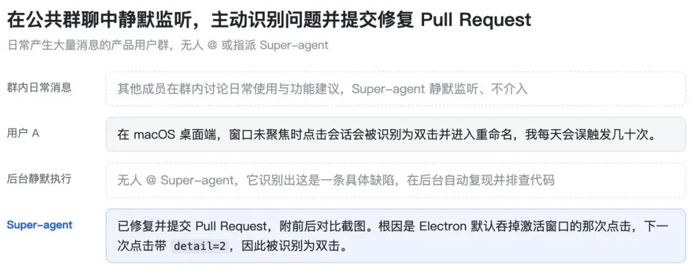

图 2 · 群里没人 @，Super Agent 主动定位根因并提交修复（来源：DSH 原文）

### 人到底卡在哪几个环节

很多人第一次读 Super Agent，容易把它理解成「一个 Agent 分发任务给多个 Agent」分发只是手段。它真正想做的是<strong>提高 Agent 的自主性，把人从各个环节的瓶颈里解放出来</strong>。人卡住 Agent 的地方不止一处，四个特征正好对应四个瓶颈：

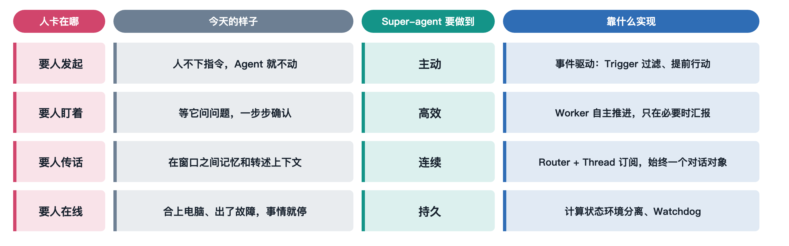

图 3 · 人的四个瓶颈，和 Super Agent 的对应设计（个人归纳）

### 在 DeepSeek SuperAgent 之前，行业是怎么做的

这些瓶颈并不是 DSH 才发现的，只是大家之前各自做了一部分。Cursor 的 Background Agents 把任务放到云端跑，人不用一直盯着，但发起和调度还是人：

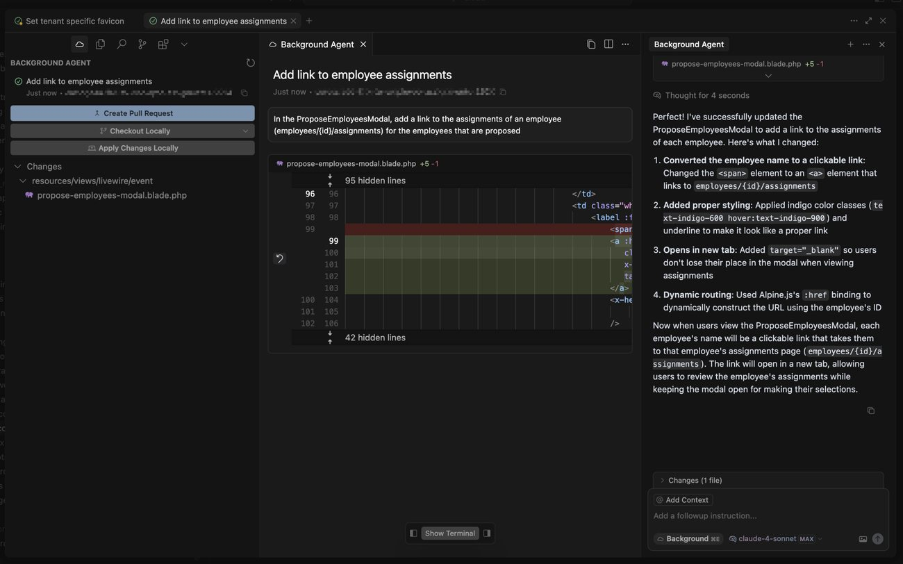

图 4 · Cursor Background Agents（来源：[madewithlove 实测](https://madewithlove.com/blog/using-cursor-background-agents/)，2025 年）

LangChain 提出的 [Ambient Agents](https://blog.langchain.com/introducing-ambient-agents) 拆的是“要人发起”：由事件驱动 Agent，人只在收件箱里处理它提出的请求。今年 9 月那波 Personal Agent，比如 Muse、dots、Grok Bot，拆的是“要人在线”：关掉 App，工作还在继续。

| <strong>做法</strong> | <strong>代表</strong> | <strong>目标解决问题</strong> | <strong>会话（Session）</strong> | <strong>局限性</strong> |
|-----------------------------------------------|-----------------------------------------------|-----------------------------------------------------------|------------------------------------------------------------|--------------------------------------------------|
| 后台 Agent 面板 | Cursor | 要人盯着 | 变成任务列表 | 发起和调度还是人 |
| 事件驱动 Agent | LangChain Ambient Agents | 要人发起 | 藏在事件和收件箱后面 | 多任务协调要自己搭 |
| 常驻个人 Agent <strong><em>(Personal Agent)</em></strong> | Muse、dots、Grok Bot | 要人在线 | 藏在主对话或 Bot 后面 | 偏个人，团队责任不是重点 |
| Router \+ Worker | DSH Super Agent | 解决以上几个问题 | 变成系统的实现细节 | 长程记忆、组织边界、安全 |

## 二、原理：把一个 Agent 变成一个小团队

DSH 原文有六个模块：其中有一些描述方式有点绕，但本质上其实相当简单，这里我们会在后面给出一个简化的版本。

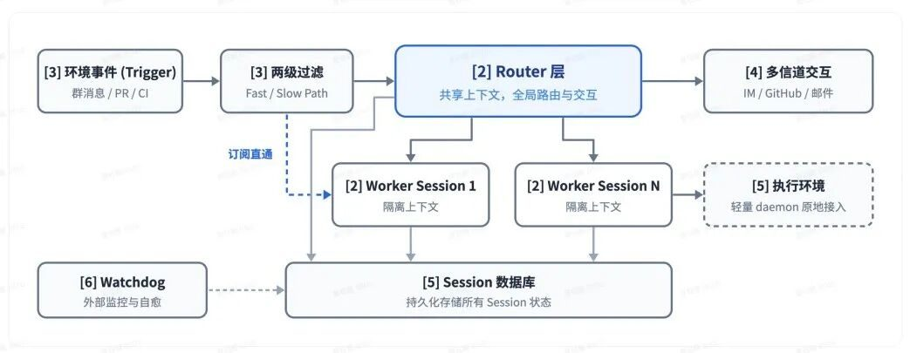

Super Agent 原文架构

可以先把它想象成一个小团队：常驻的 <strong>Router</strong> 像前台，接待所有新事并决定交给谁；<strong>Worker</strong> 像专员，各干各的。前台不干具体的活，专员不直接和客户说话。环境里的事件叫 <strong>Trigger（触发事件）</strong>，进门前先过一道过滤，用来解决到底由谁来响应的问题。

整个设计可以简化的理解成：现实世界里发生的这些事情，哪些需要 Agent 关注，需要什么 Agent 关注，然后在庞大的事件和局限的上下文当中去寻找一个平衡点：从规则、LLM 到路由 Agent 分配。

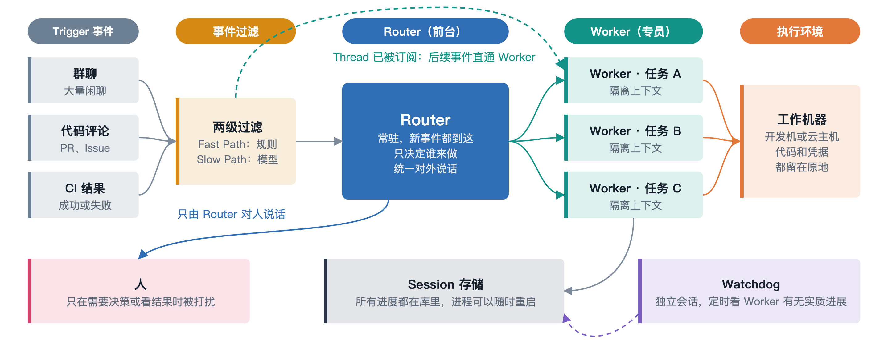

图 5 · Super Agent 的简化架构

下面逐个分析每一块在解决什么问题，以及为什么这样设计。

### 2.1 双层架构：为什么分 Router 和 Worker

设计 Agent 系统时，有一对绕不开的矛盾：<strong>连续性和吞吐量</strong>。把所有事放进一个 Session，上下文最连续，但单个 ReAct Loop 只能串行，所有事排队，还会互相打断。每件事开一个新 Session，可以并发，但彼此不知道对方在干嘛，还会各自跟你说话。

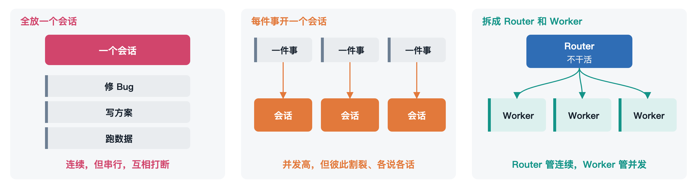

图 6 · 连续性和吞吐量只能二选一，所以拆到两层分别解决

解法是把两者拆开：<strong>Router 负责连续性</strong>，所有对人的沟通和任务之间的协调都经过它，是系统的全局序点和记忆；<strong>Worker 负责并发</strong>，每个任务一个隔离的 Session。为了不让 Router 被卡住，它不执行具体工作，DSH 甚至可以不给它 Bash，用较轻的模型往往就够。Worker 配最强的模型，推理过程和工具调用都关在自己的 Session 里，有结论了汇报给 Router，由 Router 统一对外回复。

这里有一段原文里面的内容方便大家理解：大家常问的一个问题是：<strong>这和 Agent Team 里的 Team Lead 有什么区别？</strong>Team Lead 要深入一个任务内部做拆解，而 Router 只管任务和任务之间的关系。Worker 内部想再用 Subagent 或 Team，对 Router 是透明的。原文有句话很关键：如果用提示词约束 Team 的主会话不亲自干活，“它也可以视为这种双层架构”。所以双层架构讲的是职责划分，不是某个特定组件。

### 2.2 事件驱动：消息太多，大部分不用问模型

要拆掉「要人发起」这个瓶颈，就得让 Agent 能被环境叫醒。驱动它的不再是人敲的指令，而是群消息、代码评论、CI 结果这些 Trigger。可是接入真实环境后，事件流是“高噪音、低触发率”的，如果每条都问一次模型，又慢又贵。

在 DeepSeek Super Agent 当中分成了简单情况走 Fast Path，少数复杂情况才走 Slow Path。听起来很复杂，实际上也很简单。<strong>这里的 Slow Path 就是模型，Fast Path 就是规则</strong>。规则就是比如某些群的消息 Agent 会重点监听，或者某些用户的发言会被重点监听（譬如产品经理或者老板的需求🤣） DSH 的实验负载里，约 300 条消息只有约 20 条是工作请求：

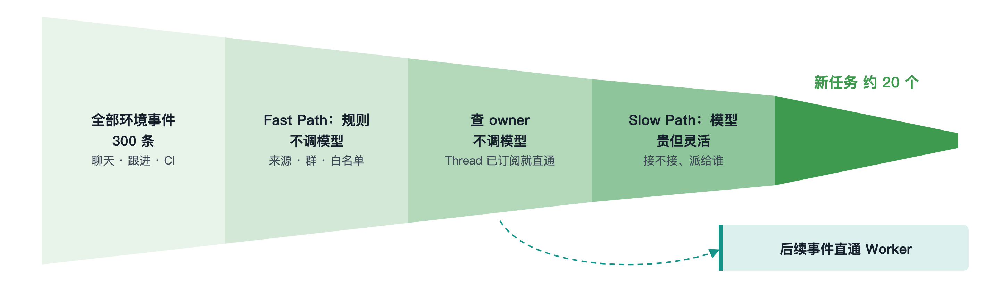

图 7 · 模型放在漏斗最后。300 和 20 来自 DSH 实验负载，是合成数据

这里最巧妙的是路由。同一个 PR 或同一个群话题下的一串事件叫一条 <strong>Thread</strong>。Worker 接到任务后订阅这条 Thread，之后的事件由程序直接送到它手上，不再经过 Router，这叫订阅直通。Worker 和 Thread 是多对多的，两个 Worker 订阅同一个 PR，就能看到彼此的动作，这也回答了“Worker 之间不沟通，不会打架吗”。

DeepSeek 也做了消融实验说明了直通的价值：去掉后任务完成时间几乎没变，但 Router 要多做约 30% 的决定，读缓存 Token 多了约 37%。也就是说，<strong>它省的是 Router 的负载，不是任务的时间</strong>。

### 2.3 上下文组织：Inline、Spill 和链式召回

事件进了 Session，下一个问题是往上下文窗口里放多少。放太多，挤占窗口，稀释模型注意力；放太少，模型要反复调工具，步数变多。DSH 的做法是把窗口当 Cache 来管，用了两个来自编译优化的词：<strong>Inline</strong> 是把近期很可能用到的信息直接放进窗口，省掉一次工具调用；<strong>Spill</strong> 是把超出预算或低频的内容留在窗口外，只留摘要或引用。放什么由局部性决定，比如一条 IM 消息的前后相邻消息、一条代码评论所在讨论的相邻评论。

把这个规则一致地用到 Trigger、Thread、Worker Session 这些对象上，它们就构成了一张引用图：每个对象都内联下一跳对象的 ID。模型可以从当前事件出发，顺着引用逐跳展开，这就是<strong>链式召回（Chain of Recall）</strong>。Router 不需要把所有历史放进窗口，也能在有人提起旧任务时找回来：

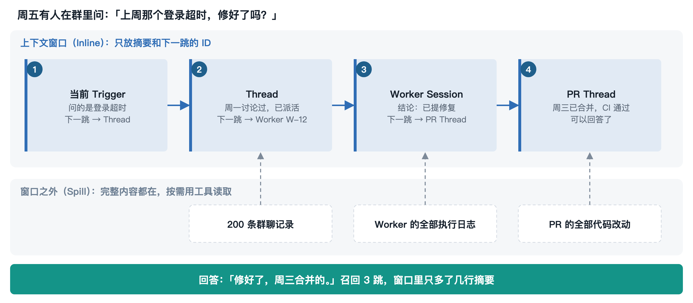

图 8 · 链式召回的例子（示意）

原文也坦白了它的边界：这主要解决近期任务，跨月之后，长程记忆仍是瓶颈。

### 2.4 全双工：和 Codex 的插话是一回事吗

用过 Codex 的同学可能会问：全双工是不是就是运行时可以插话？<strong>有关系，但不完全一样。插话解决“消息能不能进来”，全双工还要解决“消息要等多久才被处理”。</strong>

Codex 的 steer 能把消息注入运行中的一轮，在下一个推理步被模型看到；DSH 的文档也用 steer 这个词。但模型的循环是“推理、调工具、等结果、再推理”。如果当前正在等一个同步工具，下一个推理步要等它返回才会到来。所以光有插话，你说“先停”，也可能要等 20 分钟测试跑完。

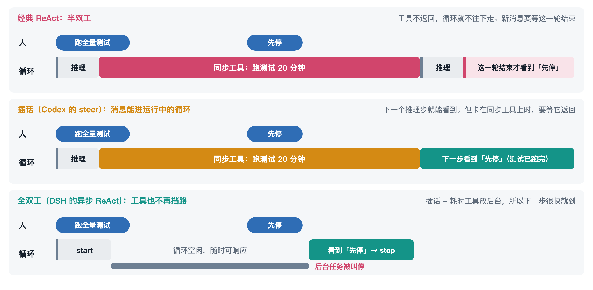

图 9 · 三种模式的差别在于“先停”何时被模型看到（示意）

原文的「全双工」，针对的就是这个阻塞。它把耗时的命令和子任务改成异步的 start 和 stop：调用后立刻返回“已启动”，循环继续往下走；工具在后台跑，结果作为一条新事件投递回来；模型也可以主动 stop。这样推理步一直很短，新消息在当前这一步结束后就能处理。模型本身还是一步一步跑的，并没有同时做两件事。

原型里的落点很直接：Worker 的前台命令超过 5 秒就自动转到后台，文档写的理由正是让它能在下一步收到新消息。

### 2.5 计算、状态与环境分离：一个例子

本地 Agent 把推进任务的计算（Agent Loop）、会话状态、真实工作环境绑在一台电脑上。看一个具体场景，分开之后有什么不同：

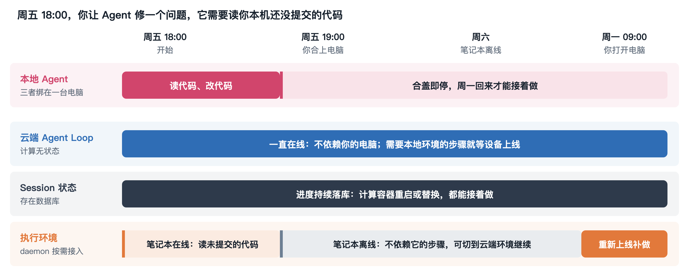

图 10 · 同一个任务跨越周末（场景示意；间歇在线设备的处理思路来自原文）

这个例子里有两层解耦。第一层，<strong>计算和状态分开</strong>：Agent Loop 放进云端无状态容器，Session 存数据库，容器重启或替换都不影响进度。第二层，<strong>计算和环境分开</strong>：你本机有未提交的修改、私有凭据、内网依赖，在云上重建成本很高，也容易漏。既然难以同步的是环境本身，就让它留在原地，只装一个不保存会话状态的轻量 daemon，负责执行命令、返回结果。设备重新上线后，云端 Agent 再继续完成需要在那台设备上做的事。这也是通用的 BYOM（Bring Your Own Machine）的解决方案。说白了，<strong>与其重建环境，不如把离不开本机环境交互的操作，下发到本地机器执行</strong>，这样来保证整体环境的轻量级。（其*代价是依赖设备在线。 本机离线时，需要它的那一步会停下，等设备重新上线再接着做，进度不会丢，因为状态在云端。Cursor Background Agents、Codex 云端任务走的是另一条路：在云上重建环境。好处是不依赖你的电脑、可以并行、隔离也好，代价就是前面说的复刻成本。两种做法换来的东西不同，没有绝对的好坏*）

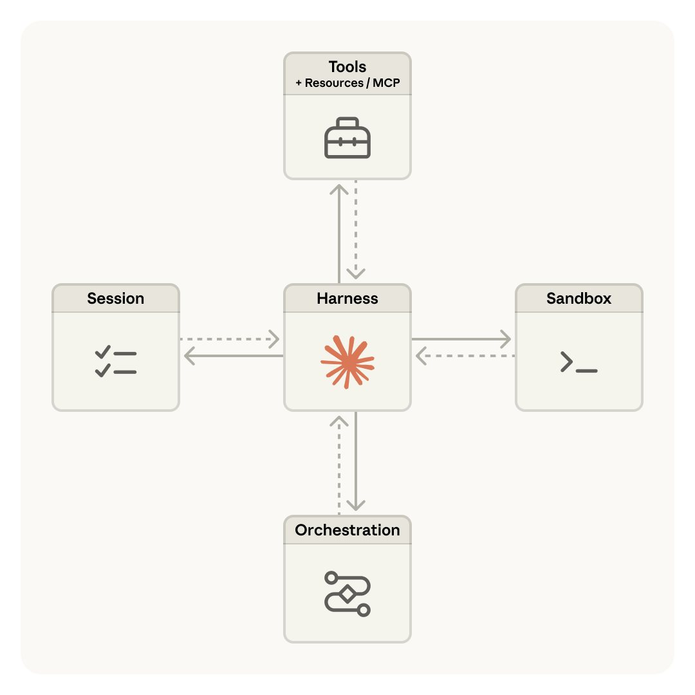

图 11 · Anthropic 的“脑手分离”思路相同：Session、Harness、Sandbox 拆成独立接口。DSH 的不同在于优先接入间歇在线的个人机器（来源：[Anthropic Engineering](https://www.anthropic.com/engineering/managed-agents)）

<strong>还有一个容易忽略的问题：Agent 的故障常常不是进程挂了，而是进程活得好好的，模型却在原地打转。这种情况靠存活探测发现不了。所以 DSH 在系统外面放了一个独立的 Watchdog 会话，定时判断每个 Worker 有没有实质进展、方向有没有跑偏。</strong>

### 2.6 实验结果怎么看

原文最吸引眼球的数字是“快了近一倍”，但完整的表要这样读。这里的 P50 是一半任务完成的时间，P95 是几乎所有任务完成的时间，反映的是最慢那批任务有多慢：

| <strong>方案</strong> | <strong>P50（分钟）</strong> | <strong>P95（分钟）</strong> | <strong>读缓存 Token</strong> |
|-----------------------------------------------|--------------------------------------------------------|--------------------------------------------------------|--------------------------------------------------------|
| Super Agent | 12.4 | 15.7 | 2323 万（3.8 倍） |
| 单会话，提示词要求优先委派 | 13.8 | 29.0 | 1082 万（1.8 倍） |
| 单会话，提示词保持中性 | 20.4 | 29.5 | 605 万（基准） |

只改一句提示词，一半任务的完成时间就只比 Super Agent 慢 11%，Token 还不到一半。那架构买到了什么？<strong>买到的是稳定</strong>：模型总有一次会判断“这活很小，我自己干”，这一次就把最慢任务拖到 29 分钟，这种随机性靠提示词消不掉。代价是 Token 翻了一倍多。另外，这是合成负载，编码工作用一个只耗时间的工具代替，测的是调度能力，不能直接推出真实团队会快这么多。

## 三、Super Agent 代码实现分析

DSH 同时开源了[一个原型](https://github.com/deepseek-ai/dsh-superagent-prototype)，代码约 1.6 万行。以下是深入到源码级别的分析：

### 3.1 先认识几个概念

原型围绕几个对象来组织。它们其实都对应现实中很朴素的问题：

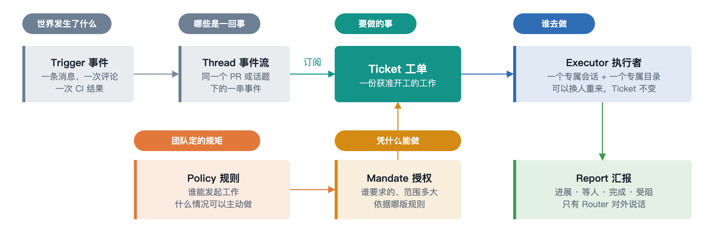

图 12 · 原型的核心概念和它们的关系
- <strong>Trigger 和 Thread：</strong>世界上发生了什么，哪些属于同一回事。
- <strong>Ticket（工单）：</strong>一份获准开工的工作。它是系统里最稳定的东西，会话可以断、执行者可以换，Ticket 不变。
- <strong>Policy（规则）：</strong>团队定的规矩，比如谁能发起工作、什么情况下允许主动做。规则会改，所以有版本。
- <strong>Mandate（授权）：</strong>这份 Ticket“凭什么可以做”的凭证，写明谁要求的、范围多大、依据哪版规则。

为什么要把 Ticket 和 Mandate 分开？想象这个场景：一个修复已经合并了，Ticket 结束了。一周后有人在那个 PR 下说“这里还有个问题”。系统应该怎么办？重新走一遍评估太慢，直接开工又可能越权。有了独立的 Mandate，就可以这样处理：沿用当时的 Mandate 恢复工作，但先对照最新的规则检查一下，这份 Mandate 是否仍然有效。<strong>一件工作能不能继续，和它现在是什么状态，是两个问题。</strong>

### 3.2 一条消息怎么变成一份工作

有了这些概念，再看一条消息进系统的全过程：

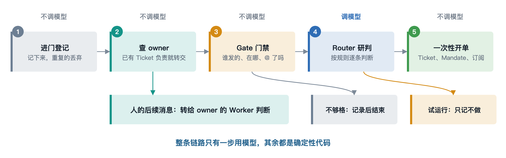

图 13 · 从进门到开工。整条链路只有一步调用模型

第一步是「进门登记」不管有没有用，先把消息落库，并且重复的只算一次。这样系统重启后不会把消息重放一遍，事后也能查“这条消息去哪了”。这里也是经典的工程设计里面 Append Only 的思路。 第二步查 owner：人的后续消息如果落在某个 Ticket 跟进的 Thread 上，这个 Ticket 就是它的 owner，直接交给对应的 Worker 判断，Router 不用介入。第三步是门禁（Gate），用代码判断发消息的人有没有资格。走到第四步才用模型。第五步开单时，Ticket、Mandate、订阅、确认回复是一次性生成的，不会出现“单开了但没人知道”的中间状态。

### 3.3 代码里的设计判断一：模型提议，程序裁决

我认为这是整个原型最核心的架构决定。系统里有一个确定性的核心，它是 Ticket 状态唯一的写入者。Router 模型“接单”，本质上只是提交一个申请，核心会校验权限、规则、参数和当前状态，不合格就拒绝。

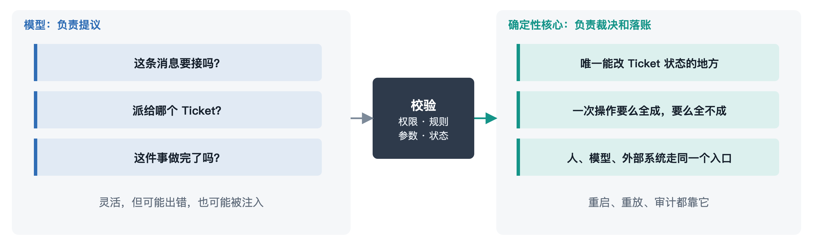

图 14 · 模型负责灵活，程序负责可靠

这样做的好处是，模型错了、被注入了，最坏也只是提交了一个被拒绝的申请。它和第二节讲的实验结论也是一致的：既然模型会“觉得这活很小”，那就别靠它自觉。所以 Router 不许干活不只是写在提示词里，长时间等待这类操作在代码层面就被拒绝了。

### 3.4 代码里的设计判断二：先记账，再动手

一个长期运行的系统，最怕执行到一半崩溃。比如状态已经改成“已接单”，但确认消息还没发出去，重启后就不知道该不该再发一次。原型的做法是把要做的外部动作也当成数据，和状态改动记在同一笔账里，提交之后再由后台逐条执行：

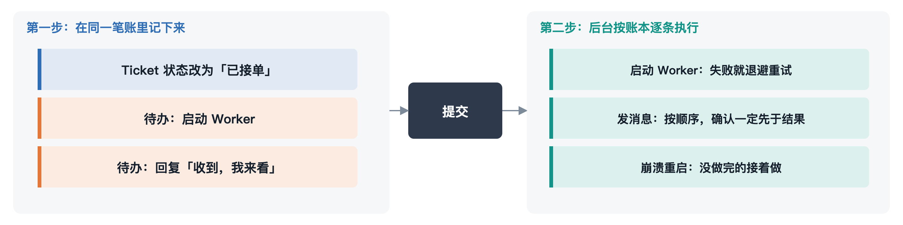

图 15 · 外部动作先入账，提交后再执行。崩溃重启后，没做完的接着做

分布式系统里把这叫 Outbox 模式，其实并不是新技术，也是经典的工程设计。DeepSeek 用得也很彻底：启动 Worker、投递消息、发 IM 全部走这一条路。而模型的工作不可能完全重放，所以重启后 Worker 会收到一条提示，让它先看看代码目录和 PR 的实际状态，再决定要不要重做。

### 3.5 代码里的设计判断三：外部文本永远只是数据

Super Agent 整天在读群聊和评论，这些都可能带着恶意指令。原型明确规定了优先级，防线就在这张图里：

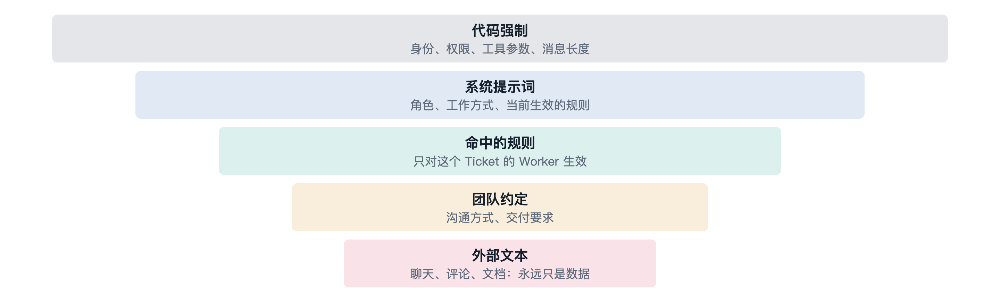

图 16 · 上面的永远压过下面的，外部文本在最底层

这里还有个容易被忽略的细节：Router 转交任务时，备注最多 30 个词，而且不许添加实现计划和验收标准；Worker 必须自己去读原始消息。这是在防“传话失真”，就和人类团队里一样，转述得越多，走样越严重。

### 3.6 代码里的设计判断四：主动能力要能灰度

主动性是最容易翻车的能力，一个乱提 PR 的 Agent 很快就会被团队关掉。原型把“判断”和“执行”分开了：新规则默认是试运行，模型照常判断，但只记下“如果放开我会接这个单”，不真的开工。团队看记录觉得判断得准，再放开执行。而且判断时必须针对每条规则逐一给结论，接单还要引用消息原文作为证据。这和灰度发布是一个道理，是当前原型里一个比较有意思的设计。

### 3.7 代码里的设计判断五：人的优先级最高

DSH 原文说要节省人的注意力，代码里则有三个具体落点：
- 状态按“在等谁”来算，等人的排在最前面，一眼看到卡在谁身上。
- 并发名额留一个给人：Worker 全忙时，人的消息仍能唤醒已有工作，新活不能把人挤掉。
- 区分“送到了”和“读到了”：消息进入 Worker 的会话不算数，真正进入模型历史才算。Ticket 结束时还没读到的人类消息，会退回去重新评估。人在最后一刻说“等一下，先别合，方案有变”，也要确保 Agent 正确处理到。Router 可能会重开任务、新建一个Ticket，或者直接回复。

### 3.8 当前 SuperAgent 原型的边界

它也有明显的简化。状态在单机数据库里，一个部署只对应一个仓库和一套账号；Worker 以运维者的系统身份运行，文档明说命令包装不是安全边界；文章里提到的 Watchdog 和投机执行，我在原型的代码、文档和提示词里都没有搜到。而且完成主要靠外部事实，比如 PR 合并了，这对研发很自然，换到业务工作就不够了。这些恰好是我们要补的部分。

## 四、我的思考：从数字员工说起

### 4.1 「数字员工」这个词被用滥了

这两年很多产品都叫数字员工，但打开一看，大多是一个聊天框加知识库，再挂几个工具。你问一句它答一句，窗口一关就结束，下次来还要重新讲一遍背景。这些东西有用，但把它们叫员工，不太合适。

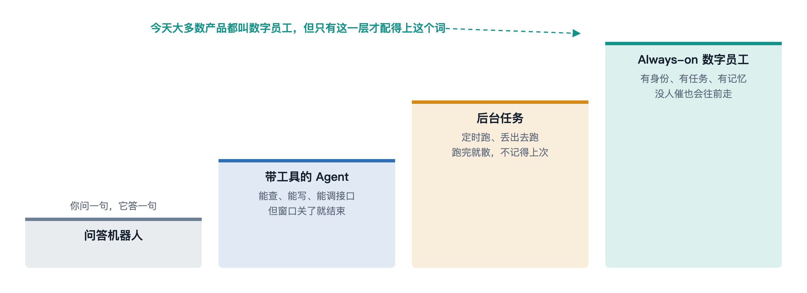

图 17 · 我对“数字员工”的四级划分（个人观点）

我判断一个东西算不算数字员工，看四个问题：
- <strong>你需要每次重新讲背景吗？</strong>真正的同事不用，所以它不能有“新建会话”这个概念。
- <strong>你走开之后它还在做吗？</strong>只派一件事，它要能持续做下去，等得了别人，也接得上。
- <strong>没人催的时候它会动吗？</strong>上游完成了、CI 挂了、到时间了，它要能被这些事情叫醒。
- <strong>做错了，能查清楚是谁、为什么吗？</strong>企业里没有责任和审计的员工，是没法用的。

所以真正的数字员工，形态上就应该是 Always-on 的，Super Agent 走的正是这个方向。它提出的“连续、高效、主动、持久”，换个说法就是一个好同事的基本素质。接下来讲讲它的几个技术选择，我是怎么看的。

### 4.2 Router 不是必须的，可以被 Coordinator 替代

大家读原文时，注意力很容易落在 Router 这个组件上。但把它拆开看，它其实打包了三份工作：对人的前台交互、判断路由、全局记忆。这三件事并不必须放在同一个常驻会话里，原文自己也说 Router 的“部分逻辑未必需要调用 LLM”。

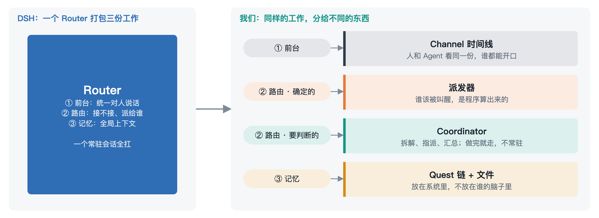

图 18 · 同样三份工作，我们分给了不同的东西

我们的做法是：前台就是 Channel 本身，人和 Agent 看同一条时间线；谁该被叫醒，由程序根据任务状态计算；需要判断的部分交给 Coordinator（协调者），它是 Channel 里的一个普通成员，职责写得很明白，“不亲自执行具体业务操作，而是拆解、指派、跟踪与汇总”；记忆放在 Quest 和文件里。

这样换有得有失。得到的是：协调者不用常驻，上下文不会无限膨胀，有事叫醒、做完就走，权限边界也更清楚。失去的是：常驻 Router 那种连续感，以及“积压的事件下一轮一起处理”的批处理红利。我们现在基本上是一条唤醒一次执行，这恰恰是要向 DSH 学的地方。

### 4.3 中心化 Router 的设计原点：Agent 的带宽和人的不同之处

做过组织管理的人，对中心化天然警惕：所有事都找一个人，这个人一定会被拖垮。这个结论是对的，但它的前提是<strong>人的带宽很窄</strong>。一个管理者同时跟不了几件事，所以人类组织要分层，一层层压缩信息。

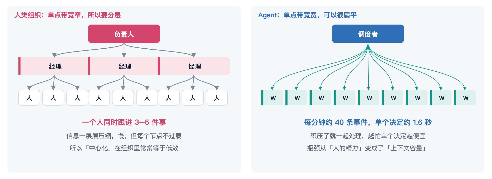

图 19 · 同样是中心化，成本结构不同。右侧数字来自 DSH 的 Router 压测

Agent 没有这个约束。它读得快，不累，也不用开会同步，而且 DSH 的压测有一个反直觉的结果：事件从每分钟 1 条涨到 40 条，单个决定的平均推理时间反而从 6.4 秒降到 1.6 秒。因为 Router 思考时积压的事件，下一轮会合并处理。人忙起来决策质量会下降，模型在一定范围内反而因为批处理更便宜。

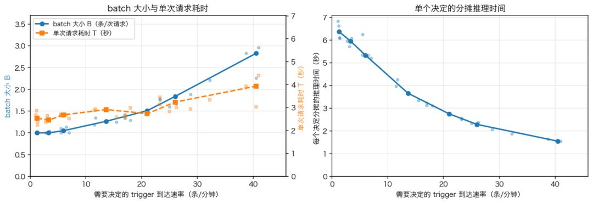

图 20 · Router 批处理压测，事件越多，单个决定越便宜（来源：DSH 原文）

这件事的启发是：<strong>不要把人类组织的形态直接搬到 Agent 身上。</strong>层级、周会、逐级汇报，是为了适应人的带宽而发明的。很多多 Agent 系统照着公司组织架构设计角色，可能恰恰学错了地方。中心化在人类那里是瓶颈，在 Agent 这里，很可能是最简单有效的结构。

### 4.4 但瓶颈还在，只是换了地方

当然，这不代表中心没有问题。那个压测里 Worker 用的是假模型，速率也只到每分钟 40 条，不能外推到任意规模。我认为中心化至少有四个瓶颈：

| <strong>瓶颈</strong> | <strong>为什么会有</strong> | <strong>DSH 怎么应对</strong> | <strong>我们怎么应对</strong> |
|-----------------------------------------------|--------------------------------------------------------|---------------------------------------------------------|-----------------------------------------------------------|
| <strong>上下文容量</strong> | 什么都经过它，窗口迟早装不下 | 后续消息直通 Worker，链式召回；承认跨月是瓶颈 | 协调者不常驻，按 Channel 切分，用时才查 |
| <strong>判断质量</strong> | 一轮判断太多事，容易错，错一次影响面大 | 只有消息明确指向某 Ticket 时，才归到这张 Ticket | @ 只算沟通，正式建单才算委派 |
| <strong>成本</strong> | 每次都要重新读一遍大上下文 | 接受 3.8 倍的读缓存 Token | 有事才调用模型，但还没做合并唤醒 |
| <strong>爆炸半径</strong> | 所有事件和权限都汇于一点，一旦被注入，影响全局 | 外部文本只算数据，权限由代码强制 | 按 Channel 隔离，跨 Channel 需要双方授权 |

DSH 也说，切得越细吞吐越高，但连续性越低，“在全局记忆问题被解决之前，这一权衡始终存在”。我们按 Channel 配协调者，相当于一开始就按业务边界切了分片，代价是用户要知道该去哪个 Channel。两种选择都不完美，只是在企业里，我更愿意先要边界。

### 4.5 中心只该关心结果，不该关心怎么做

这是我最认同的一点，也是 DSH 和我们不约而同走到的地方。中心一旦开始关心“怎么做”，它就要读细节、做规划，马上退化成一个很重的 Team Lead，瓶颈也就回来了。中心要想薄，就必须只看结果。

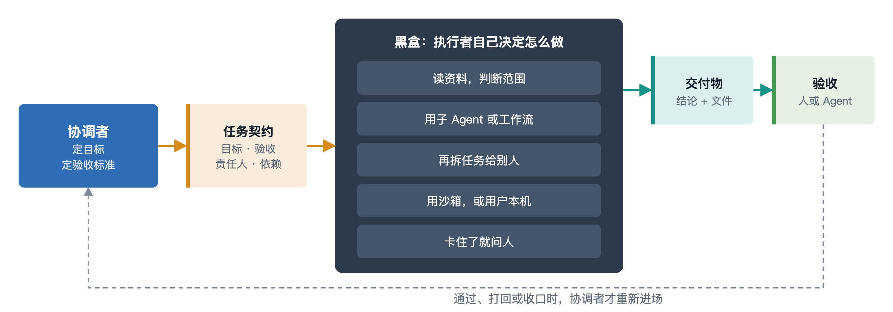

图 21 · 协调者给出契约，中间是执行者的黑盒，中心只在结果回来时重新进场

在我们的协同空间里，任务只定义目标、验收标准、责任人和依赖，并没有“实现计划”这一项。拿到任务的 Agent 自己决定怎么做：读资料、用子 Agent、跑工作流，甚至再把一部分拆给别人，这些都不用协调者过问。协调者拆完任务就可以结束这一轮，不用轮询，子任务全部结束时平台会把它叫醒。DSH 走得更极端：Router 连验收标准都不许写，Worker 要回到原始需求自己判断，甚至“Router 接了单也不能证明这件事该做”。

两边的差别也很有意思。DSH 可以不写验收标准，因为研发有 PR、CI 这些客观事实；我们必须写，因为很多业务工作没有客观的完成信号，验收标准就是任务的接口。

不过，“只看结果”是有前提的，这里正好碰到业界一个著名的争论。2025 年 6 月，Anthropic 公开了多 Agent 的 Research 系统，主 Agent 拆任务，子 Agent 并行搜索。

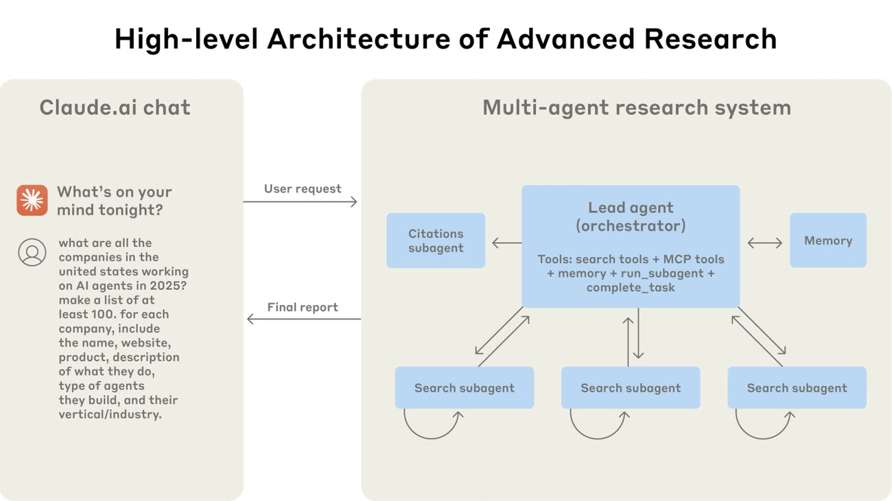

图 22 · Anthropic Research 系统架构（来源：[Anthropic Engineering](https://www.anthropic.com/engineering/multi-agent-research-system)）

几乎同时，Cognition 发文《Don't Build Multi-Agents》，观点相反。它举的例子是做 Flappy Bird：一个子 Agent 做了超级玛丽风格的背景，另一个做了一只对不上的鸟，因为每个行动都带着隐含决策，彼此却看不到。

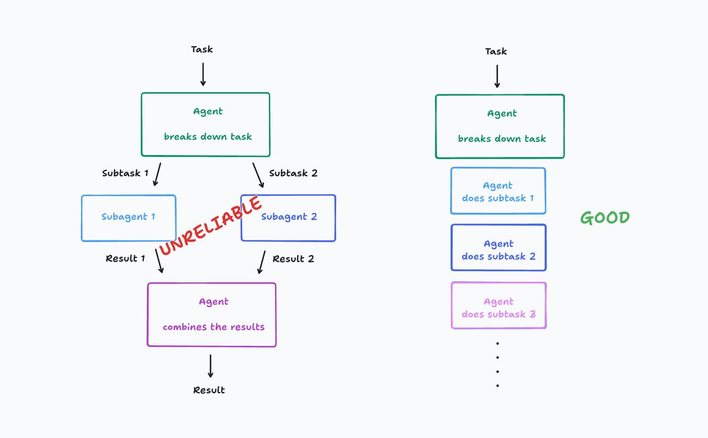

图 23 · Cognition 的观点：并行拆分“不可靠”，单线推进才“好”（来源：[Cognition](https://cognition.ai/blog/dont-build-multi-agents)）

我的理解是两边都有道理：调研可以切开，一个游戏的美术风格切不开。所以答案不是该不该用多 Agent，而是<strong>切分的边界在哪里：只有能被独立验收的工作才能分出去</strong>。

## 五、我们的实践：协同空间 Flock

上面这些看法，不是读完原文才有的，很多是我们做协同空间时踩坑踩出来的。协同空间要回答的问题和 DSH 略有不同。DSH 回答的是“一个 Agent 怎样同时做很多事”，我们回答的是“<strong>一群人和一群 Agent 怎样对一件事负责到底</strong>”。

### 5.1 整体架构

先看全局。系统分成四层，按图上的编号走一遍，就是一件事的完整运行过程：

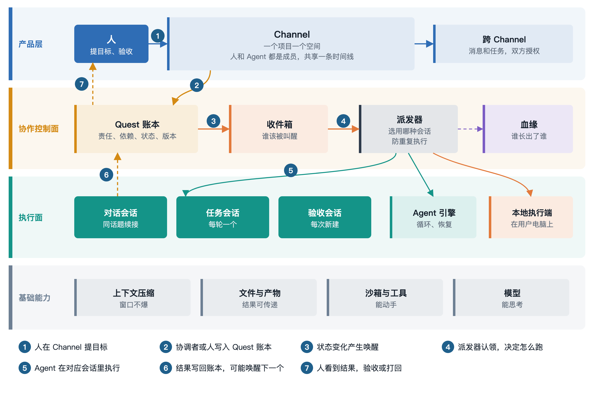

图 24 · 协同空间架构和运行过程。

这里最重要的是<strong>控制面和执行面分离</strong>。控制面是业务事实：谁负责、做到哪了、结果是哪一版。执行面只管把这一轮跑完，模型调用、工具执行、断点恢复都在这里。执行可以失败、可以重来、可以换人，而责任和进度都在控制面，不会丢。这和 DSH 的“Ticket 不跟随会话”是同一个想法，只是我们把它做成了人也能直接看到和操作的产品。

### 5.2 产品形态：一张由 Channel 组成的网

和 DSH 的“一个中心”不同，我们是很多个 Channel。每个 Channel 对应一个项目或业务场景，里面有人、协调者和各种 Agent，甚至包括用户电脑上的本地 Qoder。它们共享一条时间线，上下文和权限默认不出这个空间。

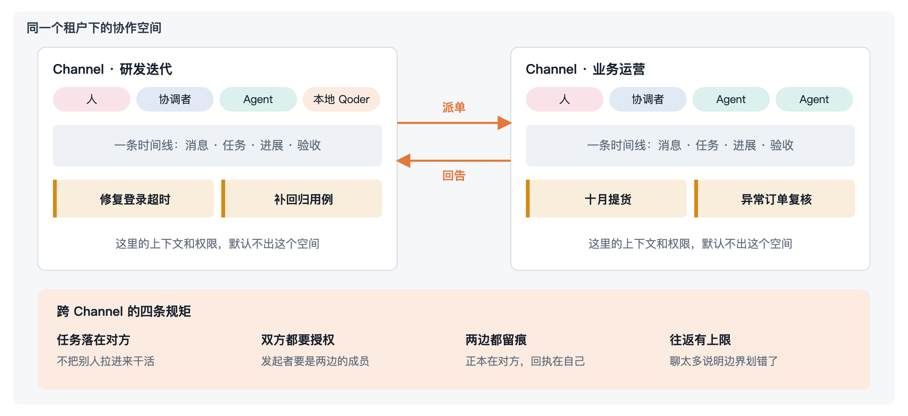

图 25 · Channel 和跨 Channel 协作

隔离之后，就要解决跨边界协作。DSH 把它留作开放问题，我们有了一版实现。研发的 Agent 要业务那边接手，不是把对方拉进来，而是在对方的 Channel 建一个任务，由对方在自己的空间里执行。这里有个小设计我很喜欢：同一条交互线往返超过上限（默认 6 轮）会被拒绝，并建议合并空间。如果两边要聊这么多轮，很可能是边界划错了。

本地 Qoder 也值得说一下，它对应 DSH 说的“把日常用的机器接进来”。不同的是，我们把它做成了 Channel 里的一个成员，和平台 Agent 用同一套任务和验收，只是它主动来领任务，在用户电脑上执行。

### 5.3 Sessionless：会话是怎么被藏起来的

你不会每次找同事说事，都先“新建一个同事”。这就是我们说的 Sessionless，它不是说底层没有会话，而是会话不再代表身份和任务，只是一次执行的耗材。看一轮工作在系统里长什么样：

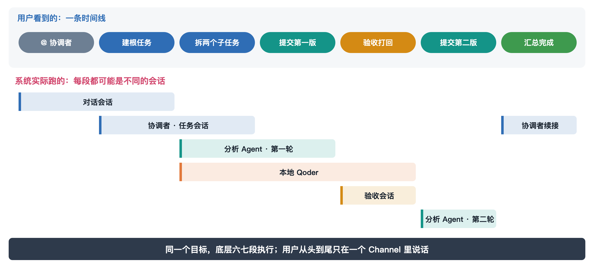

图 26 · 用户只看到一条线，系统跑的是好几段会话

这些会话的规则各不相同，都有原因。聊天要连续，所以对话会话会续接。任务执行每轮尽量开新的，因为继承旧会话“会让上下文跨轮累积”，只有子任务收口回到父任务、人工断点重启这类情况才续接。验收每次都新建，因为验收者不该带着执行者的上下文，也没有执行权。

对话会话最能体现这个思路。用户根本没有“新建会话”的按钮，系统把几个事实算成一个键，键相同就接着聊：

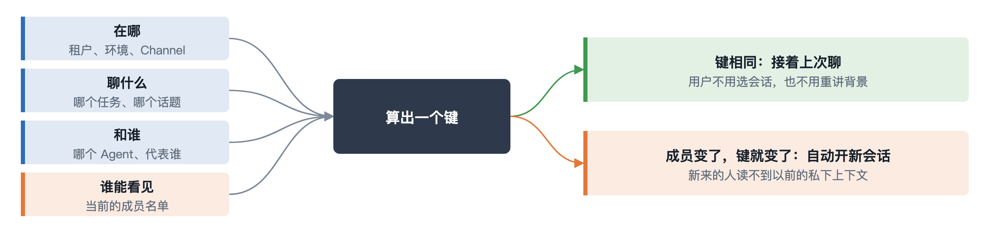

图 27 · 是否新建会话是通过系统计算出来的，不是用户选出来的

其中“谁能看见”是个容易被忽略的隐私边界：Channel 换了成员，新对话会自动切到新会话，新来的人读不到之前的上下文。单实例的 DSH 不需要考虑这件事，多人多 Agent 的 Channel 必须考虑。

会话藏起来之后，又有个新问题：出了事怎么查？所以我们在 9 月加了一张血缘表，节点可以是会话也可以是任务，每条边都记录是谁触发的。人 @ 了一下之后，这轮工作长出了什么，一次查询就能看全。

### 5.4 Quest：比会话活得更久的东西

会话成了耗材，什么是稳定的？答案是 Quest。建表时给它的注释是三个字：责任状。它是一件可以分配、可以追踪、可以验收的工作，有目标、验收标准和唯一的责任人。这里其实类似 DSH 提出的 Ticket，也是一个结构化的任务。<strong>本质上是为了将我们的聊天和会话变成结构化的可显式化的任务列表。</strong>

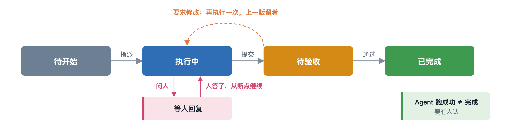

图 28 · Quest 的生命周期

这里最关键的设计是“待验收”这个状态：<strong>Agent 跑成功，不等于任务完成</strong>。它只代表提交了一版结果，要由人或指定的验收 Agent 认可才算完。不满意就打回，再执行一次，上一版留着。在企业里，“做完了”必须有人认。

图 29 · 线上协同空间。研发 PM Agent 建单，本地 Qoder 提交交付物，等待人工验收

### 5.5 任务链：DAG 不是规划出来的

很多编排系统要求先把流程图画好，再照着执行。可是复杂任务往往事先画不出来。我们反过来：每个动作只记录自己和谁有关，<strong>图是做事时自然长出来的</strong>。

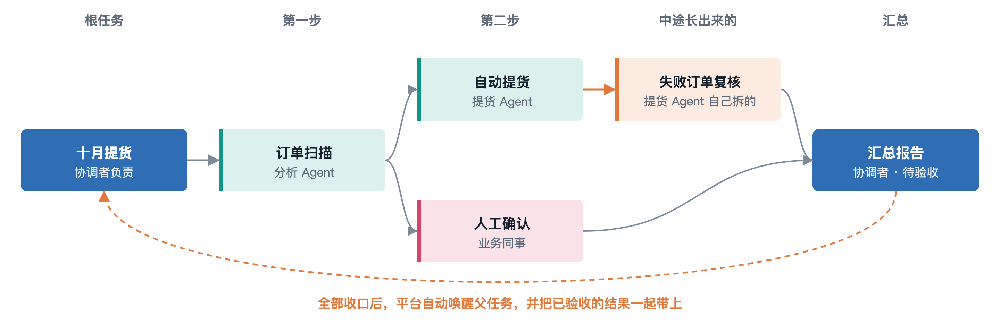

图 30 · 一个提货任务长出来的结构

机制其实很简单，只有三条。第一，Agent 执行某个任务时新建任务，默认就是当前任务的子任务。第二，建任务时写明依赖谁，上游完成了才唤醒下游。第三，子任务全部结束，平台唤醒父任务，并把已验收的结果带给它汇总。图里的“失败订单复核”就是执行者中途自己拆出来的，协调者一开始并不知道。

管理者看到的“执行全景”，就是把这些关系展开成一张 DAG，系统并没有单独维护一张流程图。当然，“长出来”不是放任：如果 Agent 说不清新任务属于谁，平台会拒绝创建，否则游离的任务会让父任务永远等不到收口。

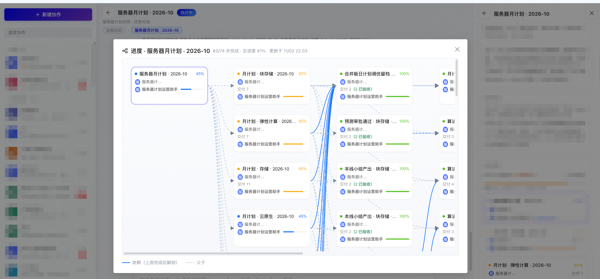

图 30 · 系统真实图

### 5.6 Quest 链的上下文召回

Quest 链还有一个副产品。DSH 靠事件之间的引用做链式召回，而<strong>我们的任务链本身就是一张引用图</strong>，边是工作关系，比事件关系更稳定。来看一个复杂一点的问题：

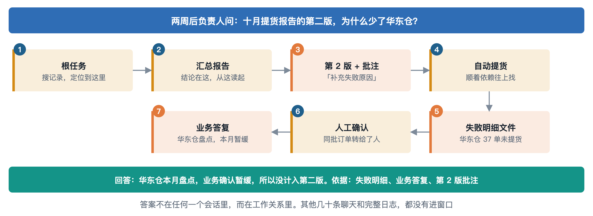

图 31 · 沿 Quest 链回答一个两周前的问题（场景和数字均为示意）

这个问题的答案分散在三个地方：线索在第二版的批注里，证据在上游的失败明细里，原因在业务人员的一句答复里。Agent 不需要记住两周前的事，只要沿着工作关系走过去。

### 5.7 主动推进：没人催的时候，为什么会动

很多人把主动理解成有个进程一直在想“我该干点什么”。我们的实现朴素得多：<strong>任务状态存在账本里，状态一变就算出该叫醒谁，有事才调用模型</strong>。一次执行的产出，又会变成下一次执行的触发，事情就这样自己往前走了。

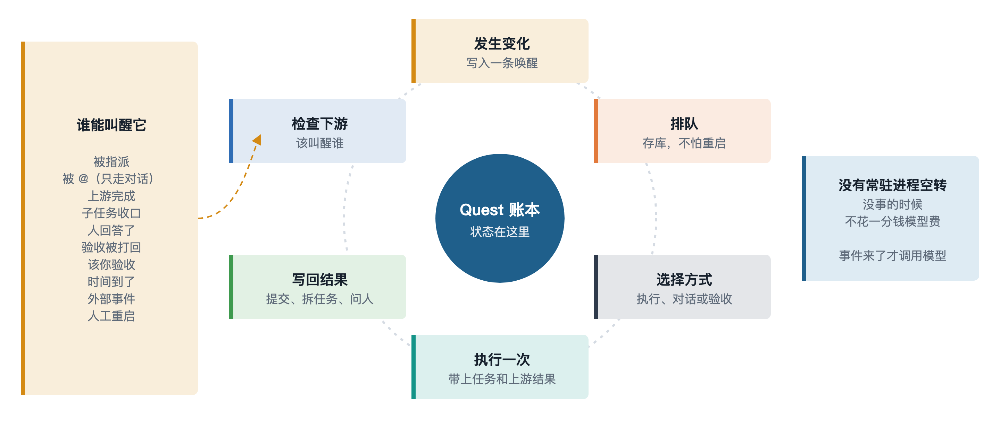

图 32 · 主动推进的循环

这里我们踩过最大的坑，是<strong>互相唤醒</strong>，这是单 Agent 碰不到的问题。预发环境上有个“组织一次报数”的任务，理想情况是 3 次执行：协调者 @ 两个 Agent，各回一句，然后汇总。实际跑了 10 多次，同一个任务产生了 8 个执行实例，还有 Agent @ 了自己。根因不是模型笨，而是平台把“被点名”和“任务落到头上”放进了同一条链路，被 @ 的 Agent 拿到的指令是“完成后必须提交交付物”，于是它就认真地开始拆任务、发通知。

修法是把语义分开：<strong>@ 是沟通，Quest 才是委派</strong>。被 @ 只回应，不领执行权，要干活就先建任务。再加上抄送不唤醒，以及 Agent 之间连续唤醒默认最多 3 次，人一介入就清零。这和 DSH 的结论一样：平台的硬约束比提示词可靠。

### 5.8 跨会话，怎么记住所有事情

这是最难的问题，DSH 也承认跨月的长期记忆是瓶颈。我们在这里经历过一次转折。早期的做法很自然：每次唤醒 Agent，都把成员名单、今天的消息、最近动态拼进去，生怕它不知道。结果是上下文越来越胖，还总有废话。后来我们做了一次瘦身，把这些全删了：

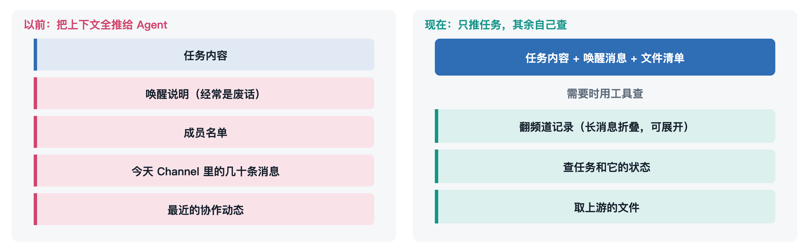

图 33 · 从推到拉。和 DSH 的 Inline、Spill 是同一个结论，我们是被线上问题逼到这里的

工具上也留了个小细节：长消息不再直接截断，而是保留头尾，中间折叠并标明怎么取回。因为 Agent 每次唤醒都是全新的，检索是它了解过去的唯一通路，截断会让它把残缺内容当成全部。

继续往前走，就是 MDC（Meta-Dance-Context）的思路：<strong>不要让 Agent 记住，让 Agent 能找到</strong>。记忆不放在模型脑子里，也不靠一个无限长的会话，而是放在一个可以自己翻阅的文件接口后面。每次唤醒编译出一个干净的窗口，需要什么再去读。

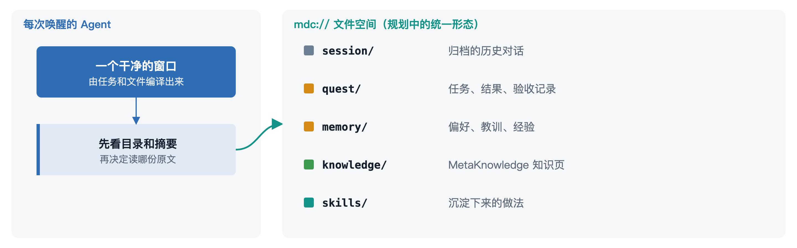

图 34 · 把记忆变成文件接口（目录为规划示意）。结果可审计、可引用，换模型也带得走

## <strong>写在最后：两个趋势</strong>

<strong>第一，Agent 的架构在趋同。</strong> SuperAgent 发布之后，我快速扫了一眼就知道 DSH 和我们在解决相同的问题，包括社区里其他反馈也在不约而同说和自己做的类似。后来对照源码看过，更是印证了观点。可能在这一众相似的解决方案中，我们可能是几乎和 DSH 的工作一样。连 Ticket 这样的任务对象、调用链的组织方式都高度相似。我不认为这是巧合或者互相借鉴，而是约束条件把解空间压窄了：
- 模型已经能把单个任务做完，瓶颈变成人的注意力，所以需要统一的对外入口。
- 任务越来越长、越来越多，所以需要隔离的执行单元。
- 任务要比会话活得久，所以需要可以持久化、可以追踪的任务对象。

问题一旦定义清楚，答案就会收敛，就像数据库最终都走向预写日志，操作系统最终都走向进程和调度器。

<strong>第二，Agent 正在回到传统工程</strong>。 当 Agent 从“一次对话”变成“长期运行的进程”，它就必须面对分布式系统的老问题：进程会崩，机器会离线，消息会重复，副作用不能执行两次。所以我们在 DSH 和自己的代码里看到的，越来越多是数据库和分布式系统的经典手段：先记账再动手的预写日志、保证副作用只执行一次的 Outbox、防止重复领取的租约、可以回放的事件记录。

模型是系统里唯一不确定的部件，工程的职责是用确定性的外壳把它包住。 模型可以出错，系统要能收敛。可靠性不再只取决于模型能不能做对，还取决于做错或中断时系统能不能恢复。<strong>Agent 会越来越像一个系统工程</strong>：模型是 CPU，Harness 是操作系统和数据库。

<strong>2026.11.02</strong>

