# AgenticOps 决策模型的能力实测

一条慢查询告警，Agent查了10.16分钟，调用123次诊断模型，最后拿到94分。结果不差，但把轨迹翻开，里面反复出现的是同一类问题：先查什么，这条证据有没有用，下一步该往哪走。这些判断，每次都需要让大模型生成一遍答案吗？以前我们在选更强的调查模型，同时持续优化我们的harness，决策模型的出现拓宽了我们的优化思路，我们想看看能不能把调查中的一部分LLM判断交给专门的决策模型。

不只是故障诊断，AgenticOps任务中的数据查询、巡检和处置都需要反复做出判断：选择对象与数据、理解已有信息、选择工具与方法、整理上下文，以及检查结果。本文从[STAROps](https://www.aliyun.com/product/starops)实际运行过程出发，在15,788个评分case上比较12个模型，覆盖内部实验版本、百炼与外部决策模型，以及Qwen3.8 Flash，并在10个RCA案例上验证不同接入位置。<strong>我们关注的不只是模型能答对多少题，还包括怎样使用它的输出，以及单步判断的优势能否改善完整Agent任务。</strong>

五类运维判断中，都有决策模型超过Qwen3.8 Flash；在1,745条共同单题输入上，Pilot准确率高2.52个百分点，P95响应时间缩短80.3%。把低置信度题交给Flash后，55组模型与任务组合中，有38组超过了两者中较强的单模型。但到了完整RCA，答案又有不同：同样10道题，Decision 1放在任务分派位置提高6.40分，Clef 27B的进展判断配置提高7.20分，Pilot根因校验配置提高2.40分、耗时缩短4.0%。专用模型已经有值得用的能力，接下来要回答的是：让谁做哪一步，才能让一次调查做得更好？

## 1\. 真实调查中的决策与开销

我们从[rca-benchmark](https://sls.aliyun.com/doc/playground/rca-benchmark.html)中最近10道故障题的运行记录里，先挑一条看清调查怎样推进，再把10道题的模型调用摊开。这样才能知道，哪些反复出现的判断值得交给专用模型。

### 1.1 一条真实轨迹中的五类判断

先把F162这道RDS慢查询题展开。slowQueries告警出现时，慢查询、CPU和IOPS一起升高，QPS与连接数却基本平稳。STAROps沿低效SQL、锁等待和实例变更三个方向查下去，派出三个子调查，分别取指标、慢日志和SQL审计。最后用时10.16分钟，Brise评分94分，诊断模型调用了123次。这个结果已经不错，值得继续追问的是：这123次调用，分别在判断什么？

顺着轨迹看，五类判断都能找到对应的动作。先选实例、数据源和时间段，再读证据：120条相同查询，每条扫描约839万行，却只返回1行，相关字段没有索引。接着选核验方法、分派子调查，API不可用就转查日志。随着材料增多，Agent还要留下时间范围、已有证据和待查问题，汇入调查图。交付前，它把查询频率、慢查询指标和业务影响放到一起核对，确认新增报表作业的低效扫描是主要原因。机制查到了，作业由谁发起还没有查到。

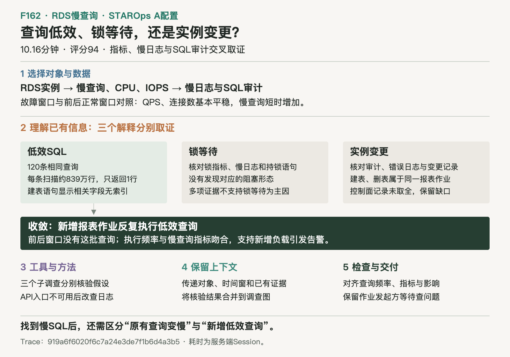

到04:12左右，三个子调查开始并行核验；09:27，主调查汇总证据，确认主要原因。这里最关键的一步，是把“有一条低效SQL”变成“这条SQL解释了本次告警”：故障前后没有这批查询，故障期间的查询频率又与慢查询指标吻合。找到异常只是起点，把异常和这次故障对上，才有了诊断依据。

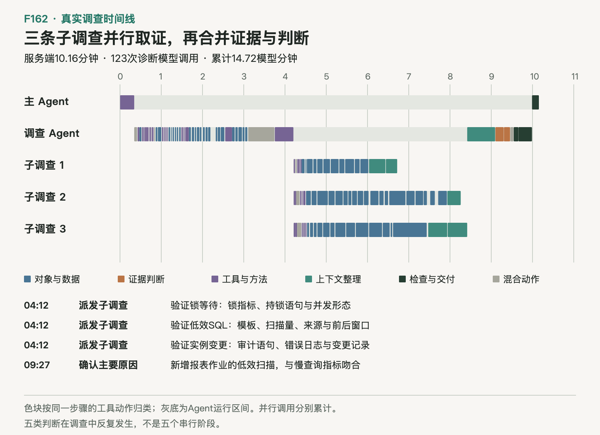

### 1.2 整批耗时集中在哪里

把范围扩大到10道题，开销更直观。STAROps某版本默认配置（版本A）最终调用模型1,653次，去掉10次标题生成，剩下1,643次诊断调用，累计耗时214.3分钟。对象与数据选择用了117.3分钟，占54.7%；上下文整理用了41.0分钟，占19.2%。也就是说，大量等待发生在“查什么”和“怎样把查到的东西留给下一步”上。这里累加的是每次模型调用的耗时，工具执行时间另计。

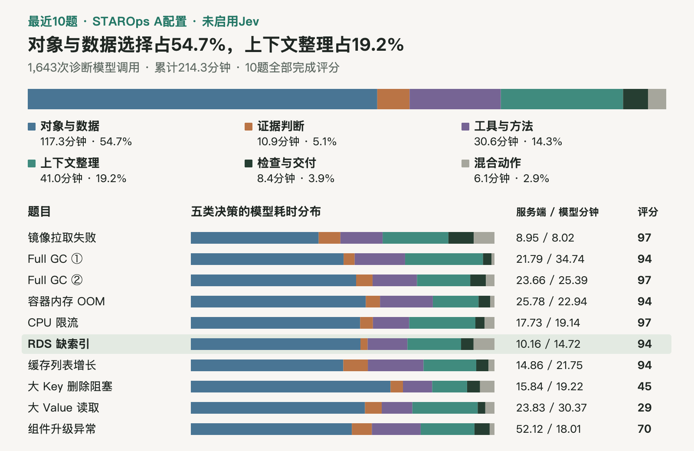

上下文整理为什么会用掉41.0分钟？32次子调查结果汇总占21.3分钟，67次以记录观察为主的调用占17.2分钟，其余用于维护调查图、证据文件和待查问题。这些动作都在为后续判断准备材料。调查越往后，已经查过的东西越多，怎样留下有用信息本身也成了一项工作。

统计按模型调用所在步骤的工具动作归类：取数与读取证据归入对象与数据选择；提出、判断假设和统计已有数据归入信息理解；加载Skill、查询工具用法和分派子调查归入工具与方法选择；记录观察、保存摘要和返回子调查结果归入上下文整理；读取报告要求、结束调查和最终回复归入结果检查与交付。同时涉及多类动作的步骤单列为混合动作。

### 1.3 对决策模型工作的启发

这就把接入问题落到了具体步骤上。选错数据，后面可能白查；读错证据，调查方向可能偏掉；整理时漏掉信息，后续又要重新找。我们想从这些高频判断里挑出适合专用模型承担的部分，再看它能否同时改善准确率和调用开销。

实验里，先给不同模型相同的材料和候选，比较判断准确率与响应时间；再把候选模型接回完整RCA，用最终分数和调查耗时检验单步优势有没有留下来。

## 2\. 评测设计与数据集

一次调查包含很多不同的判断，不能都用一个总分概括。我们把运维题按前面的五类判断整理，覆盖查询、巡检和诊断；另外加入语义理解、模型调度和执行评价三类通用题。两部分分别计分，既看模型懂不懂运维，也看它在通用任务上的表现能否延续到这里。

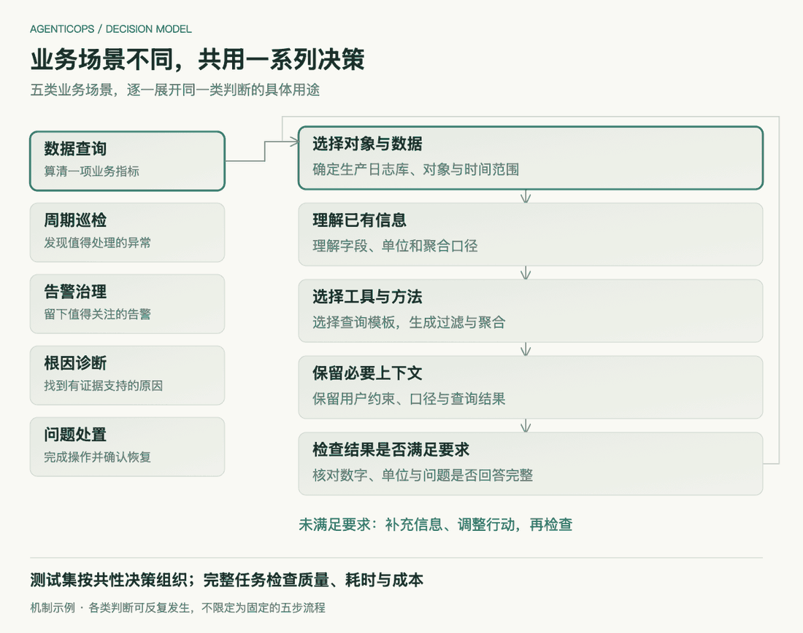

上方动态图展示数据查询、巡检、诊断和处置如何对应到共同的五类判断。

### 2.1 任务构成

评测共15,788个评分case，运维决策14,757个，通用决策1,031个。运维题对应前面的五类判断；通用题包括情感识别、模型能力档位选择和Agent执行评价。同一份材料可能问多个问题，这里每个独立计分的判断算一个评分case。

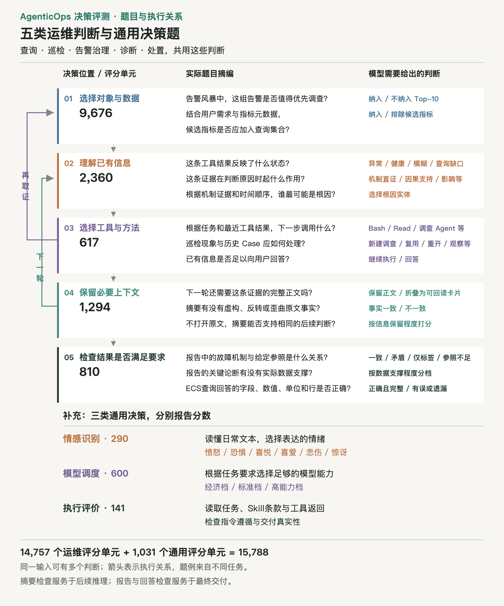

### 2.2 运维决策任务

#### 2.2.1 选择对象与数据

开始查之前，Agent先要选对目标。这类题给出任务和候选，让模型筛选告警、实体或指标：这组告警该不该进Top-10？指标元数据是否支持把它加入查询集合？选中哪些对象，决定了后面会拿到什么材料。

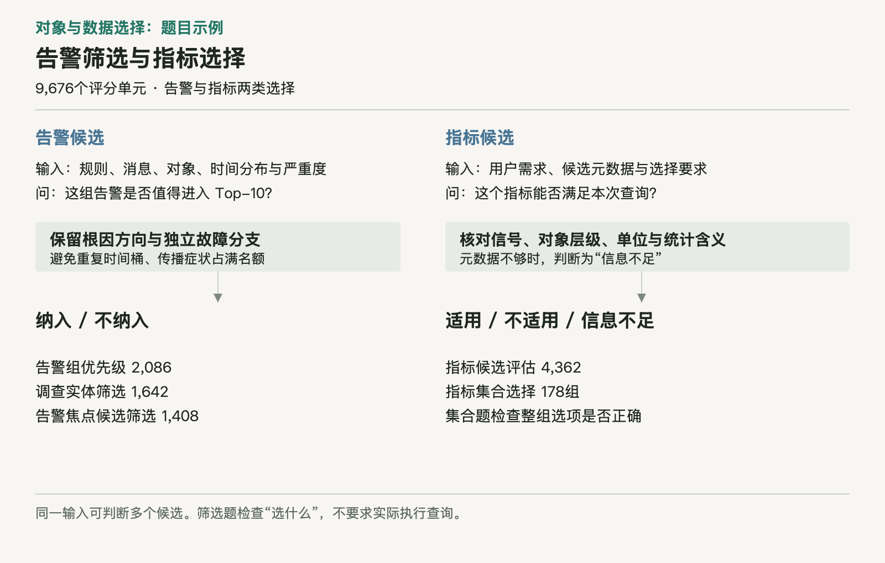

本类共<strong>9,676个评分case</strong>，检查模型能否从候选中选出与当前任务相关的对象和数据。

#### 2.2.2 理解已有信息

拿到材料以后，问题变成“这些信息说明了什么”。输入可能是工具结果、证据卡片，也可能是一份报告。模型要识别异常、判断证据的作用，或根据证据推断根因；另一些题则要求读懂报告，找出报告已经认定的根因。

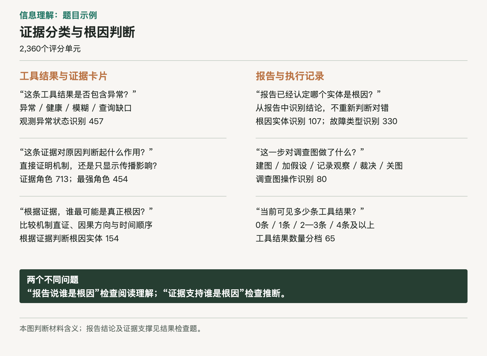

本类共<strong>2,360个评分case</strong>。其中，154个根因实体题要求根据证据作出推断，107个要求从报告中识别已有结论。<strong>两者分别检查推断能力和信息理解能力。</strong>此外还包括工具结果数量分档和调查图操作分类。

#### 2.2.3 选择工具与方法

知道当前发生了什么，还要决定下一步怎么做。比如巡检发现异常后，结合当前现象和历史Case，是新建调查、重开已有调查，还是复用结论、继续观察或无需关注？这类题把下一步工具与行动作为候选，检查模型能否选对。

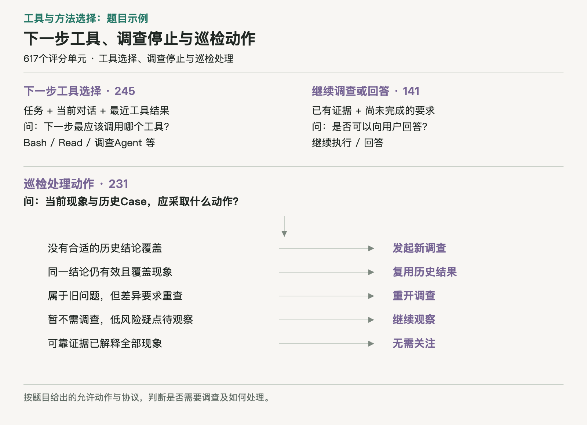

本类共<strong>617个评分case</strong>，考察下一步行动的选择。2.3.3的Agent执行评价则检查已经完成的执行过程，两类题分别对应行动前的选择和行动后的评价。

#### 2.2.4 保留必要上下文

调查留下的材料越来越多，哪些要继续带着？这类题让模型在完整正文、摘要和可回读卡片之间选择，再检查摘要是否改动事实、是否漏掉后续判断需要的信息。这里让模型评价已有摘要、选择保留方式，摘要生成本身不在这组题里。

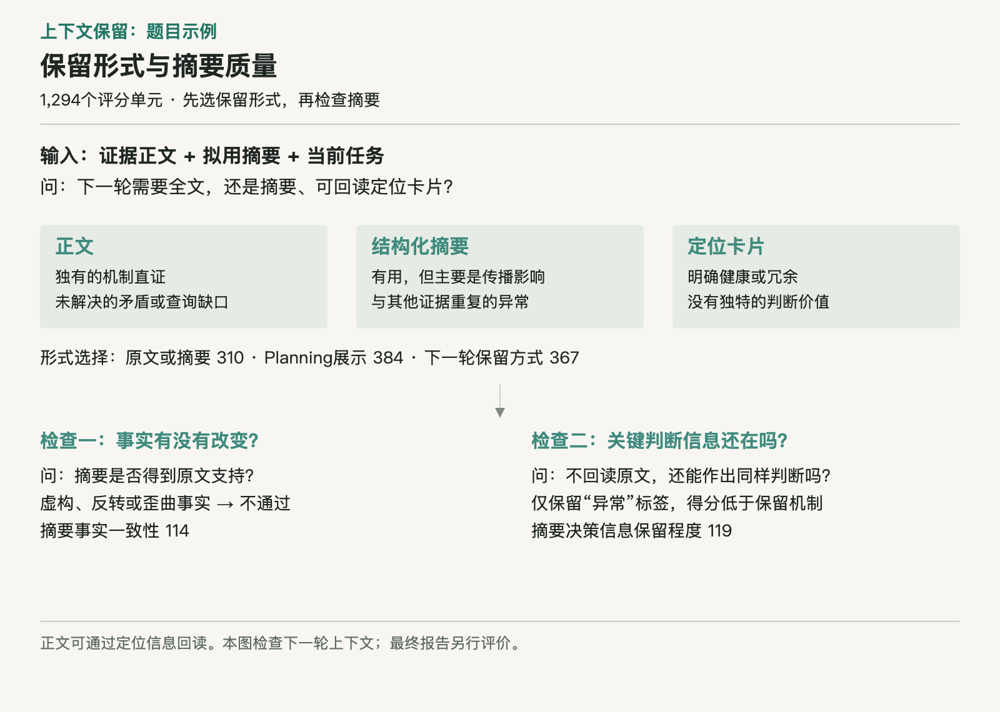

本类共<strong>1,294个评分case</strong>：1,061个检查上下文保留方式，114个检查摘要事实一致性，119个检查摘要是否保留决策所需的信息。<strong>既看保留方式是否合适，也看压缩后是否丢失关键信息。</strong>

#### 2.2.5 检查结果是否满足要求

到了交付前，还要回头核对结论。RCA报告中的故障机制是否符合给定参照？ECS查询回答里的实例、CPU均值与峰值、单位和记录是否正确？这些题检查的是最终交付是否站得住，而不只是回答有没有生成出来。

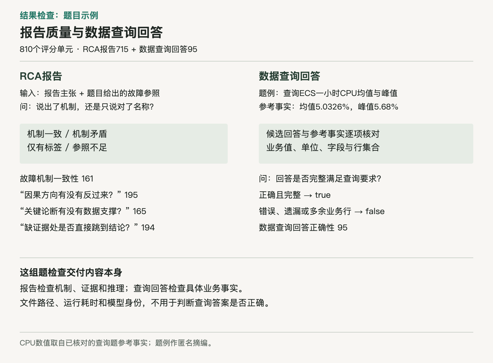

本类共<strong>810个评分case</strong>，包括715个RCA报告检查和95个数据查询回答检查。报告题中，161个检查故障机制一致性；查询回答题包含88个正确样本和7个错误样本。

### 2.3 通用决策任务

通用题提供另一组参照：擅长日常语义理解、模型调度或执行评价的模型，到了运维判断里是否也占优？我们把这三类题与运维题分开计分，方便看清哪些能力能延续过来，哪些还需要针对任务开展实验。

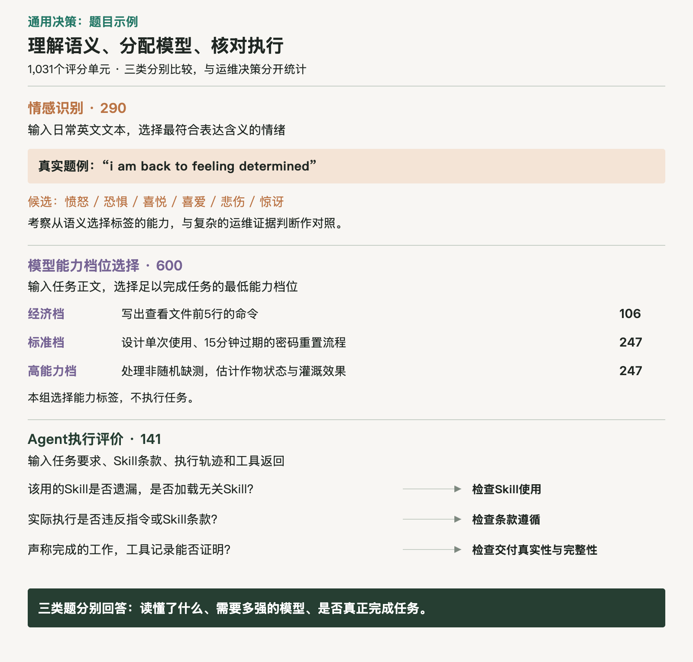

#### 2.3.1 情感识别

情感识别共290题。模型读一段日常英文文本，从愤怒、恐惧、喜悦、喜爱、悲伤和惊讶中选标签，比如判断“i am back to feeling determined”表达了什么情绪。它和运维证据分类都要求读懂材料后作出选择，放在一起看，可以观察模型在两类语义判断上的表现是否一致。

#### 2.3.2 模型能力档位选择

模型能力档位选择共600题，覆盖命令编写、软件设计和研究分析。给定任务正文，模型需要选择完成它所需的最低能力档位。参考档位由出题者经过两轮自审确定，尚未绑定具体模型；本组按标签一致性评分，不执行任务。它回答的是模型能否判断任务难度，实际调度效果还要结合具体模型的执行结果来看。

#### 2.3.3 Agent执行评价

Agent执行评价包含25条执行轨迹、141个评分case，覆盖指标统计、发布简报和配置检查。模型读取任务要求、Skill条款和工具返回，检查Skill是否漏用或误用、指令是否兼容，以及执行是否遵循要求。Agent说自己做完了，实际交付是否对得上，是这组题的重点。

## 3\. 关键问题与参测模型

有了这批题，我们沿着四个问题比较12个模型：谁适合做哪类判断，材料和答案该怎样处理，哪些题值得交给Flash，以及接入之后整场调查是否更好。

### 3.1 关键问题

#### 3.1.1 KQ1：哪些判断适合交给决策模型，准确率与响应时间如何取舍？

先看选型。同一类判断里谁更准，在共同题目上谁响应更快？再结合实验路线、架构和部署条件理解差异。结果见4.1。

#### 3.1.2 KQ2：输入材料和答案使用方式，如何影响模型判断？

再看接法。材料长度变化时成绩怎样，同一份响应怎样读成答案，低估或高估摘要又会让后续动作发生什么变化？结果见4.2。

#### 3.1.3 KQ3：何时组合两个模型，比直接使用其中一个更好？

然后看互补。低置信度时交给Flash，能否超过直接使用其中一个模型？我们既统计多答对多少题，也统计多交出去多少题，比较回退阈值和任务之间的差别。结果见4.3。

#### 3.1.4 KQ4：决策模型接入RCA Agent后，能否提高诊断质量、减少调查耗时？

最后回到完整RCA。主调查模型保持不变，分别让Clef Pilot、Microsoft Decision 1和Clef 27B接入对象选择、任务分派、进展判断、上下文管理与根因校验。用同一批任务比较最终评分、耗时和逐题变化，看看单步优势落到哪个位置才有用。结果见4.4。

### 3.2 参测模型与选择依据

本轮共12个模型：4个内部实验版本\[S1\]、1个百炼决策模型、6个外部决策模型，以及作为通用模型对照的Qwen3.8 Flash。Flash既用来回答“现有通用LLM已经能做到多少”，也在后面的组合实验中接手低置信度题。

比较分三个层次。先把专用决策模型与Flash放在一起，看准确率和响应时间；再按规模看不同路线，9B组包括Clef、StartLux-style C、Fullset和Decision 1，27B组包括Clef、Decider和Drex Max；最后看加大模型是否划算，例如Decider 4B与27B、Clef 9B与27B。各模型的底座、实验设置和部署条件也列在下面，解释成绩时一并考虑。

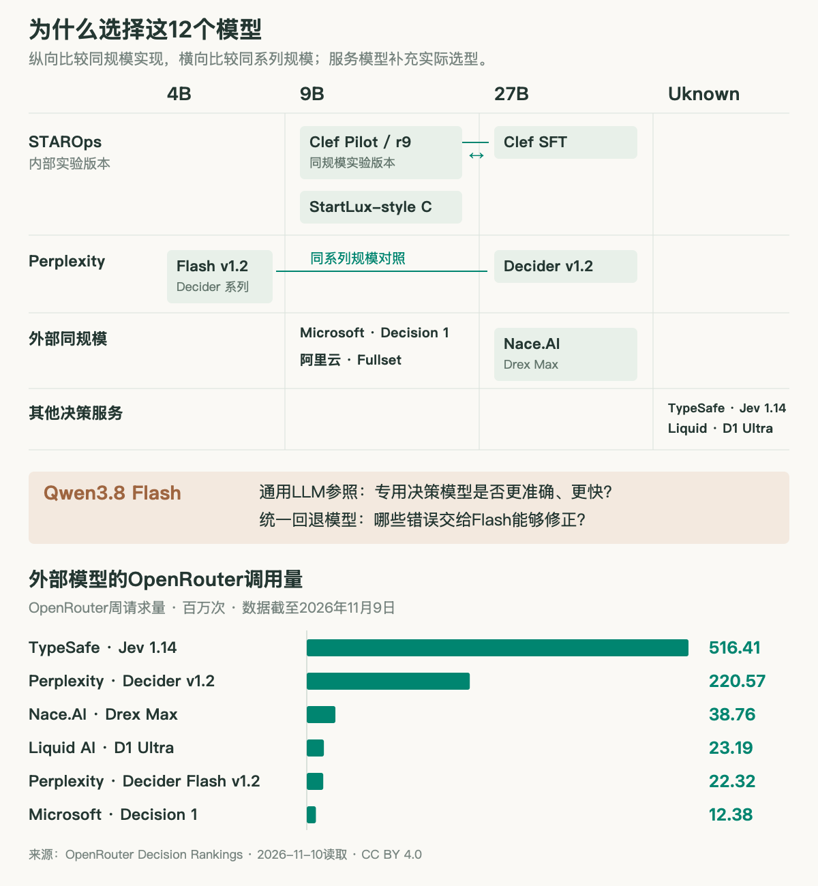

#### 3.2.1 内部实验版本与百炼模型

| 模型 | 底座与参测版本 | 实验或实现特征 | 纳入原因 |
|------|---------------------|---------------------|------------|
| STAROps－Clef Pilot－9B | Qwen3.5-9B；soft-choice pilot SFT，step256 | 内部实验、EAS部署；接入记录标为soft-choice版本 | 与r9比较同规模的不同实验版本，观察各类决策表现是否稳定 |
| STAROps－Clef r9－9B | Qwen3.5-9B；SFT step900，BF16 | 内部实验；EAS服务支持完整65,536-token输入 | 保留已有实验版本作对照，检查新版本的收益与退步 |
| STAROps－Clef SFT－27B | Qwen3.8-27B；SFT step800 | 内部实验的大模型版本，EAS部署 | 检查较大模型是否更适合证据理解、上下文和报告判断，并与外部27B比较 |
| STAROps－StartLux-style C－9B | Qwen3.5-9B；LoRA C step612，按开发集选中 | 全注意力层改为双向，26字母读出；BF16基座、FP32 LoRA与读出；未加载公开StartLux成品权重 | 与Clef 9B比较另一种决策实现，检查字母读出与宽候选适配的效果 |
| 百炼－Fullset－9B | 百炼 pre-decision-model-9b-fullset | 百炼提供的内测决策模型；本轮适配器每批最多16题 | 作为内部可接入的9B决策服务对照 |

Clef路线参考上游Clef-Flash。其公开方案在Qwen3.5-9B的隐藏状态上增加Transformer联合决策头，<strong>直接为问题中的候选打分</strong>。

#### 3.2.2 外部决策模型与通用LLM

| 模型 | 底座与规模 | 公开实现／训练特征 | 纳入原因 |
|------|---------------|---------------------------|------------|
| Perplexity－Decider v1.2－27B 周请求：220,565,105次 | Qwen3.8-27B | 同一序列读取材料与多个问题，在各题标记处用255路读出层打分；全注意力层双向；多次训练权重平均 \[S3\] | 27B通用决策对照，重点观察多问题、上下文判断与置信度 |
| Perplexity－Decider Flash v1.2－4B 周请求：22,318,397次 | Qwen3.5-4B | 沿用联合问题协议；由Decider v1.2蒸馏，并组合多个训练版本 \[S4\] | 小模型部署候选，判断哪些决策可以用更小规模承担 |
| Nace.AI－Drex Max－27B 周请求：38,761,852次 | 公开Max v1为Qwen3.8-27B稠密模型 | 专用255路读出；全注意力层双向；SFT后使用RLAF优化；每个问题单独编码 \[S5\] | 同为27B但训练和多问题处理不同，与Decider及团队27B比较 |
| Microsoft－Decision 1－9B 周请求：12,379,487次 | Qwen3.5-9B | 经过决策后训练，单次前向返回候选概率；未公开完整决策头与训练配方 \[S6\] | 9B商业决策服务对照，覆盖路由、筛选和结果评价 |
| Liquid AI－D1 Ultra－Uknown 周请求：23,187,920次 | 官方说明基于更大的开源权重模型，未披露具体底座与规模 | 直接返回类型化概率；专门训练概率可靠性，支持文本与图像 \[S7\] | 检查商业决策模型在复杂判断及概率回退上的表现 |
| TypeSafe－Jev 1.14－Uknown 周请求：516,409,378次 | 未公开底座与参数规模 | 官方披露并行采样与RLCD，即面向校准决策的强化学习；具体网络未完整公开 \[S8\] | 本次决策模型研究的原始参照，比较准确率、耗时及概率使用效果 |
| Qwen3.8 Flash | 通用生成式LLM | 关闭思考、temperature=0，生成结构化答案后解析 | 回答是否需要专用决策模型，同时作为低置信度回退的统一模型 |

### 3.3 比较条件

评分规则对所有模型一致：使用同一批题目和参考答案，选择题、布尔题检查答案匹配，多选题按整组选择计分，缺失或无效输出计错。179道分档题取概率最高的档位，Flash使用明确返回的档位。我们按任务分别报告成绩，并与2.1中的固定答案或规则对照，检查模型究竟多做对了哪些判断。

<strong>相同题目需要适配不同服务的输入限制。</strong>Clef每次请求最多128题、每题最多256个选项；StartLux-style C每次最多32题，Fullset按16题分批。StartLux遇到超过26个候选时，先按每组25个候选筛出3个，再比较入围项。Decider把材料和多个问题放在同一序列中处理，Drex Max逐题编码材料，Liquid按每题重复计算输入费用。\[S1\]\[S3\]\[S5\]\[S7\] 实验记录材料长度、题数、候选数及拆分后的请求数，用于分析这些处理方式带来的差异。

回退实验要算清一笔账：交给Flash之后，修正了多少错题，又改错了多少原本正确的题？候选概率来自专用读出层、StartLux分组后的组合结果或Flash生成的文本。实验固定Flash输出，按案例分成五组，每次用四组选阈值，在剩余一组测试，再汇总五组成绩。除了最终准确率，还报告回退比例，以及相对原模型、相对两者中较强模型的提升。

速度统计共同题目的单题HTTP请求，报告P50和P95。内部模型跑在阿里云不同GPU卡型上，外部模型走各自服务入口；网络传输和服务等待都算在内。对接入方来说，这就是发出判断请求后实际要等的时间。

## 4\. 实验结果与分析

### 4.1 哪些判断值得交给决策模型

Flash已经能做这些判断，换专用模型值不值得？先看12个模型在五类运维任务、三类通用任务中的准确率，再把题型拆细，最后一起看调用速度。

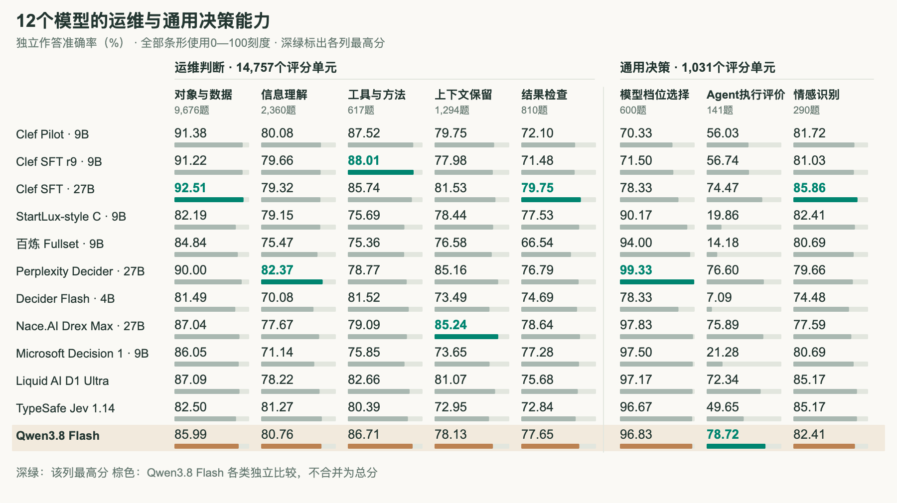

<strong>1\. Jev用得最多，选型仍要看它在哪些题上做得好。</strong>11月10日记录的OpenRouter周榜里，Jev约5.16亿次调用，在本次六个外部决策模型中最高。落到这批题，它的信息理解和情感识别高于Flash，模型档位选择接近Flash，Agent执行评价则是Flash更高。再往下拆，Jev的报告逻辑检查拿到最高分。对运维接入而言，这个具体强项比调用量排名更有用。

<strong>2\. Decider－27B很强，但也有该留给Flash的工作。</strong>Perplexity Decider的信息理解82.37%、模型档位选择99.33%，都是全部模型最高；上下文保留85.16%，与Drex Max只差一道题。可到了工具与方法选择，Decider只有78.77%，Flash是86.71%。同一个模型，接到前面三类判断里很有吸引力，拿来统一替换工具选择却不合适。

<strong>3\. 内部实验版本的优势已经落到具体任务上。</strong>五类运维判断中拿到三项第一，八类任务中拿到四项第一：Clef SFT－27B的对象筛选92.51%、结果检查79.75%，Clef r9的工具与方法选择88.01%；通用情感识别也是Clef SFT－27B最高，为85.86%。下一轮实验的参照也很清楚：保住这些强项，再追外部方案领先的信息理解、上下文保留和模型档位选择。

<strong>4\. 值得接入的能力已经有了，接下来是按任务挑模型。</strong>五类运维判断中，都有决策模型比Flash高1.30—7.11个百分点；通用题里的模型档位选择、情感识别也有决策模型领先，Agent执行评价则仍是Flash最高。这个结果支持把合适的判断交出去。至于交给谁，还要把题型和等待时间放到一起看。

#### 4.1.1 先确定模型擅长哪些判断

“擅长报告审核”这个说法还是太宽。核对依据和检查逻辑，领先的可能是两个模型。我们把报告检查拆开，再加上指标筛选、证据分类、工具选择和摘要价值，组成六类细分题，继续比较全部12个模型。

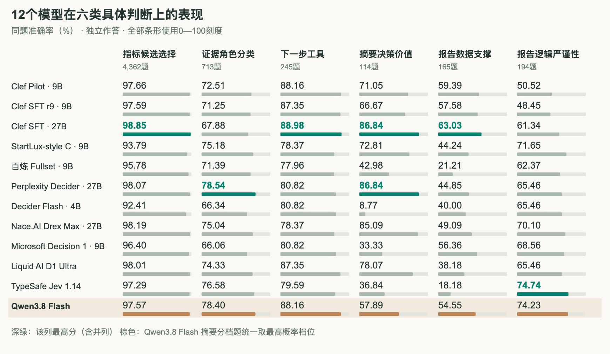

<strong>1\. 指标筛选与工具选择，已经有多个接近的高分方案。</strong>Clef SFT的指标选择98.85%，高于Flash 1.28个百分点；工具选择88.98%，高于Pilot和Flash 0.82个百分点，Liquid也有87.35%。在这种差距下，不能只盯最高分。把这些判断放进反复调用的Agent，等待时间同样会影响最终选哪个。

<strong>2\. 摘要值不值得留，三个27B方案明显更会判断。</strong>Clef SFT与Decider都是86.84%，Drex Max为85.09%，Flash只有57.89%。其他模型的差距也很大：Liquid为78.07%，Jev为36.84%，Microsoft Decision 1为33.33%，Decider Flash为8.77%。如果要从现有上下文中挑出后续任务需要的信息，我会先试这三个27B方案，再检查它们具体高估或低估了哪些摘要。

<strong>3\. 报告依据核对和逻辑检查，应该分开选型。</strong>数据支撑上，Clef SFT以63.03%领先，Pilot、r9、Microsoft Decision 1也高于Flash的54.55%，Jev只有18.18%。逻辑严谨性却反过来：Jev以74.74%领先，Flash为74.23%，Clef SFT为61.34%。一份报告可以推理写得通顺，却没有足够数据支撑；也可能引用了数据，推导仍有问题。把审核拆成这两问，才能用上各自的强项。

<strong>4\. 同样在读证据，分类和核对依据的排名并不一样。</strong>证据角色分类里，Decider为78.54%、Flash为78.40%、Jev为76.58%；Clef Pilot、r9、27B分别为72.51%、71.25%、67.88%。前面Clef领先的是核对报告有没有依据，这里要识别的是证据在调查中起什么作用。若要做证据分类，Decider和Flash值得优先看；不能直接拿报告核对的排名来选。

::: tip Takeaway｜把任务拆细，模型才选得准。

对接入方来说，“支持报告审核”还不是一个足够具体的选型要求。先说清要核对数据依据、检查逻辑，还是识别证据作用，候选模型就会不同。指标筛选和工具选择已有多个接近的高分方案，再用响应时间决定取舍，比给所有判断统一换一个模型更实际。

:::

#### 4.1.2 准确率优势是否值得增加等待

再来看速度。我们只比较12个模型都首次成功、一次HTTP请求只问一道题的输入，共有2,079条；按题型与参考答案要求筛选后，留下1,745条。下面的准确率和耗时都来自这同一批题。

这1,745条输入以信息理解和工具与方法选择为主，分别659题、591题，合计71.6%；另有276题情感识别，其余三类共219题。前面的完整分项回答“谁适合这类任务”，这里补上“实际要等多久”。P50和P95从发出请求计到收到完整响应，包含网络和服务端处理。

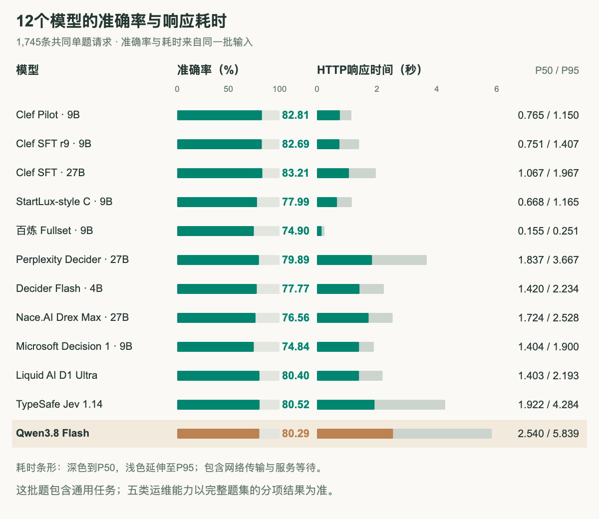

<strong>1\. 更快与更准，在这批题上可以同时做到。</strong>11个决策模型的P95都低于Flash的5.839秒，其中Clef Pilot、r9、27B、Liquid和Jev这5个模型的准确率也超过Flash的80.29%。Pilot尤其值得看：82.81%的准确率，高2.52个百分点；P95为1.150秒，缩短80.3%。对一个反复作判断的Agent，这意味着既少答错一些题，也少等一段时间。

<strong>2\. 27B分数最高，为什么还把Pilot作为接入起点？</strong>Pilot部署在H20，r9在L20，准确率分别为82.81%和82.69%，P95为1.150秒和1.407秒。Clef－27B部署在A100，准确率83.21%，P95为1.967秒。多等这些时间，换来了什么？比Pilot净多答对7题，其中情感识别净增9题，运维题合计净减2题；对象筛选、信息理解有提高，工具与方法选择等题型有下降。因此，如果要给运维Agent选一个通用的决策组件，我会先看Pilot；如果已经确定要做的题型，再看27B能否带来值得这段等待的准确率提升。这里比较的是各自GPU上的实际服务表现。

<strong>3\. 外部服务里，Liquid与Jev的取舍很直观。</strong>Liquid为80.40%，Jev为80.52%，只差2道题；P95却是2.193秒对4.284秒，Liquid缩短48.8%。Decider－27B为79.89%、3.667秒。若面对的是这批混合题，Liquid的效率很有吸引力；若已经确定任务是信息理解或上下文判断，就要回到前面的分项，继续看Decider的强项。

<strong>4\. Fullset最快，但这个速度要和准确率一起买单。</strong>它的P50只有0.155秒，P95为0.251秒，都是本轮最快；准确率74.90%，比Flash少答对94题。这个取舍不能只看“快了多少”。同样是74%左右的准确率，Microsoft Decision 1为74.84%，P95却要1.900秒。如果目标题型能接受Fullset的准确率，它就是很有吸引力的低延迟选择；如果要追回那94道题，就该继续看其他模型或回退组合。

::: tip Takeaway｜先用Pilot起步，再问大模型多解决了什么。

Pilot在共同单题对照中同时提高准确率、缩短等待，适合作为运维决策组件的接入起点。换27B时，要把额外答对的题拆到目标题型，看它是否值得增加等待。外部方案也一样：混合任务看Liquid，延迟特别敏感时看Fullset，最终都回到自己的任务与服务条件上比较。

:::

#### 4.1.3 结合实验与实现理解方案差异

同样大小的模型，差别还有多大？9B组都基于Qwen3.5－9B，包括内部实验中的Clef Pilot、Clef r9、StartLux-style C，以及外部的Microsoft Decision 1；27B组都基于Qwen3.8－27B，包括内部Clef SFT与外部Decider、Drex Max。把同底座、同规模的方案放在一起，能更直接地看实验路线、输入组织和答案读出的差别。

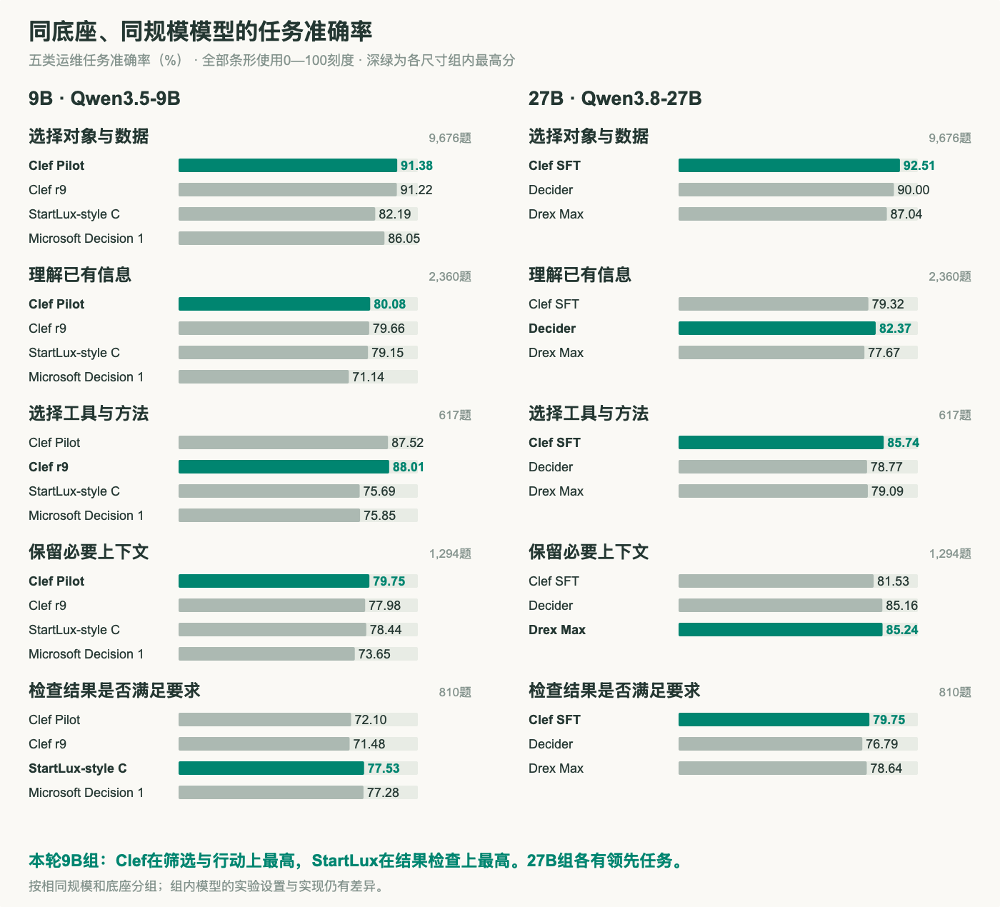

<strong>1\. 同为9B，Clef与StartLux已经走出了不同强项。</strong>对象筛选，Pilot是91.38%，StartLux是82.19%；结果检查，StartLux以77.53%超过Pilot的72.10%和r9的71.48%。再看外部对照，r9的工具与方法选择88.01%，Microsoft Decision 1为75.85%。参数量相同，任务排名仍会换位。筛选、行动选择可先看Clef，结果检查则应把StartLux放进候选。

<strong>2\. 27B也没有一个全包的赢家。</strong>Clef的对象筛选92.51%、工具与方法选择85.74%、结果检查79.75%，都领先另外两个27B方案；信息理解则是Decider的82.37%高于Clef的79.32%。上下文保留中，Drex Max为85.24%、Decider为85.16%，只差一道题，都超过Clef的81.53%。这些差距比一个平均排名更能指导实验：哪里已经领先，哪里还有明确的追赶目标，可以逐类验证。

<strong>3\. 还要看接口怎样组织同一批问题。</strong>StartLux用26字母读出，本轮工具选择只有4—5个候选，处于其范围内。Decider把材料与多个问题联合编码，Drex Max逐题编码，问题之间能否相互影响也随之不同。前面1,745条效率对照都是单题，比较的是这种调用下的表现；若业务一次要问多个问题，就应另测多题共享材料带来的效率与答案变化。

::: tip Takeaway｜开展下一轮实验，先定好要追哪类题。

9B和27B组内都出现了明显的强项分工。下一轮内部实验可以直接围绕这些差距组织：保留已经领先的筛选与行动判断，针对信息理解、上下文和报告判断补题、对照，再检查其他类别有没有退步。这样才能知道一次实验究竟改善了哪项业务能力。

:::

4.1已经按题型挑出了候选模型，也比较了各自服务的等待时间。接下来把镜头移到接入本身：给它什么材料，怎样把概率读成答案，答案又会让Agent采取什么动作。

### 4.2 如何解释成绩并使用模型输出

同一个模型，接法不同，成绩也可能不同。下面依次看材料长度、答案读出和错误方向。这三件事决定了离线能力能不能在实际调用中用对。

#### 4.2.1 长度分组中的题型影响

先看一个容易让人误解的结果：12个模型中，10个在2k—8k字符组准确率最高。分析仍用4.1.2的1,745条共同输入，其中＜2k有531条，2k—8k有897条，8k—32k有317条。这是否意味着材料控制在中间长度就最好？把题型展开后，情况要复杂得多。

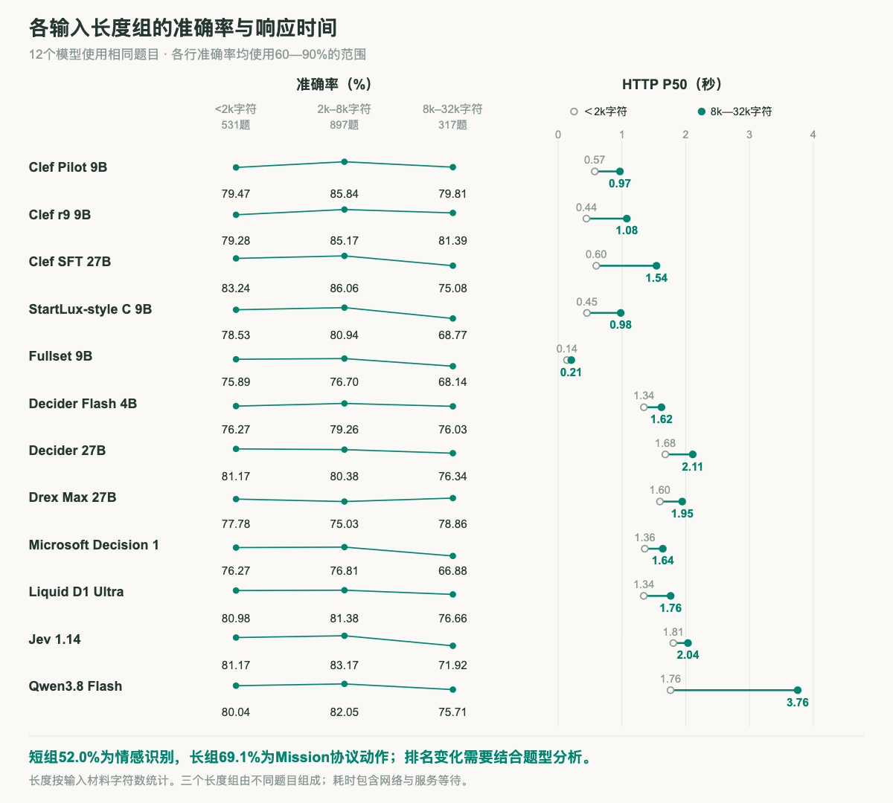

<strong>1\. 材料更长，准确率没有一路往上走。</strong>从＜2k、2k—8k到8k—32k字符，Pilot为79.47%→85.84%→79.81%，Clef SFT－27B为83.24%→86.06%→75.08%，Jev为81.17%→83.17%→71.92%，Flash为80.04%→82.05%→75.71%。10个模型都是中间高、两端低；Decider－27B在短组最高，Drex Max－27B在长组最高。对接入的启发是，增加材料本身不是目标。更值得试的是在同一道题里补缺失证据、删无关内容，看看哪一种改动真正帮到了判断。

<strong>2\. 长材料里，9B赢了27B，但要看赢在哪里。</strong>Clef SFT－27B在短、中组领先，到了长组，r9－9B为81.39%，27B为75.08%。r9净多答对20题，其中Mission贡献21题，其他任务合计少1题。再看长组里的故障类型判断，27B答对24题，r9只答对18题。若把长材料统一交给r9，就会忽略这个反转。Mission和故障类型需要分别选型。

<strong>3\. 同样变长，故障类型与根因实体的成绩却朝相反方向走。</strong>从2k—8k到8k—32k字符，12个模型的故障类型判断全部下降，根因实体选择全部上升。Pilot分别从70.76%降至47.37%、从81.68%升至93.02%；Liquid从74.85%降至57.89%、从70.99%升至88.37%；Clef SFT－27B也是这个方向。定位实体和解释故障机制显然不是一回事。接下来该检查的是题目里的证据是否明确、分散在哪些段落、候选有多接近，而不是只给模型贴一个“长上下文能力”的标签。

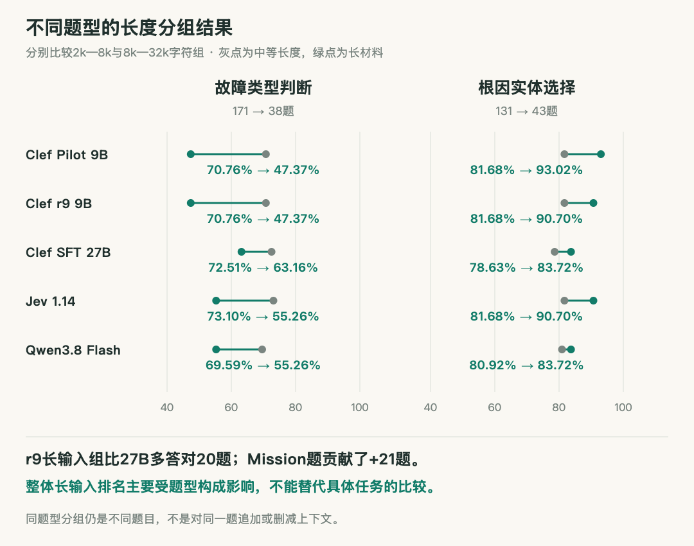

::: tip Takeaway｜先补对证据，再谈上下文长短。

长度分组里，定位根因实体与判断故障机制呈现相反趋势，说明两类任务需要分别看。接入时先检查当前判断缺什么材料，再在同题上比较补证据、删无关信息后的准确率和等待时间。把材料凑长，或统一压到某个长度，都没有回答证据是否够用。

:::

#### 4.2.2 同一响应的答案转换

<strong>1\. 响应一字没改，模型排名却变了。</strong>本节保留12个模型的原始响应，把连续分数取整改成选择概率最高的档位。摘要价值题里，StartLux从46题正确变成83题，由低于Flash的66题变为高于它；Liquid D1 Ultra从105题降至89题，Clef SFT与Decider统一读出后都是99题。Jev从15题增至42题，Decider Flash从38题降至10题。这里没有换模型、没有重新推理，变化全在系统怎样使用返回结果。

<strong>2\. 分档题里，最可能的档位与取整后的分数可能不是同一个。</strong>在utility\_01中，参考档位3表示摘要保留了重要机制、传播事实和有用数值，档位2只表示保留了关键实体与主要信号。Jev给档位3的概率0.37、档位2的概率0.35，连续分数却是2.2。取最高概率选3，与参考答案一致；把2.2取整就选2。同一份摘要，由此被读成了两种不同的信息保留程度。

<strong>3\. 读出差异对哪些题影响最大？</strong>114道摘要价值题里，StartLux、Jev净增37题、27题，Decider Flash、Fullset、Liquid净减28题、17题、16题；65道工具结果数量分档题里，11个模型只变动0—2题，只有Decider Flash增加7题。前者判断保留了多少决策信息，后者按可见数量分档，受读出影响的程度不同。价值、充分性这类题尤其应该留下连续分数、各档概率和最终选项，方便查清一次判断是模型错了，还是读法错了。

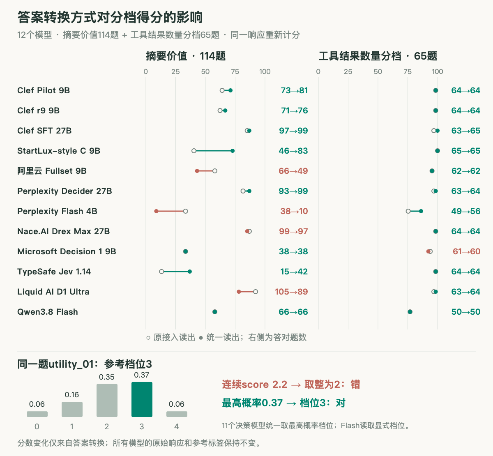

::: tip Takeaway｜接模型时，答案怎么读也要一起测。

同一份响应就能让排名换位，读出规则显然不能留到接入时临时决定。要求选择档位的题用最高概率档位；需要连续排序或阈值判断时，再使用含义明确的score。评测与线上沿用同一规则，才能把测到的能力真正用起来。

:::

#### 4.2.3 错误方向与内容取舍

<strong>1\. 78.07%的准确率，可以一次判断都不做。</strong>114道摘要价值题里，第3档89题、第2档23题、第1档2题，全选第3档就有78.07%。统一读出后，12个模型中只有Clef SFT－27B、Decider－27B、Drex Max－27B超过这条线，分别答对99、99、97题；Liquid答对89题，与固定答案相同。所以还得追问：模型是否认出了那些少见但重要的信息不足摘要？这决定了它能不能帮Agent管理上下文。

<strong>2\. Pilot总分赢了，Flash却更会找出信息不足。</strong>Pilot答对81题，Flash答对66题。拆开看，第3档是77比51，Pilot多26题；第2档是4比15，Pilot少11题，两项相抵才得到总分多15题。第3档保留了重要机制、传播事实和数值依据，第2档只留下关键实体与主要信号。若任务是找出还缺关键机制的摘要，Flash在这一档的表现更好，总分排名并没有直接给出答案。

<strong>3\. 错一档之后，Agent会少看什么？</strong>Jev的72道错误全部低估，其中40题把第3档判成第2档、15题判成第1档；Decider Flash有100题低估，其中28题从第3档降到第1档。如果低分意味着删除，就可能丢掉有用证据。Liquid则有25道错误，其中23题高估，20题把第3档判成第4档。第4档意味着“不打开原文，也足以作出相同的下一步因果判断”，据此执行就可能过早停止回读。低估和高估影响的是不同动作，不能只合成一个错误率。

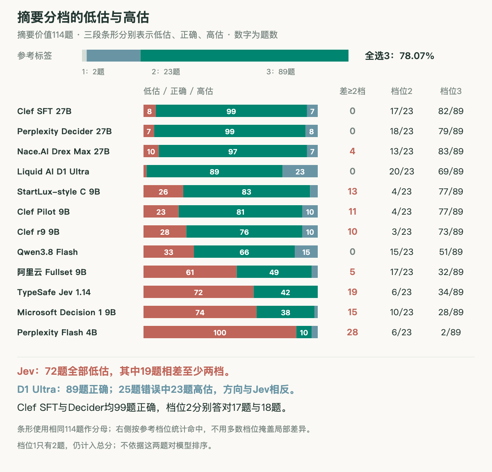

::: tip Takeaway｜先想清误判会让Agent做什么。

用分数决定删不删内容，要重点查有用证据被低估的情况；用它决定还要不要读原文，要重点查摘要被高估的情况。摘要评分最终要服务于动作选择。把错误方向和执行后果一起看，才能知道哪个模型适合承担这一步。

:::

### 4.3 何时模型组合优于单模型

主模型拿不准时，Flash能不能帮忙？总分高低并不能直接回答。我们先看哪些置信度区间交出去有收益，再看不同任务里的互补性，最后算按任务单独设阈值是否划算。

这组实验用14,245道运维选择题与判断题，将11个决策模型分别与固定的Flash答案组合：高置信度保留原答案，低于阈值就用Flash。按案例做五折验证，每轮四折选阈值、一折检验，汇总准确率与回退题数。本节的单模型成绩也在这14,245题上计算，和4.1完整任务集的成绩分开看。

#### 4.3.1 阈值决定哪些题被交出去

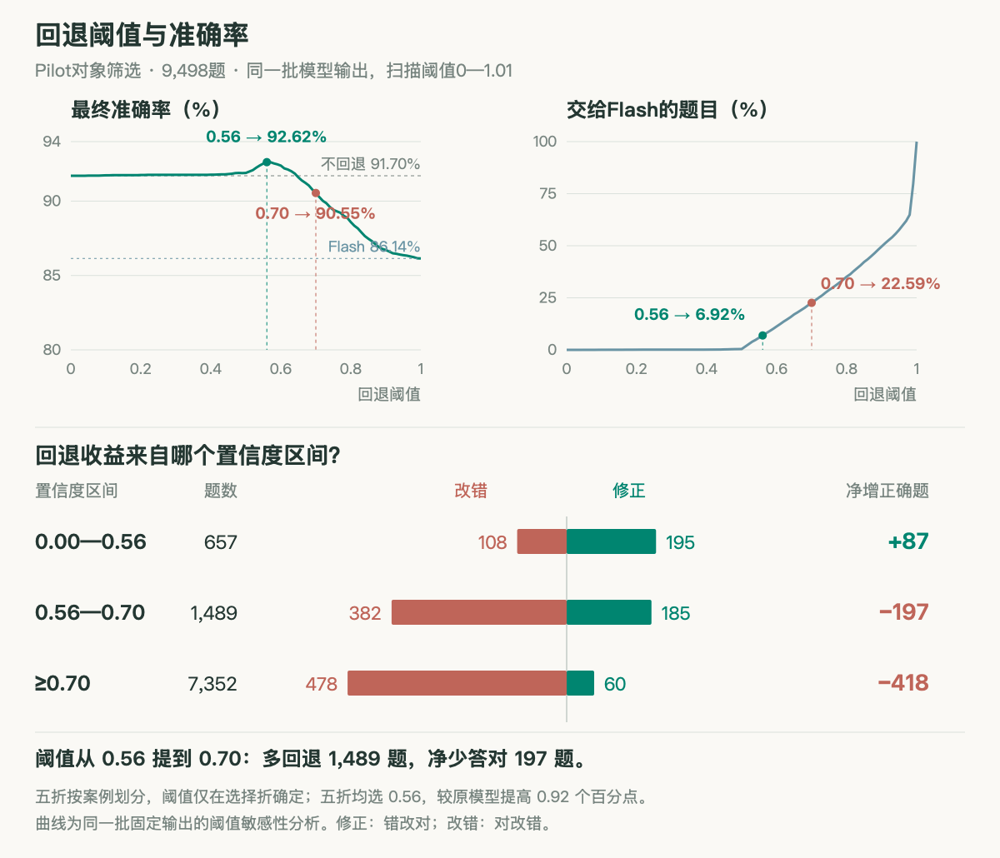

<strong>1\. Flash比Pilot低5.56个百分点，为什么还值得让它兜底？</strong>在9,498道对象与数据筛选题上，Pilot得91.70%，Flash得86.14%。直接设0.70阈值，把22.59%的题交给Flash，组合反而降到90.55%。但按案例做五折验证后，五个阈值选择折都选中了0.56：只交出6.92%的题，组合升到92.62%，比Pilot净多答对87题。各个未参与选阈值的测试折分别净增8、14、28、21和16题。这里起作用的，是Flash恰好能答对一部分Pilot不擅长的题。总分低，并不妨碍它在这部分题上帮上忙。

<strong>2\. 交出去更多题，为什么反而少答对197题？</strong>低于0.56的657题里，Flash修正195题、改错108题，净增87题；0.56—0.70的1,489题里，修正185题、改错382题，净损失197题。两段合起来，0.70阈值净少答对110题。问题就出在多交出的这段：里面有不少Pilot本来会做、Flash却做错的题。保留它们，少回退1,489题，反而多答对197题。

::: tip Takeaway｜回退的价值，看修正是否多于改错。

Pilot的例子说明，Flash总分较低仍然可以帮忙，但扩大回退范围也可能把收益吃掉。阈值要在阈值选择案例上按“修正减改错”选择，再用未参与选择的案例检验。把主模型会做的题留下，把Flash更擅长的部分交出去，组合才有意义。

:::

#### 4.3.2 哪些任务能获得组合收益

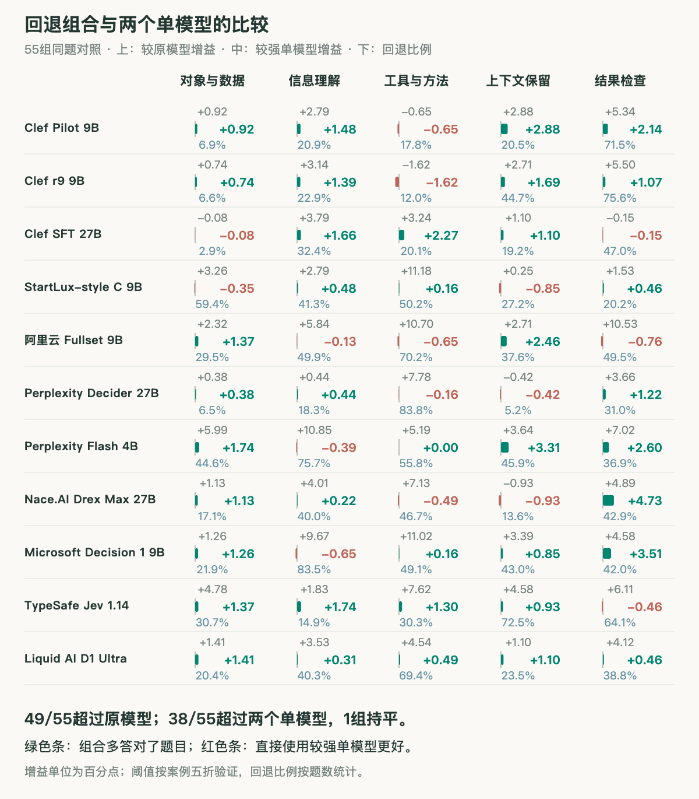

<strong>1\. 加了回退，分数涨了，就值得用吗？</strong>先和两个单模型中更强的那个比。11个决策模型与五类运维判断形成55组对照，选阈值后49组超过原模型，真正超过较强单模型的是38组。Microsoft Decision 1的信息理解就是一个例子：从70.54%升到80.22%，提高9.67个百分点，看起来很不错；但83.53%的题已经交给Flash，而直接用Flash是80.87%。对这个任务，我会直接选Flash。组合的价值，要看它是否答对了单用其中一个模型仍会答错的题。图中把相对原模型、相对较强单模型的增益和回退比例放在一起，就是为了看清这个区别。

<strong>2\. 两个单模型都没达到的成绩，组合可以做到。</strong>Clef SFT－27B的行动选择85.74%，Flash为86.71%；只将20.10%的题交给Flash，组合就达到88.98%，超过较强单模型2.27个百分点。Jev的信息理解80.78%，接近Flash的80.87%，回退14.90%后达到82.61%。这两组的价值很明确：错误并不完全重合，置信度又能帮助选出该交给另一方的题。

<strong>3\. 也有任务，保留原答案更好。</strong>Drex Max－27B的上下文判断85.25%，高于Flash的80.08%，回退后却降到84.32%；Clef r9的行动选择88.01%，高于Flash的86.71%，回退后降到86.39%。这两组在测试折上都退步了。接入时可以按任务保留两种模式：互补明确的用组合，独立作答更好的就直接作答。

::: tip Takeaway｜组合要赢过较强的那个单模型。

只看相对原模型涨了多少，很容易把“大部分题转给更强模型”的效果算成组合优势。真正值得保留的组合，应超过直接使用两者中更强的一个；否则就比较独立作答。不同任务可以采取不同模式，不必给一个模型统一套上回退。

:::

#### 4.3.3 细分回退策略是否值得

一个阈值管全部任务，还是每类单独选？继续用相同14,245道题、同一批答案和五折验证：全局策略每个模型选一个阈值，分类策略为五类运维判断分别选。除了准确率，我们还看这种细分多交出了多少题。

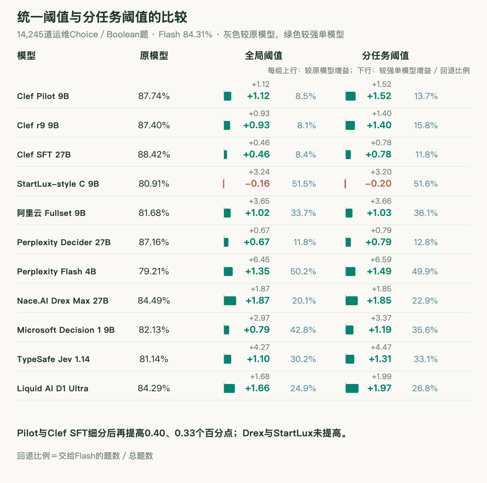

<strong>1\. 同样多答对57题，背后的开销方向却相反。</strong>Pilot从88.85%升到89.25%，回退量从1,217增到1,957，多740题；Microsoft Decision 1从85.10%升到85.50%，回退量从6,090降到5,078，少1,012题。对Pilot，是多调用Flash换来准确率；对Decision 1，则是题答得更准、回退也更少。按任务拆阈值改变的是交出去的题目组成，不只是回退量大小。

<strong>2\. 多一层策略，要看多换来了什么。</strong>11个模型里9个准确率提高、2个略降。Clef SFT－27B从88.87%到89.20%，多答对46题，增加477题回退；Clef r9多答对67题，增加1,097题回退。Fullset增加350题回退却只多答对1题，Drex增加400题回退反而少答对2题。前两组有明确的准确率增量，后两组保留全局阈值更合适。这里统计回退题数，实际耗时与Token还要按请求组织来算。

::: tip Takeaway｜阈值拆得更细，也要算投入产出。

分类策略有时多答对题，有时还能减少回退，Decision 1就同时获得了这两项收益。也有模型增加了调用却几乎没有进步。先把净增正确题和回退量放在一起，再核对实际耗时与Token，才知道这层策略值不值得留。

:::

### 4.4 决策模型接入RCA Agent后的效果

单步更准、更快，整场RCA就一定更好吗？现在把模型放回Agent：主调查模型不变，三个决策模型分别接入五个位置，用同一批RCA题比较评分、耗时和Token，再回到每道题的轨迹里找原因。

#### 4.4.1 实验设置：每次只改变一个接入位置

案例仍是第一章的10题，覆盖Full GC、镜像拉取、容器OOM、CPU限流、数据库缺失索引、缓存异常和组件升级。主调查、子调查都用DeepSeek v4.1 Flash，决策位置分别用Microsoft Decision 1、Clef Pilot、Clef 27B（前文Clef SFT－27B）。A是原始流程，B、C、D、E、F各自从头跑完整调查，每组只引入自己的改动。

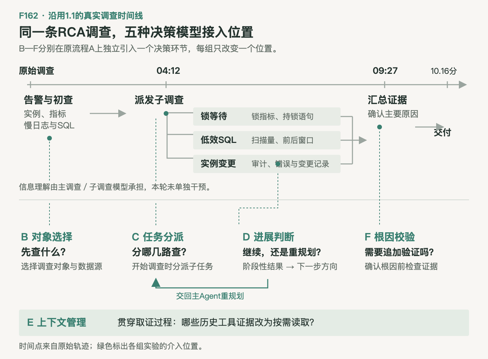

C和D分别放在调查的两个时点：C决定开始时怎样分派任务，D判断进行中要不要换路径。D读取原始指令和最近8条消息，在继续、交回重规划、弃权中选择，每个子调查最多判断3次；达到原概率阈值才把已有证据和未解决问题交回主Agent。本轮Pilot有5次、27B有4次选择交回，均未达到执行阈值，表中记录的是D完整配置的成绩。

#### 4.4.2 哪些接入能兼顾质量与开销

先记住原始流程A：81.10分、21.49分钟、每题12.892M Token。下表每格依次是评分／分钟／Token（M），保留完整数值；图中把它们换成相对A的变化，方便看提分要付出多少开销。

| 接入位置 | Decision 1 | Clef Pilot | Clef 27B |
|------------|----------|----------|--------|
| B 对象与数据源 | 77.50 / 21.02 / 12.676 | 73.00 / 21.71 / 11.777 | 72.35 / 22.36 / 13.249 |
| C 任务分派 | 87.50 / 23.56 / 12.439 | 80.00 / 21.19 / 12.499 | 76.50 / 23.19 / 12.575 |
| D 进展与重规划 | 81.20 / 18.42 / 13.297 | 74.60 / 28.63 / 12.511 | 88.30 / 22.25 / 12.876 |
| E 上下文管理 | 71.23 / 31.65 / 14.455 | 82.70 / 21.66 / 13.854 | 77.20 / 20.93 / 13.464 |
| F 根因校验 | 76.45 / 18.91 / 13.707 | 83.50 / 20.63 / 11.868 | 71.80 / 27.09 / 12.845 |

<strong>1\. 接入位置一换，领先模型也跟着换。</strong>任务分派C是Decision 1领先，上下文管理E是Pilot领先，进展判断D则由27B拿到最高均分88.30；对象选择B里，三个模型都没超过原始流程A。对B，现阶段保留A更合适；其他位置再比较分数和开销。这也回答了离线选型之后的那个问题：知道模型擅长什么，还要看这项能力放进完整调查后留下了多少收益。

<strong>2\. 提分要多等多久，三组配置给出了不同答案。</strong>Decision 1 C提高6.40分、耗时增加9.6%；27B D提高7.20分、耗时增加3.5%。若优先追求诊断质量，这两组值得继续验证。Pilot F提高2.40分，耗时还缩短4.0%，增分虽然少一些，却没有增加等待。对于既希望提高质量、又不希望排障变慢的接入目标，Pilot F是一个更直接的起点。

<strong>3\. 跑得快，Token不一定少。</strong>Decision 1 D的均分与A基本持平，耗时减少14.3%，Token却增加3.1%；Pilot E提高1.60分、耗时基本持平，已记录Token至少增加7.5%。这两组说明等待时间和模型用量需要分别算。选配置时，把分数、分钟和Token摆在一起，才能看清自己到底换来了什么。

::: tip Takeaway｜选型的单位，是模型加接入位置。

这10题里，质量优先可以看Decision 1任务分派、27B进展判断配置；希望提分的同时缩短调查时间，可以看Pilot根因校验。对象选择暂时保留原流程。离线排名帮我们缩小候选，完整RCA则决定哪种搭配值得继续投入，Token开销也要一起带入这个选择。

:::

#### 4.4.3 逐题展开：平均提升来自哪里

<strong>1\. 分数提高，报告里具体多查清了什么？</strong>largeValue读取题中，Decision 1 C把“内存增加、Key数不变”与“Redis出向、Pod入向流量同步变化”连起来，解释了GET为什么变慢、SET为什么正常。bigKey同步删除题中，两版都识别了同步删除阻塞，C进一步找到了发起删除的维护Pod。前者补上故障机制，后者定位到具体对象；这些才是评分提高之后，对排障真正有用的增量。

<strong>2\. 最高均分，主要由哪道题拉起来？</strong>27B D的10题是5题提高、4题持平、1题下降，均分提高7.20分，其中largeValue贡献6.50分，其余9题合计0.70分；缓存列表增长保持97分。Decision 1 C也在largeValue和bigKey上提分，列表增长却比A低68分。均分告诉我们整体变化，逐题结果告诉我们它修好了哪里、又退步在哪里。继续选配置时，两层都要看。

<strong>3\. 列表增长题差的，是从异常追到具体工作负载这一步。</strong>Decision 1 C已经确认大量写入造成内存增长，还需要查清具体List和LPUSH链路；Pilot E、F已经找到List增长和写入客户端IP，还需要对应到Pod／Job。问题没有停在“是否存在异常”，而是停在“谁发起了这次异常行为”。这段关联就是下一轮可以直接补的地方。

::: tip Takeaway｜下一步，沿着证据把责任对象找出来。

列表增长题给出了一个明确的改进目标：把List、LPUSH、客户端IP继续关联到具体Pod／Job。用同题检查这段证据补齐后报告是否更完整、分数是否提高，就能判断这次改动是否有效。这样的轨迹分析也能把一次RCA的失分，变成下一轮决策模型与Agent的具体任务。

:::

## 5\. 相关工作

回看近期研究，很多问题与这轮实验相通：省去生成之后能判断多复杂的问题，返回概率能不能直接用，候选和材料怎样组织才容易选对。下面按这几个问题梳理公开预印本和厂商资料。

### 5.1 决策模型的能力与效率

先看不生成推理过程能做到什么。《To Jev or Not to Jev》比较14个决策模型、4个生成式评价模型和11个评价基准，给出预先生成的参考答案后，11个决策模型在JudgeBench达到90.3%—93.4%。《AbductionBench》则发现，简短证据下选择解释，Jev能接近或超过小型LLM，较长案例上却落后。两者放在一起看，给定依据后核对、整合复杂证据、推导新解释，是需要分别测的能力。 
论文：[https://arxiv.org/abs/2611.00505](https://arxiv.org/abs/2611.00505) ；[https://arxiv.org/abs/2611.10705](https://arxiv.org/abs/2611.10705)

效率收益从哪里来？《TrialJev》用相同训练数据比较单次前向判断与生成结论，在9B—27B配置中，后者耗时是前者的2.45—2.70倍；A/B标签读出的消融也指向减少自回归生成这一来源。这与本文同时比较准确率、服务耗时和调用方式的做法相呼应：不仅看判断是否正确，也看得到这个判断要付出多少等待。 
论文：[https://arxiv.org/abs/2611.10145](https://arxiv.org/abs/2611.10145)

通用榜单能不能帮我们选模型？《To Jev or Not to Jev》报告，两个不含评价任务的通用榜单与评价准确率相关系数为0.95—0.96，说明它们有参考价值。但《Evaluating Jev on Arabic》在43项任务、9个任务族中看到，版本收益会随任务族、语言变体变化。本文继续把问题落到运维：通用优势能延续到哪些判断，哪些类别又会换一个领先模型？ 
论文：[https://arxiv.org/abs/2611.10802](https://arxiv.org/abs/2611.10802)

### 5.2 置信度校准与回退

再看概率。《Beyond Ranking》把排序效果和概率校准分开评价：TREC DL21中，Jev给出超过0.9相关概率的样本，只有66%被人工标为相关。独立数据校准后，Brier误差从0.213降到0.147，概率还能用于决定每个查询保留多少文档。排序好、概率可直接用，是两个需要分别检查的问题；后者决定了它能否可靠地参与下一步处理。 
论文：[https://arxiv.org/html/2611.11480v1](https://arxiv.org/html/2611.11480v1)

《Can the Confidence and Decisions of System 1 Models Be Trusted?》审计五个开源Jev式模型，发现confidence可能由分布熵或归一化间隔计算，数值要结合实际正确率理解。因此本文没有停在一个0.70阈值上，而是检查低置信度能否找出错题、同样回退比例下哪个组合更准，再比较固定阈值与分组验证选出的阈值。 
论文：[https://arxiv.org/html/2611.12521v1](https://arxiv.org/html/2611.12521v1)

### 5.3 输入组织与判断稳定性

候选里有没有正确答案，影响可能非常大。《When the Right Answer Is Missing》中，配对算术题有正确候选时Jev准确率99%；移除正确答案后，即使给出“以上都不是”，正确拒绝率也只有7%。改成原生Boolean核验，同类答案缺失题达到99%。《Cross-Primitive Consistency in Jev》则用相同语义在不同判断形式下的不一致识别错误，报告ROC-AUC为0.91。接入时怎样出题、怎样构造候选，需要和模型一起验证。 
论文：[https://arxiv.org/abs/2609.39496](https://arxiv.org/abs/2609.39496) ；[https://arxiv.org/abs/2610.38623](https://arxiv.org/abs/2610.38623)

问题合并与候选构造同样值得单独看。五模型审计的900条样本中，单独问与合并问让Tev1-0.8B的11.7% Boolean答案发生变化，Tev1-4B约为0.1%。《Learning to Formalize》在200个CALVIN-D测试片段里，用通用动作候选时Jev成功率11%，换成模型生成的姿态候选后达到46.5%。这些差异说明，组织问题与材料并不是接完接口就结束的工作，本身就有值得做的实验。 
论文：[https://arxiv.org/abs/2610.36595](https://arxiv.org/abs/2610.36595) ；[https://arxiv.org/html/2611.12521v1](https://arxiv.org/html/2611.12521v1)

## 6\. 结论

<strong>1\. 高频判断，已经值得交给专用模型试一试。</strong>对象筛选、证据理解、行动选择、上下文管理和结果检查，都有能明确给出材料与候选的部分。模型直接返回选择和概率，省去逐字生成答案的过程；共同单题对照中的Pilot已经同时做到更准、更快。对AgenticOps，接入可以从这些具体步骤开始：主模型继续展开调查，专用模型承担自己擅长的判断。

<strong>2\. 从离线成绩到RCA效果，中间还有接入方式这一步。</strong>离线评测先找强项，输入与读出实验检查能力怎样被使用，回退实验再判断两个模型是否互补。到了完整RCA，Decision 1任务分派、27B进展判断配置拿到较高分数，Pilot根因校验兼顾提分与提速。最后要留下的，是在某个位置上确实改善了整场调查、开销也合适的配置。

<strong>3\. 改进最终要落到一次具体故障上。</strong>缓存列表增长已经查到异常写入，下一步就是把List、LPUSH和客户端IP追到Pod／Job。把这段证据补齐，再用同题评分检验，比笼统要求模型“更会推理”更容易推进。离线题找到模型强项，完整调查暴露问题，轨迹再变成下一轮实验和回归任务。我们继续推进Agent RSI，也从这些能查清、能验证的问题开始，让每一次判断少留一个疑点，让排障更快找到可以处理的原因。

### 模型依据与版本记录

\[S1\] 团队EAS模型服务接入指南（含Pilot、r9、27B、StartLux-style C）（内部文档）

\[S2\] Cloudflare Clef-Flash模型卡：https://huggingface.co/Cloudflare/clef-flash

\[S3\] Perplexity Decider v1.2模型卡：https://huggingface.co/perplexity-ai/pplx-decider-v1.2

\[S4\] Decider Flash v1.2发布清单：https://huggingface.co/perplexity-ai/pplx-decider-flash-v1.2/blob/main/release-manifest.json

\[S5\] Drex论文：Max架构与训练：https://arxiv.org/html/2611.07854v1

\[S6\] Microsoft Decision 1官方介绍：https://commandline.microsoft.com/microsoft-decision-1-model-foundry/

\[S7\] Liquid D1 Ultra官方介绍：https://www.liquid.ai/blog/d1-ultra

\[S8\] TypeSafe Jev技术介绍：https://typesafe.ai/blog/introducing-system-one-models-and-jev
