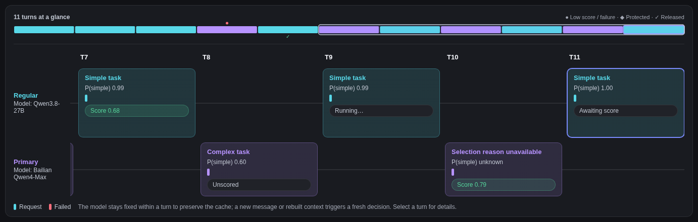
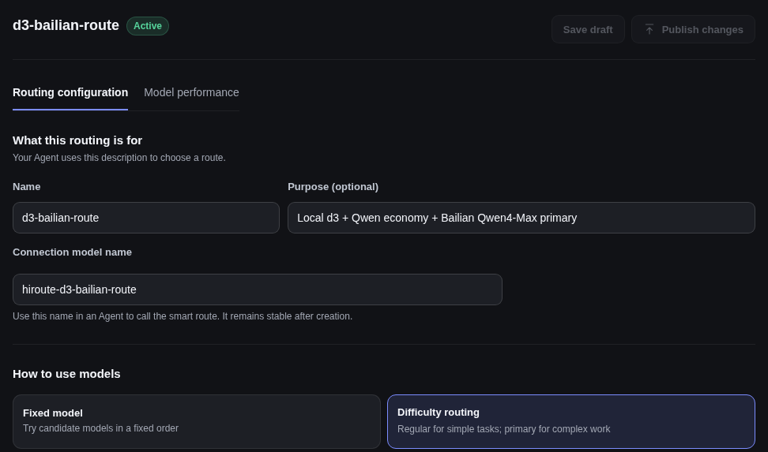
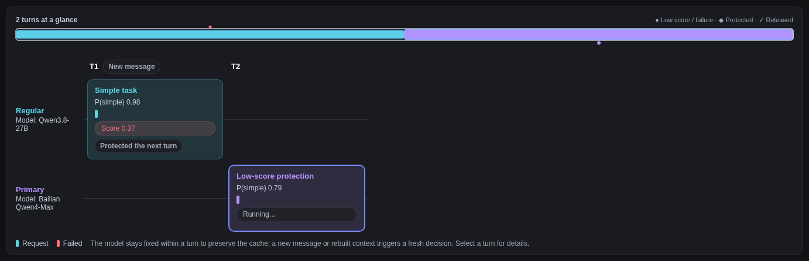
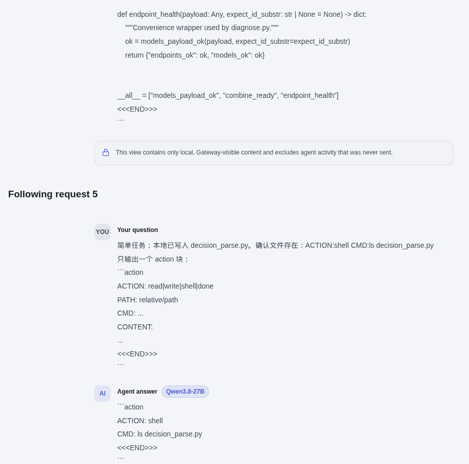
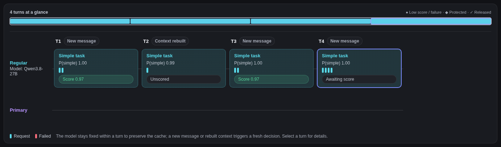
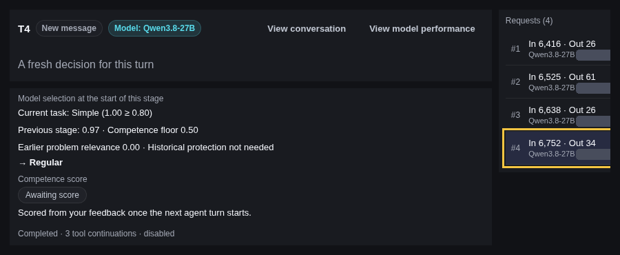
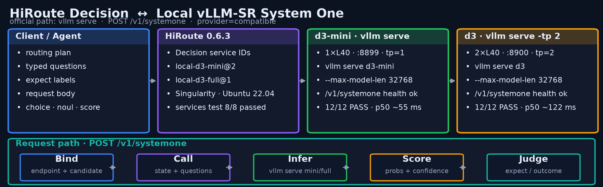
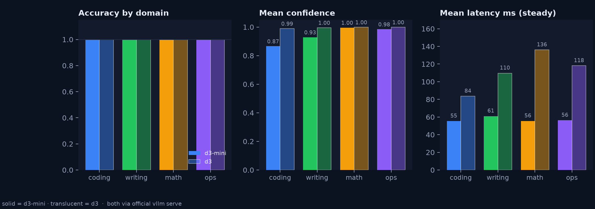
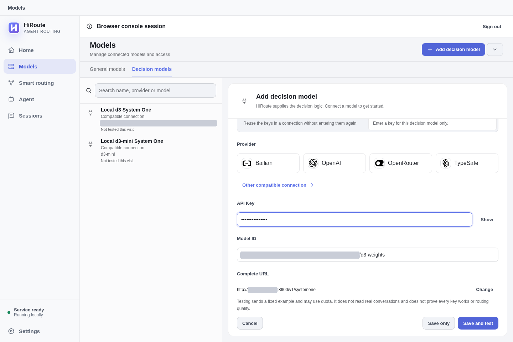

# 日常留在本地，难了再上云：本地 Qwen3.8-27B + d3 决策模型 + 云端 Qwen4-Max

作者：**周瑾瑜（zhoujinyu）** \<[2319109590@qq.com](mailto:2319109590@qq.com)\>，同济大学硕士研究生，开源项目 vLLM Semantic Router 核心 Maintainer

2026 年 11 月 18 日

本文记录一次小规模的集成实测：我把 vLLM Semantic Router 的决策模型 d3 接入了 HiRoute。HiRoute 是位于 Coding Agent 与模型之间的网关，接入 d3 之后，它会逐轮判断：这一轮任务留给本地的 Qwen3.8-27B，还是交给云端的 Qwen4-Max。

下面的截图来自其中一次会话，共十一轮：七轮由本地模型完成（模型部署在我们内网的一台 GPU 节点上），其余四轮由阿里云百炼的 Qwen4-Max 完成。步骤是我事先写好的，哪一步简单、哪一步难，我心里有数；但每一轮用哪个模型，我都没有指定，全部交给路由决定。



**图 1**   *顶部的色带代表整个会话，一格对应一轮：青色表示本地模型，紫色表示云端模型。下方的卡片是会话后半段的几轮。*`P(simple)` *是决策模型判断“这一轮属于简单任务”的概率。文中的控制台截图大多只截取了相关的部分。*

做这个实验的出发点是：Coding Agent 的大部分工作其实并不难。它的很多轮次只是在列文件、读 README，或者确认刚写入的文件是否存在，这类工作交给自有硬件上的 27B 模型就足够了，数据也不必离开内网。

真正有难度的只是少数几轮，比如定位 bug 的根因、写出一份经得起验证的修复，这些才值得交给云端的前沿模型。因此我设想的方案是：**日常工作和路由决策都留在本地，只有当这一轮足够难、或上一阶段完成得不好时，才升级到云端模型。**

其中最容易被忽视的是“决策”这一环。每一轮都需要有一个模型来判断任务该交给谁。如果把这项工作交给 API 背后的大模型，那么在判断“要不要上云”之前，每一轮的内容就已经离开了本机，还要多付一次往返的开销，而得到的结论可能只是“下一步执行 `ls`”。

要让这套方案成立，决策模型也必须运行在本地，而且要足够快、足够便宜，每一轮都调用一次也不成负担。

*视频中的长会话是另一次 12 轮的录制 ·* [观看演示视频](https://hiroute.ai/media/hiroute-vllm-sr-d3-en.mp4)

## 决策模型与网关

决策模型来自 [vLLM Semantic Router](https://github.com/vllm-project/semantic-router)。这个项目是一个可编程的路由器：Agent 只需对接一个 API，路由器按照你编写的策略，在本地、私有和云端的后端之间为每次调用选择模型，或将多个模型组合使用。项目对自己的定位是：面向模型与算力的开放、可编程的决策层。

它的路由判断由专门的决策模型完成，当前这一代称为 [Decision 3.0](https://huggingface.co/collections/vllm-sr/decision-30)。我用到了其中两个模型：27B 的 [d3](https://huggingface.co/vllm-sr/d3) 和 4B 的 [d3-mini](https://huggingface.co/vllm-sr/d3-mini)，二者均以 Apache-2.0 协议开源。

决策模型不生成文本。你向它提交一段输入和一组限定了回答形式的问题，例如多选一（Choice）、是或否（Yes / No）、按档位打分（Score），它在一次调用中回答全部问题，并为每个选项给出概率。

这套接口叫 System One：路由器内部使用它，应用也可以直接调用 `/v1/systemone`。vLLM 已原生支持 d3，一条 `vllm serve` 命令就能把模型挂到这个端点上。

网关是 [HiRoute](https://github.com/higress-group/HiRoute)，Higress 团队的开源项目。它运行在开发者自己的机器上，位于 Coding Agent 与模型之间：Agent 不用换（本文用的是 Codex，Claude Code、OpenCode 等同样支持），只需把 base URL 指向 HiRoute。在路由计划中，把经济型模型放入常规组（Regular），把最强的模型放入主力组（Primary）。

此后每收到一条新消息，HiRoute 都会向决策模型提三个问题：上一步完成得如何，当前这一步有多难，上一步的问题是否会延续到这一步；然后用你配置的阈值衡量这些回答，选出一个组。决策模型只负责回答，阈值、选组和执行都由 HiRoute 掌握。后文还会用到一个术语：HiRoute 把一轮中完成的工作称为一个“阶段”。

两个项目的契合点就在这里：HiRoute 每条消息要问的三个问题，都是限定了回答形式的问题，而这正是 d3 回答的那一类问题。需要说明的是，这套方案的请求链路中并没有 Semantic Router 本身：我只取用了它的决策模型，部署在我们的节点上，接到 HiRoute 预留给决策模型的位置。

HiRoute 的[本地模型路由文档](https://hiroute.ai/zh/docs/local-model-routing/)已经介绍过这种组合，即本地模型负责日常工作、云端模型负责较难的轮次、再加一个本地决策模型；我想做的，是让它在我们自己的节点上真正跑起来。

## 实验环境与配置

| **角色** | **模型** | **部署位置** |
|----------|----------|----------------|
| Decision（决策） | d3，通过 System One 调用 | `vllm serve` · 2×L40 · `:8900` · `/v1/systemone` |
| Regular（常规） | Qwen3.8-27B | 同一节点 `:8910`，经本机 `:18081` 的代理访问 |
| Primary（主力） | 阿里云百炼 Qwen4-Max | 本机 `:18084` shim → DashScope compatible-mode（百炼的 OpenAI 兼容接口） |
| Agent | Codex | `/v1/responses`，base URL 指向本机 HiRoute |

先说明一点：本文所说的“本地”，均指我们自己的内网。d3 和 Qwen3.8-27B 部署在同一台 GPU 节点上，各用各的卡；HiRoute 和 Codex 也在这个内网中，通过内网地址访问这两个模型。

HiRoute 的版本是 0.6.3，运行在 Singularity 容器（Ubuntu 22.04）里，文中的截图均来自它的浏览器控制台。路由计划名为 `d3-bailian-route`，在 Codex 一侧，它只是一个名为 `hiroute-d3-bailian-route` 的模型；这个名字背后有哪些模型、HiRoute 何时切换，Agent 一概不知。



**图 2**   *控制台中的这条计划。Agent 只能看到 Connection model name。*

这条计划采用“按难度分流”（Difficulty routing）。信任度保留默认的“熟悉”（Familiar），对应的简单概率阈值为 0.80；胜任下限也保留默认值 0.50。这两个数字在后面每个实验中都会出现，这里先说明它们的作用。

只有当 d3 给出的简单概率 `P(simple)` 不低于 0.80 时，这一轮才会交给常规组。另外，如果 d3 给上一阶段的胜任分低于 0.50，那么只要此前的问题仍然相关，下一轮即使看起来简单，也会交给主力组。HiRoute 把后一条规则称为低分保护（Low-score protection）。

动手之前，有一个实操细节值得了解：决策连接每保存一次，HiRoute 就会生成一个新版本，而已发布的计划始终绑定发布时选定的版本。正确的顺序是先测通连接，再在计划中选中该版本并发布，否则计划仍会调用旧地址。

再说硬件。这套环境运行在 GPU 节点上，而不是笔记本上。d3 名义上是 27B 模型，实际参数量为 26.09B，以 BF16 存储、未做量化，权重约 52 GB，超出了单张 48 GB L40 的容量，所以我用 `--tensor-parallel-size 2` 让它跨两张卡运行。

d3 基于 Qwen3.8-27B 构建，但权重是独立的一套，也就是说，在这套环境里决策模型与工作模型一样大，并且独占两张卡。单次调用的开销很小，但让这样规模的模型常驻显存，成本不容忽视。d3-mini 的参数量为 4.54B，在单张 L40 上通过了同样的端点检查和连接检查（见附录），是小规模机器的自然之选，不过我还没有用它路由过会话。

## 实验一：人工指出修复有误

第一个测试仓库是一个小型的内存限流器，我故意把它改坏了：`allow()` 从不清除早于 `window_sec` 的时间戳，于是某个 key 一旦达到上限就会被永久拒绝，`test_blocks_over_limit_then_recovers` 这条用例必然失败。选它是因为它足够小，几分钟就能修好，但也很容易修错：补丁看上去合情合理，实际上却根本没有按窗口驱逐。

第一条消息，我特意写成一件日常琐事的口吻（引用时略去了内部路径）：

> 简单任务：修 rate\_limiter 的窗口驱逐。只改 `allow()`：按 `window_sec` 驱逐过期时间戳。

d3 给这条消息的 `P(simple)` 是 0.98，这一轮于是由本地的 Qwen3.8-27B 执行，它很快给出了一份带窗口清理的草稿。这个场景我跑了好几遍：有时草稿在边界条件上存在细微错误，有时我会故意换上一份敷衍的修复（只保留最近 N 条记录，完全不看 `window_sec`），确保失败一定出现。

无论哪种情况，我都没有打开控制台，也没有手动切换模型，只是像回复同事那样，在对话里直接说明问题：

> 不对。验收失败：`test_blocks_over_limit_then_recovers` 在 sleep 窗口后仍失败。不要扩大 limit，不要全局清内存。必须按 `window_sec` 驱逐。

这条回复不会改动仓库里的任何内容，它只是下一条消息，和其他消息一样要经过决策。

这一次，d3 的回答从两个方面都指向主力组：回看上一阶段，它给出的胜任分是 0.37，低于 0.50 的下限；判断当前这一轮，它给出的 `P(simple)` 是 0.79，低于 0.80 的阈值。任何一项都足以让这一轮交给主力组。最终这一轮由 Qwen4-Max 执行，时间线上标注的原因是低分保护。



**图 3**   *同一会话中的两轮，T1 和 T2。T1 的卡片上有 0.37 的评分和 Protected the next turn 标记；T2 的卡片标注了 Low-score protection，*`P(simple)` *为 0.79。*

随后 Qwen4-Max 重写了驱逐逻辑。之后运行的 pytest 不在这张两轮的截图里，但两条用例都通过了。

这次实验让我觉得有价值的地方在于：整个过程中没有任何一句“换用更强的模型”的指令。我只是在对话里指出哪里不对，和没有路由时的做法完全一样。这条反馈由 d3 在我们自己的节点上完成评估，评分为 0.37 之后，请求才发往云端模型。

## 实验二：验收门禁持续不通过

Agent 独立工作时，身边没有人告诉它修复有误。取代人工反馈的是验收门禁，也就是仍未通过的测试。所以在第二个实验里，我想观察的是：当一条消息只报告门禁失败、不附带任何新需求时，路由会如何处理。

需要说明的是，我并没有真的运行一个无人值守的 Agent：门禁结果是我自己发送的，只是措辞模仿了流水线的汇报口吻。

截图中的会话共两轮，使用同一条计划。第一轮是一次简单的限流器修复：d3 给出的 `P(simple)` 是 0.98，因此交给了本地的 Qwen，这一阶段的胜任分为 0.44。

第二轮是下面引用的门禁消息，它的 `P(simple)` 为 0.89，高于 0.80 的阈值，单看难度本应留在本地模型上；但它被交给了 Qwen4-Max，时间线上标注的原因是低分保护。

> 验收未通过：pytest tests/ 仍失败（限流恢复 \+ stuck\_keys 为空 \+ diagnose healthy）。这是验收门禁失败，不是新需求。继续同一任务直到全绿……


**图 4**   *这次会话的两轮。T2 的* `P(simple)` *为 0.89，仍由 Qwen4-Max 执行。*

这张截图有一个明确的局限：门禁消息到来时，上一阶段的得分已经低于下限，所以这一轮即使看起来简单，也交给了更强的模型。它能说明的是低分保护对门禁反馈起了作用，而不是仅凭难度判断就把任务转到了主力组。

不过，这张截图确实展示了第二个触发条件的作用：一轮看起来简单的任务，因为此前发生的情况而被交给了更强的模型。如果要让本地模型整夜独自处理一项任务，我希望这条规则是生效的，只是这次实验并没有验证那种场景。

## 实验三：十一轮长会话，直到两道验收全部通过

### 测试任务与验收条件

限流器适合展示单次切换，但我还想看一段更接近日常工作的会话。第三个实验使用 `demo-vllm-sr-decision`，这是一组围绕 System One 决策接入编写的辅助脚本，涵盖探测结果解析、延迟窗口、端点健康检查和日志扫描。我故意改坏了其中五个文件：

- `decision_parse.py`：从决策探测结果中读取了错误的字段

- `latency_window.py`：从不按时间驱逐，计数始终偏高

- `endpoint_health.py`：把“未就绪”当作就绪

- `log_scan.py`：把无关的 WARN 行也计为失败

- `diagnose.py`：汇总上述各项时，健康判定与路由预期对不上

验收有两道门禁，必须全部通过：`pytest tests/` 全绿（本次为 14 passed），并且 `python diagnose.py` 报告的 `healthy`、`route_ok`、`latency_ok`、`endpoints_ok` 和 `log_ok` 均为 true。fixtures 中的期望值不允许修改，只能改 `.py` 文件。

这次会话由我逐条消息推进，一条消息对应一步。每条消息只要求一个动作（read、write、shell 或 done），模型回复一个 action 块；动作在我这一侧执行，下一条消息再把结果告诉它，例如“本地已写入 decision\_parse.py。确认文件存在”。因此，每一步都是独立的一轮，只包含一次请求，也都会单独做一次路由决策。

我有意让简单步骤和困难步骤交替出现：先列文件、读样本日志，再发一条类似“这是当前的失败输出，这一轮把修好的文件完整写出来，不许只 find/cat”的消息，然后确认文件已经写入。会话只有在两道门禁全部通过后才能结束，而且必须在同一个会话内完成，不能另开一个“看起来已经修好”的新对话。

这里需要说明一点：简单步骤的消息都以“简单任务：”开头，并写明了要执行的命令，截图里可以看到。因此，这些轮次上 0.99 和 1.00 的 `P(simple)`，对应的是决策模型最容易判断的情形，并不能说明 d3 在没有提示的情况下也能识别简单轮次。

### 十一轮分别路由到哪里

这就是文章开头展示的那次会话。第 1 到 3 轮是列文件和读文件，由本地的 Qwen 执行；第 4 轮是第一次真正的修复，交给了 Qwen4-Max。

此后会话在两个模型之间来回切换：第 5 轮在本地，第 6 轮在云端（`P(simple)` 0.69），第 7 轮在本地，第 8 轮在云端（0.60），第 9 轮在本地，第 10 轮在云端，第 11 轮又回到本地。第 11 轮是收尾：我在消息中告知两道门禁均已通过，并要求返回一个 `done` 动作。

文章开头的截图展示的是这次会话的结尾：T8 和 T10 由主力组执行，T7、T9 和 T11 由本地的 Qwen 执行。

我首先关注的是：升级之后，路由还会不会降回来。答案是会。困难的一轮结束后，下一轮简单任务又回到了本地模型，第 5、7、9、11 轮都是如此。如果路由只升不降，从第 4 轮起，整个会话都会停留在 Qwen4-Max 上。

不过，这次会话中并非每一次升级都能在界面上找到解释。第 10 轮没有记录选择原因，`P(simple)` 显示为 unknown；它由主力组执行，但记录中没有说明原因。

按照 HiRoute 文档的描述，难度结果不可用时会使用主力组，这与此处的表现相符，但仅凭这条记录我无法确认。第 4 轮的卡片上同样没有明确的 `P(simple)`。因此，在交给主力组的四轮中，截图里原因最清楚的是第 6 轮和第 8 轮。

### 单次请求与工具续接

下面这张截图来自同一套脚本更早的一次运行，而不是上面这次十一轮的会话。



**图 5**   *单个轮次的样子：前面是重写后的* `endpoint_health.py` *的末尾，后面是一条只有一行的确认请求，由本地模型回答。*

上面这次会话里，一条消息只带一个动作，所以每一轮只有一次请求。Agent 自己调用工具时情况不同：一条消息仍是一轮，也只做一次路由决策，但在这一轮内部，Agent 会连续发起多次模型请求（读文件 → 改代码 → 跑测试 → …）。

HiRoute 在同一轮内不换模型，以保住 prompt cache；新的用户消息才会触发新的决策。视频里的长会话就是这样录的：同一条计划，换成会自己调用工具的 Agent。下面两张截图是它的前四轮。



**图 6**   *那次录制的前四轮。一张卡片是一次决策，卡片上的一道竖线是一次请求：T4 一次决策、四次请求，都在本地模型上。*



**图 7**   *T4 的详情（节选）：收到消息时做一次决策，之后是三次工具续接，共四次请求，全部由 Qwen3.8-27B 完成。*

## 三次实验对比

| **对比项** | **实验一：人工指出修复有误** | **实验二：门禁持续不通过** | **实验三：直到两道验收全部通过** |
|-------------|----------------------------------------|-------------------------------------|----------------------------------------------|
| 会话轮数 | 2 | 2 | 11 |
| 由本地 Qwen3.8-27B 执行 | T1，`P(simple)` 0.98 | T1，0.98 | 7 轮；截图中多为 0.99 / 1.00 |
| 由 Qwen4-Max 执行 | T2 | T2 | 4 轮：T4、T6、T8、T10 |
| 截图中可见的原因 | 上一阶段 0.37 \< 0.50，且 0.79 \< 0.80 | 上一阶段 0.44 \< 0.50；T2（0.89）：低分保护 | T4：未记录；T6：0.69；T8：0.60；T10：未记录 |
| 我发送的内容 | 对话中的一句“不对” | 第二轮：一条不带新需求的门禁失败消息 | 按脚本交替安排的简单步骤和困难步骤 |

## 哪些留在本地，哪些上了云

下面是我对结果的理解。日常工作不需要离开内网：在十一轮的会话中，有七轮是列文件、读文件和确认，全部由我们节点上的 27B 模型完成。路由决策同样不需要离开内网。HiRoute 对每条新消息做一次决策，同一轮内的工具调用沿用这次决策，实验三末尾的那次录制可以看到这一点（T4 一次决策、四次请求）。

d3 在一次调用中给出概率，不生成文本。在两张 L40 上，直连 d3 的一次 System One 调用，中位延迟约为 122 ms；运行在单卡上的 d3-mini 约为 55 ms。这两个数字都是附录所述简短测试用例上的中位数。

离开内网的，是每一个被路由到主力组的轮次，以及 Agent 在该请求中发送的全部内容。如果 Agent 会重发历史，此前本地轮次的内容也会包含在请求里，所以不应把这套方案理解为给简单轮次划出了一道隐私边界。

这几次实验中我的消息都很短，而且各自独立（实验一中发给 Qwen4-Max 的请求只有 94 个输入 token），因此无法衡量实际使用中会有多少上下文离开内网。可以确定留在本地的，是每一轮的决策调用，以及从未升级过的会话。

另外，升级的两个触发条件最好分开来看，因为它们的作用不同。`P(simple)` 是任务开始之前的预判：它按照计划的标准估计这一轮有多简单，并不说明某个具体的模型能否把它做对。

胜任分则是事后的回看，评估上一阶段的结果是否站得住。实验二的第二轮就是两者不一致的例子：`P(simple)` 为 0.89，这一轮却仍然交给了主力组。如果路由只依赖预判，一个已经力不从心的模型还会不断接到看起来简单的轮次。

以上这些都不依赖我所用的具体模型。d3 只负责回答问题，0.80 和 0.50 这两个阈值是 HiRoute 中的设置，Codex 自始至终只看到一个模型名，所以原则上可以单独替换本地模型、云端模型或阈值，而不必改动其余部分。不过这只是就设计而言，我实际跑过的只有本文这一种组合。

我最初只是想验证 d3 能否充当 HiRoute 的决策模型，结论是可以。在十一轮的那次会话中，七轮留在我们的节点上，四轮交给了 Qwen4-Max，会话结束时两道门禁全部通过。

实验规模很小，脚本也是我自己写的，所以我把它看作一个跑通的演示，而不是一次评测。即便如此，这仍是我希望继续推进的方案：工作模型和决策模型运行在自有硬件上，云端模型只用于真正需要它的轮次。

## 动手试试


**图 8**   *vLLM Semantic Router × HiRoute*

两个项目均以 Apache-2.0 协议开源。想亲自尝试这套方案，可以从以下入口开始。

- **HiRoute**：[GitHub](https://github.com/higress-group/HiRoute) · [hiroute.ai](https://hiroute.ai/zh/) · [本地模型路由文档](https://hiroute.ai/zh/docs/local-model-routing/)。

它提供 macOS、Windows 和 Omarchy 的桌面应用，以及 Linux 上的 Web UI 和 CLI，我使用的是后者。要复现本文的环境，先把本地模型添加为“自定义 API”连接，把决策模型添加为“其他兼容接入”并填写完整的 `/v1/systemone` 地址，再创建一条按难度分流的路由计划，最后把 Agent 指向它。

- **vLLM Semantic Router 与 Decision 3.0**：[GitHub](https://github.com/vllm-project/semantic-router) · [vllm-sr.ai](https://vllm-sr.ai) · [博客](https://vllm-sr.ai/blog/) · [d3](https://huggingface.co/vllm-sr/d3) · [d3-mini](https://huggingface.co/vllm-sr/d3-mini)。

d3 的模型卡中有 `vllm serve` 和 System One 的使用说明；撰写本文时，vLLM 对 d3 的支持还在 nightly 构建中。如果你感兴趣的是整个路由器，而不只是它的决策模型，可以从官方文档入手。

---

## 附录：接入配置与两个 d3 模型的测试

### 端点与连接测试

两个模型都用官方的 `vllm serve` 部署，并各自做了同样的两项检查：先将 12 条 System One 用例直接发往端点，再运行 HiRoute 自带的决策测试。

| **模型** | **部署** | **Decision 服务** | **System One 用例** | **HiRoute** **`decision services test`** | **System One p50** |
|----------|----------|-------------------|---------------------|----------------------------------------|------------------|
| [vllm-sr/d3-mini](https://huggingface.co/vllm-sr/d3-mini) | 1×L40 · `:8899` | `local-d3-mini` | **12/12 PASS** | **8/8 PASS** | ~55 ms |
| [vllm-sr/d3](https://huggingface.co/vllm-sr/d3) | 2×L40 · `:8900` · `-tp 2` | `local-d3-full` | **12/12 PASS** | **8/8 PASS** | ~122 ms |

这 12 条用例覆盖 coding、writing、math 和 ops 四个领域，两个模型全部答对。d3 的平均置信度更高（四个领域为 0.99 到 1.00，d3-mini 为 0.87 到 1.00），单次调用耗时也更长。表格最后一列是直连 System One 调用的中位延迟。

两个模型的接入方式完全相同，上文三次实验使用的都是完整的 d3。下面是 d3 对应的命令，其中 `@5` 是这条连接在我这里保存的版本号，你的会有所不同。
```sh
vllm serve /path/to/d3 --max-model-len 32768 --tensor-parallel-size 2 --host 0.0.0.0 --port 8900
hiroute decision connections test --service local-d3-full@5 --output json
```

### 显存与部署

关于显存：模型卡给出的峰值显存，d3 约为 62 到 65 GiB，d3-mini 约为 15 到 23 GiB，具体取决于部署方式。

这些数字是在 AMD Instinct MI325X 上测得的，其中没有 `vllm serve` 的数据；而 `vllm serve` 默认会预留每张卡 92% 的显存，如果需要与其他模型共用一张卡，请调低 `--gpu-memory-utilization`。如果机器上放不下完整的 d3 和一个工作模型，建议先评估 d3-mini。

还要提醒参照 d3 模型卡操作的读者：模型卡中 `vllm serve` 的验证是在 AMD（ROCm）上完成的，并注明在撰写时 CUDA 的安装方式尚未在 NVIDIA GPU 上运行过。

这次实验为 NVIDIA 一侧补充了一个数据点：d3 运行在两张 L40 上，d3-mini 运行在一张 L40 上，二者均用 `vllm serve` 部署，12 条 System One 用例全部通过。



**图 9**   *HiRoute 通过 System One 接入 d3 和 d3-mini 的架构，以及端点和连接测试结果。*



**图 10**   *d3 和 d3-mini 在 coding、writing、math、ops 四类用例上的准确率、置信度和延迟。*

最后一张图是控制台中用于添加决策模型的表单。



**图 11**   *将 d3 添加为决策模型：选择“其他兼容接入”，填写 Model ID 和完整的 System One 地址。路径前缀和主机地址已打码。*
