# 智能体：解放日常答疑琐事，客服 Agent 的构建和调优之路

本文已收录至开源项目 Alibaba AI Agent Handbook，更多实践可访问：https://github.com/aliyun/ai-agent-handbook

拿到工单、翻 SOP、查日志、找代码，再把散落在几个系统里的信息串起来，写成一份能解释问题的答复。这是我们研发团队每天值班时要做的事，不仅耗时耗力，且较难产生复利，另外，工作重心是在产品的研发上。

因此，我们基于 <strong>AgentCore 托管的 QwenPaw Agent</strong>，把这些排查经验和工具接到一起，构建一个客服 Agent，从而实现 CloudLens、CMS 1.0、CMS 2.0、告警、APM、云拨测、RUM 和探针8个诊断领域的技术支持工作。

需求方可以从钉钉或 Web 工作台提问、或通过 OpenAPI 对接答疑 Agent。Agent 根据问题选择排查方法，在同一个会话中查证据、接追问、修正判断。

## 一、答疑架构：1 个 Agent，8 个诊断领域

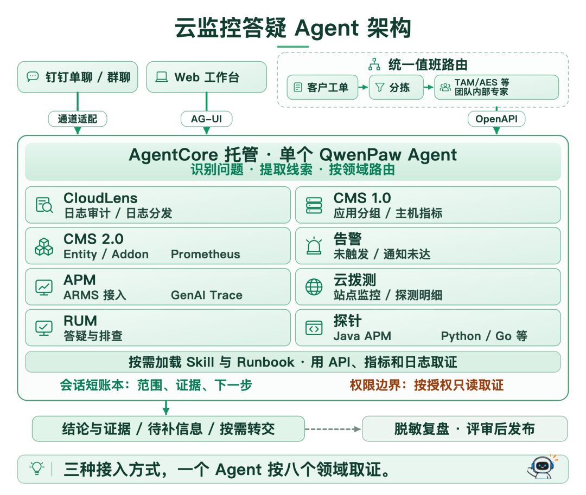

图 1：钉钉、Web 和统一值班路由接入同一个 AgentCore 托管的 QwenPaw Agent。TAM/AES 等团队内部专家通过 OpenAPI 获取答疑支持，八个领域的诊断能力由 Skill 和 Runbook 组织。

统一 Agent 也可以作为子 Agent，接受工单编排委派的任务。

- <strong>领域 Skill 与 Runbook 决定怎么查。</strong>CloudLens 有日志审计和分发的查法，CMS 1.0 有应用分组和主机监控的查法，CMS 2.0 有 Entity、Addon 和 Prometheus 的查法。告警、APM、云拨测和 RUM 也各有自己的排查步骤。探针领域主要支持 Java APM、Python、Go 等相关答疑。以配置为例，CloudLens 的日志审计有 `cloudlens-new-log-audit-troubleshoot`，CMS 2.0 的实体排查有 `cms2-troubleshoot-entity`。
- <strong>共享工具负责执行查询。</strong>不同领域可以复用工单读取、SOP 检索、日志查询和指标查询。比如配置里的 `pop-api-detail-log` 用 Request ID 查 POP 请求与响应明细。具体用哪个工具，取决于问题和当前授权。
- <strong>证据来源决定能回答什么。</strong>工单给出待核对的现象，SOP 提供排查路径。SLS 运行日志、POP 网关日志、API 响应和指标读回，可以验证调用经过了哪一层、当时查到了什么。

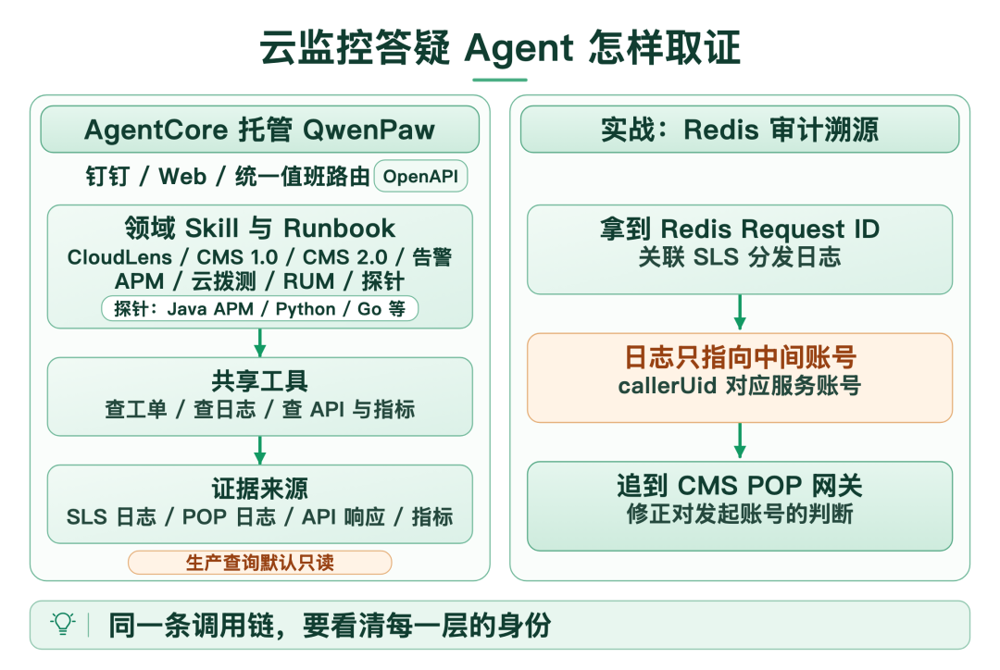

图 2：左侧是统一 Agent 的能力分层，右侧是一次 Redis 工单实际走过的取证路径。

生产诊断默认只读，查询限制在当前问题的授权范围内。会话短账本保留范围、证据和下一步，后续追问可以接着查。证据够就给结论和依据，证据不足就交代缺口，域外问题按需转交。

## 二、从值班经验开始：把 SOP 写成写执行的查法

这套能力从整理值班经验开始。我们先梳理 CMS 1.0、CMS 2.0、CloudLens 和告警的 SOP、工具入口与排查约定，再把这些知识组织成 Agent 可以按需读取的 Skill 和 Runbook。之后并入 APM、云拨测，又增加 RUM 和探针，支持范围逐步扩展到八个领域。

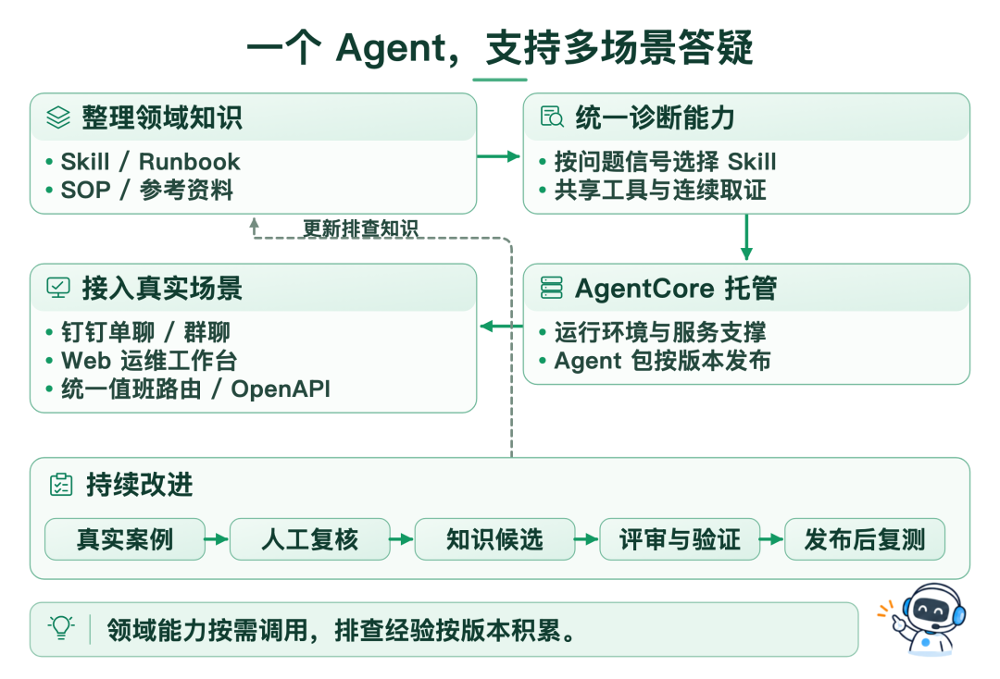

图 3：建设过程从知识整理开始，逐步补齐统一诊断、服务托管、使用入口和持续迭代。

云监控的问题覆盖多个产品和数据链路。同样一句“没有数据”，可能是采集配置没有生效，也可能是日志分发异常，或者工作空间中的资源与源端不一致。

整理每个领域的知识时，需要明确问题适用哪套流程、应该取得哪些证据，以及查到什么程度可以回答。

人工 SOP 往往默认读者知道去哪个系统、查哪个字段；交给 Agent 后，这些默认知识需要补齐。例如，查询日志之前必须确定地域和时间窗，拿到列表后必须处理分页，接口调用失败时要区分权限问题与资源不存在。

我们把可复用流程写进 Skill，把详细字段、地域差异、长命令和案例放进参考资料。Skill 的入口保留适用条件、反向边界、最短流程、风险约束和输出要求，Agent 需要细节时再往下读。

## 三、一个 Agent，怎样支持多个答疑场景

统一 Agent 接收问题后，先提取资源、地域、时间范围和报错等线索，再选择领域 Skill 与 Runbook。用户可以直接贴工单、Request ID 或截图，后续信息就在原会话中补充。

一次排查往往需要连续取证：先读工单拿到资源和 Request ID，确定地域与工作空间，再查询接入策略；读完策略以后，继续缩小查日志和指标的范围。Agent 在同一会话中保留前序证据、已排除的可能性和待确认事项，让下一步有据可查。

### 用 Skill 和 Runbook 组织领域能力

我们的做法是，把领域信号、规则优先级、适用与反向边界写进路由表，再映射到能力注册表与具体 Runbook。例如，同样出现 `EtlMeta`，与 `workspace / addon` 一起出现时，优先进入 CMS 2.0 的相应流程；与 `CloudLens / SLS / 日志投递` 一起出现时，则进入日志投递流程。

| <strong>输入中的信号</strong> | <strong>优先选择的能力</strong> |
| --- | --- |
| EtlMeta 与 workspace、addon | CMS 2.0 接入相关排查 |
| EtlMeta 与 CloudLens、SLS、日志投递 | CloudLens 投递相关排查 |
| 领域信号不足 | 先补充信息，以低置信判断开始，随证据修正 |

每个流程还要写清证据要求、查询预算和停止条件。查到足够证据，就给出结论与依据；查询失败或信息不足，就保留部分结果，说明还缺什么。

## 四、AgentCore 托管：把诊断能力提供给日常值班

生产答疑由 <strong>AgentCore 托管 1 个统一的 QwenPaw Agent</strong>。同一套能力先通过钉钉机器人提供，后来接入可观测开放平台。

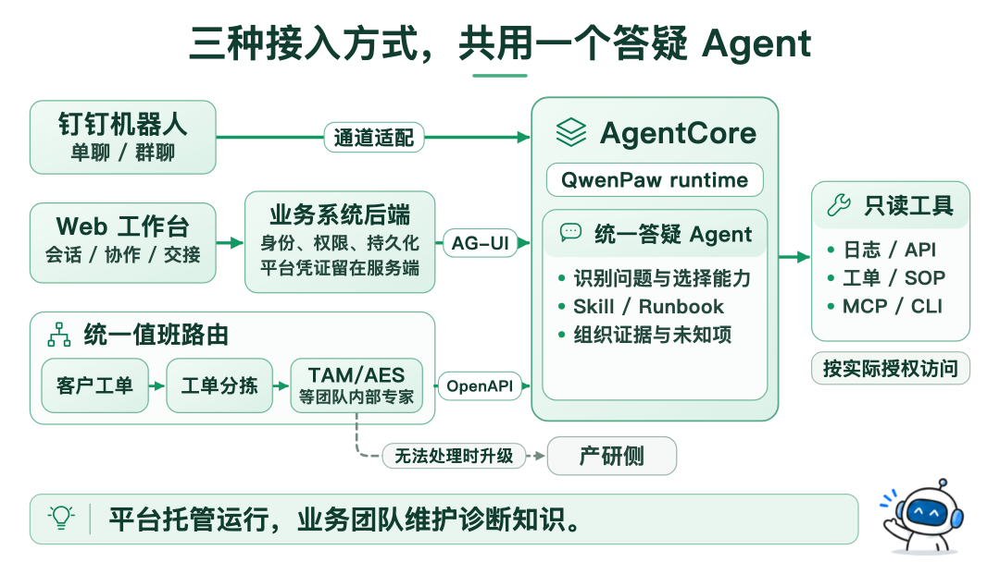

图 4：三种接入方式共用同一个托管答疑 Agent。Web 经业务后端使用 AG-UI，统一值班路由中的 TAM/AES 等专家通过 OpenAPI 接入；无法处理的问题按路由升级到产研侧。

### 平台托管与业务知识各自负责什么

在这套实现中，AgentCore 提供服务托管与运行支撑，QwenPaw runtime 在其中运行。业务 Agent 解析问题、选择能力、组织证据，所需资料与工具来自工单、SOP、日志、OpenAPI、MCP 和 CLI。

业务侧把行为规则、路由表、能力注册表、Skill 和 Runbook 打成 Agent 包，按版本发布到托管环境。发布前既要检查引用是否存在，也要验证工具依赖、凭证和实际查询。

打包细节也要验收。例如，源仓库里的配置目录在发布时可能被展平，需要核对运行时的相对路径。工具可调用之后，还要用真实但可控的问题验证目标日志是否查得到、返回字段是否足以支撑判断，以及访问是否符合授权范围。

### 用 NAS 留住知识库、代码库和 CLI

托管运行还需要解决一个实际问题：排查要读的 SOP、代码和工具文件放在哪里？我们在 AgentCore 的存储配置中挂载 NAS，将这些文件保存在持久化目录里。Agent 启动后从挂载路径读取，实例重建后也能重新挂载已有文件。

当前配置使用 AgenticFS，分别挂载到 `/mnt/agenticfs/private` 和 `/mnt/agenticfs/shared`。前者保存这个答疑 Agent 的运行文件，后者提供共享制品的读取位置。两组挂载在当前配置中均为读写权限。

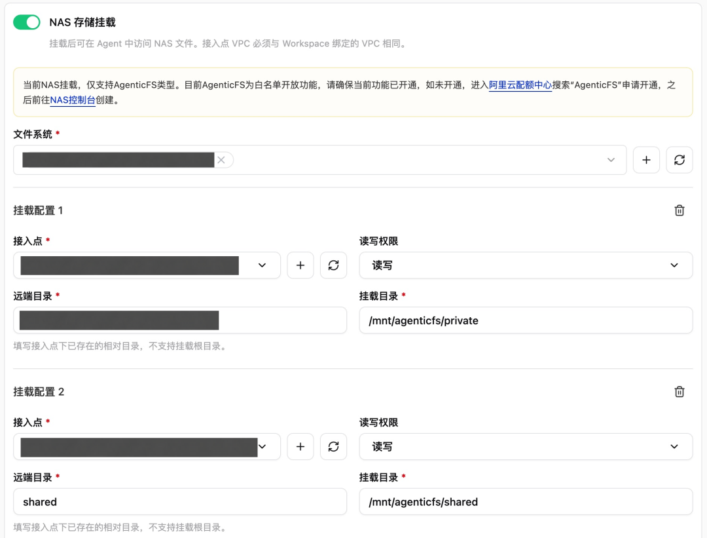

托管实景 1：AgentCore 存储配置的真实截图。保留 NAS 开关、挂载关系与读写设置，文件系统、接入点标识及业务目录已遮盖；浏览器地址与账号区域已裁去。

在私有目录下，我们按用途存放文件：

- codes/：SOP 知识库和代码库。Agent 按问题检索文档，必要时读取源码核对实现。
- cli/：CLI、插件和运行依赖，供日志、工单、OpenAPI 等查询使用。
- downloads/：排查过程中下载的附件、导出结果和临时文件。

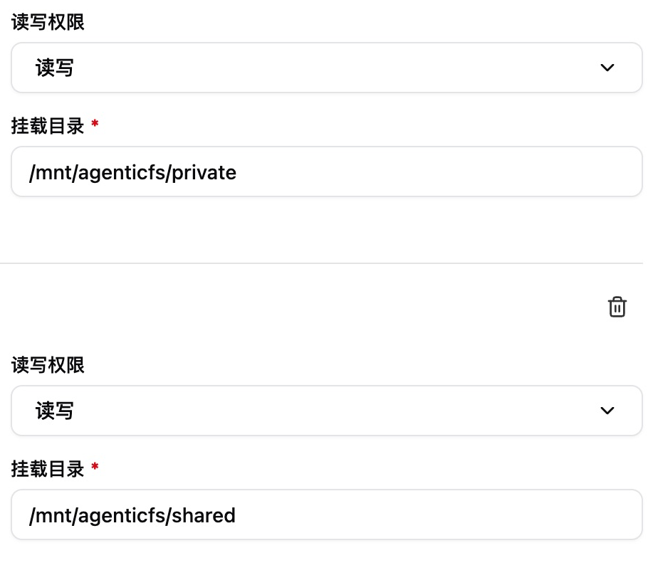

托管实景 2：同一页面的局部放大。上方为 `/mnt/agenticfs/private`，下方为 `/mnt/agenticfs/shared`；保留实际界面文字，方便在手机上核对路径。

运行准备脚本先检查 NAS 是否可写，再核对仓库和工具依赖；每次 Shell 调用加载对应环境，让工具从约定目录读取文件。NAS 上保存了代码和 CLI，并不代表当前 Worker 已经具备完整运行条件，发布后仍要检查版本、凭证和实际查询结果。

文件保留下来，知识更新也要有记录。SOP 和代码需要核对来源与版本，新增知识和 Runbook 仍按后文的审核、发布、复测流程处理。NAS 承担文件持久化，Agent 包中的行为规则、领域路由和能力声明继续按版本发布。

这张截图记录的是本实践的挂载配置。AgenticFS 的能力和开通条件可查阅阿里云官方说明\[1\]，实际接入以所用地域与控制台要求为准。

## 五、接入运维系统：用 AG-UI 连接 AgentCore

诊断能力托管到 AgentCore 后，接入运维系统还需要处理进度展示、工具活动和历史恢复。一次查询可能持续几分钟，用户也可能中途刷新页面，接入层需要保存运行状态，并向页面持续返回结果。

AG-UI（Agent User Interaction Protocol）为应用与 Agent 定义了结构化事件。本实践使用 SSE 传输这些事件，分别呈现运行状态、文本增量和工具调用；协议本身支持不同传输方式。可参考 AG-UI 架构说明\[2\]。

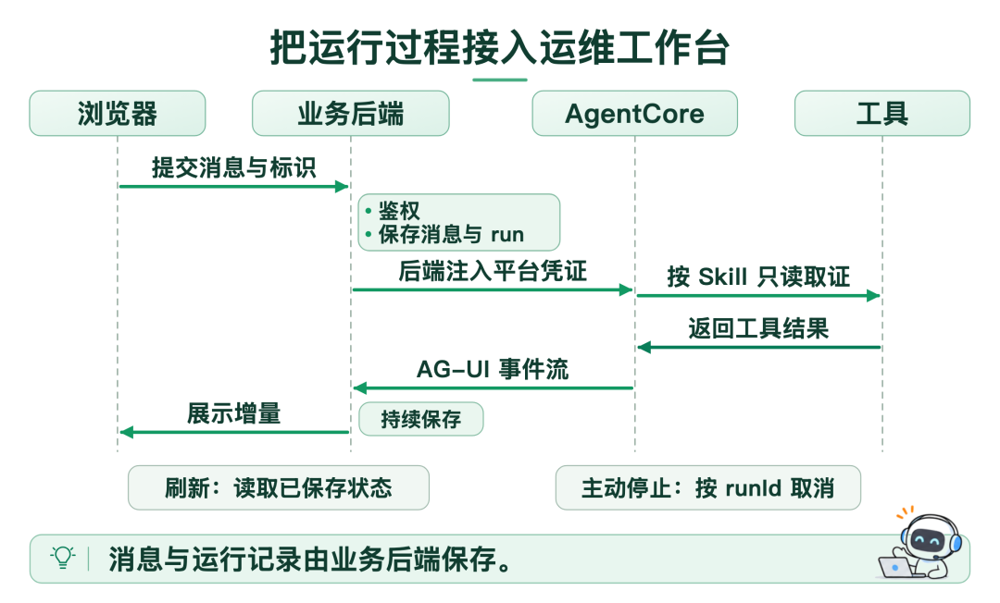

图 5：本实践的接入分工。业务后端保存消息和 run，浏览器负责展示；页面断连与主动停止分别处理。

### 由业务后端连接 AgentCore

在当前工作台实现中，浏览器经业务网关访问后端。后端校验登录身份与会话访问权限，保存用户消息和本轮 run，再调用 AgentCore 的 AG-UI 接口。后端累积上游事件并保存消息快照，同时向仍保持连接的页面转发增量。早期使用的内部 Open Chat 适配已经被这条调用链替代。

平台调用凭证保存在后端。前端负责流式展示，结束后回查会话，刷新时读取已保存的运行状态。

自己接入时，可以先创建托管 Agent，取得 Endpoint 和调用凭证，再由业务后端发起调用。创建步骤见 AgentCore 托管 Harness 使用指南\[3\]。公开托管接口使用 `POST /ag-ui/agent`，请求头 `X-AgentCore-Session-ID` 要与请求体的 `threadId` 一致，响应是 SSE。鉴权、重连和停止的字段按具体接口约定处理。AgentCore AG-UI 接口参考\[4\]。

有三个标识要先分清：`threadId` 对应会话，`runId` 对应一次运行，消息的 `id` 与文本事件里的 `messageId` 用来标识各自对应的消息。连续追问沿用会话标识，新一轮运行使用新的 run 标识。断线后查看已有 run 和重新发起请求是两件事；应用若允许重试提交，还要自己处理去重。

下面是按标准字段组织的简化请求示例，所有值均为演示值。它用于说明数据结构，不是可直接访问的生产请求：

```json
{
  "threadId": "conversation-demo",
  "runId": "run-demo-001",
  "messages": [
    {
      "id": "message-demo-001",
      "role": "user",
      "content": "请检查演示任务在指定时间窗内的日志投递情况。"
    }
  ],
  "state": {},
  "tools": [],
  "context": [],
  "forwardedProps": {}
}
```

字段含义可核对 AG-UI RunAgentInput 与消息类型\[5\]。示例中的 `tools` 为空，表示本轮没有声明客户端工具，Agent 仍可使用服务端已配置的工具。工作台保存所选 Agent 与会话的绑定，普通续问沿用原会话。需要附带历史时，由后端组织已保存的消息。能接续上下文和能读取完整历史记录，需要分别验证。

后端负责生成可信的身份与授权信息。用户在输入框里写了某个账号，或者浏览器传来了一个 `userId`，都不能替代服务端的资源权限校验。

### 让页面消费事件，少猜状态

前端至少要识别下面几类事件：

| <strong>事件</strong> | <strong>页面如何处理</strong> |
| --- | --- |
| `RUN_STARTED` | 建立本轮运行状态 |
| `TEXT_MESSAGE_START`、`TEXT_MESSAGE_CONTENT`、`TEXT_MESSAGE_END` | 按 `messageId` 组织并追加文本 |
| `TOOL_CALL_START`、`TOOL_CALL_ARGS`、`TOOL_CALL_END` | 按 `toolCallId` 关联调用、参数片段和结束事件 |
| `TOOL_CALL_RESULT` | 接收工具结果，再按业务语义判断结果 |
| `RUN_FINISHED`、`RUN_ERROR` | 保留本轮结果或错误；接入支持中断的服务时，按 `outcome` 区分正常完成与等待输入 |

其中，`TOOL_CALL_END` 表示调用描述与参数流结束，不能据此宣称查询成功；`RUN_FINISHED` 表示本轮运行结束，也不证明回答中的业务判断已经验证。事件定义见 AG-UI Events\[6\]。

下面用最小的 SSE 序列说明文本怎样增量返回，示例省略了事件 `id:` 行。实际运行中还可能有工具事件。SSE 用空行结束一条事件，不能把一次网络读取当成一条事件。对接 AgentCore 的公开接口时，按其文档记录事件 ID，供重连使用。

```text
data: {"type":"RUN_STARTED","threadId":"conversation-demo","runId":"run-demo-001"}
data: {"type":"TEXT_MESSAGE_START","messageId":"answer-demo-001","role":"assistant"}
data: {"type":"TEXT_MESSAGE_CONTENT","messageId":"answer-demo-001","delta":"在指定窗口与抽样目标内，未观察到明显异常。"}
data: {"type":"TEXT_MESSAGE_END","messageId":"answer-demo-001"}
data: {"type":"RUN_FINISHED","threadId":"conversation-demo","runId":"run-demo-001"}
```

页面可以展示正在执行的步骤和工具摘要。对于敏感参数、完整工具输出及调试信息，应按用户权限与用途筛选后呈现。

### 接通以后，重点检查四件事

<strong>第一，网关是否真的透传了事件。</strong>我们在适配时遇到过事件 JSON 被再次编码成字符串、或被包进响应字段的情况。页面连接正常，却读不到预期的 `type` 和 `delta`。需要用脱敏样本逐层检查上游、网关和前端解析结果，再验证增量是否及时到达。

<strong>第二，断流有没有明确状态。</strong>HTTP 200 或 SSE 连接关闭，都不能替代 Agent 的终态。后端应保存已经收到的内容；没有等到终态就断开的运行，需要明确错误或待核对状态，供页面恢复时查询。

<strong>第三，刷新与停止有没有分开。</strong>在这套工作台的实现中，浏览器断连后，业务后端仍可接收上游结果，用户回来时读取保存的快照。用户主动停止时，后端把会话与本轮 run 标识交给 Stop 接口。需要分别验证刷新后能否读回记录、主动停止后后台是否结束，以及原会话能否继续追问。最后一项要随所用 Harness 和版本验收。

<strong>第四，协作权限是否随每次请求校验。</strong>复制一个会话链接能帮助交接，能否读历史、加入会话、发送下一轮消息，仍应由业务后端判断。AG-UI 解决交互格式，组织身份、资源权限和变更审批要由接入系统与执行层落实。

接入可以从一个只读排查流程开始。先验证连续追问、失败返回和历史恢复，再增加工具与场景，更容易发现问题。

## 六、三种接入方式，覆盖不同答疑场景

### 钉钉：单聊提问，群里一起排查

内部同事可以与 `observe-oncall` 单聊，也可以在已接入机器人的群中 @ 它。

单聊适合独立咨询和连续追问；群聊适合多人围绕同一个问题补充材料。以下截图来自真实工单与支持记录，已裁剪、脱敏，并清理操作鼠标标记。工单号、账号、人员与资源标识均已遮盖。

<strong>单聊：发一个工单链接，让机器人从现象开始查。</strong>

此前有一张云监控探针安装失败的工单。用户直接在单聊中发出“排查工单：”和工单链接。机器人从工单里提取了 ECS 实例、地域，以及安装脚本返回 `HTTP 404 (NoSuchKey)` 的现象。

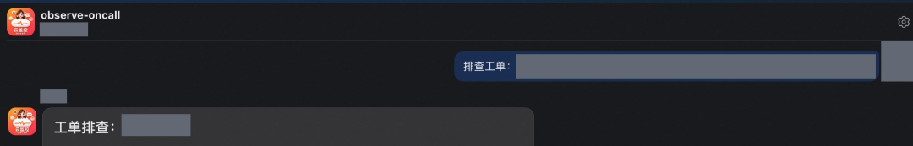

实景 1：原始单聊截图。用户发送工单链接，机器人返回对应的工单排查卡片；链接和编号已遮盖。

随后，机器人用一张表对比两个地域的多个脚本版本：在当时抽查的版本中，一个地域均返回 404，另一个地域部分版本返回 200。这给出了下一步：核查两个地域的脚本部署记录，确认是否需要补齐。仅凭响应码，还不能断定为什么访问失败。

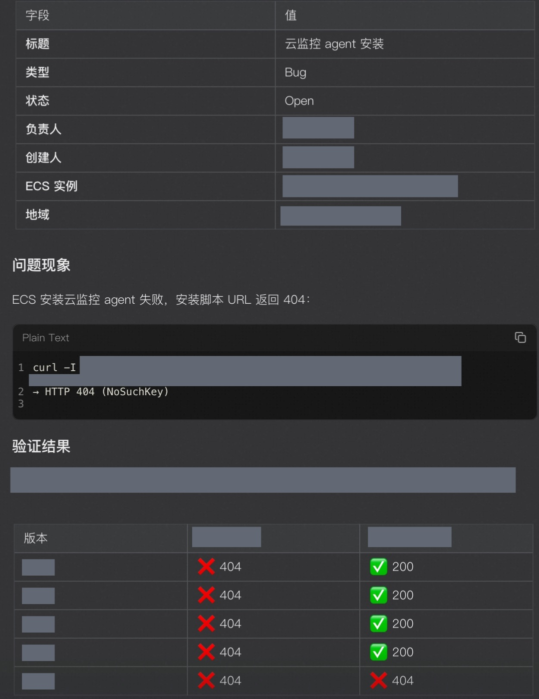

实景 2：同一工单的历史回复。表格中、右两列是两个地域，保留各行的返回码；地域和版本值已遮盖。表里只列出了当时抽查的版本，也没有记录后续修复结果。

这样就省下了重新转述工单、挑选领域入口和手工整理对照表的步骤。值班同事仍然需要核对直接证据，再决定如何处理。另一个真实用法是把接入中心链接发给机器人，让它提取 workspace、region 和 policy，继续核对 Addon 状态、采集链路与指标存储位置。

<strong>群聊：直接在群里发截图、补材料。</strong>

在支持群里，一位同事上传控制台报错截图，@ `observe-oncall` 问：“帮看下这是站点监控出现问题了吗”。机器人从图片中读出 `Error: Loading CSS chunk 42 failed.`，将排查方向转向前端静态资源加载，列出网络、缓存等需要核实的可能原因。

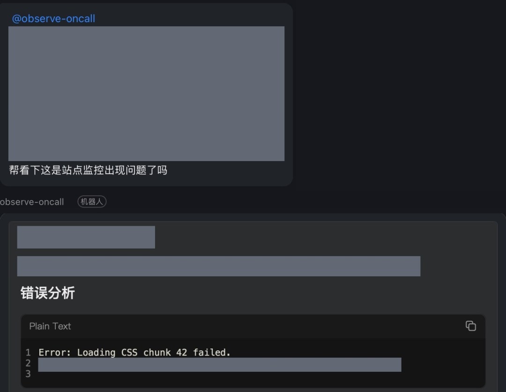

实景 3：真实群聊记录。保留了 @、附件位置、提问和回复中的报错原文；附件画面和完整资源路径已遮盖。这个报错说明页面没有成功加载该 CSS 文件，尚不能确定是网络、缓存还是 CDN 环节出了问题，也不能据此排除后端异常。

同事可以继续补充“换网络后的结果”“同一链接是否可访问”等材料，再 @ 机器人继续判断。需要交给人工处理时，问题、已经尝试的检查和机器人回答仍在同一段讨论里。

一次有效的提问，通常包含问题现象、地域、资源或工作空间、时间范围、预期与实际差异，以及已经做过的检查。RequestId 和报错原文也很有帮助；已有工单或截图时，可以从这些材料开始。

机器人支持的具体命令和会话操作应以入口提示为准。群里的上下文也不能自动视为可跨群、跨会话复用的信息，资源访问仍然受授权约束。

### 工作台：让排查能接着做

可观测开放平台把答疑放进了独立功能模块。工单排查、自由咨询和 SRE 问题共用会话模型，用标签区分场景。

工作台提供会话搜索、历史消息、图片输入、成员协作、链接复制和 Markdown 导出。参与者可以围绕同一个会话继续补证据，交接时也能保留此前的判断。管理员有「全部会话」查询入口；查看权限与继续发言的资格分别校验。

<strong>从真实工单进入，再沿同一个会话追问。</strong>

一张实际工单里的问题是：客户看到了“数据导出数据点数量”费用，但反馈在 CMS 1.0 的实时数据导出页面没有看到相关配置。用户把工单链接贴进工作台，Agent 读取工单后，把 CMS 2.0 接入策略和 MetricExporter 列为排查线索。

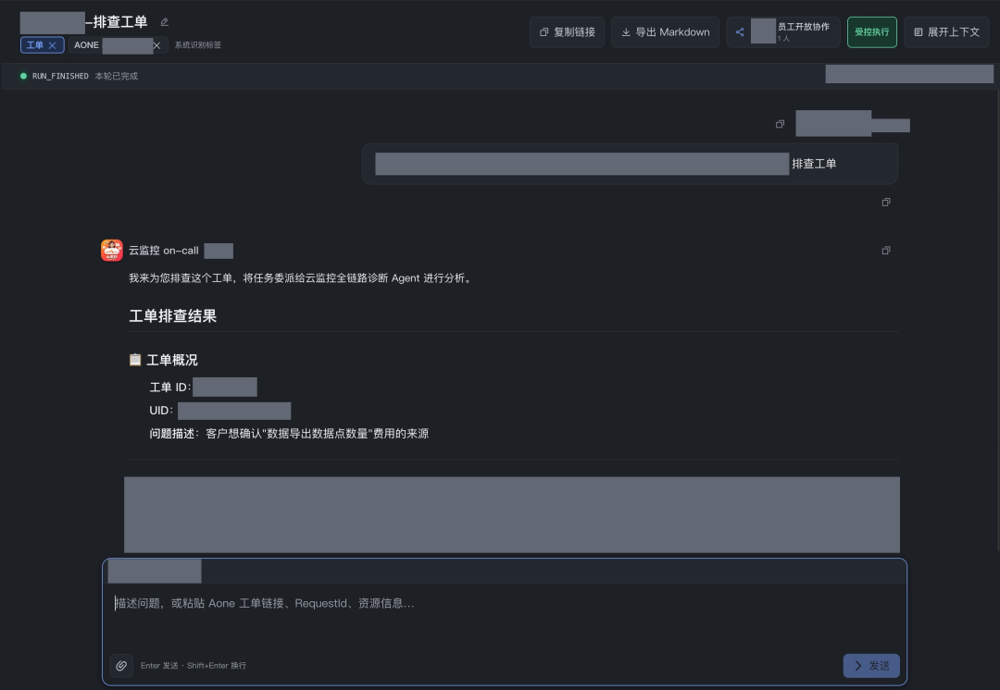

实景 4：真实工单会话。保留工单标签、复制链接、Markdown 导出、协作入口，以及用户提问和 Agent 读取的工单概况。客户标识和首轮未经核实的归因已遮盖。

继续追问时，我们让 Agent 区分已核对的信息、推测和待补证据。它列出了接入策略与 Addon 的查询来源，也指出还缺调用日志和用量明细。要确认费用归属，仍需把账单计费项、用量明细和实际调用记录对上。这张工单展示的是怎样缩小排查范围，不提供计费结论。

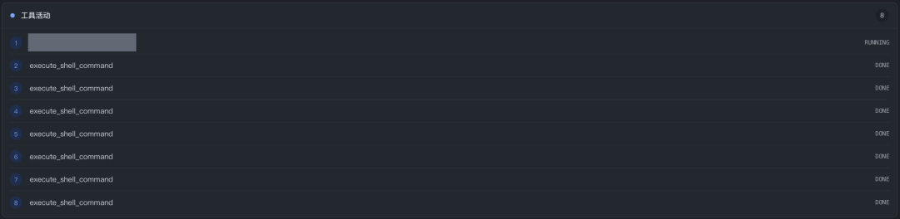

实景 5：这轮追问执行时，工作台的工具活动面板同时显示了 `RUNNING` 和 `DONE`。这些状态记录执行进度。要核对费用归属，还得看调用返回的账单和用量记录。

实际操作时，新建对话、粘贴工单链接，先检查 Agent 提取的问题是否准确；发现缺项，就在当前会话补截图、RequestId 或时间窗；需要交接，再按权限通过会话链接继续协作，或导出 Markdown 带走排查记录。

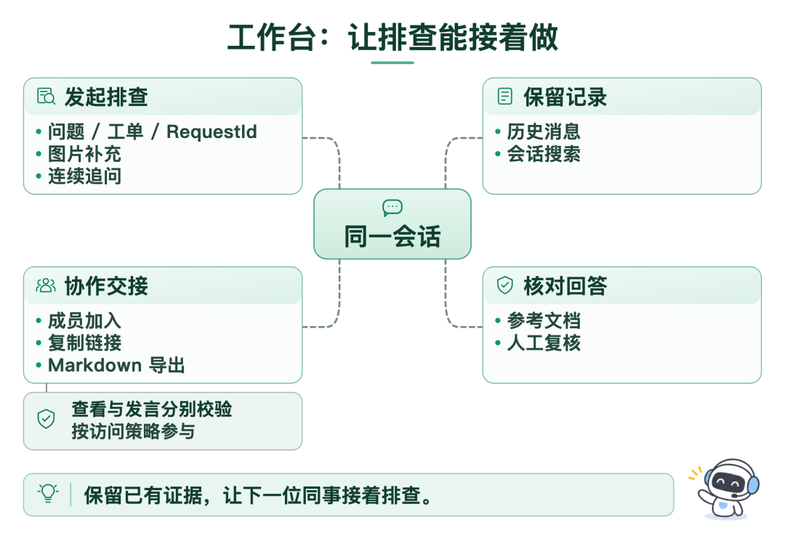

图 6：工作台功能示意。输入、记录、协作与复核围绕同一会话展开，查看与发言分别按访问策略校验。

这套工作台设计可供其他团队参考。目前上述入口用于内部协作，访问范围以实际授权为准。

### 统一值班路由：专家通过 OpenAPI 获取答疑支持

第三种接入方式放在阿里云统一值班路由中。客户提交工单后，先经过分拣，再由 TAM/AES 等团队内部专家处理。专家通过 OpenAPI 对接答疑 Agent，在处理问题时获取答疑支持；无法处理的问题再升级到产研侧。

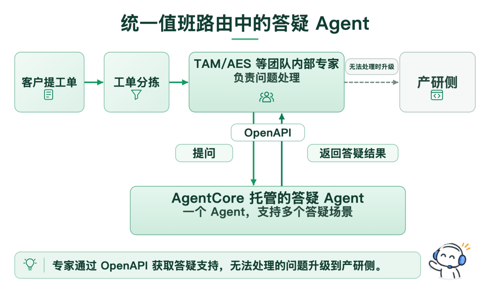

图 7：Agent 在专家处理环节提供答疑支持。OpenAPI 的提问与返回连接专家和 Agent；灰色虚线表示无法处理时向产研侧升级。

这条通道把答疑能力接入专家已有的工单处理流程。钉钉支持即时提问，Web 工作台保留持续排查与协作记录，OpenAPI 则让 TAM/AES 等专家在统一值班路由中调用同一个 Agent。工单的分拣、专家处理和向产研升级仍按原有路线进行。

## 七、统一入口以后，真实问题怎样查下去

下面几个例子来自脱敏后的历史会话，保留了追问、纠正判断的过程，也能看到不同证据分别说明了什么。

### 追溯时间：先问清“开始”指什么

一个 PAI-EAS 日志投递问题中，用户看到日志从某一分钟开始出现，希望确认实际开通时间。Agent 对照了投递配置的创建记录和目标日志，整理出一张时间表。

这类回答比“已开启，请再观察”更有用：配置记录能说明控制面何时发生变化，目标端检索能确认是否有相应日志，用户的观察则补充了页面上看到的情况。核对这张表时，还需要分清不同时间各自代表什么。

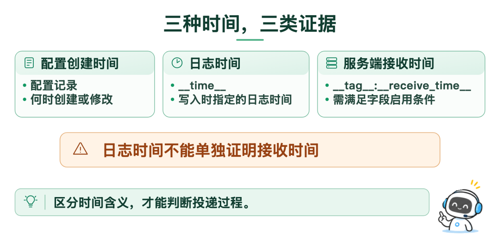

图 8：三类时间证据示意。历史回答曾把日志时间称为“数据到达”，这里需要纠正：当时列出的证据是日志的 `__time__`，不足以单独证明接收时间。

SLS 的 `__time__` 是写入时指定的日志时间。开启「记录外网 IP」功能后，SLS 服务端收到日志时会追加 `__tag__:__receive_time__`，记录接收时间。不能假定每条日志都有这个标签。历史回答里，配置创建时间与查到的首条日志的 `__time__` 相差 16 秒，这个差值不能用来计算端到端投递耗时。字段含义见 SLS 保留字段说明\[7\]。

我们希望 Agent 给出一张注明来源的时间线：配置何时创建、查到了什么日志、日志时间是什么、接收时间是否有证据。缺哪一段，就把哪一段留为未知。

### 数量对不上：先找差集，再验证生命周期

有一次，两个页面显示的应用数量对不上。Agent 报出差异实体后，最初沿着同步遗漏的方向解释。同事拿出删除记录，要求把查询窗口扩大到全天，再追踪增量事件。下一轮回答报告查到了删除事件，但在所查日志里没有找到对应的消费记录。接下来要核对的是消费环节。

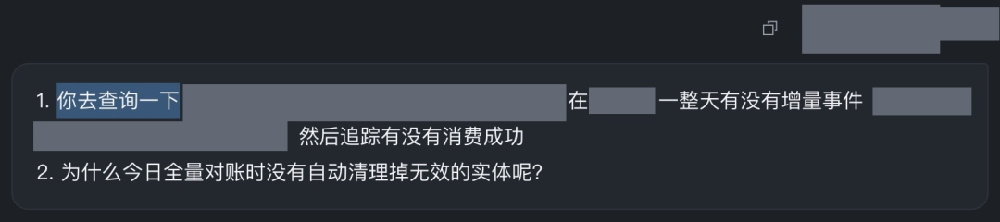

实景 6：同事要求查询一整天的增量事件，再追踪有没有消费成功。资源标识、日期和内部项目名前缀已遮盖。

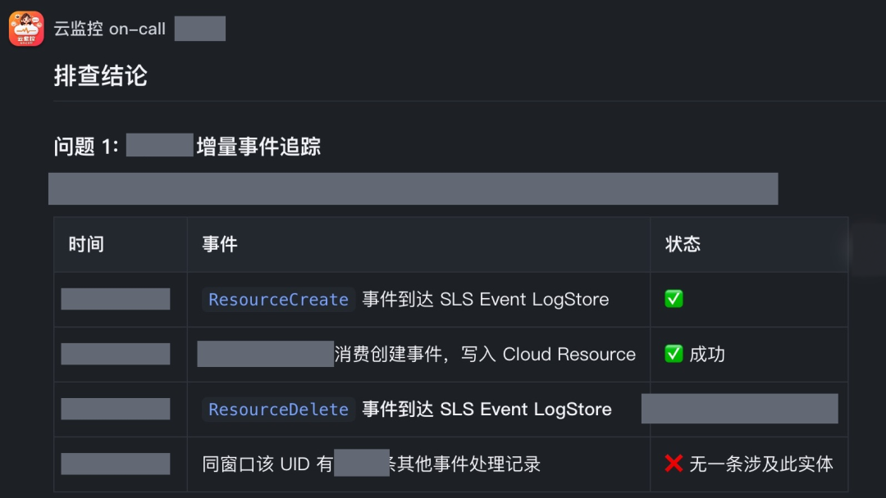

实景 7：Agent 后一轮回复列出了创建、删除和查找消费记录的线索。精确时间、内部组件名及未经核实的消费结论已遮盖。消费是否失败、失败在哪一步，仍需回查原始日志。

对同类问题，可以复用的是这条排查路径：

1. 统一两个列表的地域、过滤条件与实体标识，找出差集。
2. 核对差异实体的创建、更新与删除记录。
3. 沿事件产生、投递、消费、落库逐段验证，写清查到了哪一段。

会话中提到的代码原因、修复建议和预计恢复时间，还需要相应源码、原始日志和变更验收结果来支持。

### Redis 审计溯源：查到了调用账号，谁发起的操作？

工单提供了 Redis 侧开启审计日志的 Request ID，直接调用者是 SLS 的服务关联角色（SLR）。同事想知道，这条请求最早由哪个账号发起。

<strong>第一轮，Agent 把中间调用账号当成了操作者。</strong>它向上追到一个 `callerUid`，又把 `callerParentId` 当成客户主账号。值班同事追问了一句：“提供日志证明”。


实景 8：值班同事要求提供日志，核对首轮的账号归因。

<strong>第二轮，日志串起了调用链，也暴露了归因问题。</strong>Agent 用 Redis Request ID 匹配 SLS 分发控制面里调用 Redis 的响应日志，再用同一条 SLS trace 对上该控制面的入口日志。值班同事认出入口日志里的调用账号是服务账号，追问能否再往上找到发起操作的用户 ID。


实景 9：同事指出该账号是服务账号，并要求沿调用链继续追到请求入口。账号值已遮盖。

<strong>第三轮，Agent 把取证范围推到了网关入口。</strong>它报告从 CMS POP 网关的入口日志中找到了发起账号，并修正了前两轮的解释。此前查到的 `callerUid` 是中间服务账号，`callerParentId` 是该服务账号所属的主账号。

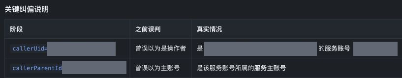

实景 10：第三轮答复保留了两条身份修正。账号值、内部组件名和业务编号已遮盖。

要确认发起者，需要用请求标识或 trace 关联入口审计记录，再核对记录中的请求主体。这次会话记录了 Agent 如何改变判断，具体账号归属仍需原始审计记录支撑。

### 跨账号 ECS 监控：Addon Ready 之后，还要查什么？

另一个工单里，资源账号能查到主机指标，负责集中查看的监控账号却查不到。问题可能出在两个账号之间的数据链路上，得逐段确认。

<strong>第一轮，Agent 根据空列表推测 Exporter 未部署。</strong>同一份回复还列出了 `Ready=True` 和 `Ready without metric checking`。这个状态说明 Addon 标记为 Ready，但这一步没有检查指标。单凭 Ready 或空列表，都无法判断具体是哪一环出了问题。


实景 11：首轮答复中的状态行同时显示 `Ready=True` 和 `Ready without metric checking`。版本号已遮盖。

同事在原会话里只补了一句：“继续排查”。


实景 12：值班同事沿用原会话继续追问。

<strong>第二轮，Agent 把策略声明、部署和数据查询分开核对。</strong>它在回复中对照了 Addon Release、采集器列表和两侧账号的指标查询结果。新增线索是 System Policy 的 `addonNames` 声明了 `metric-agent`，对应查询却返回 `releases=0`。下一步就可以针对这个组件核对部署记录。


实景 13：第二轮答复列出两项可对照的信息，策略中声明了 `metric-agent`，本次查询返回 `releases=0`。

这里的 `releases=0` 只说明当时的查询没有返回部署记录。要确认采集器是否缺失，还要核对账号、地域和策略范围。最终验收要在监控账号里读回目标指标。

### 检查延迟：给结论加上覆盖范围

另一个会话直接询问某地域的日志分发任务有没有延迟。Agent 按控制面配置、源端数据、目标端数据和错误记录组织检查，并在回答末尾注明：目标端只验证了一个抽样用户。

这个限制很关键。任务存在、配置启用，只能说明配置的状态；抽样目标有新数据，也只能据此判断该目标在所查窗口里的情况。要回答某个具体用户是否异常，还得带着他的资源和时间范围继续查。

因此，回答最好写清“在本次时间窗口和抽样目标内，未观察到明显异常”，并列出还有哪些范围没查。历史会话里的“未发现”，也不能直接当作今天的运行状态。

## 八、一次排查结束后，怎样让下一次少走弯路

排查结束后，还要把可复用的查法写进知识，供后续问题使用。我们把这种打磨方式叫作“剃须刀式迭代”：用典型问题反复验证，再复盘哪里多查了、哪里选错入口、哪里缺少资料。

早期我们会拿真实问题逐个验证，让 Agent 完成排查，再要求它回看过程。连续对话有个好处：方向偏了，可以当场补充证据、纠正方向，再验证改进后的排查方法。

复盘时，我们会提出这样的要求：

```markdown
复盘这次排查：
1. 列出多余调用、高成本输出和流程执行不完整的地方，
   区分执行问题与文档缺口。
2. 给出更短的可复用查询路径，包含分页、时间窗和输出范围。
3. 形成对应 Skill / Runbook 的修改建议，
   标明目标文件、证据与需要执行的验证。
4. 保存脱敏后的候选经验，交给知识维护流程处理。
```

### 维护侧：用本地工程环境打磨知识

知识准备与维护阶段，我们也通过 LoongSuite，把 AgentCore Web 连接到办公网 Mac mini 上的 Codex CLI。代码仓库、Skill、SOP 和诊断工具在同一个工程环境里，方便沿日志继续查实现，再修改相应的排查资料。

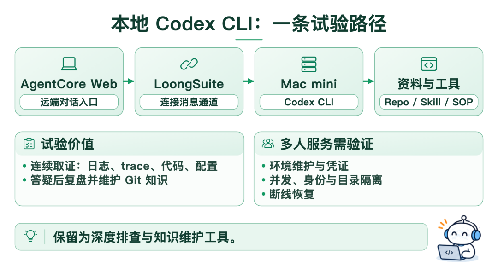

图 9：这条试验路径用于深度排查和知识维护，图中多人服务能力列为当时的待验证项。日常生产答疑使用前述 AgentCore 托管的 QwenPaw Agent。

内部实践里有一个日本地域 addon 安装失败的案例。Agent 沿失败 trace 核对服务端错误、代码位置和地域配置，再整理原因、证据能说明什么，以及验证办法。这样的工程环境便于把排查中发现的资料缺口整理成可 review、测试和回滚的知识变更。

本地 Codex 的维护会话可以继续生成 diff、运行检查；明确仓库、分支和提交授权后，还可以把变更提交到 Git。这样，排查经验就变成了 Git 中可以追踪的变更。

### 定期同步知识：在本地做全量查漏补缺

逐单复盘积累具体问题的处理经验，定期资料核对则检查知识库有没有漏掉场景、沿用旧步骤，或者留下互相矛盾的说法。资料包括四类：

- 官网帮助文档：核对功能支持范围、使用条件和参数说明。
- 内部 QA 文档：核对常见问题、判断依据和适用边界。
- 线下沉淀的处理流程：补齐排查步骤、工具用法和验收办法。
- 工单列表：一起看问题描述、处理方式和对客口径，保留结论成立的条件。

先找到这些资料，整理成本轮核对清单，再交给本地 Qoder/Codex 安排子 Agent 逐项验证。这里的子 Agent 属于本地知识维护流程。每项任务都要对照已有知识库和 Runbook，指出缺了什么、哪里需要更正，以及补充内容的依据。遇到资料冲突或证据不足，先记录差异与待验证项，不直接覆盖原有结论。

核验后的内容补进知识库、Skill 参考资料或 Runbook。客户身份、资源标识和原始响应先脱敏；单个工单的对客口径，要核对适用范围后再提炼为通用说明。

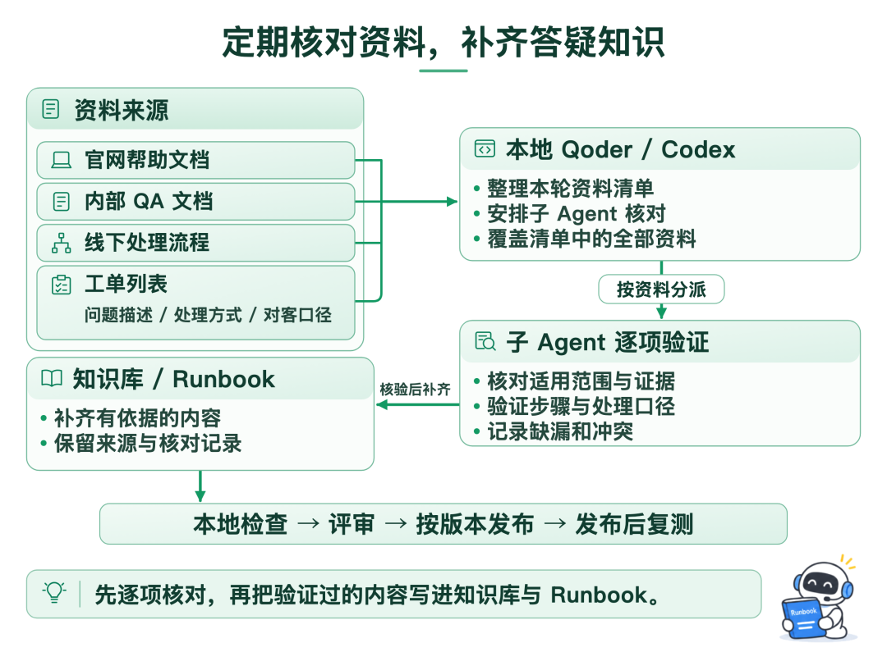

图 10：本地维护会话按资料安排子 Agent 核对。全量核对的范围是本轮清单中的全部资料，已核对、待验证和存在冲突的条目都要留下记录。

一轮核对结束时，再回查清单中的遗漏项，汇总修改文件、证据来源和未解决的冲突。变更经过本地检查、评审和版本发布后，供 AgentCore 托管的答疑 Agent 使用；发布后再用相似问题复测，确认新知识有没有被正确选用。

### 从线上复盘到正式知识

生产托管环境的知识维护分成两段：线上排查产生复盘与候选经验，获授权的维护流程再把改进送进 Git，经过评审、测试、打包和发布后生效。

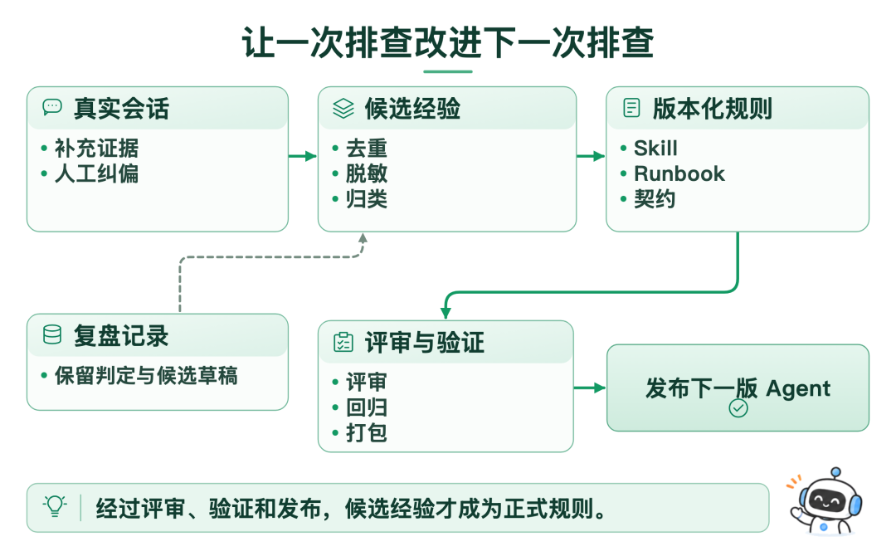

图 11：复盘记录保留判定与候选草稿。候选经验经过评审、验证和版本发布，才成为正式规则。

随 Agent 包发布的 `MEMORY.md` 可以是只读知识索引。工作台里的回答判定和复盘记录保存本次迭代的依据与状态，两者各有用途。

我们还保留了人工工单复盘的环节。工单中的问题、处理过程和人工核实结果，会定期整理进答疑知识库；每周工单复盘时，除了讨论怎样处理问题，也会 review AI 回答的准确性，对有问题的回答再次复测、修正排查方法。

### 先判定回答，再决定沉淀什么

同一个会话里，Agent 可能先后给出几个互相矛盾的解释。人工确认最后一条回答正确以后，如果把整段对话压成一份总结，早先的错误假设也可能一起留下来。因此，我们给复盘增加了两个约束。

第一个是<strong>把人工判定绑定到具体的业务答复</strong>。多轮对话可以切换判定对象，复盘报告本身不作为业务答复。保存一次判定，只留下审核记录。真正开始复盘时，再保存所选答复、当时的判定、会话边界和授权范围。后面又有新回答，之前的判定仍属于原来的对象。

第二个是<strong>按证据决定可以沉淀哪些内容</strong>。答复被判为错误或不清晰，仍然可以复盘已经成功执行的查询，修正参数、分页、输出字段和停止条件。业务结论被确认正确，并且选择生成业务知识候选后，才继续提炼有证据的判断规则。此前已经撤回的解释，要在复盘中剔除。

我们希望下一次相似问题能更早选对分支，减少重复试探。把证据缺口和停止条件写进排查方法，也能减少没有依据的追查。知识有来源、有变更记录，出错时可以查清是哪一版引入并回退。实际收益要在发布后用相似问题比较查询路径、输出量、耗时和回答质量，本次案例没有这些指标的前后对照统计。

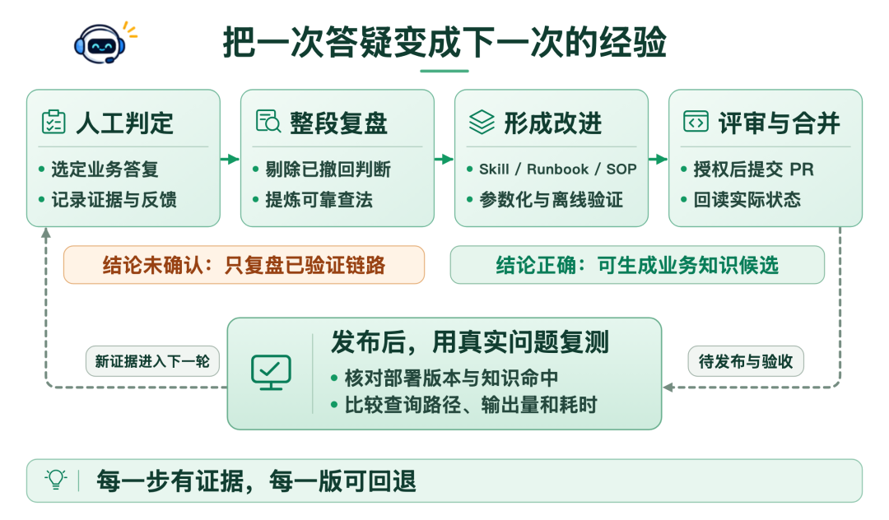

图 12：每次复盘交付一轮可验证的改进。图中的发布与复测是下一道验收，需要单独取得证据。

### 一张 NLB 工单，怎样变成可复用的查法

这次复盘来自 2026 年 11 月 18 日继续排查的一张真实工单。客户按标签管理应用分组，发现新打标签的 NLB 没有自动入组，而分组里已经存在其他 NLB。旧会话曾把“组里有历史成员”解释成“标签自动入组支持这个产品”，随后又根据入组时间猜测历史成员来自全量同步或标签事件。

<strong>第一步，先把这些推断逐条纠正。</strong>同事要求继续查代码和历史。Agent 起初拿浅克隆仓库做历史判断，在被追问后补齐了仓库历史，再核对标签事件与全量同步使用的产品映射。会话中的更正表撤回了此前的入组来源推断，也撤回了“重新同步就能补齐”的建议。

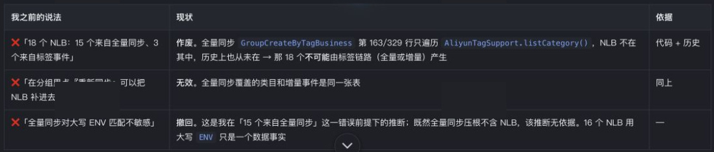

复盘实景 1：这是当次排查的历史更正表。历史成员存在、入组时间相同，都需要结合写入入口和日志核对。

后续查询又找到该批操作的业务日志，支持静态批量添加这条路径。对于到底是控制台点击还是脚本调用，回答保留了证据缺口。这里沉淀的是“先核对产品映射，再区分入组路径”的方法。具体支持范围要以排查时的有效代码与配置复核。

<strong>第二步，选定业务答复，再给出人工判定。</strong>工作台用回答序号和时间帮助选择对象，确认后才保存。这个案例里，被选中的答复判为“正确”，复盘范围则覆盖截至当时边界的整段会话，包括追问、纠正和已取得的证据。

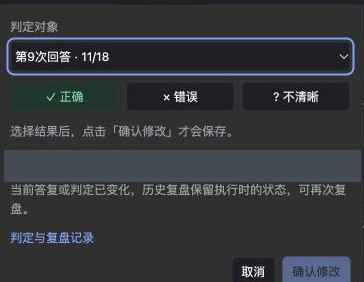

复盘实景 2：判定对象是具体业务答复。后续新答复与复盘报告有各自的处理方式。

<strong>第三步，把知识候选与提交 PR 分别授权。</strong>“生成业务知识候选”决定是否提炼业务判断，“生成变更并提交 PR”决定是否进入仓库交付。不选择后者时，流程只生成草稿。这个案例选择了知识候选和 PR，并补充要求把完整的应用分组排查方法写入 SOP 知识库，由主 Agent 的 Runbook 引用。

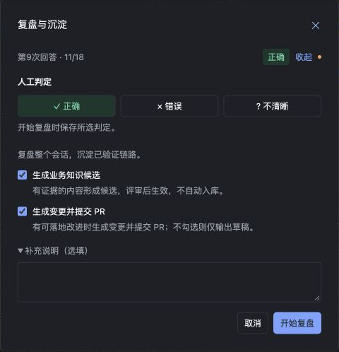

复盘实景 3：同一条已完成案例的界面回看。有证据的内容先形成候选，经过评审后生效。

<strong>第四步，把查法写进对应的知识文件。</strong>Agent 给出的改进分为四层。专项 Skill 的参考资料保存支持范围、判定矩阵、最短查询步骤和停止条件。`SKILL.md` 增加触发分支与引用。主 Agent 的 Runbook 保存值班时的短路径。SOP 知识库补齐完整解释，供人和 Agent 共同检索。

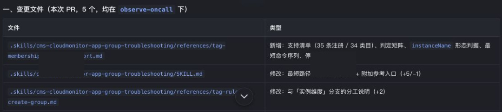

复盘实景 4：图中是首轮变更清单的局部。清单按文件交代改了什么，便于评审人逐项核对。

这次整理出的查法，把分组规则、分页取全的成员投影、产品支持范围和同组对照资源排在前面。需要追溯入组来源时，再查询对应的写入日志。证据不足以区分操作者或具体入口时，保留未知项。一次客户的账号、实例名称和原始响应都不进入通用规则。

<strong>第五步，把权限和交付中的未完成项列清楚。</strong>首轮报告显示，Agent 仓库 PR 已创建，但评审人指派没有回读确认。SOP 章节已有本地提交，推送被权限拒绝。报告也明确留下了部署态验收缺口。

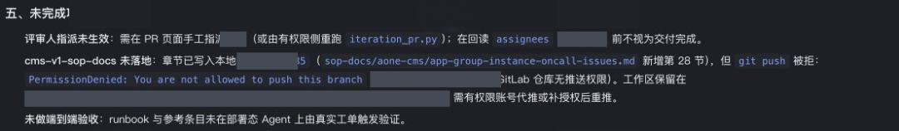

复盘实景 5：PermissionDenied 是当时真实遇到的失败。创建了部分 PR，还需要处理另一仓库和评审信息的断点。

同事随后补充了授权，让 Agent 继续处理 SOP 仓库。下一轮报告给出 SOP MR 和评审人回读结果，并发现前一轮 Agent 仓库 PR 已经合并。


复盘实景 6：继续沿用同一会话。补齐授权后，从上次保留的断点接续交付。

<strong>第六步，合并后归档，记录知识写到了哪里。</strong>同事确认两边 PR 已合并后，Agent 的归档报告分别列出仓库、目标分支和合并状态，清理临时工作区，并保留迭代记录。

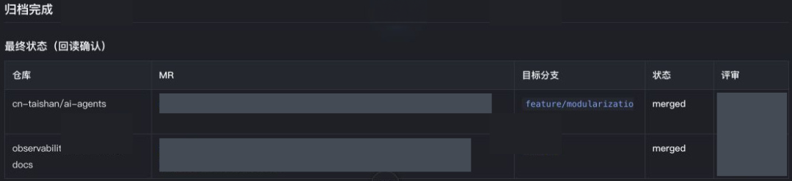

复盘实景 7：这是会话中保存的合并状态回读结果。仓库合并与部署生效分别验收。

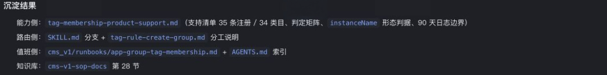

复盘实景 8：同一个案例形成多个有分工的知识入口，入口之间通过引用连接。

归档还保留了一项待处理的工具问题。评审人指派请求曾返回成功，但回读列表为空。后续改用适用的参数后，指派才真正生效。当次记录中，自动化脚本的相应修复仍留作下一轮任务。这也说明创建 PR 后，需要回读目标分支、文件范围和评审人。

这次交付完成了知识变更、两个仓库的合并状态回读和临时迭代区归档。自动化脚本的评审人指派仍待修复；发布后，还要用相似工单检查新增 Runbook 和 SOP 是否被正确选用、有没有减少弯路。知识交付后的效果尚待验证。

### 这次实践留下的几个约定

- 人工判定绑定具体答复，复盘覆盖明确的会话边界。历史中被推翻的判断逐条剔除，最终答复正确也要保留未知项。
- 每条知识写清必要输入、适用条件、证据入口和停止条件。记录形态用于提出线索，调用来源尽量用对应入口日志验证。
- 复用已经成功的工具调用，参数化客户数据，更新仓库中的原件。细节进参考资料，入口保留路由，跨仓库交付按授权推进。
- 分别记录草稿、验证通过、PR 创建、合并、部署和实际命中。没有同口径对照数据时，先记录可观察结果。

工具问题有了修复目标，知识缺口有了对应文件。下一次出现相似问题，就用实际查询路径检验这次整理的查法。

## 九、让答疑能力随着真实问题持续积累

这套实践中，AgentCore 承接服务托管与运行支撑，一个 Agent 按问题选择领域能力，业务团队持续维护知识、工具和证据要求。钉钉和接入 AG-UI 的 Web 工作台支持同事连续追问、补充证据和交接；OpenAPI 将答疑能力接入 TAM/AES 等专家的工单处理流程。Web 工作台将消息、协作权限与复盘记录接到日常工作流中。

真正需要长期打磨的，是每次问题怎样查清楚：Request ID 能否追到入口，Ready 状态有没有实际指标支持，人工纠正有没有写进下一版排查方法。每周 review 工单与 AI 回答，定期核对官网帮助、内部 QA、处理流程和工单记录；改进经过评审、发布后，再用相似问题复测，答疑经验才能持续积累。

<strong>相关链接：</strong>

\[1\] 阿里云官方说明

<https://help.aliyun.com/zh/nas/product-overview/agenticfs-overview>

\[2\] AG-UI 架构说明

<https://docs.ag-ui.com/concepts/architecture>

\[3\] AgentCore 托管 Harness 使用指南

<https://help.aliyun.com/zh/agentcore/agent-instructions-managed-harness>

\[4\] AgentCore AG-UI 接口参考

<https://help.aliyun.com/zh/agentcore/ag-ui-protocol-reference>

\[5\] AG-UI RunAgentInput 与消息类型

<https://docs.ag-ui.com/sdk/js/core/types>

\[6\] AG-UI Events

<https://docs.ag-ui.com/concepts/events>

\[7\] SLS 保留字段说明

<https://help.aliyun.com/zh/sls/reserved-fields>
