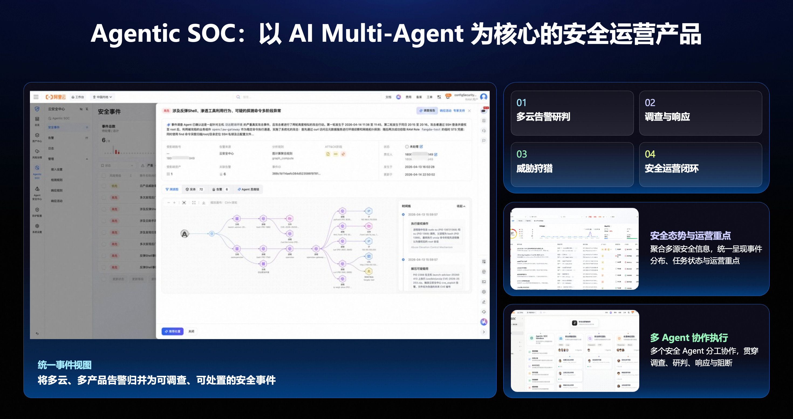
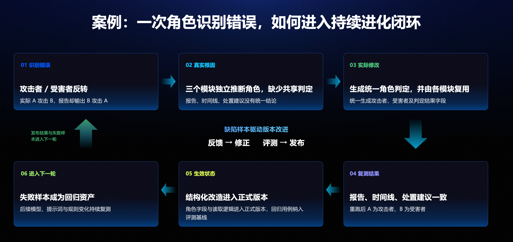
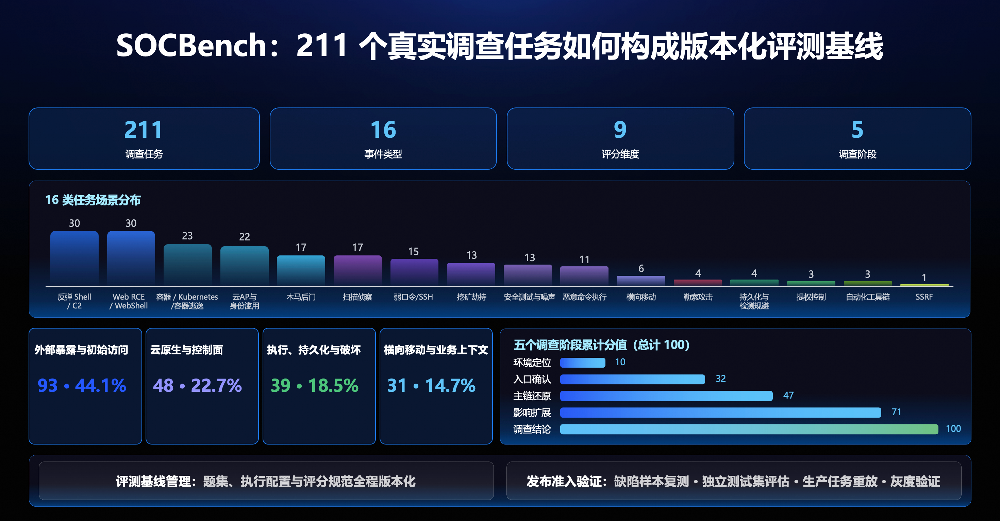
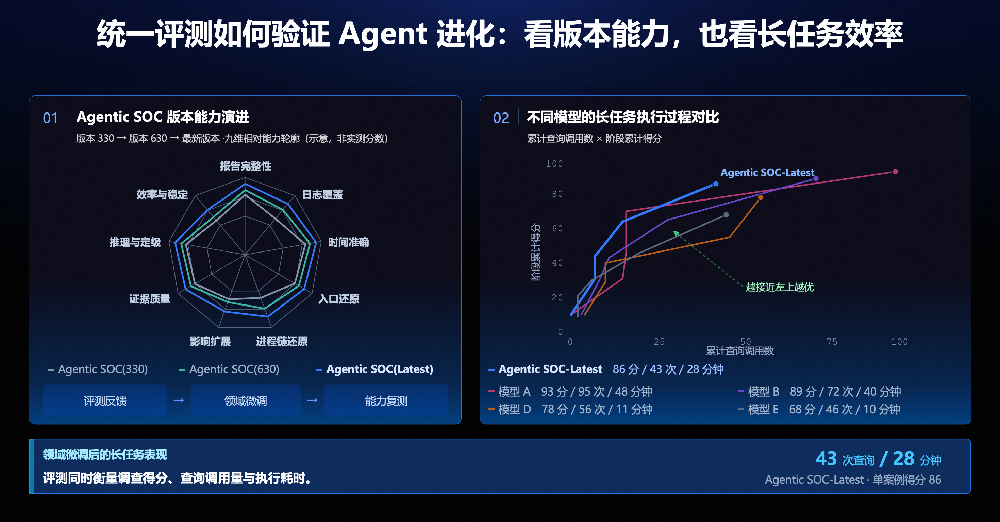
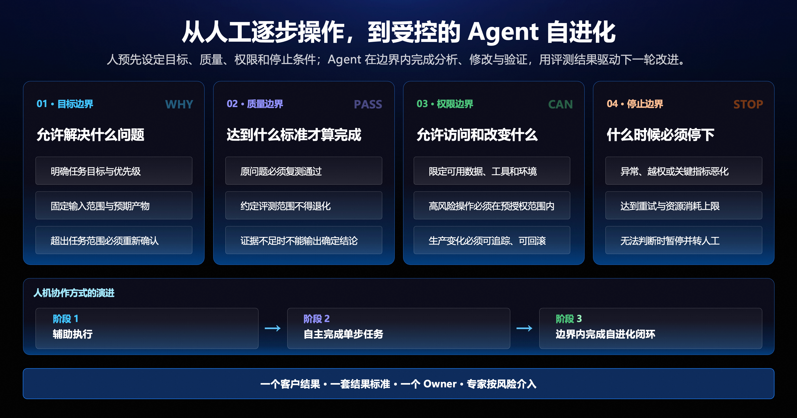
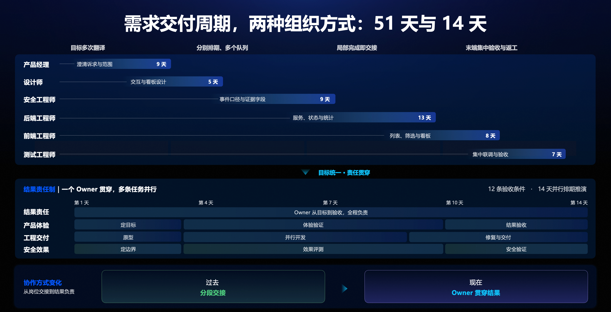
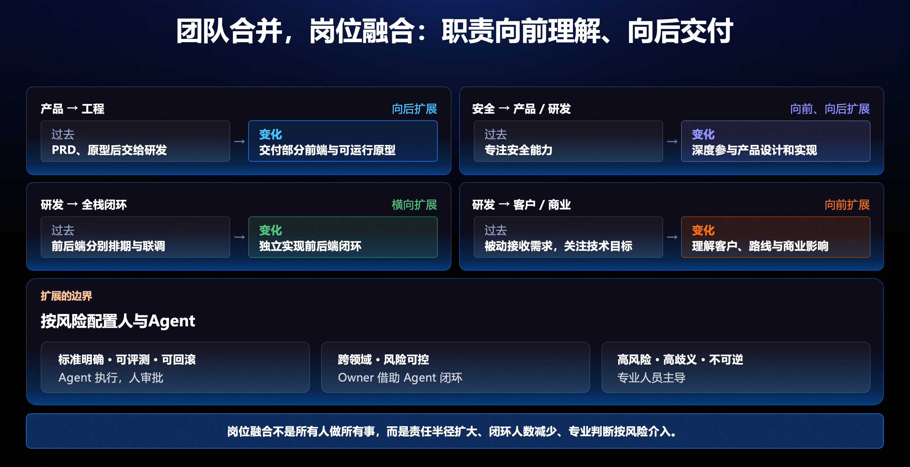
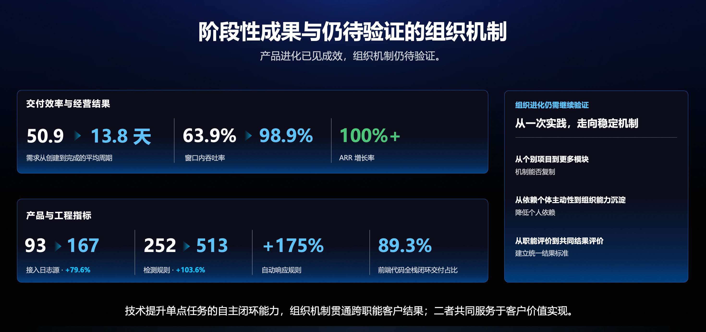

# Agentic SOC 安全产品⾃进化背后的组织重构

在 Agentic SOC 的建设过程中，我们逐步形成了由真实问题、统一评测、修改验证和生产反馈组成的产品改进闭环。随着 Agent 承担更多工作，团队也开始调整协作方式，让产品、安全、研发和测试围绕同一个客户结果共同推进。

本文结合这段实践，介绍评测如何驱动产品持续进化、人机协作的边界如何设定，以及团队如何通过统一目标、结果标准和责任分工，减少跨岗位交接，降低沟通损耗，把技术能力转化为实际交付效果。

## 一、从安全运营任务出发

Agentic SOC 是一个以多 Agent 协作为核心的安全运营产品。面对分散在多云、多产品中的告警，它首先需要把信息归并成可以调查、可以处置的安全事件，再由不同 Agent 分工完成调查、研判、响应与阻断，并支撑威胁狩猎和日常安全运营。

对用户来说，看到一份分析报告只是过程。更重要的是：发生了什么，证据在哪里，影响了哪些对象，接下来应该采取什么行动。报告、时间线和处置建议，需要共同回答这些问题。

图 1：Agentic SOC 将多源告警归并为安全事件，由多个 Agent 协作完成调查与响应。

因此，产品的改进也必须回到真实任务。线上暴露了什么问题，哪一种能力没有达到要求，修改后是否解决了问题，有没有影响原本正确的场景，都需要有可检查的依据。

我们逐渐形成了一条持续迭代的链路：生产问题形成失败样本，评测帮助定位能力差距，Agent 提交候选修改，验证与审批决定变更是否生效。新的生产结果，再进入下一轮改进。

这条链路能否成立，取决于两个基础：有一套稳定的标准判断产品是否变好，也有人持续对最终结果负责。

## 二、一次角色识别错误，如何变成回归资产

在一次调查中，实际发生的是 A 攻击 B，报告却把两者的角色写反了。攻击者和受害者反转，会影响读者对整个事件的理解。更麻烦的是，如果几个模块各自做判断，即使报告中的角色被修正，时间线或处置建议仍可能沿用另一套结论。

排查发现，问题出在三个模块缺少共享判定。沿着这个原因，修复方案从“改正一段报告”扩展为一次结构化改造：统一生成攻击者、受害者及判定结果字段，再让报告、时间线和处置建议复用这些字段。

图 2：从错误识别、根因定位、实际修改，到复测、生效与持续回归，一次缺陷成为后续版本的验证依据。

复测时，我们重新运行原来的场景，检查 A 是否被识别为攻击者、B 是否被识别为受害者，同时核对三个模块的输出是否一致。这样才能确认，修改解决了造成错误的机制，而不只是修好了某一处表述。

角色字段与读取逻辑随后进入正式版本，对应回归用例也纳入评测基线。以后无论改模型、提示词还是规则，都需要继续用这个样本检查角色判定及其在各模块中的一致性。

**一次修复留下两份结果：生效的产品能力，以及可以反复运行的验证样本。**后者使团队不必每次都依赖某个人记得这个问题，也让后续改进有了可以比较的起点。

这就是我们所说的产品自进化：真实问题持续进入改进流程，修改通过评测和风险判断后生效，失败经验成为下一轮的约束。它需要可追踪的修改、可靠的验证和清晰的发布边界。

## 三、用统一评测判断每次修改是否有效

修好一个案例，还不足以说明版本整体变好了。一次修改可能解决角色识别问题，却让其他场景的能力退化。因此，候选变更需要放到同一套基线中比较。

围绕安全调查任务，我们建设了 SOCBench。在这次分享所记录的阶段，它包含 211 **个真实调查任务，覆盖** 16 **类事件，从** 9 **个维度评估** 5 **个调查阶段**。题集、执行配置和评分规范都纳入版本管理，便于复现结果、比较版本。

图 3：评测覆盖不同事件类型和调查阶段，题集、配置与评分规范统一进行版本管理。

安全调查是一个长程任务，只检查最后的结论，会遗漏很多问题。我们还需要看环境定位是否准确、入口是否确认、攻击主链是否还原、影响范围是否得到检查，以及最终结论是否有证据支撑。

对应到能力评估，除了报告完整性，也要检查日志覆盖、时间准确、入口还原、进程链还原、影响扩展、证据质量、推理与定级，以及效率与稳定性。这样，评测才能说明“哪个环节需要改”，而不只是给出一个总分。

### 同时看调查质量和执行成本

长任务的效果还需要结合查询量与执行耗时来理解。查询更多，并不必然意味着调查更充分；耗时更短，也不代表任务已经完成。

图 4：左侧比较版本能力轮廓，右侧观察长任务中的查询调用与阶段得分。

分享中的一个长任务案例里，Agentic SOC-Latest 得到 86 分，进行了 43 次查询，耗时 28 分钟。对比项中，也有 93 分、95 次查询、48 分钟的结果。这个案例帮助我们观察质量、查询开销和时间之间的关系；它是单案例表现，不能直接作为全量任务的平均效果。

从候选修改到发布，我们关注的是：原问题是否复测通过，约定评测范围内是否出现退化，风险是否可接受。缺陷样本复测之外，还需要结合独立测试集评估、生产任务重放和灰度验证。未通过的修改退回调整，暴露出的失败样本继续沉淀到回归集中。

统一评测由此承担三项工作：定位弱项、验证改进、持续回归。每一次变化都应当留下能够解释、复查和复用的结果。

## 四、让 Agent 在明确边界内自主工作

随着 Agent 能承担的步骤增加，人的参与方式也要变化。逐步指导每一次操作，容易让人变成任务分发和结果搬运的中间环节；完全放开，又无法满足安全产品对生产变更的要求。

我们的做法，是在任务开始前明确四类边界，让 Agent 在这些边界内完成分析、修改与验证。

图 5：人预先定义目标、质量、权限和停止条件，Agent 在约定范围内推进任务。

+ **目标边界**回答允许解决什么问题。任务目标、优先级、输入范围和预期产物需要明确，超出范围的工作需要重新确认。
+ **质量边界**回答什么状态才算完成。原问题必须复测通过，约定评测范围不得退化，证据不足时不能输出确定结论。
+ **权限边界**回答允许访问和改变什么。可用数据、工具和环境需要限定，高风险操作必须在预授权范围内，生产变化必须可追踪、可回滚。
+ **停止边界**回答什么时候必须转交人工。出现异常、越权、关键指标恶化，达到重试或资源消耗上限，或者无法继续作出可靠判断，都应触发暂停。

这些约束越清楚，Agent 可以自主推进的空间也越清楚。人的精力则集中在目标设定、关键判断和风险处置上。我们期待的演进路径，是从辅助执行到自主完成单步任务，再到边界内完成自进化闭环。

## 五、把跨岗位交接改成共同结果负责

产品内部开始围绕任务结果持续迭代后，组织中的另一种工作方式显得更加突出：产品完成需求，安全完成规则，研发完成实现，测试完成验收。每一段都有交付物，但客户的问题要等整条链路走完才算解决。

这时，仅仅提高某一岗位的执行速度，能压缩的总时间是有限的。目标在交接中被多次解释，不同岗位分别排队，验收集中在末端，问题又可能沿原路返回。

用一个需求的排期对比说明了这种差异。分段交接方式中，诉求澄清、设计、安全口径、后端、前端和集中验收依次展开，合计51 天。另一种方式先确定 12 条验收条件，由一个结果负责人贯穿全过程，把产品体验、工程交付和安全效果组织为并行任务，形成了 14 天的周期提升。

图 6：51 天的分段排期与 14 天的并行周期。

这个对比中，值得关注的是验收与责任的位置。原来要等到末端才集中判断的标准，被放到了任务开始时；原来随交付物逐段转移的责任，由一个 Owner，也就是结果负责人，从目标确认一直跟到结果验证。

围绕这种工作方式，可以把组织协作归纳为四个要求。

首先，**统一客户结果**。产品、安全和研发需要共同理解这次工作要改善什么，最终用什么真实使用效果判断完成。

其次，**统一结果标准**。指标和证据口径提前确定，避免各岗位分别完成自己的清单，却在最后才发现目标不一致。

第三，**贯穿结果责任**。负责人持续跟进问题、依赖和验证结果，推动任务收敛。并行工作可以由多个人和多个 Agent 承担，结果仍然需要有人负责。

最后，**按风险安排专家介入**。高风险和不可逆变更必须由专业人员把关，其他环节根据任务需要参与，减少无必要的等待。

这些要求也解释了为什么团队合并和岗位融合会成为重要一步。共享一个目标和完成标准，需要落实到日常分工中。

## 六、岗位融合以后，专业能力怎样发挥作用

在这次实践中，岗位变化主要表现为责任范围扩大：向前理解问题，向后跟进交付，同时借助 Agent 完成更多执行工作。

产品经理从 PRD 和原型继续向实现延伸，能够交付部分前端与可运行原型，用运行结果验证产品判断。安全工程师从专注安全能力，扩展到产品设计和实现，把专业经验转化为场景、判定标准与效果验证。

研发工程师一方面向全栈闭环扩展，减少前后端分别排期和联调带来的等待；另一方面向客户与业务理解延伸，理解需求背后的路线、价值和商业影响。

图 7：产品、安全与研发扩大责任范围，具体由人还是 Agent 执行，取决于标准清晰度与风险。

这里需要把“能够多做一些工作”和“所有人都承担所有工作”区分开。对于标准明确、可以评测、可以回滚的任务，可以由 Agent 执行、人审批；对于跨领域但风险可控的工作，由结果负责人借助 Agent 完成闭环；高风险、高歧义或不可逆的工作，仍需要专业人员主导。

因此，专业能力仍然重要，只是越来越多地体现在定义问题、判断方案、验证效果和承担责任上。安全工程师需要把经验表达成系统可执行、可检查的规则和代码；产品经理需要判断可运行结果是否解决真实问题；研发需要兼顾实现质量与生产可靠性。

三类角色也有共同需要增强的能力：理解业务和价值，以及调度 AI 完成复杂工作。任务如何拆分、哪些可以并行、需要提供什么信息、哪些结果必须复核，都会影响最终交付质量。

## 七、阶段性成果，以及仍要验证的事情

分享材料中的阶段统计显示，需求从创建到完成的平均周期由 50.9 **天降至** 13.8 **天**，按这两个数值计算，缩短约 72.9%；窗口内吞吐率由 63.9% **提升至** 98.9%。

图 8：阶段性结果与后续验证方向。

接下来需要验证的事情也很明确：同样的机制能否从个别项目复制到更多模块；能否把依赖个人主动性的做法沉淀为团队的稳定能力；能否让共同结果标准进入日常评价，而不只在某一次项目推进时有效。

对于希望尝试类似实践的团队，可以先从一个真实问题开始：明确要交付的客户结果和验收证据，指定一个持续负责的人，运行完整个过程，再检查时间花在了哪里，哪些交接可以减少，哪些风险仍需要专业判断。

Agent **围绕任务结果持续进化，团队也需要围绕同一个客户结果共同工作。**这是我们在 Agentic SOC 实践中正在推进、也仍需继续验证的方向。
