# 完整还原 AIOps Agent 的评测和调优实践

阿里云 STAROps 是基于大模型和智能体技术打造的 Agentic Ops 平台，通过连接多域数据、运维工具与专家经验，从被动响应走向智能自治，7×24 保障业务连续、稳定运行。目前已服务xx等客户。本文将分享 STAROps 的评测和调优实践。

## 一、背景与评测对象
### 运维评测集的快速发展
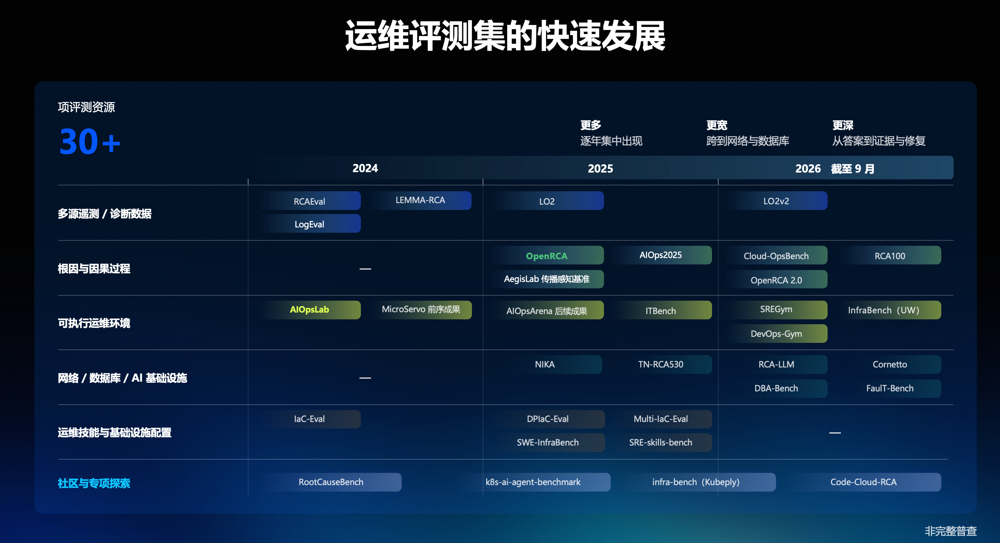

新的大模型或 Agent 发布时，外界判断它的能力上限，主要依据的是一份份评测报告，背后是公开或私有的评测集。评测集覆盖哪些任务、标准答案是否可靠，直接决定**评估结论能不能信**，这一点对大模型和 Agent 都成立。公开评测集便于横向比较，企业要评估自己的 Agent，还需要一套**贴合自身业务和场景的评测集**。

以运维评测集为例，图里整理了 30 多项运维相关的评测资源，横轴是年份，纵轴是任务领域。**数量上**，新的评测集逐年集中出现，大部分是近两年的成果。**覆盖面上**，早期集中在遥测诊断数据和少数可执行环境，之后出现了专门考核根因与因果过程的评测，并扩展到网络、数据库和 AI 基础设施。变化最大的是**评估方式**：早期多基于日志、指标等离线数据，只看 Agent 给出的最终答案，像是在考场上拿着试卷答题；现在越来越多的评测把 Agent 放进可执行的运维环境里完成任务，更像是放进真实的猎场里看它的本事，考核也从答案延伸到它找到的证据，以及能不能把问题修好。

考核延伸到执行过程之后，一条数据要回答的问题也变了：以前只问 Agent 最后给的根因对不对，现在还要问它查了哪些数据、为什么排除了某个假设、有没有用错时间窗、能不能把问题修好。这些问题都要靠数据里保存的**过程信息和证据**来回答，后面各节的做法都从这里出发。

### 一次根因分析过程
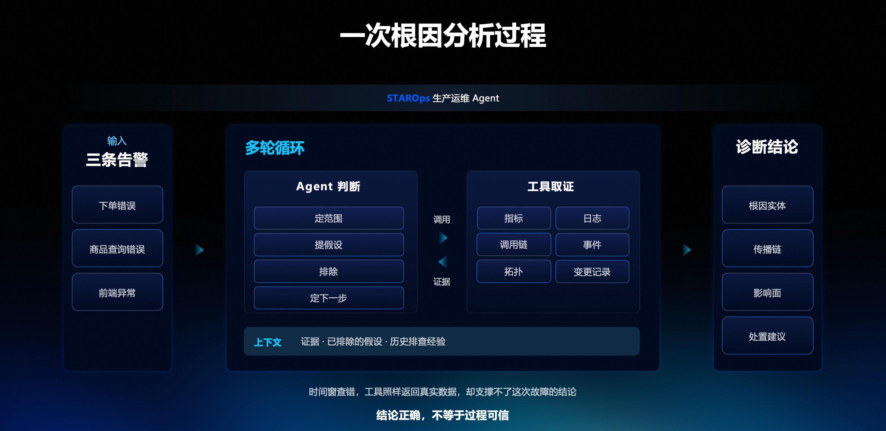

这种变化，从一次具体的根因分析过程里能看出来。STAROps 是一个生产运维 Agent，根因分析是它的主要能力之一。一次根因分析可以抽象成三部分：输入，多轮「Agent 判断、工具取证」的循环，以及最后的诊断结论。

图左边是输入，这次是三条告警：下单错误、商品查询错误、前端异常。右边是诊断结论，包括根因实体、传播链、影响面和处置建议。中间的**多轮循环**是重点。每一轮里，Agent 先定范围，从告警出发判断问题大概落在哪些服务、哪段时间；再提假设，列出可能的根因；然后排除，用取到的证据否定不成立的假设；最后定下一步，决定接下来查什么。判断需要证据时，Agent 调用工具去查指标、日志、调用链、事件、拓扑和变更记录。各轮之间靠**上下文**衔接：已经取得的证据和已经排除的假设，决定下一轮往哪里查；历史排查经验，影响先查什么、后查什么。

评一次根因分析，要看每一轮的判断和取证站不站得住，因为**结论正确不等于过程可信**。具体有三件事要评，每一件都对评测集提出了要求。第一是**这套分析思路能不能通用**：同一个 Agent 在一类故障上表现很好，换一个故障场景、换一类异常可能就不行，评测集要覆盖足够多的场景，才看得出这种差异。第二是**结果错在哪一步**：结果不对时，要分清是工具没查到，还是查到了没用对，为此数据里要能对照每一步：Agent 调了什么工具、工具返回了什么、它据此做了什么判断。第三是**执行效率**：结果对了，也要看有没有无效的工具调用、上下文有没有越堆越乱，这需要保留完整的调用过程。

还有一类错误更难发现，就是图下方标的**时间窗查错**。这时工具调用成功，返回的也是真实数据，Agent 据此做的推理可能前后自洽，结论甚至可能碰巧是对的，但这些数据对应的不是这次故障发生的时间段，支撑不了结论。从外面看一切正常，所以这类错不容易发现。要发现它，评测数据里必须记下这次故障真实的时间窗，拿 Agent 实际用的时间窗去对照。这也是后面「时间绑定」和标准答案里「告警锚点」这两项要求的由来。

---

## 二、评测数据的要求
### 对评测集的一些需求
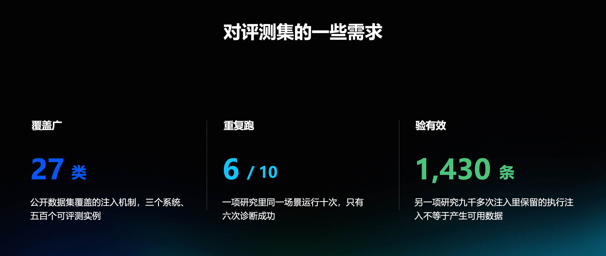

一次任务要看完整过程，整体能力还要看覆盖和稳定性。所以评测数据有三条基本要求：**覆盖要足够广**，**能重复执行**，每一条还要**证明自己有效**。图上三栏的数字都来自外部的公开研究，不是本评测集自己的统计。

先看覆盖。一版公开的运维根因数据集，在三个系统上覆盖了 27 类注入机制、500 个可评测实例，这个覆盖面还不能代表真实环境，真实环境里的故障类型更多。再看重复执行。同一套题在相同或者不同的环境下，执行结果也会有差异：一项研究里，同一个 Agent 对同一个场景跑 10 次，只有 6 次诊断成功。原因包括大模型本身的不确定性和环境的变化，所以一个场景只跑一次、只留成功的那一次，是不够的。

最后是有效性。有些数据集虽然有故障的输入和输出，却缺乏清晰的因果关系，要考核的那层推理其实并不存在。比如某个服务出现异常，因为这次注入的是 CPU 故障，就直接把 CPU 当成标准答案；但真实运行时，同样的异常完全可能由其他原因导致。另一项研究从九千多次初始注入里，最后只保留了 1,430 条，其余的按它的标准没有造成可感知的异常。可见**执行了注入不等于产生了可用数据**。

所以公开数据集不能直接替代面向自身系统构建的评测集，这三条要求落到自己的构建上，各有对应的做法。覆盖广，要求题目按自己系统的**能力域和难度**去铺，不能拿一份公开集合当全部，后面能力地图那一节讲的就是这件事。重复跑，要求能区分大模型本身的不确定性和环境变化带来的差异，环境本身也要足够稳定、数据能原样重跑，后面环境和质量检查两节会分别讲。验有效，要求注入之后先证明故障真的发生了、因果链确实存在，再去写标准答案，这是构建循环里**信号捕获和证据提取**两步要做的事。

### 一条运维评测数据的构成
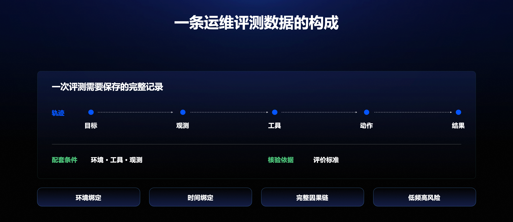

一条评测数据要保存的，是一次评测的完整记录，核心要求是**能还原一次完整的分析轨迹**。图上第一行是轨迹，分五步，拿前面那次根因分析对照来看。**目标**是要考核的东西，那次是从下单错误、商品查询错误、前端异常三条告警出发定位根因。**观测**是这次任务里 Agent 要看的数据，来自指标、日志、调用链、事件、拓扑和变更记录。**工具**是查这些数据用到的工具。**动作**是排查路径上的每一次工具调用或推理，包括定范围、提假设、排除、定下一步这几轮判断，以及每一次取证调用。**结果**是最后的结论，也就是根因实体、传播链、影响面和处置建议。

轨迹和答案的区别也在这里。答案只是最后一步的结果，轨迹还包括前面的目标、观测、工具和动作。只保存答案，评测时只能比结论；保存了轨迹，才能看出 Agent 在哪一步查错了数据、在哪一步做错了判断。轨迹不要求 Agent 按固定路径执行，但关键判断、关键证据和关键动作必须明确，否则答案对了也可能是碰巧对的。

图上第二行是轨迹之外必须一起保存的两样东西：**配套条件**是环境、工具和观测手段，**核验依据**是评价标准。它们要和轨迹放在一起保存，是因为评测集要反复拿来评不同版本的 Agent。配套条件没有一起保存，下一个版本来跑同一道题时，可能已经换了环境、换了工具，跑出来的轨迹和上一次不可比；评价标准没有固定下来，同一条轨迹这次判对、下次判错，分数的变化就说不清是 Agent 变了还是判分的人变了。

最下面四个是运维场景特有的约束。一条数据保存下来的，是某个时间窗口、某套环境下的一次完整快照，脱离上下文的静态答案没有用处，这四个约束后面各有一项做法对应。**环境绑定**：故障离开真实环境就不存在，所以故障要在真实的服务、流量和观测里发生，数据和产生它的环境一起保存，对应按需扩展的评测环境。**时间绑定**：证据有保留期，调用链和日志过几天就会被清掉，要及时把时间窗和当时查出来的证据保存下来，否则过一段时间就无法回头核验，对应线上回流时的「先保全」和标准答案里的告警锚点。**完整因果链**：因果链上的每一步都要有证据，对应标准答案里的因果链字段，原因、传播和影响分开写。**低频高风险**：生产故障不能拿线上反复试，就用故障注入在评测环境里按同一机制造出来，可以反复执行。

---

## 三、根因分析数据的构建流程
### STAROps 评测集的构建流程
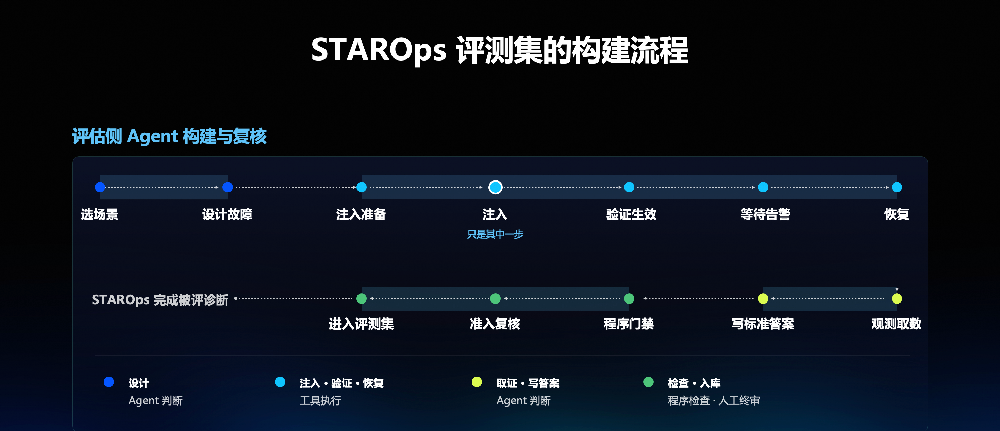

有了这些要求，再看一条根因分析评测数据是怎么构建出来的。图上这条线共十二步，分四个阶段，图下方标了每一段由谁来做。**注入只是其中一步**，注入前后的准备、取证和核验才是大头，构建一条数据的时间也主要花在这里：等告警、核信号、取证、写答案、过两道检查，任何一步不过还要退回重来。

第一段是**设计**，由 Agent 判断。先选场景，题目来自后面要讲的两个来源：能力地图上还空着的格子，以及线上回流的真实问题；再设计故障，定下注入什么、注入在哪，以及它应该沿哪条链传播、影响到哪里。这两步交给 Agent，是因为选哪个场景、故障设计成什么样，都要结合业务和架构去想。

第二段是**注入、验证与恢复**，由工具执行：这几步是确定的动作，每次执行都要一样，才能重复。注入准备要确认环境处在未注入时的干净基线上，流量在跑、观测可查，否则注入之后看到的异常，分不清是故障造成的还是原来就有的。验证生效和等待告警是两件事：注入动作执行成功，只说明命令跑完了，故障是否真的生效要看信号，后面构建循环里「信号捕获」的六项就是这一步要查的东西；告警是否触发，要等告警真的出现，告警是后面诊断的起点，也是标准答案里的锚点。最后把环境恢复回去，下一次注入要从干净的环境开始。

第三段是**取证与写答案**，又回到 Agent 判断。取证在故障期间和恢复之后两个阶段都要做。图上的观测取数排在恢复之后，但故障期间的现场同样要取：验证生效、等待告警时看到的信号、告警和调用链，反映的是故障正在发生时的状态，要当场保存下来。恢复之后再取一次，这时故障从发生、传播到恢复的整段数据都有了，收集和分析这段时间的指标、日志、调用链等数据，才能把注入点、根因、传播链、影响面完整还原出来。之后按后面会讲的七个字段写标准答案，把一段时间的数据组织成一份因果链完整的答案，需要读懂信号之间的关系。

第四段是**检查与入库**，由程序和人把关，两道检查查的东西不一样。**程序门禁**查能写成规则的事：字段是不是齐全，答案里的每个数字有没有附上可执行的查询、重跑出来是不是同一个值。**准入复核**查需要判断的事：因果链说不说得通，相似的候选有没有排除干净；这一步先由 Agent 审一遍，最后由人决定准不准进，人看到的已经是通过了程序门禁、又经 Agent 审过一遍的答案。通过之后，数据进入评测集。

这条线的终点是「STAROps 完成被评诊断」：数据进入评测集之后，被评的 Agent 拿着同样的输入去做一次诊断，它的输出再和标准答案逐个字段对照。所以前面每一步都会影响评分：故障没有真正发生，标准答案就是错的；证据没有取全，评分就缺依据；检查没有把住，错答案会把正确的诊断判成错。

---

## 四、持续构建的主要问题
### 构建评测集的四个核心问题
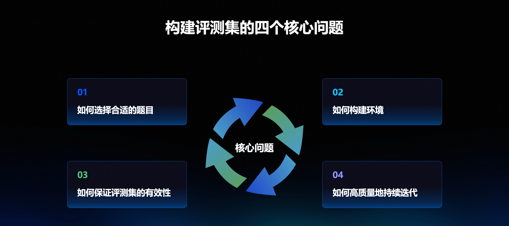

单条流程跑通只是起点。要持续构建、长期使用，实际还有四个问题要解决，后面逐个回答。第一是**如何选择合适的题目**，也就是题目从哪来、怎么设计，由「按能力域和难度规划场景」和「线上问题还原成评测集」两节回答。第二是**如何构建环境**：评测数据要从真实的环境里产生，Agent 是和环境交互的，脱离真实环境就没有可评的东西，由「按需扩展评测环境」一节回答。第三是**如何保证评测集的有效性**，由「基于故障注入的评测集构建循环」一节回答。第四是**如何高质量地持续迭代**，由「评测集的质量检查」一节回答。这四个问题互相依赖：环境不稳，有效性就无从验证；题目来源不受控，效率再高也只是在批量生产熟悉的那几类。所以要用一套方法同时回答它们，下面按题目、环境、构建、监督的顺序展开。

---

## 五、构建方法与核验
### 评测集构建中 Agent 分工
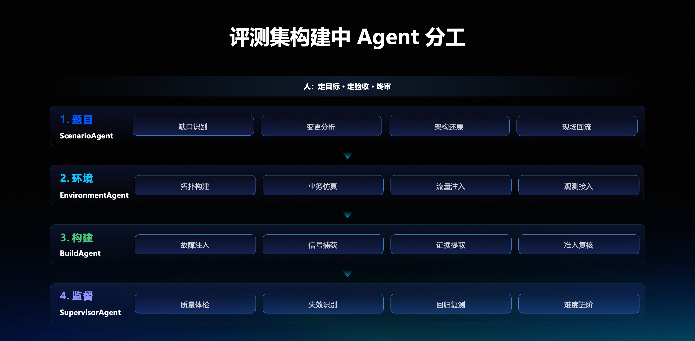

以往这些事情靠人逐条梳理，规模上不去；拆给 Agent 之后可以并行推进。构建拆成四段，每一段对应前面的一个问题，由一个 Agent 负责，各有四项具体工作。**题目**由 ScenarioAgent 负责，做缺口识别、变更分析、架构还原和现场回流：缺口识别是对照能力地图找还没覆盖的格子，变更分析和架构还原是从业务系统的变更和架构出发梳理要验证的分析能力，现场回流是把线上问题还原成评测数据。**环境**由 EnvironmentAgent 负责，做拓扑构建、业务仿真、流量注入和观测接入，也就是把服务按需要的依赖关系搭起来，让这些服务承载一条真实的业务链，让业务链上一直有请求在跑，再把指标、日志、调用链和告警接通，故障发生时看得到。

**构建**由 BuildAgent 负责，四项工作就是构建循环的四步：故障注入、信号捕获、证据提取、准入复核。**监督**由 SupervisorAgent 负责，做质量体检、失效识别、回归复测和难度进阶：质量体检是五项检查，失效识别是把跑不出来的数据下架，回归复测是被评 Agent 修复后在仍然有效的数据上复测，难度进阶是分数都接近满分时主动提高难度。准入复核也由 BuildAgent 来做，审核时不沿用构建时的上下文，重新取证据核对，否则复核会顺着已有的答案走。

图中最上面一条写的是人的位置：**定目标、定验收、终审**。定目标，是决定要构建什么数据：哪些能力域、哪些难度要优先补，地图上的空格先做哪一格。定验收，是决定什么样的数据算合格：标准答案要有哪些字段、证据要到什么程度。终审，是数据进入评测集之前的最后一道决定。这三件事都要结合业务和评测目的来判断，留给人；逐条构建、逐条核对这类重复的工作，交给 Agent。人不退出，但不再逐条去梳理。

评测集是用来评 STAROps 的，但构建评测集这件事本身，也是一项复杂的 Agent 任务。一条数据从场景理解、任务规划、环境构建、故障执行、工具调用、观测取证、因果还原，到标准答案构建、独立复核和质量准入，任何一环都不能孤立完成。所以能不能自动化地构建出一套可信的评测集，反过来也能看出一个组织的 Agent 工程能力：有没有能力让一组 Agent 在真实环境里持续完成复杂工作，而且最后交出来的东西是可信的。从这个角度看，它也是对 **Agent 能力和基础设施成熟度的一次压力测试**。

这场压力测试同时考验四个方面。一是 **Agent 自身的能力**：能不能理解业务和架构，能不能正确调用工具，能不能基于证据做推理，能不能发现自己的结果存在问题。二是 **Agent 之间的协同**：题目、环境、构建、监督这几个角色之间要有清晰的输入输出和状态传递，前一个角色的产出必须能成为后一个角色可靠的输入。三是**支撑它们的基础设施**，这一层往往最关键：工具是否标准化，环境是否可重建，上下文和状态怎么保存，长任务怎么恢复，失败怎么重试，不同角色之间怎么交接，证据怎么追踪。四是**治理和质量机制**：Agent 自己说完成了不算数，还要有程序检查、证据校验、独立复核和人工终审。至于用一个 Agent、多个 Agent，还是 Agent 加 Skill 来实现，都可以，关键在于组织有没有把这些能力、工具和环境建设到 Agent 能自主调用、相互协同的程度。

### 按能力域和难度规划场景
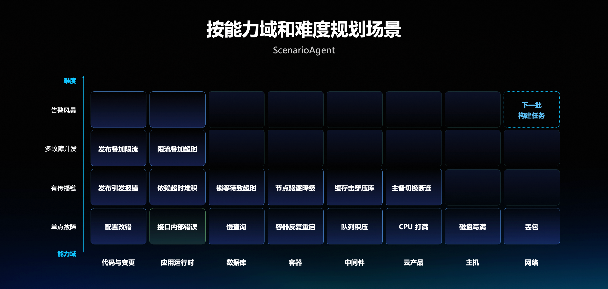

先看第一段：题目从哪来。出题有两个来源，第一个是**主动规划的能力覆盖**：基于自身的业务系统，梳理需要验证的分析能力，有点类似于混沌工程。这里尽量借用 Agent 本身的领域知识，以及它能掌握到的业务和架构来做分析。

具体做法是按能力域和难度把场景铺成一张**能力地图**。横轴是能力域：代码与变更、应用运行时、数据库、容器、中间件、云产品、主机、网络。纵轴是难度：单点故障、有传播链、多故障并发、告警风暴。纵轴不是互斥的分类，它表示**要排除多少干扰才能定位**：单点故障，一个异常一条线；到了告警风暴，同时有十几个信号在响，真正的根因藏在里面。

地图上每一格放的是具体场景。单点故障这一行，从代码与变更到网络依次是配置改错、接口内部错误、慢查询、容器反复重启、队列积压、CPU 打满、磁盘写满、丢包；有传播链这一行，有发布引发报错、依赖超时堆积、锁等待致超时、节点驱逐降级、缓存击穿压库、主备切换断连；多故障并发这一行，目前有发布叠加限流、限流叠加超时；告警风暴这一行还没有具体场景，图上右上角标的就是下一批构建任务。

拿几格对比就能看出难度差在哪。数据库这一列，单点的慢查询是一个异常一条线；往上一格的锁等待致超时，数据库里的锁等待传导成调用方的超时，要沿着链往回找。代码与变更这一列，单点的配置改错只有一个原因；多故障并发的发布叠加限流，同时有两个机制在起作用，要把它们分开。这样一格一格铺下来，**空着的地方就是还没覆盖的**，由人来确认优先级，再交给 Agent 构建。

### 线上问题还原成评测集
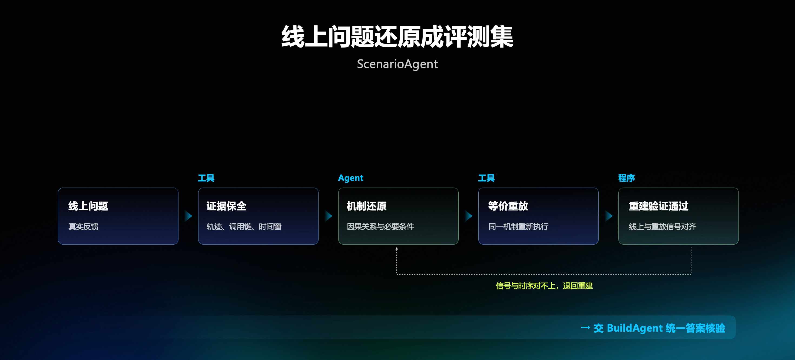

出题的第二个来源是**线上真实发生过的问题**。能力地图组织的是计划性的覆盖，地图上的格子是按已知的能力域和难度规划出来的；线上发生的问题不受这张地图限制，它可能落在某个已有的格子里，作为这一格的一条真实样本，也可能是地图里原来没有记录的机制，那就要在地图上补一格，再按这一格去规划后续的构建。

这条路的顺序很要紧：**先保全，再还原**。线上出问题的时候，先用工具把证据保全下来，包括轨迹、调用链和当时的时间窗，之后还原机制、比对重放、写标准答案都要用到。先保全，是因为调用链这类证据保留期短，处理晚了，这条数据就取不回来了。

保全之后分三步。**机制还原**由 Agent 做，弄清因果关系和必要条件，也就是这个故障在什么条件下才会发生，再把它重建成评测环境里的一个场景；同样的报错可能来自不同的原因，只看现象，重建出来的场景就不对。**等价重放**由工具做，用同一机制重新执行；只把报错复现出来不够，要让同一个原因在评测环境里再发生一次。**重建验证**由程序做，线上与重放的信号要对齐：信号出现的先后反映故障传播的顺序，信号和时序对不上，说明重建出来的传播路径和线上不一样，要退回重建。验证通过之后，交给 BuildAgent 统一做答案核验，让线上还原出来的数据和注入构建的数据用同一套标准：同样的七个字段、同样的证据要求、同样的检查，进入评测集之后才能放在一起比较。

### 按需扩展评测环境
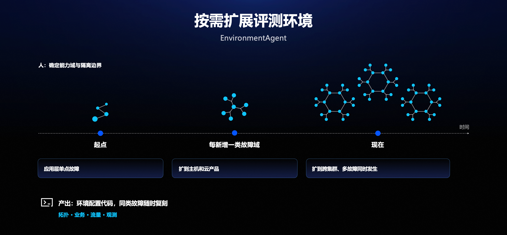

题目定下来，才知道要建什么环境。环境扩展由**覆盖需求触发**，单纯规模变大，不作为新建环境的理由：能力地图出现空白、线上出现新机制，或者故障需要隔离时，才扩展环境。图左上角写的是人在这一步的位置：先由人**确定能力域和隔离边界**。隔离是为了避免不同故障在同一个时间窗里互相干扰，这和构建循环里「噪音干扰」那一项是同一个问题。

图上是环境的演进。**起点**是一个开源微服务样板，用脚本驱动一条下单链路，只能做应用层单点故障。之后**每新增一类故障域**就扩一次，补什么由要覆盖的故障决定：增加主机故障域时，要有主机层的注入手段，还得能看到主机指标，否则注入了也看不出影响；增加云产品故障域时，要接入云产品自己的观测与告警，因为这类故障最先表现在云产品上。这两步对应能力地图上新增的主机、云产品两列。

做跨集群和多故障并发时，就得真的有两套集群和跨集群的调用，于是克隆了第二套集群，流量也从脚本扩成**常态加场景化两层**，这一步对应更高的难度档。常态流量让环境像真实系统一样一直有请求在跑，故障发生时才有业务被影响、才有信号；场景化流量按具体场景驱动特定的链路，让需要验证的那条传播路径真的有请求经过。告警阈值用历史数据回放校准，让告警在该触发时触发、不该触发时不乱报。**现在**已经有多套集群、多条业务链。

一次扩展分五步走。先由 Agent 读取依赖和已有环境，确定要补哪些服务、流量路径与观测，是否需要隔离；再由 Agent 编排任务，工具按模板生成并部署服务，或者克隆集群；然后接通观测与两层流量，建立告警、回放校准阈值，并固化可重复的注入和恢复配置；接着由程序检查未注入时的**基线**，常态流量必须干净，观测必须可查，检查不过就停止构建；通过后，产出可复刻的**环境配置代码**。

基线检查卡得严，是因为基线本身有异常时，注入产生的信号会和原有的异常混在一起，分不清哪些是故障造成的；观测查不到时，故障发生了也看不到。产出的环境配置代码覆盖拓扑、业务、流量、观测，加上固化好的注入和恢复配置，同类故障随时可以复刻，需要几套就复刻几套，不必重新摸索。这些环境长期要做到稳定承载故障、流量持续且接近真实业务、观测完整接入，三者里**优先保证观测**：缺少它，连数据中的故障是否真实都无法确认。

### 基于故障注入的评测集构建循环
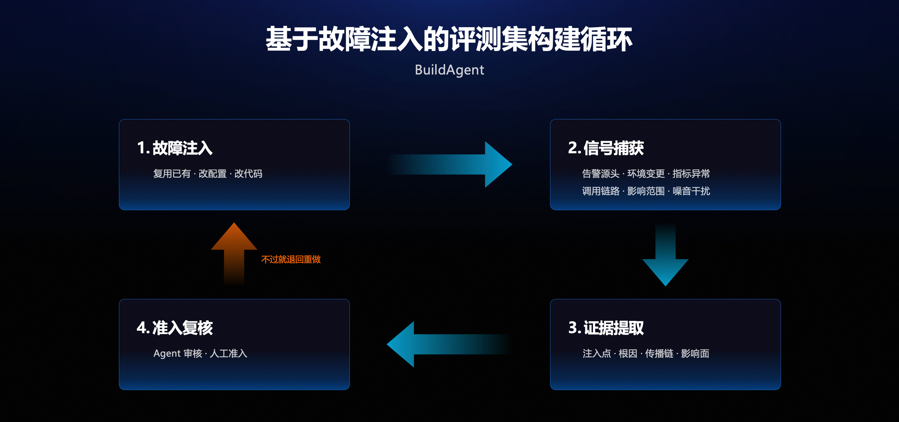

环境就位之后，才谈得上把一道题真正造出来。BuildAgent 的任务是让每条数据都有**可以逐项查证的标准答案**，它做的四件事是一个循环：故障注入、信号捕获、证据提取、准入复核。准入复核先由 Agent 审核，最后由人决定准不准进入评测集；四步里任何一步没过，就退回重做。

**故障注入**有三条路。复用已经做好的注入方式，适合已经造过、注入和恢复配置已经固化的故障，可以直接重复执行；改配置，适合由配置引起的故障，比如地图上「配置改错」这一类；改代码，适合需要让程序本身出错的故障，比如「接口内部错误」。不管走哪条路，注入完成后都要逐项证明故障真的发生，**不能因为注入命令执行成功就认为故障发生了**。

**信号捕获**有六项必查。告警源头，看告警是不是由这次注入的对象触发；环境变更，看同一时间有没有别的变更混进来；指标异常，看根因相关的指标有没有真的异常；调用链路，看异常有没有沿调用链传播出去；影响范围，看哪些上下游受到了影响。其中最需要留意的是**噪音干扰**：同一个时间窗里如果有别人的故障也在跑，这次注入产生的信号就说不清是谁的，这条数据直接作废。

**证据提取**要从现场把注入点、根因、传播链、影响面四个维度都取出来，再组织成标准答案。标准答案的格式决定评估能查到什么。有的标准答案只记录故障时间、根因组件和故障原因，这样的格式没有记录因果链：无法回查判断依据，也难以区分相似候选；数字没有固定时间窗可以重查，能比对的就只剩组件名。所以在这一步，标准答案由 Agent 组织成**七个字段**。

**根因实体**要写到具体的资源或服务，评分时才能判断 Agent 定位得准不准。**故障类型**记录可以验证的机制，不是表面的现象。**因果链**把原因、传播和影响分开，Agent 把传播路径上的某个服务当成根因时，评分能看出它错在哪里。**鉴别点**写为什么排除了相似的候选，让答案除了结论，还说明了为什么不是别的。**告警锚点**保存实际触发的事件和时间窗，前面讲的时间窗查错，就靠它来对照。**关键数字**附上原查询，谁都可以重新查一遍。最后一个字段是**评分**规则：按字段独立打分，一个答案可以根因对、传播链错，分数能如实反映出来。

证据提取的四个维度和这些字段是对应的：注入点和根因，落在根因实体和故障类型上；传播链，落在因果链里原因到传播的那一段；影响面，落在因果链里影响的那一段。四个维度取全了，答案的骨架就有了；再加上鉴别点、告警锚点和关键数字，才是一份可以逐项核验的答案。

其中**数字必须单独核验**。有一条答案曾写着错误率约 25%，人工阅读没有发现异常；工具重新查询连续五个时间窗后，错误数均为零。还有两类数单看都像是对的：查询接口有返回上限时，返回条数不能直接当作总数；基线窗和故障窗长度不同时，比值也不能直接用。所以数字要连同查询和时间窗一起写，能重新执行，读的人才能判断这个数是怎么来的。**写不出查询的数字，不能进入标准答案**。这样写出来的标准答案，是一组可以重新验证的事实：每一步都附证据，谁都可以重新查一遍。

---

## 六、质量检查、规模与下一步
### 评测集的质量检查
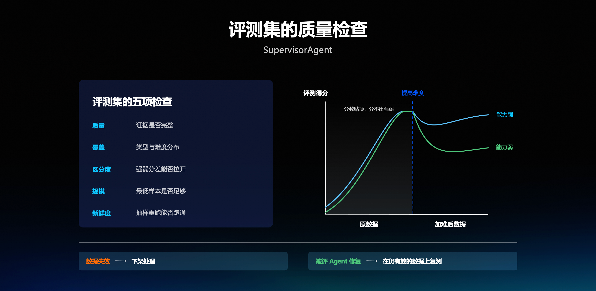

入库前核验通过，不代表以后一直有效。环境和观测配置会变化，所以评测集本身还要持续检查。图左边是**五项检查**：质量，看证据是否完整，七个字段齐不齐、每个数字有没有可执行的查询；覆盖，看类型与难度分布，对照能力地图哪些格子还空着；区分度，看强弱分差能否拉开；规模，看最低样本是否足够，整体样本量够不够下结论；新鲜度，看抽样重跑能否跑通。五项**按短板检查**，不能用平均分抵消局部问题。

新鲜度不能只看数据建成多久。决定一条数据能不能用的，是当初的信号今天还能不能复现：基础镜像、告警规则或观测配置一变，昨天刚建好的数据也可能跑不出来。所以新鲜度主要看**抽样原样重跑**能不能跑通，数据的年龄只作辅助参考。

图下方是两种情况的处理办法。**数据失效的，下架处理**：当初的信号已经无法复现，评估却还在照常出分，被评 Agent 在这些题上答不对，会被记成能力问题，研发可能去修一个并不存在的缺陷。**被评 Agent 修复之后，在仍有效的数据上复测**，确认改进是否保持；复测用的数据里如果混着失效的题，分数的变化就说不清是修复带来的，还是数据带来的。所以先判断是数据的问题还是 Agent 的问题，再决定是下架还是复测。

前面那个错误率约 25% 的例子，后来变成了一条规则：写进标准答案的每个数字都要附上可执行的查询、时间窗和实体，由程序把查询重跑一遍，重跑值和答案不一致就退回；给不出查询的数字直接删掉。检查只认重跑出来的结果，不认数字写得像不像。

五项检查里最不直观的是**区分度**，图右边的曲线讲的就是它。左半段是原数据，能力强和能力弱的两条曲线一起往上爬，最后几乎重合在顶部，**分数都接近满分，分不出强弱**；中间的竖虚线是「提高难度」；右半段是加难后的数据，能力强的曲线略有回落后又往上走，能力弱的明显落下去，两条线重新分开。

评测集用久了，强弱模型都能拿高分，分数已经不能说明谁更强。分数接近上限时，Agent 能力提升和数据难度不足会呈现相同的结果，单看分数无法决定该发版还是补数据。做法是**主动提高难度**再比较：把简单的换成有传播链的、多故障并发的，告警风暴场景建好后也可以叠加上去，让曲线重新分开；如果分差重新出现，就说明原有数据已经难以区分能力。加难之后分数下降，是题目变难了，不能直接读成能力退步。如果现有数据的分差仍能拉开、数据也能复现，就可以降低新增投入；五项里哪一项下降，就针对那一项再补一批。

近来也有几项研究专门检查评测集本身，正好对应五项检查里的不同项。2026 年 8 月，PAIChecker 复查 SWE-bench Verified 的 500 条数据，发现其中一成多的任务描述与参考修复不对齐，属于质量；2026 年 6 月，CORE-Bench 在几十条修订任务上，表现最好的几种配置已接近满分，说的是区分度；2026 年 7 月的一项研究按置信区间决定需要评多少数据，是规模；ICML 2026 的 MMBench-Live 在关键词检索中只取一年内上传的图像，再生成评测数据，是新鲜度。STAROps 评测集本身也在持续接受这五项检查。

### STAROps 评测集规模
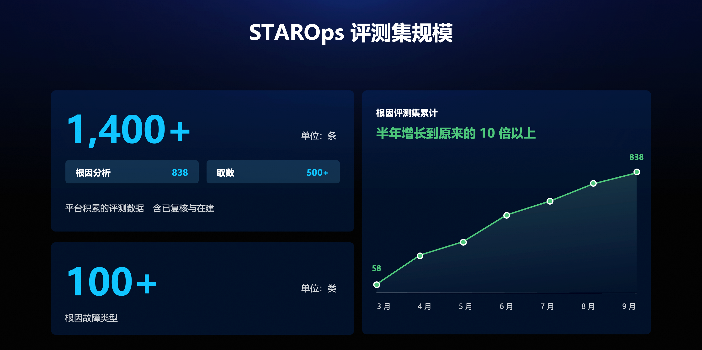

截至 9 月，积累的评测数据有 **1,400 多条**，含已复核与在建的条目。其中**根因分析 838 条**，已复核有效，不含在建和已淘汰，覆盖 100 多类故障类型；根因评测集 3 月还只有 58 条，**半年增长到原来的 10 倍以上**。另有**取数 500 多条**：除了造故障，Agent 取数取得对不对，同样要有数据来评。

公开数据集已经不少，仍然要自己建评测集，原因有三个，前面各节都有对应的做法。一是**服务拓扑和告警规则是自己的**，公开集合里的服务拓扑跟自己的系统对不上，所以题目要按自己系统的能力域和难度去铺。二是**线上新出现的机制**公开集合里没有，而它们恰恰是最该评的，要靠线上问题回流补进来。三是**环境一变，已有的数据要能立刻重跑**，这一点自己维护评测集才容易做到，靠的是环境配置代码和定期的抽样重跑。

### 构建评测集的成本投入
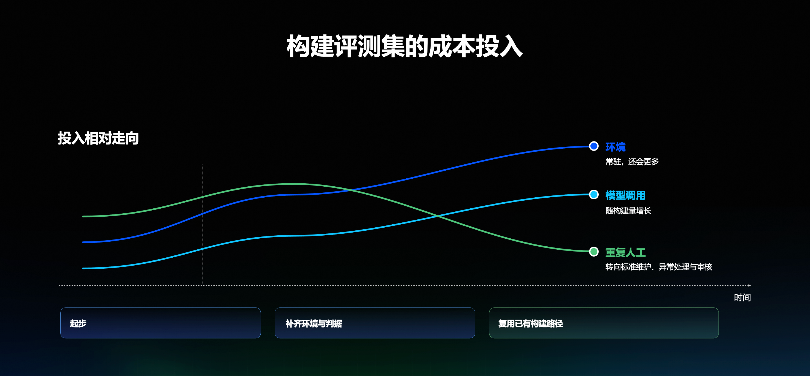

这些积累背后需要持续投入。图是**投入结构的示意**，不是实测的成本曲线，画的是人工、环境、模型调用三项投入的相对走向，时间分成三段。**起步**阶段以人工为主，先把少量场景的构建和验证流程跑通，环境刚建起一套，模型调用还很少。**补齐环境与判据**阶段，环境、流量、观测和告警要逐项补齐，环境投入快速追上人工；判据靠试跑和返工逐条明确，人工投入也在这一段见顶。**复用已有构建路径**阶段，环境能够重建、构建步骤和校验规则可以复用，同类场景不必每次从头手工处理，人从逐条构建转向标准维护、异常处理和质量审核，重复的人工投入回落；构建侧的模型调用随构建量上升，在这一段超过人工。

到最后，**环境**成为三项里最高的一块：集群、流量和观测常年在跑，覆盖越广这部分越大，还会更多。所以用了 Agent，**总成本不一定下降**：环境运行、模型调用和质量审核都在持续花钱，真正减少的是重复的人工操作。

公开研究里也有类似的做法。2026 年 6 月的一项研究用自动化流水线构建评测任务，构建、验证和评估自动完成，人工负责质量审核，报告构建一条被接受的任务约 40 美元、1 到 2 小时。2026 年 8 月的另一项研究同样用 Agent 流水线筛选材料、组装任务，专家还参与判据和评分规则的校准。这两项都说明构建可以自动化并保留人工把关；成本结构本身要各自实测，不能照搬。

### 开源开放共建
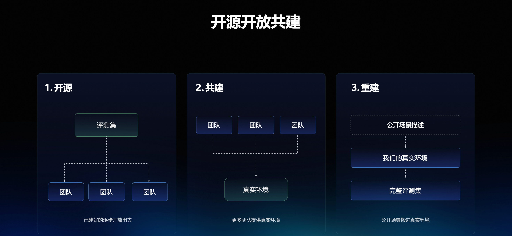

图上是开放共建的三个方向。**开源**，是把已建好的评测集逐步开放出去：RCA100、RCA200 已开放，后续逐步开放更多数据和评测方式。**共建**，是更多团队提供真实环境，接入真实场景和领域经验，为后续构建提供来源。**重建**，是把公开场景描述搬进真实环境，重建成完整评测集。其中共建和重建目前还是方向，没有对外承诺时间。

开放之外，构建本身也在往更自动的方向走。重复执行中的很多工作已经交给 Agent，但下一批何时发起，目前仍由人决定：由人发起，评估侧 Agent 执行构建与核验，人工准入。**下一步**是让评估侧 Agent 根据地图空白、某类分数长期接近上限，以及线上出现的新问题主动发现缺口，这部分已经在建：任一信号触发后，由它发起下一批构建，能力更新后自动复测，稳定后再提高难度。后续重点是把缺口识别接到构建任务，再用复测结果确认新数据是否仍有区分度。

---

## 小结
回头看，这套方法改变了四件事。**数据可以原样重跑**：环境、机制、证据、答案和评价标准一起保存。**答案有证据支撑**：每一步都附证据，都能重新查询核对。**分工更明确**：人定目标与终审，Agent 负责构建和审核，审核时重新取证据核对。**评测集按能力缺口持续演进**：根据地图空格、评测结果和线上新机制，决定下一批构建什么。

支撑这些变化的是**三条原则**：标准答案只能来自证据；复核的独立性来自证据的独立；评测集本身也要被持续评估、持续演进。所以除了入库前的复核，还要持续跟踪三个指标：已放行的数据中，事后发现错误的有多少；强弱能力的分差能否保持；数据从建成到失效能维持多久。

构建评测集这件事本身也很考验一个组织的 **AI Native 程度**。如果评测数据从找问题、搭环境、查证据、整理标准答案到检查质量都靠人工拼，即使用了很多 Agent，也未必形成了 AI Native 的工作方式；比较接近的状态是：人定义目标和标准，Agent 自主拆解和协作，基础设施提供环境和工具，系统自动验证，人只处理异常和最终裁决。
