# 从单点探索到规模化运营：滔搏体育的企业级智能体实践

我想先请大家代入一位门店店长的角色。周末快到了，作为店长，要开始规划周末的经营计划。听起来是很小的一件事，但背后除了要看销售、查库存，还要找顾客等等。我们把这个事情交给 AI 的话，它又能给到我们什么呢？

## 一、滔搏为什么需要多个企业级 Agent？

在滔搏，这样的问题并不是一个店长的偶发需求。滔搏拥有 4360 家实体门店，有超过 3700 家小程序店铺，跟 20 多个领先的运动品牌长期合作，累计用户更是超过了 9000 万。对于单独一家门店来说，它的经营问题，我们可以找有经验的人一起来商量。但是面对几千家店，我们不能只靠找到那个最懂的人。因为最有经验的人不可能同时出现在我们的每一家店铺里，所以我们希望做的是，让经过验证的专业经验能够及时服务更多门店。

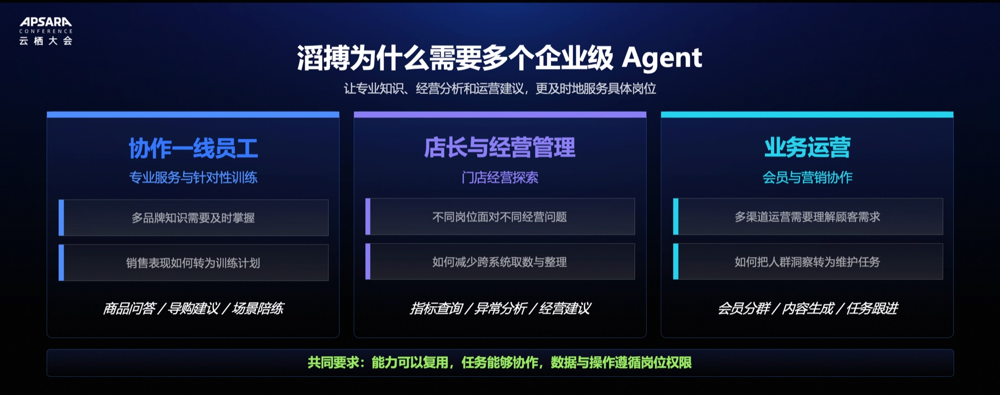

不过岗位不同，需要的帮助也不同。同样是要把经营做好：

+ 一线员工可能会问：这个商品怎么介绍？我还需要接受哪些培训？
+ 店长的问题是：问题出现在哪里？接下来我要怎么调整业务运营？他还会问：哪些顾客现在需要被维护？我怎么把分析落地成为具体动作？

在这里，大家的目标其实是相关的，然而需要的知识、数据、权限却又不一样。所以，我们需要不同能力的 Agent 来帮我们解决不同岗位的具体问题。

## 二、多个 Agent 协同使用的难点

听起来好像多做几个 Agent 就可以了，可是多做几个，这个问题就能做好吗？**单个 Agent 能工作，不代表多个 Agent 合在一起就能把事情做好。**

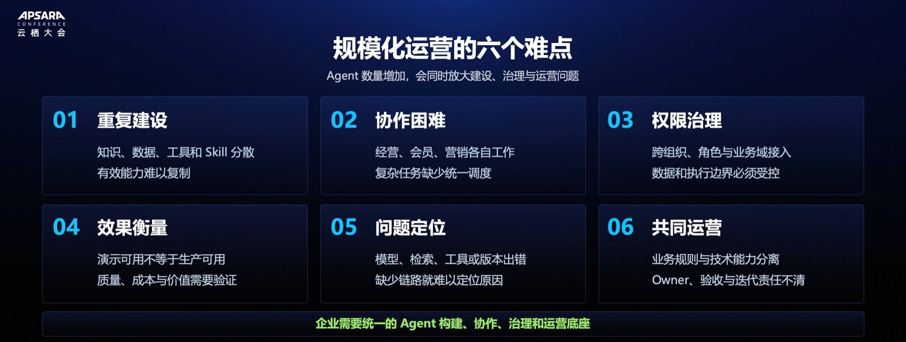

首先，我们会遇到重复建设的问题：同样的知识、数据、工具，每一个项目都得重新接一遍。接着是协作跟权限：经营 Agent 做完了之后，会员、营销怎么接下一步？不同岗位能看什么、能做什么，都需要有清晰的界定。

运行起来之后，我们还要回答三个问题：效果怎么衡量？出现错误怎么定位？上线之后谁持续负责？这些问题不可能再让每一个项目各自解决，我们需要一个统一的运营底座。

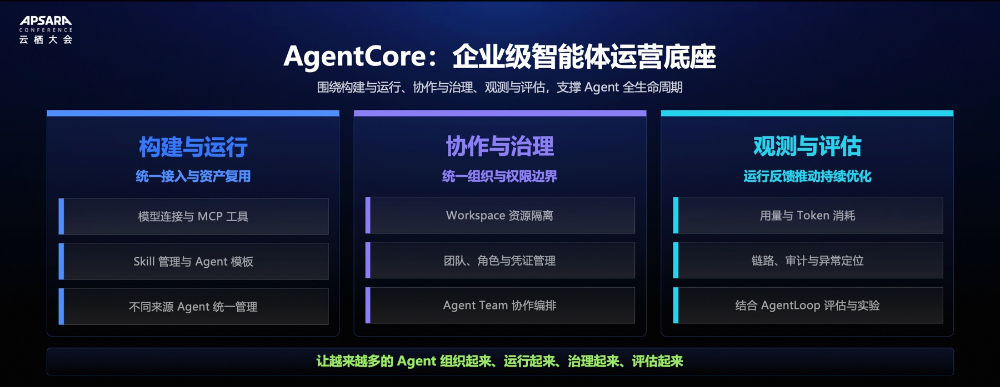

**AgentCore 在这里承担的就是这样的角色。**我们希望做到，在做第二个 Agent 的时候不必从头开始，在做第 10 个的时候也能管理清楚。AgentCore 能让模型连接、MCP 工具、Skill 和 Agent 都进行统一管理，同时可以通过 Workspace、团队、角色、凭证管理来明确资源边界。使用 Agent Team 的能力时，可以让多个专业 Agent 围绕任务协作运行。**以后出了问题能够追溯，再结合阿里云的 AgentLoop 去评估和改进，而不是上线之后什么都不管了。**

## 三、底座 + 零售经验

当然，平台不能代替业务回答所有问题。什么样的结果算合格？哪些动作需要人工确认？这些需要我们自己明确。

**所以，底座有了，接下来要做的就是把滔搏的零售经验变成可复用、能协作的专业能力。**

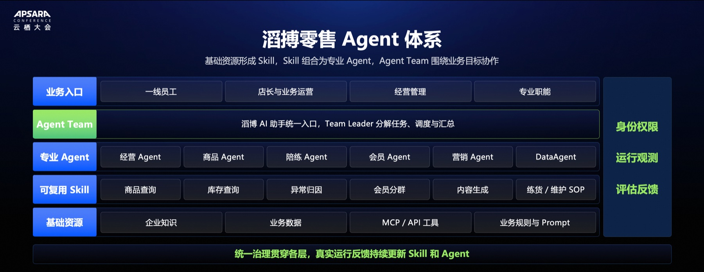

这张图，我们从下往上看，最底层的是知识、业务数据、MCP 和 API 工具。在这些资源之上，我们做了一层可复用的 Skill，比如商品查询、库存、会员分群。再往上，就是经营 Agent、商品 Agent、陪练 Agent、会员 Agent、营销 Agent 等专业 Agents。这些 Agents 可以围绕一个业务目标组成团队。用户可以通过 AI 助手提出需求，背后由 Team Leader 分解任务、调度能力，再汇总成为结果。身份权限、运行观测以及评估反馈会贯穿整个过程。用户不再需要学会去找哪个 Agent，专业能力也不需要重复开发。

### 一线练货

接下来，我们先看一个非常具体的事情：员工今天应该练什么？

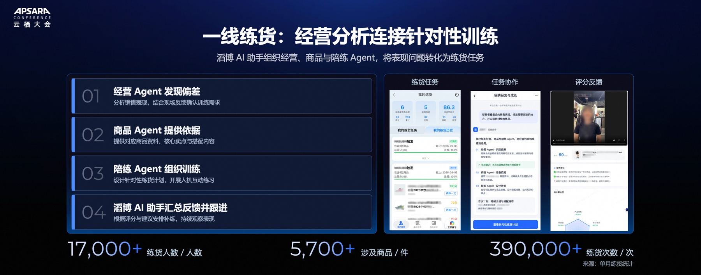

经营 Agent 可以告诉我们，一个商品的销售表现出现了偏差。但是，我们不能把卖得不好直接翻译成员工学得不好。所以，当经营 Agent 识别到偏差之后，我们还需要结合现场反馈，确认问题是不是真的存在。

确认有训练需求以后，商品 Agent 再提供商品资料、卖点和搭配内容，陪练 Agent 再组织针对性的练货训练，开展互动练习。练完之后，也不是简单打分就结束了，评分跟建议会回到 AI 助手，用来安排补练以及持续观察后续表现。

**到这里，我们可以看到几个 Agent 的分工：经营分析找到了问题，商品能力提供依据，陪练把它变成可练习的动作。**在我们单个月的统计里，练货涉及的商品超过了 5700 件，练货次数更超过了 39 万次。这组数字体现的只是使用规模，而真正值得关注的是：这个训练有没有帮助员工把能力用到实际服务中？

### 线索挖掘

接下来，我们换一个岗位，就是线上小程序的店长。线上小程序整个店就只有店长一个人，看数据、选顾客、挑商品，还有组织沟通，最终都要落到他一个人身上。**如果 AI 再生成一份报告，他的阅读任务增加了，经营任务却没有减少。所以，我们要做的是把报告后面的这些准备工作连接起来。**

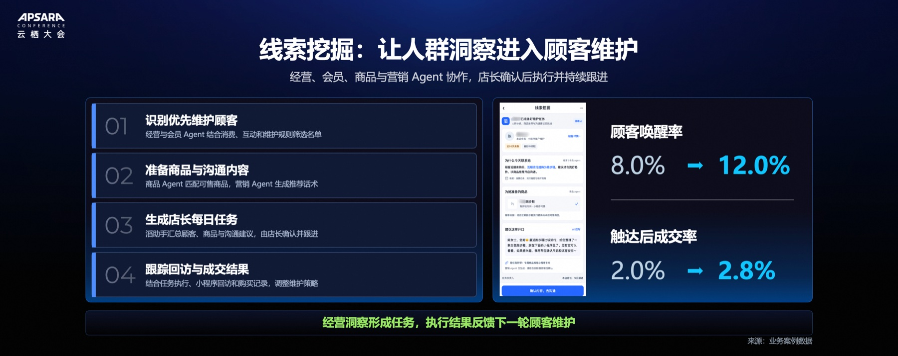

经营 Agent 与会员 Agent 识别出需要优先维护的顾客，然后商品 Agent 匹配出顾客的偏好和可售商品，营销 Agent 再准备沟通建议，AI 助手汇总成为店长当天可以执行的任务，由店长确认并且亲自跟进。随后，小程序的回访和成交记录再反馈到下一轮顾客维护里。

**我们可以看到，店长还是一个人，但是现在不需要再做大量的分析和准备。在这个场景里，专业能力协作之后，交到店长手里的可以不只是一份洞察，而是一项准备充分的行动。**

### 门店经营探索

接下来，我们回到开场的那个问题：这个周末怎么安排？

它没有一个现成的按钮。店长提出的是目标和约束，也不是一条预设好的指令。要回答这个问题，就需要把经营表现、商品库存以及会员情况等放在一起。AI 助手调用相关能力，把这些分散的信息整理成为商品主推、陈列调整、顾客维护等建议。店长在这个时候可以继续追问、修改以及最终确认执行。

**这里还有一条不能省略：复用能力不等于共享所有数据。店长使用的仍然只能是本店授权的数据。**

在我们单次的经营分析案例里，**店长的工作从耗时 2 小时缩短到了约 20 分钟。**时间的变化看得很直观，但我们更关注的是，减少跨系统取数和整理之后，店长可以把更多时间留给经营判断。

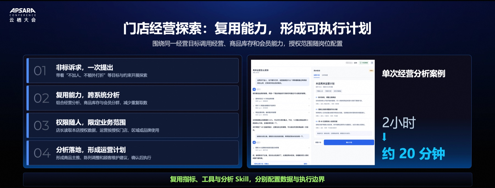

## 四、单店到多店的复制

这三个案例走到这里，AI 已经从输出资料和分析，进一步走向了训练、经营安排等其他工作。**开场的问题，对于店长来说答案有了，但对于企业来说呢？如果下一个店长再问，我们是不是还要重新再来一遍？**

这也是我们从做场景走向沉淀能力的一个转折点。我们把整套能力沉淀的过程分为四步。

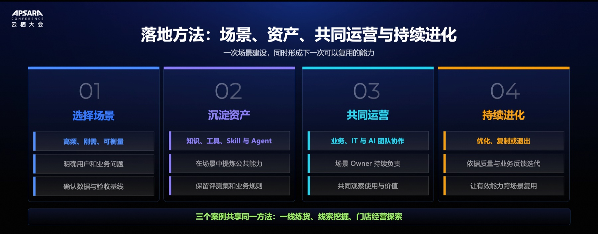

首先是选场景。我们先找那些高频、刚需、可衡量的问题，明确原来的流程耗时跟验收标准。在建设过程中，我们把知识、工具、Skill、Agent 跟测评数据沉淀下来，让下一次有东西可用。上线之后，由业务、IT 跟 AI 团队共同运营，持续看使用与价值。有效的能力可以继续优化和复制，长期低价值的场景要及时调整跟退出。

所以，做完一个场景之后，我们都会回答自己两个问题：第一，这次解决了什么？第二，下一次可以复用什么东西？

而最值得留下来的，往往是**那些反复确认有效的处理方法。比如，同一类经营问题出现了很多次，业务也验证过，这个时候其实不需要让 Agent 重新灵机一动，我们把这些经过经验验证的方法沉淀为 SOP 型 Skill。**

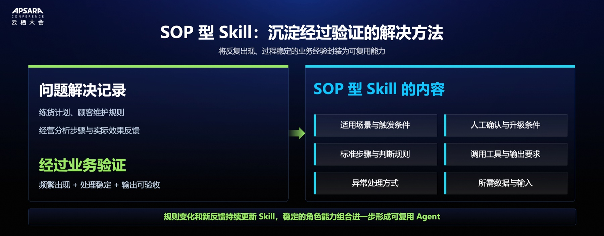

它要讲清楚适用条件、输入处理、调用工具以及输出等等。正常情况怎么走，遇到异常怎么办，什么时候需要由人来确认，这些都需要明确。它并不是说，把经验写成一份文档之后就完成了，而是要让它能够被调用、被验证，并随着反馈更新。

因此，**Skill 还需要版本化，还需要负责人和测评标准。稳定的 Skill 可以进一步组合成为专业的 Agent，这样留下来的不只是一次答案，而是一套已经验证过的解法。**

## 五、AI 时代，业务和 IT 关系更加紧密

不过，**经验可以沉淀，业务规则还会继续变化。**这些能力又是谁来持续维护呢？答案并不是简单地交给某一个团队。业务其实最了解问题跟判断规则，因此要定义验收标准，并且持续承担场景负责人的角色。IT 团队负责平台、系统集成、身份权限以及运行稳定性。AI 团队需要负责 Agent 工程、公共能力、测评，还有一些版本优化。**各有分工，但不能各自验收、各自结束。**

### 共同运营企业智能能力

上线之后，要围绕共同的业务结果，共同决定是继续优化，还是退出。**否则就会出现一个问题：Agent 上线了，责任却下线了。**

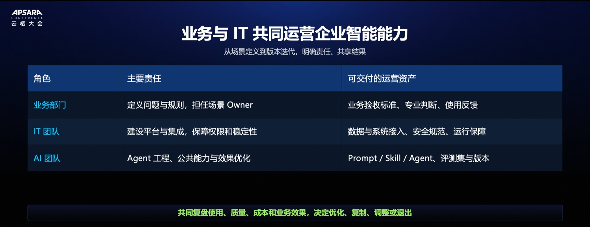

**我们希望改变的，正是这种一次性的交付关系。能力有人建设，也有人长期对它的有效性负责。而共同负责，又需要有一套共同的衡量办法。**

### 持续调优

一个 Agent 被调用了很多次，听上去是一个好消息。但是，如果建议没有被采纳，或者每一次都需要反复纠错，这个调用量还没有变成真正的业务价值。

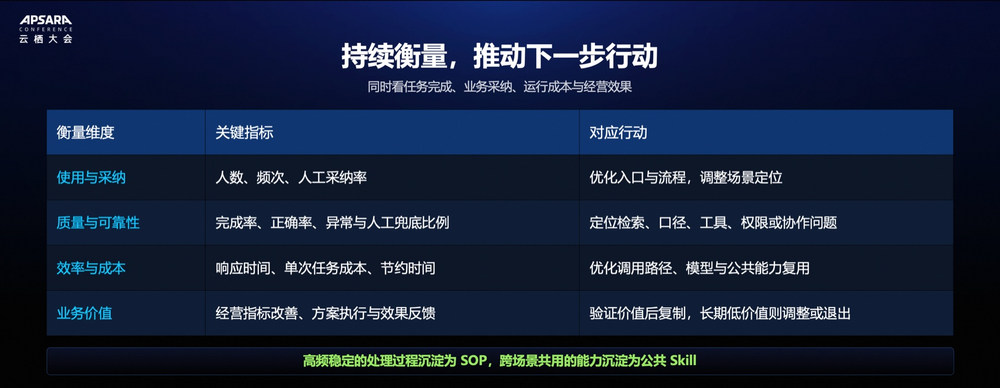

所以，我们不仅要看有没有人用，还要看建议是否被业务采纳；不仅看任务是否完成，还要看正确率、异常情况和人工兜底情况。效率上，我们要看耗时、节约的时间和单次成本；业务上，我们要看方案有没有被执行，结果有没有被改善。

这些指标最终要导向行动：入口是否需要调整，工具是否要修复，还是 Skill 需要更新？仪表盘告诉我们发生了什么，而运营还要继续回答：然后改什么？这些改进进入下一次循环，闭环才真正开始。

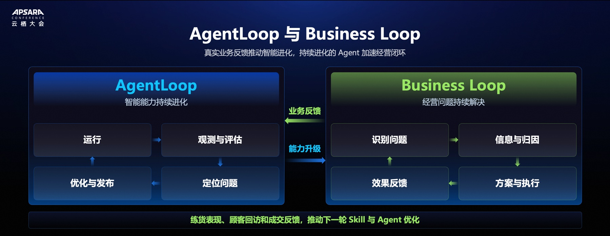

这是两个闭环，但它们讲的是同一件事的两个面。**AgentLoop 关心的是能力怎么变好，而 Business Loop 关心的是经营问题怎么解决。**这里的关键不是运行次数多了，Agent 就会自动变好，而是反馈有没有被接住，有没有转化为经过验证的改进。

比如，我们的练货效果不理想，那就要关注训练需求，也要检查内容和评估。顾客维护没有达到预期，我们要进一步分析，是人群筛选、商品匹配，还是沟通内容需要调整。

一旦这些真实反馈进入 Skill 跟 Agent 的优化，更新后的能力就能帮助业务解决下一轮问题。关键决策和执行责任仍然由人来承担。

**到这里，我们才真正回答了企业怎么把能力真正用起来。在这里留下的不是一份结果，而是一套可以改进、持续使用的能力。**

## 六、总结

回到开场，那位店长需要的是一份周末经营安排，但我们的目标并不只是这一次问题的解决。这次用过的商品查询、经营分析和顾客维护能力，能不能继续服务下一个门店、下一个岗位，这才是规模化的意义。

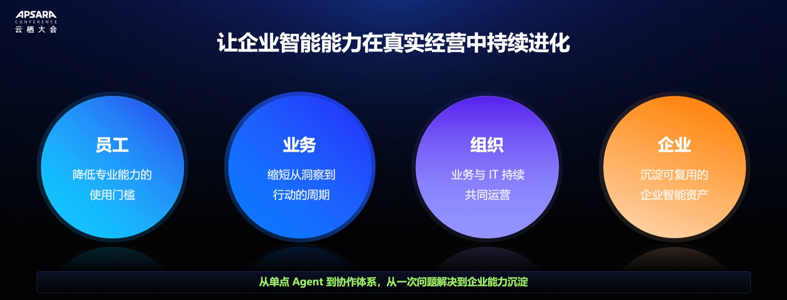

**AgentCore 提供智能体构建和治理的底座，AgentLoop 提供数据飞轮的底座，滔搏把零售经验不断沉淀为可复用、可运营的企业资产。**所以，我们追求的从来不是让企业里多出更多 Agent，而是让今天解决过的问题，成为明天可以复用的能力。

这就是从单点探索到规模化运营。以上就是滔搏基于 AgentCore 和 AgentLoop 的企业级智能体探索。
